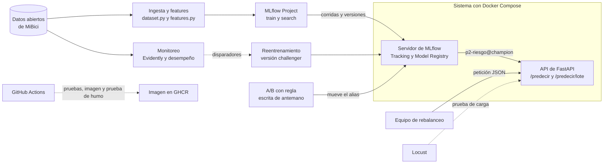

# TC5061-Proyecto-Equipo38

[](https://github.com/nicoynurreta/TC5061-Proyecto-Equipo38/actions/workflows/ci.yml)

Sistema de aprendizaje automático de punta a punta sobre los datos abiertos de [MiBici](https://mibici.net/es/datos-abiertos/), el sistema de bicicleta pública del Área Metropolitana de Guadalajara: de la ingesta de los viajes y el seguimiento de experimentos con MLflow a un servicio de predicción en contenedores, con CI/CD, pruebas de carga, monitoreo del modelo en producción, análisis de costo y su [Model Card](MODEL_CARD.md). Proyecto integrador de Operaciones de aprendizaje automático (TC5061) del Equipo 38, Tecnológico de Monterrey.

Repositorio: https://github.com/nicoynurreta/TC5061-Proyecto-Equipo38

## Problema

MiBici opera cerca de 470 estaciones y en 2026 registró de 305,000 a 608,000 viajes válidos al mes. Cuando una estación se queda sin bicicletas, quien quiere salir de ahí pierde el servicio; cuando se llena, quien llega no tiene dónde dejar la suya. El equipo de rebalanceo mueve bicicletas en camión y cada hora tiene que decidir a qué estaciones ir. El proyecto responde tres preguntas de esa operación:

| # | Pregunta | Tarea | Quién lo usa y qué decide |
|---|---|---|---|
| P1 | ¿Cuántos viajes se iniciarán en una estación mañana? | Regresión | El operador, para dimensionar flota y personal de cada estación |
| P2 | ¿Una estación estará en riesgo de llenarse o vaciarse en las dos horas siguientes? | Clasificación | El equipo de rebalanceo, para decidir a dónde manda el camión en la siguiente hora |
| P3 | ¿Qué estaciones comparten patrones de uso y dónde están? | *Clustering* | Planeación, para decidir dónde ampliar o reubicar estaciones |

P2 es la decisión que se toma cada hora, con variables que cambian cada hora, y por eso es la que se sirve en línea como API. Los datos abiertos no publican el inventario por estación, así que el riesgo se aproxima con los viajes y la capacidad: una estación está en riesgo si en las dos horas siguientes el flujo neto acumulado (llegadas menos salidas) alcanza la mitad de sus anclajes en cualquiera de los dos sentidos. Una estación sin aviso (falso negativo) se valúa en cinco viajes de camión de más (falso positivo), y esa proporción fija el umbral de decisión del modelo.

## Solución

| Etapa del ciclo de vida | Qué se construyó | Dónde está |
|---|---|---|
| Estructura | Plantilla de [Cookiecutter Data Science](https://cookiecutter-data-science.drivendata.org/) con el módulo `mibici` instalable y la configuración en un solo lugar | `mibici/`, `mibici/config.py`, `pyproject.toml` |
| Datos | Ingesta reproducible de los CSV del portal: codificación por mes, limpieza, descarte de columnas personales y manifiesto con SHA-256 y versión de los datos | `mibici/dataset.py`, `data/manifiesto.json` |
| *Feature engineering* | Rezagos y medias móviles por estación y día (P1), flujos de las tres últimas horas, la semana anterior y la etiqueta de riesgo (P2), perfiles horarios de 98 variables (P3), partición temporal sin fuga | `mibici/features.py` |
| MLflow Project | Siete puntos de entrada con entorno declarado: `ingest`, `train`, `search`, `ingest_actual`, `monitor`, `reentrenar` y `abtest` | `MLproject`, `python_env.yaml` |
| MLflow Tracking | 39 corridas en el experimento `mibici-equipo38`: *baselines*, candidatas, búsquedas con *nested runs*, monitoreo, reentrenamiento y A/B, con parámetros, métricas, artefactos, datos y commit | `mibici/modeling/train.py`, `search.py`, `artefactos.py` |
| Model Registry | Tres modelos registrados, siete versiones, alias `champion` y `challenger` y linaje en etiquetas | `mibici/modeling/registry.py` |
| Calidad | 160 pruebas con pytest, reproducibilidad con semilla, DeepChecks, bandit, pip-audit y búsqueda de secretos | `tests/`, `chequeos/`, `reports/deepchecks/`, `reports/seguridad/` |
| Servicio | API de FastAPI y Pydantic que carga `models:/mibici-equipo38-p2-riesgo@champion` al arrancar, en una imagen OCI sin privilegios | `api/`, `Containerfile` |
| Orquestación | Docker Compose con el servidor de MLflow y la API, salud, límites, volúmenes y perfiles `registro`, `siembra` y `carga` | `docker-compose.yml`, `servicios/mlflow/` |
| CI/CD | GitHub Actions: pruebas con Python 3.12 a 3.14, seguridad, imagen, sistema con Compose y prueba de humo, y publicación de la imagen en GHCR | `.github/workflows/ci.yml`, `scripts/prueba_humo.py` |
| Carga | Locust por escalones con `docker stats` y diagnóstico de concurrencia | `carga/`, `reports/carga/` |
| Monitoreo | Drift y calidad con Evidently, desempeño mensual del modelo vigente, versión reentrenada y A/B con regla escrita de antemano | `mibici/monitoreo/`, `mibici/modeling/reentrenar.py`, `abtest.py`, `reports/monitoreo/` |
| FinOps | Costo por inferencia con la capacidad medida y el precio de la instancia | `mibici/finops/costo.py`, `reports/carga/costo.md` |
| Gobernanza | Model Card con linaje, métricas, factores, riesgos, monitoreo y costo | [MODEL_CARD.md](MODEL_CARD.md) |

## Arquitectura



El servidor de MLflow guarda el registry en dos volúmenes con nombre y la API carga de él la versión con alias `champion` una sola vez al arrancar: una caída del servidor no tira el servicio que ya está arriba. Los dos servicios publican sus puertos solo en `127.0.0.1`, corren sin privilegios y la API no se declara sana hasta tener el modelo en memoria. El detalle está en [docs/operacion.md](docs/operacion.md) y [docs/servicio_prediccion.md](docs/servicio_prediccion.md).

## Decisiones de MLOps

- Partición temporal y *baseline* primero. Se entrena de enero a septiembre de 2025, se valida en octubre y se prueba en noviembre y diciembre; cada candidata se compara contra un *baseline* ingenuo con las mismas métricas.
- Métrica de negocio y umbral dentro del modelo. P2 se decide por el costo de los errores y el umbral (0.92) se elige en validación y viaja dentro del modelo registrado (`FixedThresholdClassifier`): lo que se despliega es exactamente lo que se evaluó.
- Alias en lugar de etapas. `champion` es producción y `challenger` la siguiente candidata; promover o revertir es mover un alias, y cada respuesta de la API dice qué versión contestó.
- Inferencia en línea solo donde hace falta. P2 se sirve como API porque la decisión es horaria; P1 se predice por lotes y P3 se corre a mano.
- Fallar a la vista. Sin modelo en el registry la API responde 503 y Compose no la marca sana; el modelo de prueba solo entra con el perfil `siembra`.
- Capacidad medida, no supuesta. La prueba de carga mostró que la CPU es el cuello de botella y que atender una petición a la vez por proceso sube la capacidad de 8 a 15 peticiones por segundo a 20 a 30 con la misma máquina; quedó como configuración por omisión.
- Drift con distancia y umbral fijos, y promoción solo por regla. Evidently mide Wasserstein y Jensen-Shannon con umbral de 0.1; la versión reentrenada solo se promueve si cumple una regla escrita antes de ver el resultado.

## Cómo reproducir de punta a punta

Requisitos: Git, Python 3.12 a 3.14 y Docker Engine 25 o posterior con Compose 2.20 o posterior (probado con Docker Desktop en Windows). Los comandos van desde la raíz del repositorio; en Windows se muestran para PowerShell.

### 1. Entorno

```
git clone https://github.com/nicoynurreta/TC5061-Proyecto-Equipo38.git
cd TC5061-Proyecto-Equipo38
python -m venv venv
venv\Scripts\Activate.ps1
pip install -r requirements.txt
```

En Linux o macOS el entorno se activa con `source venv/bin/activate`. `requirements.txt` fija todas las versiones e instala `mibici` en modo editable.

### 2. Sistema con Docker Compose

El modelo que sirve el sistema es el que haya en el registry de sus volúmenes. El registry del equipo (`mlflow.db` y `mlartifacts/`) no se versiona, así que hay tres formas de levantarlo, cada una con un solo comando:

| Situación | Comando | Qué pasa |
|---|---|---|
| Clon recién bajado, sin registry | `docker compose --profile siembra up --build --wait` | Arranca MLflow vacío, registra un modelo de prueba con la firma de P2 (`origen=siembra`) y levanta la API. Es lo que corre el *pipeline* |
| Clon con el registry del equipo en la raíz | `docker compose --profile registro up --build --wait` | Copia `mlflow.db` y `mlartifacts/` a los volúmenes (solo los lee) y la API sirve el `champion` real, la versión 1 de P2 |
| Volúmenes ya poblados | `docker compose up -d --wait` | Arranca los dos servicios con lo que ya había |

`--wait` devuelve el control cuando los dos chequeos de salud pasan. En la máquina de trabajo, el 27 de noviembre de 2026, el comando con el perfil `registro` tardó 357 s con las imágenes en caché (la copia de los 820 MB de artefactos ocupó 79 s) y, con los volúmenes poblados, `docker compose up -d --wait` tardó 150 s. Después:

```
docker compose ps
python scripts/prueba_humo.py --mlflow http://127.0.0.1:5000
docker compose logs api
```

| Servicio | URL local |
|---|---|
| Documentación interactiva de la API (Swagger) | http://127.0.0.1:8000/docs |
| Salud y metadatos del modelo | http://127.0.0.1:8000/health y http://127.0.0.1:8000/metadata |
| Interfaz de MLflow (experimentos y Model Registry) | http://127.0.0.1:5000 |

El sistema se apaga con `docker compose --profile registro --profile siembra --profile carga down`, que conserva los volúmenes; con `--volumes` borra también el registry del sistema, nunca el del clon.

### 3. Consumir la API

```
Invoke-RestMethod http://127.0.0.1:8000/health
Invoke-RestMethod -Method Post -Uri http://127.0.0.1:8000/predecir -ContentType application/json -InFile api/ejemplos/peticion_p2.json
Invoke-RestMethod -Method Post -Uri http://127.0.0.1:8000/predecir/lote -ContentType application/json -InFile api/ejemplos/peticion_lote.json
```

Con `curl`: `curl -s -X POST http://127.0.0.1:8000/predecir -H "Content-Type: application/json" -d @api/ejemplos/peticion_p2.json`. Ejemplo real de una hora que el modelo no vio: la estación 34 (C. Degollado y Av. Miguel Hidalgo, 15 anclajes) a las 8:00 del lunes 5 de octubre de 2026, con 21 llegadas y 7 salidas en esa hora y un flujo neto de +23 en las últimas tres:

```json
{
  "estacion_id": 34,
  "salidas_h0": 7,
  "llegadas_h0": 21,
  "salidas_h1": 11,
  "llegadas_h1": 18,
  "salidas_h2": 3,
  "llegadas_h2": 5,
  "neto_3h": 23,
  "neto_futuro_semana_anterior": 12,
  "riesgo_semana_anterior": 1,
  "hora_dia": 8,
  "dia_semana": 0,
  "fin_de_semana": 0,
  "capacidad": 15
}
```

Respuesta del sistema levantado con el perfil `registro`. En las dos horas siguientes llegaron 15 bicicletas más de las que salieron, más que la mitad de sus 15 anclajes: la estación sí estuvo en riesgo de llenarse.

```json
{
  "estacion_id": 34,
  "riesgo": 1,
  "probabilidad": 0.988602,
  "umbral": 0.92,
  "modelo": {"nombre": "mibici-equipo38-p2-riesgo", "version": "1", "alias": "champion"}
}
```

`/predecir/lote` recibe una lista de peticiones y responde en el mismo orden; la hora completa de todas las estaciones cabe en una sola llamada. Las peticiones inválidas responden 422 con el detalle de Pydantic (campo faltante o de más, valor fuera de rango, `neto_3h` que no cuadra con las salidas y llegadas). Esquemas y endpoints en [docs/servicio_prediccion.md](docs/servicio_prediccion.md).

### 4. Experimentos con MLflow Project

Las corridas se registran en un servidor de MLflow: el del sistema (http://127.0.0.1:5000, que escribe en los volúmenes) o uno local sobre `mlflow.db` con el sistema apagado (`mlflow server --backend-store-uri sqlite:///mlflow.db --port 5000`).

```
$env:MLFLOW_TRACKING_URI = "http://127.0.0.1:5000"
mlflow run . -e ingest --experiment-name mibici-equipo38 --env-manager local
mlflow run . -e train -P question=p2 -P model=regla_semana -P run_name=p2_baseline_regla_semana --experiment-name mibici-equipo38 --env-manager local
mlflow run . -e train -P question=p2 -P model=hgb -P run_name=p2_hgb --experiment-name mibici-equipo38 --env-manager local
mlflow run . -e search -P question=p2 -P model=hgb -P run_name=p2_busqueda_hgb --experiment-name mibici-equipo38 --env-manager local
python -m mibici.modeling.registry --pregunta p2 --champion <run_id> --challenger <run_id>
python -m mibici.modeling.registry --verificar
python -m mibici.modeling.predict --pregunta p2
```

`ingest` descarga los doce meses de 2025 (unos dos minutos). `--env-manager uv` corre lo mismo en un entorno aislado creado desde `python_env.yaml`. Los 15 comandos de las corridas de la segunda entrega, los parámetros de cada punto de entrada y lo que registra cada corrida están en [docs/datos_y_experimentos.md](docs/datos_y_experimentos.md).

### 5. Pruebas y chequeos

```
python -m pytest -q tests
python -m bandit -c pyproject.toml -r mibici api scripts carga servicios -q --severity-level medium
python chequeos/secretos.py
```

La suite no necesita datos, servidor ni Docker: las pruebas que registran o cargan modelos usan un tracking temporal, y las dos marcadas `lento` (datos reales y `champion` del registry) se omiten solas cuando no los encuentran. DeepChecks corre en un entorno aparte con Python 3.12 ([docs/pruebas_y_chequeos.md](docs/pruebas_y_chequeos.md)).

### 6. Prueba de carga y costo

```
docker compose --profile carga run --rm locust
python -m carga.correr --solo un_proceso_en_serie
python -m carga.resumen
python -m mibici.finops.costo --instancia t3.small:2:2:0.0208 --instancia c6a.large:2:4:0.0765
```

La primera línea corre el escenario de Locust dentro de la red de Compose; `carga.correr` además reconfigura el servicio y muestrea `docker stats`, y sin `--solo` corre las seis configuraciones (unos 55 minutos). Detalle en [docs/operacion.md](docs/operacion.md).

### 7. Monitoreo, A/B y Continuous Training

```
mlflow run . -e ingest_actual --experiment-name mibici-equipo38 --env-manager local
mlflow run . -e monitor -P version=1 --experiment-name mibici-equipo38 --env-manager local
mlflow run . -e reentrenar --experiment-name mibici-equipo38 --env-manager local
mlflow run . -e abtest -P promote=1 --experiment-name mibici-equipo38 --env-manager local
```

`ingest_actual` descarga enero a octubre de 2026 en archivos aparte; `monitor` escribe el reporte de Evidently, el desempeño mensual y las figuras en `reports/monitoreo/`; `reentrenar` registra la versión nueva como `challenger`; `abtest` compara `champion` contra `challenger` y, con `promote=1`, mueve el alias solo si la regla se cumple. Detalle en [docs/monitoreo.md](docs/monitoreo.md).

Sin `make` (Windows), cada objetivo del `Makefile` tiene su comando equivalente en [docs/pruebas_y_chequeos.md](docs/pruebas_y_chequeos.md#comandos).

## Estado del Model Registry

Al 27 de noviembre de 2026, en el experimento `mibici-equipo38`. El linaje completo de cada versión (corrida, `run_id`, datos, commit y rama) está en el [Model Card](MODEL_CARD.md#versiones-y-linaje).

| Modelo registrado | Versión | Alias | Corrida de origen | Métrica de decisión |
|---|---|---|---|---|
| `mibici-equipo38-p1-demanda` | 1 | `champion` | `p1_hgb_mejor` | `test_mae` 5.979 |
| | 2 | `challenger` | `p1_bosque` | `test_mae` 5.926 |
| `mibici-equipo38-p2-riesgo` | 1 | `champion` | `p2_hgb_mejor` | `test_costo` 26,432 (umbral 0.92) |
| | 2 | sin alias, relevada por la 3 | `p2_bosque` | `test_costo` 26,854 (umbral 0.88) |
| | 3 | `challenger` | `p2_hgb_reentrenado` | Reentrenada con datos hasta mayo de 2026 (umbral 0.94); no se promovió por la regla del A/B |
| `mibici-equipo38-p3-grupos` | 1 | `champion` | `p3_kmeans_pca_k4` | `train_silhouette` 0.085 |
| | 2 | `challenger` | `p3_kmeans_mejor` | `train_silhouette` 0.095 (k = 3) |

## CI/CD

[](https://github.com/nicoynurreta/TC5061-Proyecto-Equipo38/actions/workflows/ci.yml)

`.github/workflows/ci.yml` corre en cada *push*, en cada *Pull Request* y a mano: `pruebas` (la suite con Python 3.12, 3.13 y 3.14), `seguridad` (bandit, secretos en todo el historial y pip-audit), `imagen` (construye y arranca la imagen del servicio), `sistema` (levanta Compose con el perfil `siembra` y corre la prueba de humo) y `resumen`; con todo en verde y solo en `main`, `publicar` sube la imagen a `ghcr.io/nicoynurreta/tc5061-proyecto-equipo38` con las etiquetas `latest` y `sha-<commit>`. La rama `main` está protegida: todo cambio entra por *Pull Request* con una aprobación.

## Resultados

- Modelo de P2 en producción: `test_costo` 26,432 contra 28,170 de la regla de la semana anterior (6.2 % menos), recall 0.376, precisión 0.315 y PR-AUC 0.334 en noviembre y diciembre de 2025. En 2026 su costo frente a no alertar se mantuvo entre 0.757 y 0.798, salvo junio (0.869). [MODEL_CARD.md](MODEL_CARD.md)
- Drift: ninguna de las 16 columnas deriva en el semestre de enero a junio de 2026; mes a mes, mayo (8 de 16) y agosto (9 de 16) cruzan la regla de deriva del conjunto. [reports/monitoreo/resumen.md](reports/monitoreo/resumen.md)
- A/B: la versión reentrenada cuesta 0.80 menos por mil horas-estación (IC de 95 % de -1.08 a -0.51) pero pierde 0.041 de recall (IC de -0.045 a -0.036); la regla mantiene la versión 1 como `champion`. [reports/monitoreo/abtest.md](reports/monitoreo/abtest.md)
- Carga: con un proceso, 1 CPU y una petición a la vez, la API atiende de 20 a 30 peticiones por segundo con p95 de hasta 500 ms y sin errores con 60 usuarios; un lote de 472 estaciones rinde de 1,888 a 3,776 predicciones por segundo. [reports/carga/resumen.md](reports/carga/resumen.md)
- FinOps: una t3.small siempre encendida cuesta 15.18 dólares al mes para una demanda de 472 predicciones por hora; encendida solo para la predicción de cada hora, de 0.25 a 0.34. [reports/carga/costo.md](reports/carga/costo.md)

## Model Card y reportes

| Documento | Contenido |
|---|---|
| [MODEL_CARD.md](MODEL_CARD.md) | Detalles, uso previsto, factores, métricas, datos, análisis cuantitativo, monitoreo, costo, consideraciones éticas y recomendaciones |
| [reports/monitoreo/resumen.md](reports/monitoreo/resumen.md) | Reporte de drift con Evidently por columna, por comparación y por mes |
| [reports/monitoreo/desempeno.md](reports/monitoreo/desempeno.md) | Desempeño del modelo vigente por conjunto, por mes y por antigüedad de la estación |
| [reports/monitoreo/abtest.md](reports/monitoreo/abtest.md) | A/B testing entre las versiones 1 y 3 de P2 con la regla de decisión |
| [reports/carga/resumen.md](reports/carga/resumen.md) | Prueba de carga con Locust por corrida, escalón, endpoint y contenedor |
| [reports/carga/costo.md](reports/carga/costo.md) | Costo por inferencia y optimizaciones |
| [reports/deepchecks/resumen.md](reports/deepchecks/resumen.md) | Validación de los datos con DeepChecks |
| [reports/seguridad/](reports/seguridad/) | Evidencia fechada de bandit, pip-audit y la búsqueda de secretos |
| [references/](references/) | ML Canvas y diagrama de arquitectura de la propuesta |

## Estructura del repositorio

Generada con [Cookiecutter Data Science](https://cookiecutter-data-science.drivendata.org/) (`ccds`, con `include_code_scaffold` en Yes).

```
├── Makefile           <- make server, ingest, baselines, candidatas, busquedas, corridas, registry, test, chequeos, verificar, api, imagen, contenedor, probar-api, exportar-modelo, ingest-actual, monitor, reentrenar, abtest, sistema, sistema-registro, sistema-prueba, sistema-estado, sistema-abajo, humo, carga, costo
├── docker-compose.yml <- sistema completo: servidor de MLflow, servicio de predicción y perfiles registro, siembra y carga
├── .github
│   └── workflows
│       └── ci.yml     <- pipeline de CI/CD: pruebas en matriz, seguridad, imagen, sistema con Compose y publicación de la imagen
├── MLproject          <- puntos de entrada ingest, train, search, ingest_actual, monitor, reentrenar y abtest para mlflow run
├── python_env.yaml    <- versión de Python y dependencias con versión fija para mlflow run
├── pytest.ini         <- configuración de pytest (carpeta de pruebas y marcador lento)
├── README.md
├── MODEL_CARD.md      <- Model Card de los modelos en producción (formato de Mitchell et al., 2019)
├── docs               <- documentación técnica de cada entrega: datos y experimentos, pruebas, servicio, monitoreo, operación y flujo de trabajo
├── requirements.txt   <- dependencias con versión fija
├── requirements-deepchecks.txt <- versiones fijas del entorno aparte de DeepChecks (Python 3.12)
├── requirements-api.txt <- dependencias de la imagen del servicio, con las versiones del entrenamiento
├── pyproject.toml     <- metadatos del módulo mibici y configuración de bandit
├── .env.example       <- plantilla de las variables de entorno que lee el código (MLFLOW_TRACKING_URI y RUTA_MODELO) y de las que sustituye Compose (puertos, procesos, límites y escenario de carga)
├── Containerfile      <- imagen OCI del servicio de predicción, válida para Podman y Docker
├── .dockerignore      <- exclusiones del contexto de construcción, válidas para Docker y Podman
├── api                <- servicio de predicción de P2 con FastAPI
│   ├── main.py        <- aplicación y endpoints /health, /metadata, /predecir y /predecir/lote
│   ├── esquemas.py    <- modelos de Pydantic de la petición, la respuesta y los metadatos
│   ├── modelo.py      <- carga desde el Model Registry (o desde RUTA_MODELO) y predicción con la firma
│   └── ejemplos       <- petición, lote y respuesta de ejemplo de la corrida real
├── servicios
│   └── mlflow         <- imagen del servidor de MLflow (Containerfile y requirements.txt) e importar.py, que copia el registry del equipo a sus volúmenes
├── scripts
│   ├── probar_api.py  <- petición de prueba al servicio
│   ├── sembrar_modelo.py <- modelo de prueba de P2 para un registry vacío (pipeline y clones sin el registry del equipo)
│   └── prueba_humo.py <- prueba de humo del sistema levantado: salud, metadatos, predicción, lote, validación y registry
├── carga              <- prueba de carga del servicio
│   ├── locustfile.py  <- escenario de Locust: tres tareas ponderadas y usuarios que suben por escalones
│   ├── escalones.py   <- estadísticas exactas por escalón y por endpoint
│   ├── muestreador.py <- CPU y memoria de los contenedores con docker stats, en CSV
│   ├── correr.py      <- lanza cada corrida: configura el servicio, muestrea los recursos y corre Locust
│   ├── hilos.py       <- diagnóstico de concurrencia dentro del contenedor
│   └── resumen.py     <- tablas, punto de degradación, variación entre repeticiones y gráficas
├── chequeos
│   ├── validar_datos.py <- suites de DeepChecks sobre las tablas de data/interim (entorno .venv-deepchecks)
│   └── secretos.py      <- búsqueda de secretos en el historial de Git y en los archivos versionados
├── data
│   ├── manifiesto.json <- versión de los datos de 2025
│   ├── manifiesto_actual.json <- versión de los datos del periodo actual (los dos manifiestos son lo único de data/ que se versiona)
│   ├── external
│   ├── interim        <- tablas que exporta mibici.validacion para DeepChecks
│   ├── processed      <- viajes.parquet y estaciones.parquet
│   └── raw            <- archivos CSV descargados del portal
├── models             <- predicciones de predict.py
├── notebooks          <- 1.0-mah-exploracion-mibici.ipynb, solo exploración
├── references         <- ML Canvas y diagrama de arquitectura
├── reports
│   ├── deepchecks     <- JSON de cada suite y resumen.md con los hallazgos (los HTML quedan fuera de Git)
│   ├── figures        <- capturas de la ejecución de las pruebas y los chequeos, y figuras del monitoreo y del A/B
│   ├── monitoreo      <- reportes de drift, de desempeño mensual y del A/B (los HTML de Evidently quedan fuera de Git)
│   ├── carga          <- resumen de la prueba de carga, diagnóstico de hilos y costo por inferencia (los HTML y los CSV de Locust quedan fuera de Git)
│   └── seguridad      <- salidas fechadas de bandit, pip-audit y la búsqueda de secretos
├── tests              <- pruebas con pytest: un archivo por módulo, más reproducibilidad y seguridad
│   ├── test_dataset.py, test_features.py, test_artefactos.py, test_train.py, test_search.py, test_predict.py, test_registry.py
│   ├── test_reproducibilidad.py <- mismas predicciones y métricas con la misma semilla en P1, P2 y P3
│   ├── test_seguridad.py        <- .gitignore, .env.example y ausencia de secretos en los archivos versionados
│   ├── conftest.py              <- cliente de la API con un modelo mínimo inyectado
│   ├── test_api.py, test_api_ejemplos.py <- servicio de predicción: validación, endpoints, ejemplos y registry real
│   ├── test_monitoreo.py, test_reentrenar.py, test_abtest.py <- monitoreo, versión alternativa y A/B con datos sintéticos
│   ├── test_orquestacion.py     <- docker-compose.yml, .env.example, Makefile e importación del registry
│   ├── test_siembra.py, test_humo.py <- modelo de prueba del pipeline y prueba de humo del sistema
│   └── test_carga.py, test_costo.py  <- escalones, muestreo, resumen de la carga y costo por inferencia
└── mibici
    ├── __init__.py
    ├── config.py      <- rutas, URL, rango de fechas, partición, umbrales, semilla, experimento, hiperparámetros y rejillas
    ├── dataset.py     <- ingesta: descarga, normalización, Parquet y manifiesto
    ├── features.py    <- features por pregunta y partición temporal
    ├── plots.py       <- gráficas que se registran como artefactos
    ├── validacion.py  <- exporta a data/interim las particiones, el perfil y un mes de viajes crudos para DeepChecks
    ├── monitoreo      <- datos.py, drift.py, desempeno.py, costos.py, graficas.py y formato.py (sección Monitoreo y drift)
    ├── finops         <- costo.py: costo por inferencia a partir de la prueba de carga y del precio de la instancia
    └── modeling
        ├── artefactos.py <- artefactos de cada corrida: plots/, data/, config/, log_input y modelo con firma
        ├── train.py      <- baseline o candidata de una pregunta, con sus métricas y artefactos
        ├── search.py     <- búsqueda de hiperparámetros con nested runs
        ├── registry.py   <- registro en el Model Registry con linaje y alias
        ├── predict.py    <- predicción con el modelo en producción (models:/<nombre>@champion)
        ├── reentrenar.py <- versión alternativa de P2 con la receta del champion y más datos
        └── abtest.py     <- A/B testing de dos versiones registradas y regla de decisión
```

`data/raw/`, `data/interim/`, `data/processed/`, `models/`, `mlruns/`, `mlartifacts/`, `mlflow.db`, los archivos `.env`, el entorno `.venv-deepchecks/` y los HTML de `reports/deepchecks/`, de `reports/monitoreo/` y de `reports/carga/` están en `.gitignore`: ni datos, ni base de datos de MLflow, ni modelos serializados, ni credenciales entran al historial. Los CSV que deja Locust en `reports/carga/` tampoco se versionan (la regla `*.csv` los cubre); lo que queda en Git de la prueba de carga son sus resúmenes en Markdown y JSON y sus gráficas.

## Equipo y aportes

| Integrante | Matrícula | Cuenta de GitHub | Responsabilidad |
|---|---|---|---|
| José Andrés Hernández Guerra | A01840564 | `a01840564` (sus *commits* aparecen como `jandreshgr`) | Datos e ingesta, Model Registry, seguridad, pruebas de la API, reentrenamiento y A/B, CI/CD y FinOps |
| Miguel Angel Higuera López | A01451684 | `miguelhigueralop` | *Features* y exploración, casos límite, imagen del servicio y sus herramientas, desempeño mensual y prueba de carga con Locust |
| Nicolás Hernández Ynurreta García | A01284528 | `nicoynurreta` | Integración y MLOps: estructura, MLflow Project y búsquedas, reproducibilidad y DeepChecks, API, drift con Evidently, Docker Compose, Model Card y README |

El equipo quedó integrado por tres personas: la cuarta inscripción registrada en Canvas está inactiva. Todo entró a `main` por *Pull Request* revisado por otro integrante:

| PR | Entrega | Rama | Abrió | Aprobó | Integró |
|---|---|---|---|---|---|
| [#1](https://github.com/nicoynurreta/TC5061-Proyecto-Equipo38/pull/1) | 1 | `feat/experimento-base` | Nicolás | José Andrés | Nicolás |
| [#2](https://github.com/nicoynurreta/TC5061-Proyecto-Equipo38/pull/2) | 1 | `docs/referencias` | Nicolás | Miguel | Nicolás |
| [#3](https://github.com/nicoynurreta/TC5061-Proyecto-Equipo38/pull/3) | 1 | `feat/ingesta` | José Andrés | Miguel y Nicolás | Nicolás |
| [#4](https://github.com/nicoynurreta/TC5061-Proyecto-Equipo38/pull/4) | 1 | `feat/features` | Miguel | José Andrés, después de pedir cambios | Nicolás |
| [#5](https://github.com/nicoynurreta/TC5061-Proyecto-Equipo38/pull/5) | 2 | `feat/mlflow-project-registry` | Nicolás | José Andrés | Nicolás |
| [#6](https://github.com/nicoynurreta/TC5061-Proyecto-Equipo38/pull/6) | 2 | `fix/features-particion-perfiles` | Miguel | Nicolás | Nicolás |
| [#7](https://github.com/nicoynurreta/TC5061-Proyecto-Equipo38/pull/7) | 2 | `feat/model-registry` (*commits* de José Andrés y Nicolás) | Nicolás | José Andrés | Nicolás |
| [#8](https://github.com/nicoynurreta/TC5061-Proyecto-Equipo38/pull/8) | 3 | `feat/tests-reproducibilidad-deepchecks` | Nicolás | José Andrés | Nicolás |
| [#9](https://github.com/nicoynurreta/TC5061-Proyecto-Equipo38/pull/9) | 3 | `test/casos-limite-datos-features` | Miguel | Nicolás | Nicolás |
| [#10](https://github.com/nicoynurreta/TC5061-Proyecto-Equipo38/pull/10) | 3 | `feat/chequeos-seguridad` | José Andrés | Miguel | Nicolás |
| [#11](https://github.com/nicoynurreta/TC5061-Proyecto-Equipo38/pull/11) | 4 | `feat/api-rest-contenedor` | Nicolás | José Andrés | José Andrés |
| [#12](https://github.com/nicoynurreta/TC5061-Proyecto-Equipo38/pull/12) | 4 | `feat/api-contenedor-herramientas` | Miguel | Nicolás | Nicolás |
| [#13](https://github.com/nicoynurreta/TC5061-Proyecto-Equipo38/pull/13) | 4 | `feat/api-pruebas-ejemplos` | José Andrés | Miguel | Miguel |
| [#14](https://github.com/nicoynurreta/TC5061-Proyecto-Equipo38/pull/14) | 5 | `feat/monitoreo-drift` | Nicolás | José Andrés | José Andrés |
| [#15](https://github.com/nicoynurreta/TC5061-Proyecto-Equipo38/pull/15) | 5 | `feat/monitoreo-herramientas` (*commits* de Miguel y José Andrés) | Miguel | José Andrés | José Andrés |
| [#16](https://github.com/nicoynurreta/TC5061-Proyecto-Equipo38/pull/16) | 5 | `feat/ab-testing-versiones` | José Andrés | Miguel | José Andrés |
| [#17](https://github.com/nicoynurreta/TC5061-Proyecto-Equipo38/pull/17) | 6 | `feat/orquestacion-compose` | Nicolás | Miguel | Miguel |
| [#18](https://github.com/nicoynurreta/TC5061-Proyecto-Equipo38/pull/18) | 6 | `feat/ci-cd-finops` | José Andrés | Miguel | Miguel |
| [#19](https://github.com/nicoynurreta/TC5061-Proyecto-Equipo38/pull/19) | 6 | `feat/prueba-carga` | Miguel | José Andrés | José Andrés |

Lo que aportó cada integrante en cada entrega, archivo por archivo, está en [docs/flujo_de_trabajo.md](docs/flujo_de_trabajo.md#integrantes-y-roles).

## Flujo de trabajo

GitHub Flow sobre `main` protegida: cada cambio nace en una rama corta (`tipo/descripcion-corta`), se publica, se abre un *Pull Request*, otro integrante lo revisa y se integra con *merge commit*, para que los *commits* que etiquetan las corridas de MLflow (`commit_git`) queden en el historial. Los *commits* siguen [Conventional Commits](https://www.conventionalcommits.org/es/v1.0.0/) en español. Ningún dato de MiBici, modelo serializado, base de MLflow ni credencial entra al historial: `.gitignore` los excluye y `tests/test_seguridad.py` lo comprueba.

## Documentación técnica

| Archivo | Contenido |
|---|---|
| [docs/datos_y_experimentos.md](docs/datos_y_experimentos.md) | Preguntas, datos, instalación, servidor de tracking, MLflow Project, ingesta, corridas, artefactos, Model Registry y resultados de los experimentos |
| [docs/pruebas_y_chequeos.md](docs/pruebas_y_chequeos.md) | Pruebas por módulo, reproducibilidad, DeepChecks, seguridad y comandos sin `make` |
| [docs/servicio_prediccion.md](docs/servicio_prediccion.md) | API, carga desde el registry, esquemas, endpoints, imagen y estrategia de despliegue |
| [docs/monitoreo.md](docs/monitoreo.md) | Drift, calidad de datos, desempeño mensual, versión alternativa, A/B y Continuous Training |
| [docs/operacion.md](docs/operacion.md) | Docker Compose, CI/CD, prueba de carga, recursos y costo por inferencia |
| [docs/flujo_de_trabajo.md](docs/flujo_de_trabajo.md) | Ramas y *Pull Requests* por entrega, integrantes y roles, buenas prácticas |
