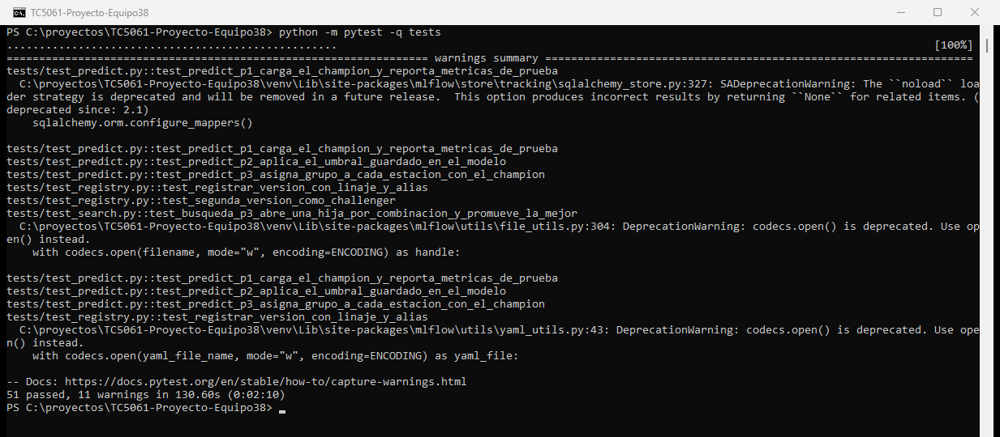
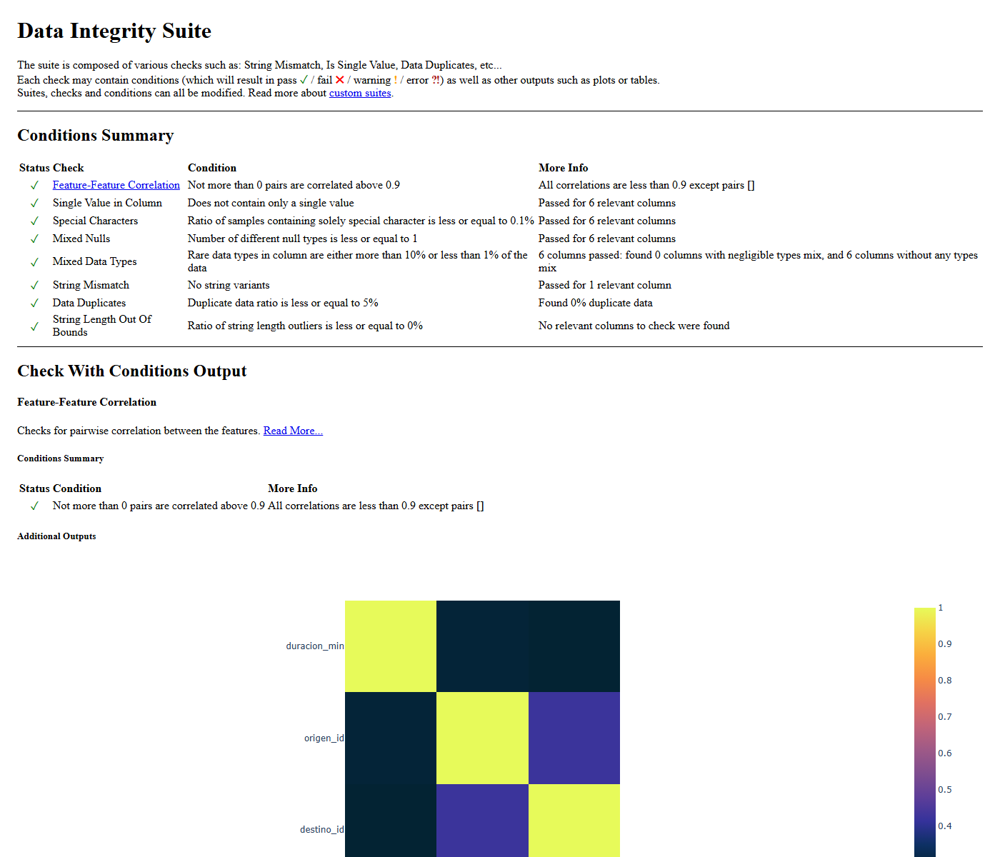
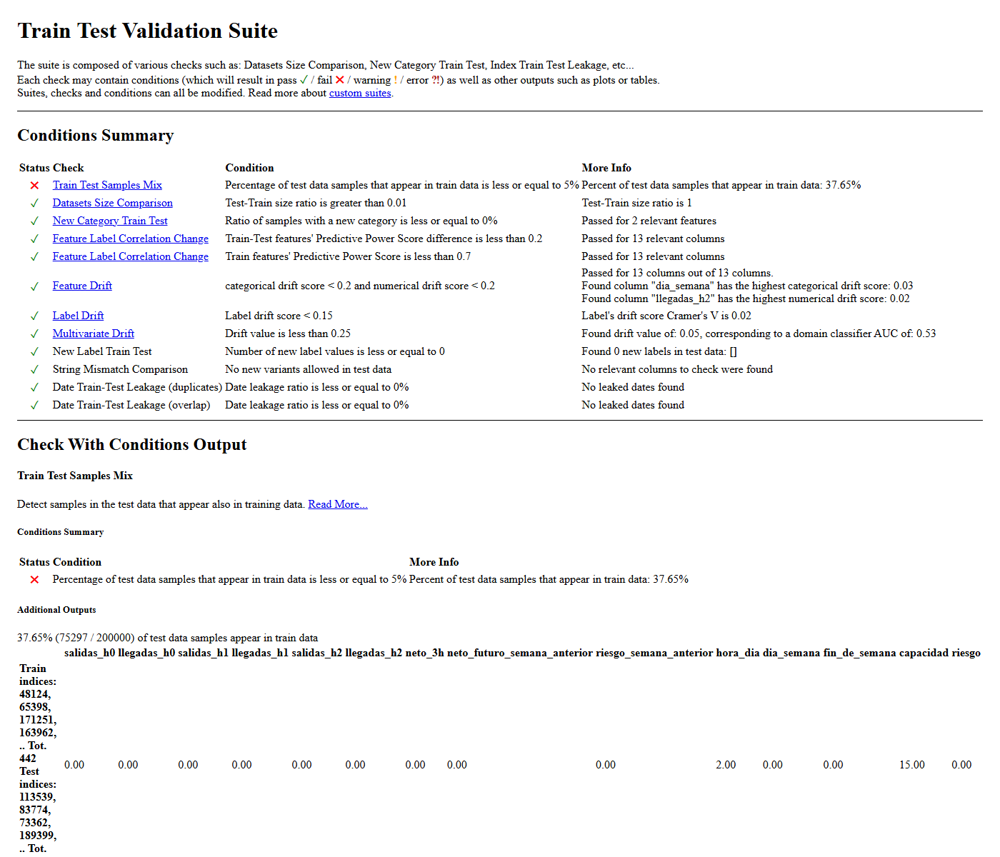
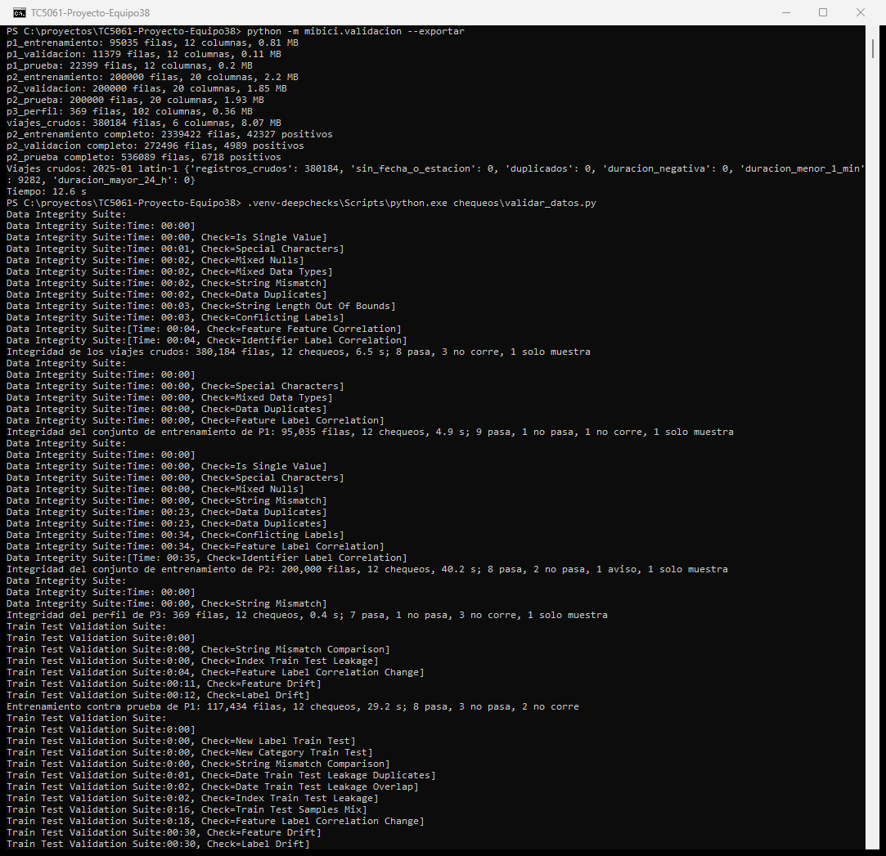
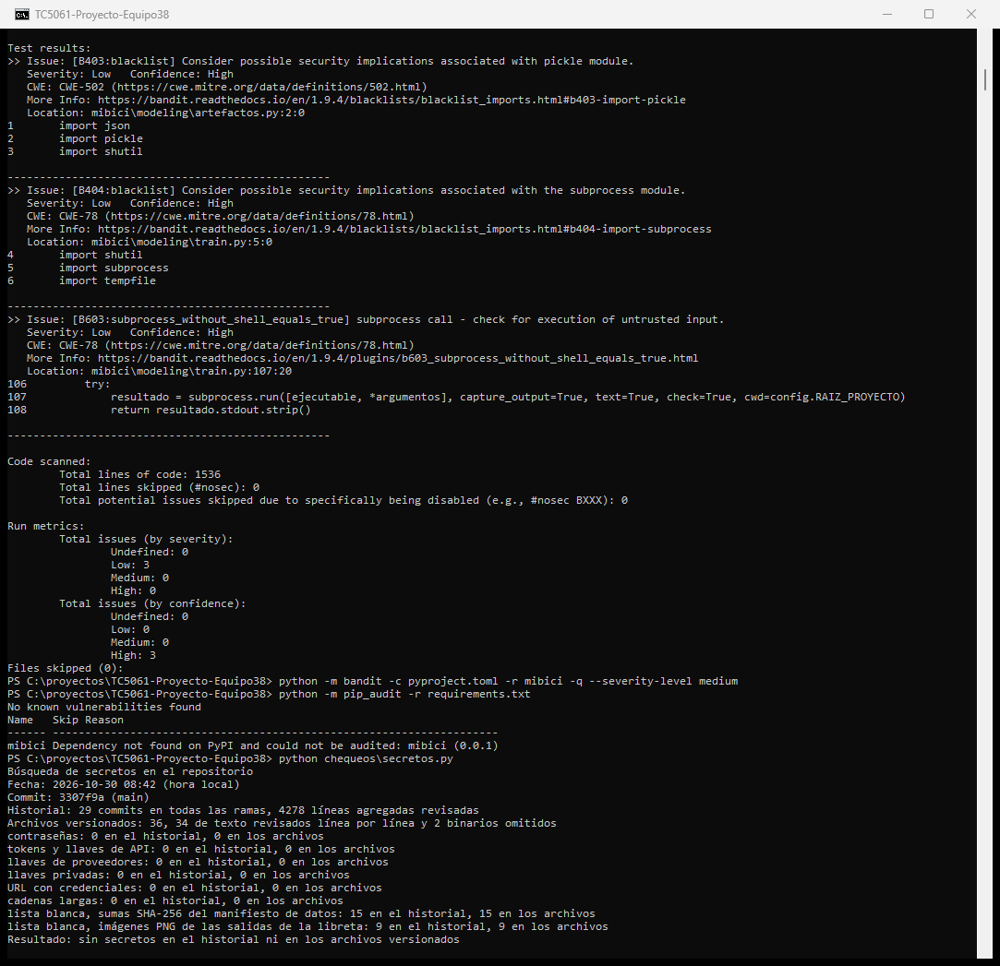
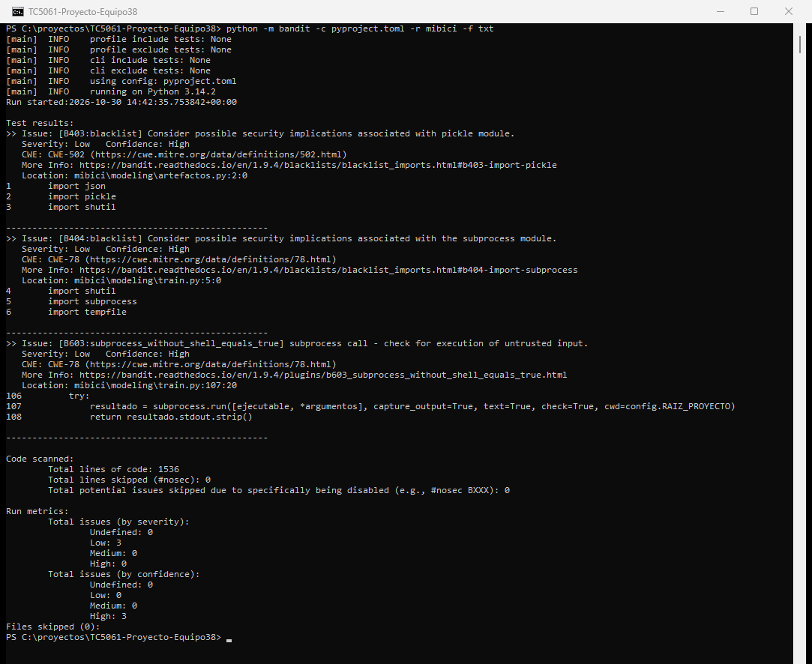
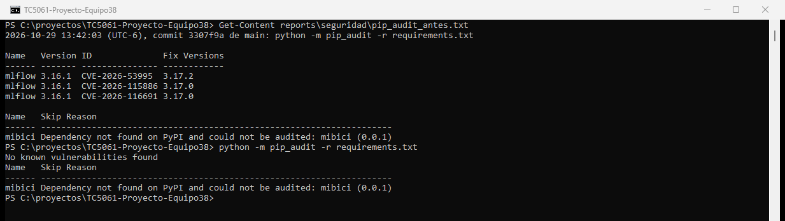

# TC5061-Proyecto-Equipo38

Proyecto integrador de Operaciones de aprendizaje automático (TC5061) sobre los datos abiertos de [MiBici](https://mibici.net/es/datos-abiertos/), el sistema de bicicleta pública del Área Metropolitana de Guadalajara. Equipo 38.

Repositorio: https://github.com/nicoynurreta/TC5061-Proyecto-Equipo38

## Propósito

El proyecto responde tres preguntas sobre la operación de MiBici con un modelo de regresión, uno de clasificación y uno de *clustering*. La primera entrega dejó la base: ingesta reproducible y versionada de los viajes, módulo de *features*, experimento base en MLflow y flujo de trabajo con ramas y *Pull Requests*. La segunda entrega convierte el repositorio en un [MLflow Project](https://mlflow.org/docs/latest/ml/projects/) que se ejecuta con un solo comando, compara varias candidatas por pregunta contra ese experimento base (con una búsqueda de hiperparámetros organizada como *nested runs*), guarda en cada corrida los artefactos que respaldan su resultado y deja el mejor modelo de cada pregunta registrado y en producción en el [Model Registry](https://mlflow.org/docs/latest/ml/model-registry/). La tercera entrega agrega la capa de calidad del repositorio: pruebas unitarias con pytest para cada módulo, con casos límite y una prueba de reproducibilidad del entrenamiento, validación de los datos con DeepChecks, chequeos de seguridad con su evidencia y un solo comando, `make verificar`, que corre todo.

## Las tres preguntas

| # | Pregunta | Tarea | Qué se predice o agrupa | Quién lo usa y qué decide |
|---|---|---|---|---|
| P1 | ¿Cuántos viajes se iniciarán en una estación en un periodo futuro? | Regresión | Viajes iniciados por estación y día, con horizonte de un día | El operador del sistema, para dimensionar la flota y el personal de cada estación |
| P2 | ¿Una estación estará en riesgo de quedarse sin bicicletas o sin anclajes disponibles? | Clasificación | Riesgo por estación y hora para las dos horas siguientes | El equipo de rebalanceo, para decidir a qué estaciones mandar el camión en la siguiente hora |
| P3 | ¿Qué grupos de estaciones comparten patrones de uso y dónde se ubican en la ciudad? | *Clustering* | Grupos de estaciones según su perfil horario de salidas y llegadas en días hábiles y fines de semana | Planeación urbana y expansión del sistema, para decidir dónde ampliar o reubicar estaciones |

Los datos no incluyen el inventario de bicicletas por estación, así que el riesgo de P2 se aproxima con los viajes y la capacidad: una estación está en riesgo en una hora dada si, en la ventana de las dos horas siguientes, el flujo neto acumulado (llegadas menos salidas) alcanza la mitad de su capacidad en cualquiera de los dos sentidos, es decir, si tiende a llenarse o a vaciarse. La fracción y la ventana son parámetros de `config.py` (`UMBRAL_RIESGO` y `VENTANA_RIESGO_HORAS`).

Por pregunta, el experimento compara el *baseline* de la primera entrega con varias candidatas y una búsqueda de hiperparámetros:

| # | *Baseline* | Candidatas | Búsqueda con *nested runs* | Métricas |
|---|---|---|---|---|
| P1 | Valor de hace siete días (`naive7`) | `hgb` (`HistGradientBoostingRegressor`), `bosque` (`RandomForestRegressor`), `ridge` (regresión lineal regularizada con día y mes codificados) y la mejor hija de la búsqueda | `learning_rate` {0.05, 0.1, 0.2} por `max_depth` {4, 8, sin límite} con 300 árboles | `val_mae`, `val_rmse`, `test_mae`, `test_rmse` (viajes por estación y día) |
| P2 | `dummy` (`DummyClassifier` estratificado) y `regla_semana` (riesgo si hubo riesgo a la misma hora de la semana anterior) | `regresion_logistica` balanceada, `bosque` (`RandomForestClassifier` balanceado), `hgb` (`HistGradientBoostingClassifier` balanceado) y la mejor hija de la búsqueda | `learning_rate` {0.05, 0.1} por `max_depth` {4, 8, sin límite} con 200 árboles | `recall`, `precision`, `f1`, `pr_auc`, falsos positivos, falsos negativos y `costo` (falsos positivos más cinco veces los falsos negativos), en validación y en prueba |
| P3 | `kmeans` con k = 4 | `aglomerativo` (ward, k = 4), `kmeans_pca` (PCA a 10 componentes y k = 4) y la mejor hija de la búsqueda | k de 3 a 8 con `kmeans` | `train_silhouette`, `train_davies_bouldin`, `train_inercia` (en el espacio escalado de las 98 variables, para que las tres candidatas sean comparables) |

Todas las corridas registran además `tiempo_entrenamiento_s`, `tiempo_inferencia_s` y `tamano_modelo_mb`, que son el costo de entrenar y de servir cada candidata. En P2 el umbral de decisión sobre la probabilidad (`threshold`) no es 0.5: cada candidata lo elige con el conjunto de validación como el valor que minimiza el costo esperado de los errores, con un falso negativo (una estación que se queda sin servicio sin aviso) valuado en cinco falsos positivos (un viaje de camión de más), y el umbral queda dentro del modelo registrado (`FixedThresholdClassifier` de scikit-learn), de modo que `predict` ya lo aplica. `COSTO_FALSO_NEGATIVO` también vive en `config.py`.

## Datos

- Fuente: portal de datos abiertos de MiBici, https://mibici.net/es/datos-abiertos/. Publica un archivo CSV de viajes por mes (`datos_abiertos_AAAA_MM.csv`) y la nomenclatura de estaciones (`nomenclatura_2026_09.csv`) con identificador, nombre, latitud, longitud y capacidad de cada estación. Las URL exactas de cada archivo quedan en `data/manifiesto.json`.
- Rango: los doce meses de 2025 (`FECHA_INICIO` y `FECHA_FIN` en `config.py`). Un año calendario completo cubre la estacionalidad semanal y anual, los doce archivos comparten las mismas columnas aunque cambian de codificación entre meses, y los meses de 2026 quedan como datos nuevos para las entregas siguientes.
- Tamaño real obtenido con la ingesta de los doce meses (`version_datos` `7aa5e436d887`): 12 archivos mensuales con 4,532,032 registros y 393.1 MB en CSV, más la nomenclatura con 484 estaciones. Después de la limpieza quedan 4,414,800 viajes válidos del 1 de enero al 31 de diciembre de 2025 (se descartan 117,226 viajes de menos de un minuto y 6 de más de 24 horas; no hay duplicados ni registros sin fecha o sin estación) entre 371 estaciones con viajes, todas presentes en la nomenclatura. `viajes.parquet` pesa 88.5 MB y la ingesta completa tarda alrededor de dos minutos.
- Variables originales que se usan: `Viaje_Id`, `Inicio_del_viaje`, `Fin_del_viaje`, `Origen_Id` y `Destino_Id` de los viajes; `id`, `name`, `latitude`, `longitude` y `dpcapacity` de la nomenclatura. La variable objetivo de P1 es el conteo de viajes iniciados por estación y día; la de P2 es la etiqueta de riesgo descrita arriba; P3 no tiene variable objetivo.
- Datos personales: `Usuario_Id`, `Genero` y `Año_de_nacimiento` se descartan en la ingesta y no llegan al Parquet, a las *features*, a los artefactos ni a MLflow. Las condiciones de uso del portal están en sus [términos y condiciones](https://mibici.net/es/termino-y-condiciones/).
- Partición temporal: entrenamiento de enero a septiembre, validación en octubre y prueba en noviembre y diciembre de 2025 (`FIN_ENTRENAMIENTO` y `FIN_VALIDACION` en `config.py`). Es la misma partición de la primera entrega, con las mismas métricas, para que la comparación contra el *baseline* sea válida. Todas las variables se calculan con información anterior al momento de la predicción.
- Versionado: `data/manifiesto.json` registra la URL, el tamaño en bytes y la suma de verificación SHA-256 de cada archivo crudo, el número de registros y la suma de cada Parquet, los descartes de la limpieza y la versión de los datos (`version_datos`, derivada de las sumas de los archivos crudos). Cada corrida registra esa versión como parámetro, guarda el manifiesto como artefacto y registra el conjunto de entrenamiento con `mlflow.log_input`. El manifiesto sí se versiona en Git; los datos no.

## Estructura del repositorio

Generada con [Cookiecutter Data Science](https://cookiecutter-data-science.drivendata.org/) (`ccds`, con `include_code_scaffold` en Yes).

```
├── Makefile           <- make server, ingest, baselines, candidatas, busquedas, corridas, registry, test, chequeos, verificar
├── MLproject          <- puntos de entrada ingest, train y search para mlflow run
├── python_env.yaml    <- versión de Python y dependencias con versión fija para mlflow run
├── pytest.ini         <- configuración de pytest (carpeta de pruebas y marcador lento)
├── README.md
├── requirements.txt   <- dependencias con versión fija
├── requirements-deepchecks.txt <- versiones fijas del entorno aparte de DeepChecks (Python 3.12)
├── pyproject.toml     <- metadatos del módulo mibici y configuración de bandit
├── .env.example       <- plantilla de las variables de entorno que lee el código (MLFLOW_TRACKING_URI)
├── chequeos
│   ├── validar_datos.py <- suites de DeepChecks sobre las tablas de data/interim (entorno .venv-deepchecks)
│   └── secretos.py      <- búsqueda de secretos en el historial de Git y en los archivos versionados
├── data
│   ├── manifiesto.json <- versión de los datos (único archivo de data/ que se versiona)
│   ├── external
│   ├── interim        <- tablas que exporta mibici.validacion para DeepChecks
│   ├── processed      <- viajes.parquet y estaciones.parquet
│   └── raw            <- archivos CSV descargados del portal
├── models             <- predicciones de predict.py
├── notebooks          <- 1.0-mah-exploracion-mibici.ipynb, solo exploración
├── references         <- ML Canvas y diagrama de arquitectura
├── reports
│   ├── deepchecks     <- JSON de cada suite y resumen.md con los hallazgos (los HTML quedan fuera de Git)
│   ├── figures        <- capturas de la ejecución de las pruebas y los chequeos
│   └── seguridad      <- salidas fechadas de bandit, pip-audit y la búsqueda de secretos
├── tests              <- pruebas con pytest: un archivo por módulo, más reproducibilidad y seguridad
│   ├── test_dataset.py, test_features.py, test_artefactos.py, test_train.py, test_search.py, test_predict.py, test_registry.py
│   ├── test_reproducibilidad.py <- mismas predicciones y métricas con la misma semilla en P1, P2 y P3
│   └── test_seguridad.py        <- .gitignore, .env.example y ausencia de secretos en los archivos versionados
└── mibici
    ├── __init__.py
    ├── config.py      <- rutas, URL, rango de fechas, partición, umbrales, semilla, experimento, hiperparámetros y rejillas
    ├── dataset.py     <- ingesta: descarga, normalización, Parquet y manifiesto
    ├── features.py    <- features por pregunta y partición temporal
    ├── plots.py       <- gráficas que se registran como artefactos
    ├── validacion.py  <- exporta a data/interim las particiones, el perfil y un mes de viajes crudos para DeepChecks
    └── modeling
        ├── artefactos.py <- artefactos de cada corrida: plots/, data/, config/, log_input y modelo con firma
        ├── train.py      <- baseline o candidata de una pregunta, con sus métricas y artefactos
        ├── search.py     <- búsqueda de hiperparámetros con nested runs
        ├── registry.py   <- registro en el Model Registry con linaje y alias
        └── predict.py    <- predicción con el modelo en producción (models:/<nombre>@champion)
```

`data/raw/`, `data/interim/`, `data/processed/`, `models/`, `mlruns/`, `mlartifacts/`, `mlflow.db`, los archivos `.env`, el entorno `.venv-deepchecks/` y los HTML de `reports/deepchecks/` están en `.gitignore`: ni datos, ni base de datos de MLflow, ni modelos serializados, ni credenciales entran al historial.

## Instalación

Probado con Python 3.14.2. Desde la raíz del repositorio:

```
python -m venv venv
venv\Scripts\activate
pip install -r requirements.txt
```

En Linux o macOS el entorno se activa con `source venv/bin/activate`. `requirements.txt` fija la versión de cada dependencia e instala el módulo `mibici` en modo editable. Las pruebas se corren con `python -m pytest -q tests` o `make test`; la sección Pruebas y chequeos describe la suite, el entorno aparte de DeepChecks y los chequeos de seguridad.

## Servidor de tracking

El Model Registry necesita un almacén respaldado por una base de datos, así que las corridas no se registran en archivos sino en un servidor local con SQLite. Desde la raíz del repositorio, en una terminal propia:

```
mlflow server --backend-store-uri sqlite:///mlflow.db --port 5000
```

La base queda en `mlflow.db` y los artefactos en `mlartifacts/`, los dos en la raíz y fuera de Git. En la terminal donde se lanzan las corridas se apunta al servidor:

```
set MLFLOW_TRACKING_URI=http://127.0.0.1:5000
```

(en Linux o macOS, `export MLFLOW_TRACKING_URI=http://127.0.0.1:5000`). La interfaz queda en http://127.0.0.1:5000. Si la variable no está definida, `train.py` usa `mlflow.db` en la raíz como almacén directo, que sirve para probar pero no para el registro de modelos.

## MLflow Project

`MLproject` declara el entorno (`python_env.yaml`, con las mismas versiones fijas de `requirements.txt`) y tres puntos de entrada. Los valores por defecto de rutas, fechas, semilla, umbrales e hiperparámetros viven solo en `config.py`: los parámetros del proyecto que llegan vacíos los toma de ahí.

| Punto de entrada | Comando | Parámetros |
|---|---|---|
| `ingest` | `python -m mibici.dataset` | `months`: meses `AAAA-MM` separados por comas; vacío ingiere los doce meses de `config.MESES` |
| `train` | `python -m mibici.modeling.train` | `question` (`p1`, `p2` o `p3`) y `model`, obligatorios; `run_name` (por defecto `pregunta_modelo`); los hiperparámetros se pasan como parámetros adicionales con el mismo `-P` (`n_estimators`, `learning_rate`, `max_depth`, `min_samples_leaf`, `C`, `max_iter`, `alpha`, `k`, `componentes` y `threshold`) y los que no se pasan toman los valores de `config.HIPERPARAMETROS` (`max_depth=sin_limite` quita el límite; `threshold` se elige en validación si no se pasa) |
| `search` | `python -m mibici.modeling.search` | `question` y `model`, obligatorios (`hgb` en P1 y P2, `kmeans` en P3); `run_name` (por defecto `pregunta_busqueda_modelo`). La rejilla vive en `config.BUSQUEDAS` |

Todas las corridas se lanzan con `mlflow run` desde la raíz, con `--experiment-name mibici-equipo38` (el experimento del proyecto, el mismo de la primera entrega) y un gestor de entornos:

- `--env-manager local` ejecuta el proyecto con el entorno activado, el de `requirements.txt`. Es el modo con que se lanzaron todas las corridas de esta entrega, en Windows.
- `--env-manager uv` crea un entorno aislado a partir de `python_env.yaml` (Python 3.14.2 y las dependencias fijas) con [uv](https://docs.astral.sh/uv/) y corre el punto de entrada dentro de él; hace falta `uv` instalado (`pip install uv`). Con MLflow 3.16.1 y uv 0.13.5 el comando `mlflow run . -e train -P question=p1 -P model=naive7 --experiment-name mibici-equipo38 --env-manager uv` termina con el mismo resultado que en modo local.

El parámetro `-P run_name=...` fija el nombre de la corrida. Un `-P` con un hiperparámetro que el modelo no usa detiene la corrida con un mensaje, para que ningún valor se quede sin efecto en silencio.

## Ingesta

```
mlflow run . -e ingest --experiment-name mibici-equipo38 --env-manager local
```

Sin pasos manuales: descarga los doce archivos de viajes de 2025 y la nomenclatura de estaciones a `data/raw/`, normaliza los nombres de columnas a `snake_case` sin acentos, resuelve la codificación de cada archivo (los meses mezclan UTF-8 y Latin-1) y convierte las fechas a `datetime`, calcula la duración de cada viaje, descarta los viajes duplicados y los de duración negativa, menor a un minuto o mayor a 24 horas, elimina las columnas con datos personales, marca si cada estación aparece en la nomenclatura y escribe `data/processed/viajes.parquet`, `data/processed/estaciones.parquet` y `data/manifiesto.json`.

Para probar con un solo mes, `-P months=2025-12`; con varios, `-P months=2025-11,2025-12`. Los archivos ya descargados se reutilizan. El comando directo `python -m mibici.dataset` (con `--meses 2025-11 2025-12` y `--forzar`) sigue disponible.

## Corridas de la entrega

Con el servidor levantado y `MLFLOW_TRACKING_URI` apuntando a él, las corridas de esta entrega son las siguientes (`make corridas` las lanza todas en orden):

```
mlflow run . -e train -P question=p1 -P model=naive7 -P run_name=p1_baseline_naive7 --experiment-name mibici-equipo38 --env-manager local
mlflow run . -e train -P question=p2 -P model=dummy -P run_name=p2_baseline_dummy --experiment-name mibici-equipo38 --env-manager local
mlflow run . -e train -P question=p2 -P model=regla_semana -P run_name=p2_baseline_regla_semana --experiment-name mibici-equipo38 --env-manager local
mlflow run . -e train -P question=p3 -P model=kmeans -P k=4 -P run_name=p3_kmeans_k4 --experiment-name mibici-equipo38 --env-manager local

mlflow run . -e train -P question=p1 -P model=hgb -P run_name=p1_hgb --experiment-name mibici-equipo38 --env-manager local
mlflow run . -e train -P question=p1 -P model=bosque -P run_name=p1_bosque --experiment-name mibici-equipo38 --env-manager local
mlflow run . -e train -P question=p1 -P model=ridge -P run_name=p1_ridge --experiment-name mibici-equipo38 --env-manager local
mlflow run . -e train -P question=p2 -P model=regresion_logistica -P run_name=p2_regresion_logistica --experiment-name mibici-equipo38 --env-manager local
mlflow run . -e train -P question=p2 -P model=bosque -P run_name=p2_bosque --experiment-name mibici-equipo38 --env-manager local
mlflow run . -e train -P question=p2 -P model=hgb -P run_name=p2_hgb --experiment-name mibici-equipo38 --env-manager local
mlflow run . -e train -P question=p3 -P model=aglomerativo -P k=4 -P run_name=p3_aglomerativo_k4 --experiment-name mibici-equipo38 --env-manager local
mlflow run . -e train -P question=p3 -P model=kmeans_pca -P k=4 -P run_name=p3_kmeans_pca_k4 --experiment-name mibici-equipo38 --env-manager local

mlflow run . -e search -P question=p1 -P model=hgb -P run_name=p1_busqueda_hgb --experiment-name mibici-equipo38 --env-manager local
mlflow run . -e search -P question=p2 -P model=hgb -P run_name=p2_busqueda_hgb --experiment-name mibici-equipo38 --env-manager local
mlflow run . -e search -P question=p3 -P model=kmeans -P run_name=p3_busqueda_k --experiment-name mibici-equipo38 --env-manager local
```

Los cuatro primeros comandos relanzan los *baselines* de la primera entrega desde el MLflow Project (mismas métricas, etiquetas nuevas); los ocho siguientes son las candidatas y los tres últimos las búsquedas. Cualquier hiperparámetro se cambia desde la línea de comandos, por ejemplo `mlflow run . -e train -P question=p1 -P model=hgb -P n_estimators=300 -P learning_rate=0.05 -P max_depth=8 -P run_name=p1_hgb_lr005 --experiment-name mibici-equipo38 --env-manager local`.

Cada corrida registra:

- Parámetros: `pregunta`, `modelo` y sus hiperparámetros, `semilla`, `fecha_inicio`, `fecha_fin`, `meses` y `version_datos` del manifiesto, `fin_entrenamiento`, `fin_validacion`, `repositorio`, los registros de cada conjunto y, en P2, `umbral_riesgo`, `ventana_riesgo_horas`, `costo_falso_negativo`, `threshold` y `threshold_origen` (`validacion` o `argumento`).
- Métricas con el prefijo del conjunto en que se calculan (`val_*`, `test_*`, `train_*`) más `tiempo_entrenamiento_s`, `tiempo_inferencia_s` y `tamano_modelo_mb`.
- Etiquetas para filtrar y comparar en la interfaz: `question` (`p1`, `p2`, `p3`), `model_family`, `stage_of_work` (`baseline`, `search` o `candidate`), además de `equipo`, `pregunta`, `commit_git` (el commit con que se ejecutó, también en `mlflow.source.git.commit`) y `rama`.

La búsqueda (`search.py`) abre una corrida padre por búsqueda y una hija por combinación de la rejilla, en el mismo proceso y con los conjuntos construidos una sola vez. Cada hija registra sus hiperparámetros, sus métricas y `metricas.json`; el padre registra la rejilla, la métrica de cada combinación (`val_mae`, `val_costo` o `train_silhouette`, con un paso por hija), la tabla `data/resultados_busqueda.csv` y la gráfica `plots/resultados_busqueda.png`. La mejor hija queda con los artefactos completos, el nombre `pregunta_modelo_mejor` y la etiqueta `stage_of_work=candidate`, para compararla con las demás candidatas sin volver a entrenarla.

## Artefactos de cada corrida

Las corridas candidatas y los *baselines* guardan, en subcarpetas:

- `plots/`: real contra predicho y residuales en P1; matriz de confusión y curva precisión-recall con el umbral elegido en P2; mapa de estaciones y perfiles horarios por grupo en P3.
- `data/`: `manifiesto.json` de la ingesta (la versión de los datos) y, en P3, `grupos_estaciones.csv` con el grupo de cada estación. El conjunto de entrenamiento se registra además con `mlflow.log_input` (nombre `mibici_<pregunta>_entrenamiento`, digest igual a `version_datos`), de modo que la pestaña de datasets de la corrida muestra su esquema y su tamaño.
- `config/`: `config.json` con las constantes de `config.py`, `argumentos.json` con los argumentos e hiperparámetros con que se ejecutó la corrida y copia de `python_env.yaml`.
- `metricas.json` y el modelo bajo `modelo`, con su firma y un ejemplo de entrada (`mlflow.sklearn.log_model`). En P2 el modelo guardado es el `Pipeline` envuelto en `FixedThresholdClassifier` con el umbral elegido.

Ningún artefacto contiene datos de usuarios: la ingesta descarta las columnas personales y las tablas de entrenamiento solo tienen conteos por estación y hora o día.

## Model Registry

El modelo elegido de cada pregunta se registra con `registry.py`, que toma el modelo de la corrida, crea el modelo registrado si no existe (con su descripción) y agrega una versión con el linaje en etiquetas: `experimento`, `run_id`, `corrida`, `commit_git`, `rama`, `version_datos`, `modelo`, la métrica de decisión con su valor y, en P2, `threshold`. La descripción de cada versión repite la corrida de origen, el commit, la versión de los datos, la métrica y la partición.

| Pregunta | Modelo registrado | Métrica de decisión |
|---|---|---|
| P1 | `mibici-equipo38-p1-demanda` | `test_mae` (viajes por estación y día) |
| P2 | `mibici-equipo38-p2-riesgo` | `test_costo` (falsos positivos más cinco veces los falsos negativos) |
| P3 | `mibici-equipo38-p3-grupos` | `train_silhouette` y lectura operativa de los grupos |

```
python -m mibici.modeling.registry --pregunta p1 --champion <run_id> --challenger <run_id>
python -m mibici.modeling.registry --pregunta p2 --champion <run_id> --challenger <run_id>
python -m mibici.modeling.registry --pregunta p3 --champion <run_id> --challenger <run_id>
python -m mibici.modeling.registry --verificar
```

Esquema de ciclo de vida: alias, no etapas. Las etapas `Staging`, `Production` y `Archived` están marcadas como obsoletas desde MLflow 2.9; los alias son nombres que apuntan a una versión y se mueven sin crear versiones nuevas, así que promover o revertir un modelo es cambiar a qué versión apunta el alias. `champion` es la versión en producción, la que carga `predict.py`; `challenger` es la siguiente mejor candidata, lista para sustituir al `champion` si lo supera en la siguiente evaluación. `--verificar` carga `models:/<nombre>@champion` de las tres preguntas con `mlflow.pyfunc.load_model` y predice con el ejemplo de entrada guardado con el modelo.

`predict.py` usa el modelo en producción por nombre y alias, sin identificadores de corrida:

```
python -m mibici.modeling.predict --pregunta p1
python -m mibici.modeling.predict --pregunta p2
python -m mibici.modeling.predict --pregunta p3
```

Calcula las predicciones del conjunto de prueba, las guarda en `models/predicciones_<pregunta>.csv` e imprime las métricas de prueba, que coinciden con las de la corrida de origen (en P2 porque el umbral va dentro del modelo). Con `--modelo_uri runs:/<run_id>/modelo` o `models:/<nombre>@challenger` se evalúa otra versión.

## Resultados de la segunda entrega

Treinta y seis corridas en el experimento `mibici-equipo38` lanzadas con los comandos de arriba el 22 de octubre de 2026 (`version_datos` `7aa5e436d887`, semilla 42, partición de la propuesta): cuatro *baselines*, ocho candidatas lanzadas con `train`, tres corridas padre y veintiuna hijas, de las que las tres mejores quedan promovidas a candidatas (once candidatas en total: cuatro en P1, cuatro en P2 y tres en P3). Métricas en prueba (noviembre y diciembre de 2025); el umbral de P2 se eligió en validación con el costo de los errores (un falso negativo vale cinco falsos positivos).

| Pregunta | Corrida | Modelo e hiperparámetros | Métricas en prueba | Entrenamiento, inferencia, tamaño |
|---|---|---|---|---|
| P1 | `p1_baseline_naive7` | Valor de hace siete días | `test_mae` 7.275, `test_rmse` 12.67 | 0 s, 0 s, 0 MB |
| P1 | `p1_hgb` | HGB lr 0.1, 200 árboles, sin límite | `test_mae` 6.052, `test_rmse` 10.62 | 0.6 s, 0.02 s, 0.4 MB |
| P1 | `p1_bosque` | RandomForest 300 árboles, hoja mínima 5 | `test_mae` 5.927, `test_rmse` 10.22 | 16.3 s, 0.30 s, 414 MB |
| P1 | `p1_ridge` | Ridge alpha 1 con día y mes codificados | `test_mae` 6.256, `test_rmse` 10.54 | 0.2 s, 0.02 s, 0.003 MB |
| P1 | `p1_hgb_mejor` (mejor de 9 hijas) | HGB lr 0.05, 300 árboles, profundidad 4 | `test_mae` 5.979, `test_rmse` 10.45 | 0.9 s, 0.06 s, 0.5 MB |
| P2 | `p2_baseline_dummy` | Estratificado | `test_costo` 42,594, `test_f1` 0.014, `test_pr_auc` 0.013 | 2.2 s, 0.27 s, 0.003 MB |
| P2 | `p2_baseline_regla_semana` | Riesgo de la misma hora de la semana anterior | `test_costo` 28,170, recall 0.320, precisión 0.287, `test_pr_auc` 0.101 | 0 s, 0 s, 0 MB |
| P2 | `p2_regresion_logistica` | Logística balanceada C 1, umbral 0.92 | `test_costo` 29,369, recall 0.373, precisión 0.232, `test_pr_auc` 0.207 | 22.6 s, 0.31 s, 0.004 MB |
| P2 | `p2_bosque` | RandomForest balanceado 200 árboles, hoja mínima 50, umbral 0.88 | `test_costo` 26,854, recall 0.383, precisión 0.296, `test_pr_auc` 0.328 | 222 s, 3.5 s, 192 MB |
| P2 | `p2_hgb` y `p2_hgb_mejor` (mejor de 6 hijas) | HGB balanceado lr 0.1, 200 árboles, sin límite, umbral 0.92 | `test_costo` 26,432, recall 0.377, precisión 0.316, `test_f1` 0.343, `test_pr_auc` 0.334 | 55 s, 2.9 s, 0.7 MB |
| P3 | `p3_kmeans_k4` | KMeans k = 4 | `train_silhouette` 0.084, `train_davies_bouldin` 2.34 | 0.3 s, 0.01 s, 0.01 MB |
| P3 | `p3_aglomerativo_k4` | Ward k = 4 | `train_silhouette` 0.071, `train_davies_bouldin` 2.40 | 0.2 s, sin `predict`, 0.01 MB |
| P3 | `p3_kmeans_pca_k4` | PCA 10 componentes y KMeans k = 4 | `train_silhouette` 0.085, `train_davies_bouldin` 2.33 | 0.4 s, 0.01 s, 0.02 MB |
| P3 | `p3_kmeans_mejor` (mejor de 6 hijas, k de 3 a 8) | KMeans k = 3 | `train_silhouette` 0.095, `train_davies_bouldin` 2.41 | 0.3 s, 0.01 s, 0.01 MB |

Modelos en producción:

| Modelo registrado | Versión 1 (`champion`) | Versión 2 (`challenger`) | Por qué |
|---|---|---|---|
| `mibici-equipo38-p1-demanda` | `p1_hgb_mejor` | `p1_bosque` | El bosque gana 0.05 viajes de MAE (0.9 %) con un modelo 800 veces más pesado y 17 veces más lento de entrenar; la diferencia no cambia ninguna decisión de flota |
| `mibici-equipo38-p2-riesgo` | `p2_hgb_mejor` | `p2_bosque` | Menor costo de los errores en validación y en prueba, mejor PR-AUC y 270 veces menos pesado que el bosque; la regresión logística no supera a la regla con este criterio |
| `mibici-equipo38-p3-grupos` | `p3_kmeans_pca_k4` | `p3_kmeans_mejor` | k = 4 conserva la lectura operativa de los cuatro perfiles con la mejor silueta entre las candidatas de k = 4; k = 3 es la partición que prefiere la silueta y queda pendiente de validar con planeación |

Para reproducir el modelo elegido de cada pregunta como corrida independiente:

```
mlflow run . -e train -P question=p1 -P model=hgb -P n_estimators=300 -P learning_rate=0.05 -P max_depth=4 -P run_name=p1_hgb_mejor --experiment-name mibici-equipo38 --env-manager local
mlflow run . -e train -P question=p2 -P model=hgb -P run_name=p2_hgb --experiment-name mibici-equipo38 --env-manager local
mlflow run . -e train -P question=p3 -P model=kmeans_pca -P k=4 -P run_name=p3_kmeans_pca_k4 --experiment-name mibici-equipo38 --env-manager local
```

## Pruebas y chequeos

La tercera entrega agrega al repositorio una capa de calidad que se ejecuta con un solo comando: 51 pruebas con pytest (una fila por módulo de `mibici/`, con casos normales y límite y una prueba de reproducibilidad del entrenamiento), la validación de los datos con DeepChecks (integridad de las tablas y deriva entre entrenamiento y prueba) y los chequeos de seguridad (`.gitignore`, variables de entorno, bandit, pip-audit y búsqueda de secretos en el historial), con la evidencia versionada en `reports/`.

### Los dos entornos

Las pruebas y los chequeos de seguridad corren en el entorno del proyecto (sección Instalación). bandit y pip-audit no son dependencias del proyecto, así que se instalan aparte en ese mismo entorno:

```
pip install bandit==1.9.4 pip-audit==2.10.1
```

DeepChecks corre en un entorno propio. La última versión de deepchecks (0.19.1, de diciembre de 2024) no es compatible con scikit-learn 1.9 ni con pandas 3: pide el scorer `max_error` que scikit-learn retiró en la 1.6, usa `np.Inf`, retirado en NumPy 2, e importa `pkg_resources`, que setuptools 81 eliminó. Bajar las versiones del proyecto cambiaría el entorno con que se hicieron las 36 corridas y los tres modelos registrados, así que DeepChecks vive en `.venv-deepchecks`, creado con [uv](https://docs.astral.sh/uv/) con Python 3.12 y las versiones fijas de `requirements-deepchecks.txt` (uv descarga CPython 3.12 si no está instalado):

```
pip install uv
uv venv --python 3.12 .venv-deepchecks
uv pip install -r requirements-deepchecks.txt --python .venv-deepchecks
```

`.venv-deepchecks/` está en `.gitignore`. En Windows el clon debe estar en una ruta corta (por ejemplo `C:\proyectos\TC5061-Proyecto-Equipo38`) o con las rutas largas habilitadas en el sistema, porque algunos archivos de scikit-learn dentro de `.venv-deepchecks` superan los 260 caracteres de ruta cuando el clon está en una carpeta profunda.

### Comandos

El orden es `make ingest` (una sola vez, genera `data/processed/`), `make test` y `make chequeos`; `make verificar` encadena los dos últimos. Sin `make` (Windows), los comandos equivalentes se corren desde la raíz con el entorno del proyecto activado:

| Comando | Qué hace | Equivalente sin `make` |
|---|---|---|
| `make test` | Las 51 pruebas. No necesita datos ni el entorno de DeepChecks, así que corre desde un clon limpio | `python -m pytest -q tests` |
| `make chequeos` | Exporta a `data/interim/` las tablas que valida DeepChecks, corre las seis suites, bandit (reporte completo y compuerta), pip-audit y la búsqueda de secretos | `python -m mibici.validacion --exportar`, `.venv-deepchecks\Scripts\python.exe chequeos\validar_datos.py`, `python -m bandit -c pyproject.toml -r mibici -f txt --exit-zero`, `python -m bandit -c pyproject.toml -r mibici -q --severity-level medium`, `python -m pip_audit -r requirements.txt` y `python chequeos\secretos.py` |
| `make verificar` | `make test` seguido de `make chequeos` | Los dos renglones anteriores en ese orden |

- Variables del Makefile: `PYTHON_INTERPRETER` (por defecto `python`) y `PYTHON_DEEPCHECKS` (`.venv-deepchecks/Scripts/python.exe` en Windows y `.venv-deepchecks/bin/python` en Linux o macOS), por ejemplo `make chequeos PYTHON_INTERPRETER=venv/Scripts/python.exe`.
- `make chequeos` usa `chequeos/secretos.py` y la evidencia de `reports/seguridad/`, que llegan con la rama `feat/chequeos-seguridad`, y la suite incluye los casos límite de `tests/test_dataset.py` y `tests/test_features.py` de la rama `test/casos-limite-datos-features`, así que `make verificar` completo corresponde a `main` con las tres ramas de la tercera entrega integradas.
- Si `data/processed/` no existe, la exportación y las suites de DeepChecks indican cómo generar los datos y terminan con código 0; bandit, pip-audit y la búsqueda de secretos corren de todos modos.
- La prueba `test_p1_ridge_reproduce_sobre_los_datos_reales` lleva el marcador `lento`, usa los datos reales y tarda unos 2 s; se omite sola cuando falta `data/processed/`. `python -m pytest -q tests -m "not lento"` la excluye y `python -m pytest -q tests -m lento` corre solo esa.
- bandit se corre dos veces: la primera imprime el reporte completo con `--exit-zero` y la segunda es la compuerta que detiene `make` solo si aparece un hallazgo de severidad media o alta. pip-audit resuelve `requirements.txt` en un entorno temporal y consulta el servicio de avisos de PyPI, por eso tarda de dos a cuatro minutos. `chequeos/secretos.py` devuelve 1 si encuentra algo.
- Tiempos en la máquina de trabajo: la suite tarda poco más de dos minutos (130.6 s en la captura de abajo), casi todos en las seis pruebas que registran, versionan o cargan modelos en un tracking temporal de MLflow (`log_model` infiere los requisitos del entorno); los comandos de `make chequeos` tardan unos cuatro minutos, de los que las seis suites de DeepChecks ocupan dos (120.7 s en `reports/deepchecks/resumen.md`) y pip-audit uno.

### Pruebas

Cada módulo de `mibici/` tiene su archivo en `tests/`, más `test_reproducibilidad.py` y `test_seguridad.py`. Ninguna prueba necesita los datos reales ni un servidor de MLflow: las que registran o cargan modelos usan un tracking temporal en SQLite dentro de `tmp_path`, y las de `predict` redirigen las rutas de `config` con `monkeypatch`, de modo que la suite no deja rastro en el clon. La columna Rama dice en qué *Pull Request* de la tercera entrega llega cada grupo de pruebas nuevas; las de las entregas anteriores se indican entre paréntesis.

| Módulo | Archivo | Pruebas | Casos normales | Casos límite | Rama |
|---|---|---|---|---|---|
| `dataset` | `tests/test_dataset.py` | 7 | `normalizar_nombre` quita acentos y mayúsculas; `limpiar_viajes` descarta duplicados, duraciones inválidas y columnas personales y convierte las fechas (`feat/ingesta`) | Columna necesaria faltante lanza `ValueError`; `viaje_id` repetido conserva la primera aparición y cuenta los descartes; duraciones en los límites exactos (negativa, 0 s, 59 s, 60 s, 24 h y 24 h más un segundo); tabla vacía devuelve tabla vacía con las columnas finales y los seis conteos en cero; nombres vacíos, con espacios, acentos y guiones bajos repetidos | `test/casos-limite-datos-features` |
| `features` | `tests/test_features.py` | 12 | Rezagos de P1 que no miran el día actual; etiqueta de P2 con la ventana posterior; partición temporal sin mezclar periodos; P2 excluye la ventana que cruza el corte; perfiles de P3 con estaciones de solo llegada y bloques que suman uno (`feat/features`, `fix/features-particion-perfiles`) | Registros exactamente en los cortes de la partición; periodos vacíos y tabla vacía; ventana que cubre todo el bloque, ventana cero y ventana de 23 horas; etiqueta cuya ventana cruza el final de la serie y ventana igual al largo; estación con exactamente `viajes_minimos` viajes frente a una con uno menos; estación sin llegadas o sin salidas sin `NaN` ni infinitos | `test/casos-limite-datos-features` |
| `plots` | indirecto | 0 | Sin archivo propio: la búsqueda completa de `tests/test_search.py` genera `plots/mapa_grupos.png`, `plots/perfiles_grupos.png` y `plots/resultados_busqueda.png` y comprueba que quedaron entre los artefactos. Las gráficas de P1 y P2 no las ejecuta ninguna prueba | | |
| `artefactos` | `tests/test_artefactos.py` | 4 | Constantes sin rutas absolutas; `config/` con tres archivos; subcarpetas de la corrida; tamaño del modelo y cronómetro (`feat/mlflow-project-registry`) | | |
| `train` | `tests/test_train.py` | 9 | `valor_hiperparametro` respeta el tipo del valor por defecto; `completar_hiperparametros` toma `config`; etapa *baseline* o candidata; `elegir_umbral` minimiza el costo; métricas de clasificación con costo; inercia igual a la de `KMeans` (`feat/mlflow-project-registry`) | `elegir_umbral` sin positivos no emite alertas y con probabilidades constantes solo tiene dos costos posibles; `valor_hiperparametro` rechaza texto no numérico y decimales con referencia entera, y acepta `None` con espacios | `feat/tests-reproducibilidad-deepchecks` |
| `search` | `tests/test_search.py` | 5 | `combinaciones` con las tres rejillas reales de `config` (9, 6 y 6 combinaciones); `etiqueta_combinacion`; `es_mejor` con el sentido de cada métrica; búsqueda completa de P3 con `search.main()` y tracking temporal: corrida padre con sus parámetros, seis hijas con sus nombres y etiquetas, la mejor promovida a candidata con sus artefactos y la métrica por combinación | Rejilla vacía (una sola combinación con los fijos) y lista de valores vacía (ninguna); empates en `es_mejor` | `feat/tests-reproducibilidad-deepchecks` |
| `predict` | `tests/test_predict.py` | 3 | Modelo mínimo registrado como `champion` en un registry temporal y `predict.main()` con argumentos simulados: métricas de prueba iguales a las del entrenamiento y CSV con las columnas y los registros esperados; en P2 el umbral viaja dentro del modelo; en P3 un grupo por estación | | `feat/tests-reproducibilidad-deepchecks` |
| `registry` | `tests/test_registry.py` | 2 | Versión con linaje y alias `champion`; segunda versión como `challenger` (`feat/model-registry`) | | |
| reproducibilidad | `tests/test_reproducibilidad.py` | 4 | Dos entrenamientos con `config.SEMILLA` sobre conjuntos sintéticos con las columnas exactas de cada pregunta producen predicciones, probabilidades, umbral, grupos y métricas idénticos en P1 (`hgb`), P2 (`hgb`) y P3 (`kmeans`), y la semilla llega al estimador (`random_state` igual a 42 en los tres); prueba `lento` con los datos reales y `ridge` en P1 | | `feat/tests-reproducibilidad-deepchecks` |
| seguridad | `tests/test_seguridad.py` | 5 | Entradas de `.gitignore` para datos, modelos, MLflow y `.env`; `git check-ignore` sobre ocho rutas de muestra; `.env.example` define `MLFLOW_TRACKING_URI`; ningún CSV, Parquet, modelo, base de datos ni `.env` versionado; ningún archivo versionado con patrones de secretos | | `feat/chequeos-seguridad` |

La prueba de reproducibilidad compara dos ejecuciones completas de `entrenar_p1`, `entrenar_p2` y `entrenar_p3` con la misma semilla y exige igualdad exacta (`numpy.array_equal` e igualdad de los diccionarios de métricas), no cercanía; en conjuntos pequeños dos semillas distintas pueden coincidir por azar, por eso la prueba verifica además que la semilla llega al `HistGradientBoostingRegressor`, al `HistGradientBoostingClassifier` dentro del `FixedThresholdClassifier` y al `KMeans` del `Pipeline`, en lugar de exigir resultados distintos con otra semilla.



### Validación de datos con DeepChecks

`python -m mibici.validacion --exportar` escribe en `data/interim/` las tablas que se validan: las tres particiones de P1 completas (95,035, 11,379 y 22,399 filas estación-día), una muestra sin reemplazo de 200,000 filas estación-hora por conjunto de P2 (de 2,339,422, 272,496 y 536,089; semilla 42, orden temporal conservado, con los conteos completos de la etiqueta guardados en `exportacion.json`), el perfil de P3 (369 estaciones con 98 variables) y los 380,184 viajes crudos de enero de 2025 tal como los publica el portal, antes de `limpiar_viajes`, sin las columnas personales. `chequeos/validar_datos.py` corre la suite `data_integrity` sobre los viajes crudos, sobre los conjuntos de entrenamiento de P1 y P2 y sobre el perfil de P3, y la suite `train_test_validation` entre entrenamiento y prueba de P1 y P2. Las condiciones son las que DeepChecks trae por defecto (deriva menor a 0.2 por variable y a 0.15 en la etiqueta, deriva multivariada menor a 0.25, correlación entre variables hasta 0.9, duplicados y mezcla de muestras hasta 5 %, cero categorías, etiquetas y fechas nuevas); el único ajuste es `OutlierSampleDetection(timeout=60)`, porque con 380,184 viajes el tope de 10 s abortaría el chequeo. Cada suite deja un JSON (`to_json(with_display=False)`) y `reports/deepchecks/resumen.md` reúne las tablas de las seis con la lectura de cada hallazgo; los HTML con las gráficas quedan fuera de Git por su tamaño (unos 4.7 MB cada uno).

| Suite | Filas | Resultado | Hallazgos y lectura |
|---|---|---|---|
| Integridad de los viajes crudos (enero de 2025) | 380,184 | 8 pasan; 3 no aplican porque la tabla no tiene etiqueta; atípicos solo informativo | Sin `viaje_id` duplicado, sin faltantes en las cinco columnas necesarias, sin duraciones negativas ni mayores a 24 h. El problema real del mes son 9,282 viajes de menos de un minuto (2.44 %), que `limpiar_viajes` descarta: el conteo de la tabla cruda coincide con el que reporta la limpieza. 0.60 % de las muestras con probabilidad de atipicidad mayor o igual a 0.7 |
| Integridad del conjunto de entrenamiento de P1 | 95,035 | 9 pasan, 1 no pasa | Ocho pares con correlación mayor a 0.9: `dia_semana` con `fin_de_semana` (1.00, porque la segunda se deriva de la primera), `media_7` con `media_28` (0.99) y los rezagos con las medias móviles (0.91 a 0.92). La demanda diaria de una estación está muy autocorrelada y las medias móviles promedian los mismos rezagos, así que la redundancia es por construcción; los árboles no la resienten y Ridge la amortigua con la regularización. La condición se conserva y el hallazgo queda documentado |
| Integridad del conjunto de entrenamiento de P2 (muestra) | 200,000 | 8 pasan, 2 no pasan, 1 aviso | 0.65 % de las horas comparten exactamente las trece variables con otra hora de etiqueta contraria y 12.87 % de las filas son idénticas a otra: horas de poco o ningún movimiento en las que el riesgo de las dos horas siguientes no se distingue con las variables de la hora actual. Es ruido irreducible para cualquier modelo con estas entradas y acota el recall alcanzable. `dia_semana` y `fin_de_semana` correlacionan por diseño |
| Integridad del perfil de P3 | 369 | 7 pasan, 1 no pasa, 3 no aplican | Seis columnas constantes (`salidas_habil_02` a `salidas_habil_04` y `salidas_finde_02` a `salidas_finde_04`): el sistema no registra salidas entre las 2:00 y las 4:59, así que no aportan a la agrupación y conviene excluirlas en la siguiente iteración del perfil |
| Entrenamiento contra prueba de P1 | 95,035 contra 22,399 | 8 pasan, 3 no pasan | `mes` vale 11 y 12 solo en prueba, por eso fallan categorías nuevas, deriva por variable (Cramer's V de 1.0) y deriva multivariada (1.0): es consecuencia de la partición temporal, no un defecto de los datos. Al repetir `MultivariateDrift` sin `mes` la deriva baja a 0.128 (AUC del clasificador de dominio 0.564), las demás variables derivan menos de 0.04 y la etiqueta 0.04. Para el modelo sí importa: `HistGradientBoostingRegressor` trata `mes` como numérico y extrapola, y Ridge deja sin efecto mensual a las filas de prueba; queda como mejora codificar `mes` de forma cíclica o retirarlo de P1 |
| Entrenamiento contra prueba de P2 (muestras) | 200,000 contra 200,000 | 11 pasan, 1 no pasa | 37.65 % de las horas de prueba coinciden en las trece variables y la etiqueta con alguna hora de entrenamiento. No es fuga, porque la partición es temporal y los dos chequeos de fechas pasan: son horas sin movimiento o con flujos pequeños que se repiten en cualquier mes, y la cifra mide qué parte del conjunto es trivial para el modelo. Deriva por variable menor a 0.03 y de la etiqueta 0.022 |

La deriva que importa para la operación no la marca ninguna condición. En P2 la tasa de horas en riesgo pasa de 1.81 % en entrenamiento (42,327 de 2,339,422) a 1.25 % en prueba (6,718 de 536,089), una caída de 30.7 % en noviembre y diciembre; DeepChecks la mide en 0.022 porque con una clase tan rara la puntuación queda pequeña aunque la caída relativa sea grande, así que la lectura se hace con los conteos completos. Con la tasa de enero a septiembre se esperarían 9,699 horas en riesgo en prueba y ocurren 6,718: un modelo que mantuviera la frecuencia de alertas del entrenamiento daría del orden de 2,981 alertas sin riesgo real, un viaje de camión de más por cada una; en el otro sentido, no anticipar ninguna de las 6,718 horas costaría 33,590 unidades con el costo de P2 (cinco falsos positivos por cada falso negativo), y cada punto porcentual de recall que se pierda por la deriva equivale a 67 horas en riesgo mal anticipadas, 336 unidades. En P1, `rezago_7` promedia 33.26 viajes por estación y día en entrenamiento y 32.91 en prueba mientras la variable objetivo baja de 33.31 a 31.10: `rezago_7` menos `salidas` pasa de -0.05 viajes en entrenamiento a +1.81 en prueba, la demanda de fin de año cae pero el nivel de la semana anterior se mantiene. Como el *baseline* `naive7` predice exactamente `rezago_7`, ese sesgo son 40,560 viajes sobredimensionados en los 22,399 pares estación-día de prueba, flota y personal asignados a una demanda que no llega; los modelos que usan `media_28` y `mes` lo corrigen solo en parte, porque los meses 11 y 12 no existen en entrenamiento.





### Chequeos de seguridad

Configuración y secretos. El código lee el servidor de tracking con `os.environ.get("MLFLOW_TRACKING_URI", config.TRACKING_URI)`, cuyo valor por defecto es el almacén local `sqlite:///mlflow.db`; `.env.example` es la plantilla de esa variable. No hay carga automática de `.env`: el valor se exporta en la terminal (`set` o `export`) o se copia a `.env`, que está en `.gitignore` junto con `data/raw/*`, `data/interim/*`, `data/processed/*`, `*.csv`, `*.parquet`, `mlruns/`, `mlartifacts/`, `mlflow.db`, `models/*`, `*.pkl` y `*.joblib`. `tests/test_seguridad.py` comprueba esas entradas, que `git check-ignore` las aplica, que `.env.example` existe y que ningún archivo versionado contiene patrones de secretos; `chequeos/secretos.py` repite la búsqueda sobre las líneas agregadas en todos los commits de todas las ramas (`git log -p --all`) y sobre los archivos de `git ls-files`, con las categorías contraseñas asignadas, tokens y llaves de API, llaves de proveedores por su prefijo (AWS, GitHub, Google, Slack, OpenAI, Hugging Face), bloques PEM, URL con credenciales y cadenas largas en base64 o hexadecimal. Tres motivos de lista blanca, declarados en el código, evitan falsos positivos: las sumas SHA-256 de `data/manifiesto.json`, las imágenes PNG incrustadas en la libreta de exploración y las tablas comprimidas que DeepChecks serializa en los JSON de `reports/deepchecks/`. `reports/seguridad/secretos.txt` guarda la corrida sobre `main`: 29 commits, 4,278 líneas agregadas y 36 archivos versionados (34 de texto y 2 binarios) sin ningún hallazgo.

bandit. Sobre `mibici/` reportaba cuatro hallazgos de severidad baja y confianza alta en 1,392 líneas: B403 (importación de `pickle` en `artefactos.py`), B404 (importación de `subprocess` en `train.py`), B607 (arranque de un proceso con la ruta parcial `git`) y B603 (llamada a `subprocess.run` sin `shell=True`). B607 se corrigió resolviendo el ejecutable con `shutil.which("git")`, que devuelve `desconocido` cuando no hay `git`. Los otros tres se justifican en `[tool.bandit]` de `pyproject.toml` sin excluirlos del reporte: `pickle` solo mide el tamaño del modelo con `pickle.dumps` y nunca deserializa nada, y `subprocess` corre `git` con una lista fija de argumentos y sin intérprete de comandos para leer el commit y la rama. Después de la corrección bandit reporta tres hallazgos de severidad baja en 1,396 líneas del mismo código (1,536 con `mibici/validacion.py`) y ninguno de severidad media o alta, que es lo que vigila la compuerta de `make chequeos`. Evidencia: `reports/seguridad/bandit_antes.txt` y `bandit_despues.txt`.

| Hallazgo | Ubicación | Antes | Después | Qué se hizo |
|---|---|---|---|---|
| B403 `import pickle` | `mibici/modeling/artefactos.py` | Low | Low | Justificado: `pickle.dumps` mide `tamano_modelo_mb`; el modelo se guarda y se carga con MLflow, nunca con `pickle.load` |
| B404 `import subprocess` | `mibici/modeling/train.py` | Low | Low | Justificado: lista fija de argumentos, sin `shell`, solo para `git rev-parse` y `git status` |
| B607 ruta parcial del ejecutable | `mibici/modeling/train.py` | Low | Corregido | `shutil.which("git")` resuelve la ruta completa antes de `subprocess.run` |
| B603 `subprocess.run` sin `shell=True` | `mibici/modeling/train.py` | Low | Low | Justificado: es la forma segura de llamar a un proceso; la entrada no viene del usuario |

pip-audit. Sobre `requirements.txt` con MLflow 3.16.1 reportaba tres vulnerabilidades en ese paquete y ninguna en las otras dependencias:

| Aviso | Qué es | Versión que pip-audit indica como corrección | Relación con el proyecto |
|---|---|---|---|
| CVE-2026-53995 | Path traversal en el backend de tracking `FileStore` por el API de trazas | 3.17.2 | El servidor del proyecto usa SQLite por SQLAlchemy, no `FileStore`, y el proyecto no registra trazas |
| CVE-2026-115886 | SSRF en los endpoints de scorers de evaluación GenAI, con los paquetes opcionales `trulens` | 3.17.0 | El proyecto no usa scorers ni evaluación GenAI y no instala `trulens` |
| CVE-2026-116691 | El autologging de CrewAI registra la llave de API del proveedor de LLM en las trazas | 3.17.0 | El proyecto no usa CrewAI ni maneja llaves de API |

Aunque ninguna era explotable en la configuración del proyecto (servidor local con SQLite, sin scorers, sin CrewAI), la versión que pip-audit señala como corrección es 3.17.2 y con ella deja de reportar las tres, así que `requirements.txt` y `python_env.yaml` fijan `mlflow==3.17.2`; para CVE-2026-53995 OSV no nombra versión corregida y la garantía de fondo sigue siendo el almacén SQLite. La subida se verificó con la suite completa en verde y con una corrida `mlflow run . -e train -P question=p1 -P model=ridge --experiment-name mibici-equipo38 --env-manager local` contra un almacén temporal, que reproduce las métricas de la corrida `p1_ridge` de la segunda entrega (`test_mae` 6.2555 y `test_rmse` 10.5436). Con esa versión pip-audit no encuentra vulnerabilidades conocidas (`reports/seguridad/pip_audit_antes.txt` y `pip_audit_despues.txt`; `mibici` aparece como omitido porque es el paquete local de `-e .` y no existe en PyPI). Las 36 corridas y los tres modelos registrados de la segunda entrega se hicieron con 3.16.1 y se conservan tal cual.

Los cinco archivos de `reports/seguridad/` llevan en la primera línea la fecha, el commit y el comando exacto con que se generaron, para que la evidencia se lea sin correr nada.

Las dos capturas siguientes son el inicio y el final de la misma corrida de los comandos de `make chequeos`: la exportación de las tablas y las seis suites de DeepChecks, y después el reporte de bandit, la compuerta, pip-audit y la búsqueda de secretos.









## Flujo de trabajo con Git y GitHub

- GitHub Flow: `main` siempre está en estado entregable. Cada cambio nace en una rama corta creada desde `main`, se publica en GitHub, se abre un *Pull Request*, otro integrante lo revisa, se integra y la rama se borra.
- Rama principal protegida: `main` exige *Pull Request* con una aprobación y bloquea el *force push* y el borrado de la rama. Los tres primeros *commits* (estructura generada con `ccds`, configuración inicial y README) entraron directo a `main` antes de activar la protección; desde entonces todo entra por *Pull Request*.
- Solo integración con *merge commit* (*squash* y *rebase* desactivados en la configuración del repositorio), para que los *commits* de cada rama, que son los que etiquetan las corridas de MLflow en `commit_git`, queden en el historial de `main`.
- Ramas: `tipo/descripcion-corta` en minúsculas y sin acentos, por ejemplo `feat/ingesta`, `feat/mlflow-project-registry`, `fix/features-particion-perfiles`.
- *Commits*: [Conventional Commits](https://www.conventionalcommits.org/es/v1.0.0/) en español, con los tipos `feat`, `fix`, `docs`, `test`, `refactor` y `chore`; asunto en minúsculas, sin punto final y de no más de 72 caracteres, por ejemplo `feat: búsqueda de hiperparámetros con nested runs`.
- Cada integrante abre al menos un *Pull Request* y revisa al menos uno de otro integrante; las revisiones se cruzan en anillo.
- Primera entrega, en el orden en que se integraron: `feat/ingesta` (`dataset.py`, manifiesto y pruebas), `feat/features` (`features.py`, pruebas y notebook de exploración), `feat/experimento-base` (`train.py`, `predict.py`, `plots.py`, `MLproject` y entorno) y `docs/referencias` (ML Canvas, diagrama de arquitectura y resultados del experimento base).
- Segunda entrega, en el orden en que se integran porque la primera rama consume lo que deja la segunda: `feat/model-registry` (`registry.py`, `predict.py` con carga por alias y `tests/test_registry.py`), `feat/mlflow-project-registry` (`MLproject`, `python_env.yaml`, `Makefile`, `artefactos.py`, `train.py`, `search.py`, pruebas y este README) y `fix/features-particion-perfiles` (corrección de `features.py` señalada en la revisión de la primera entrega: en P2 se excluyen de entrenamiento y validación las horas cuya ventana objetivo cruza el corte siguiente y en P3 los perfiles se alinean sobre la unión de estaciones con salidas y llegadas; entra después de las corridas de esta entrega para que sus `commit_git` reproduzcan exactamente lo que se midió, y se aplica en la siguiente iteración de los modelos).
- Tercera entrega, en el orden en que se integran: `feat/tests-reproducibilidad-deepchecks` (`pytest.ini`, `tests/test_reproducibilidad.py`, `tests/test_search.py`, `tests/test_predict.py` y los casos límite de `tests/test_train.py`; `mibici/validacion.py`, `chequeos/validar_datos.py`, `requirements-deepchecks.txt` y `reports/deepchecks/`; la corrección de bandit en `train.py`, `[tool.bandit]` en `pyproject.toml` y MLflow 3.17.2 en `requirements.txt` y `python_env.yaml`; `Makefile`, `.gitignore` y este README), `feat/chequeos-seguridad` (`tests/test_seguridad.py`, `.env.example`, `chequeos/secretos.py` y la evidencia de `reports/seguridad/`) y `test/casos-limite-datos-features` (casos límite de `tests/test_dataset.py` y `tests/test_features.py`). Cada rama pasa `python -m pytest -q tests` por separado antes de abrir su *Pull Request*, y la integración cierra con `make verificar` sobre `main`.
- Nada de datos de MiBici, modelos serializados, carpetas de MLflow ni credenciales en el historial: `.gitignore` los excluye y los *Pull Requests* se revisan también con ese criterio.

## Integrantes y roles

El trabajo se repartió por etapas del *pipeline*, que es la separación que propone la plantilla: cada integrante es responsable de un módulo con una interfaz definida y revisa el módulo vecino.

| Integrante | Matrícula | Rol en el proyecto | Primera entrega | Segunda entrega | Tercera entrega |
|---|---|---|---|---|---|
| José Andrés Hernández Guerra | A01840564 | Datos e ingesta; Model Registry; seguridad del repositorio | `mibici/dataset.py`, `data/manifiesto.json` y `tests/test_dataset.py` (rama `feat/ingesta`); revisión del *Pull Request* de *features* | `mibici/modeling/registry.py`, `mibici/modeling/predict.py` y `tests/test_registry.py` (rama `feat/model-registry`); revisión del *Pull Request* del MLflow Project | `tests/test_seguridad.py`, `.env.example`, `chequeos/secretos.py` y la evidencia fechada de `reports/seguridad/` (rama `feat/chequeos-seguridad`); revisión del *Pull Request* de pruebas y DeepChecks |
| Miguel Angel Higuera López | A01451684 | *Features* y exploración; casos límite de datos | `mibici/features.py`, `tests/test_features.py` y `notebooks/1.0-mah-exploracion-mibici.ipynb` (rama `feat/features`); revisión del *Pull Request* de ingesta | Corrección de la partición de P2 y de los perfiles de P3 en `mibici/features.py` con sus pruebas (rama `fix/features-particion-perfiles`); revisión del *Pull Request* del Model Registry | Casos límite de `limpiar_viajes` y `normalizar_nombre` en `tests/test_dataset.py` y de `particion_temporal`, `sin_ventana_posterior`, `etiquetar_riesgo` y `perfiles_por_estacion` en `tests/test_features.py` (rama `test/casos-limite-datos-features`); revisión del *Pull Request* de chequeos de seguridad |
| Nicolás Hernández Ynurreta García | A01284528 | Integración y MLOps | Estructura con `ccds`, configuración, README, experimento base en MLflow, ML Canvas y diagrama, documento de la propuesta, revisión e integración | `MLproject`, `python_env.yaml`, `Makefile`, `artefactos.py`, `train.py`, `search.py` y sus pruebas (rama `feat/mlflow-project-registry`); corridas de la entrega, selección y registro de los modelos, reporte, revisión de los *Pull Requests* del equipo e integración | Prueba de reproducibilidad, `tests/test_search.py`, `tests/test_predict.py` y casos límite de `train`; validación con DeepChecks (`mibici/validacion.py`, `chequeos/validar_datos.py`, `reports/deepchecks/`); corrección de bandit y MLflow 3.17.2; `Makefile`, `.gitignore`, capturas y este README (rama `feat/tests-reproducibilidad-deepchecks`); revisión del *Pull Request* de casos límite e integración |

El equipo quedó integrado por tres personas: la cuarta inscripción registrada en Canvas está inactiva.

## Buenas prácticas

| Ámbito | Práctica | Dónde se cumple en este repositorio |
|---|---|---|
| MLflow Projects | Proyecto ejecutable con un solo comando y entorno declarado | `MLproject` con `ingest`, `train` y `search`; `python_env.yaml` con las versiones de `requirements.txt` |
| MLflow Tracking | Un experimento por proyecto y *runs* con nombre descriptivo | Experimento `mibici-equipo38` y `run_name` en cada comando; `train.py` y `search.py` nombran cada corrida |
| MLflow Tracking | Registrar todo lo necesario para reproducir el *run* | Parámetros de rango de fechas, `version_datos`, semilla, modelo e hiperparámetros, partición; `config/` con las constantes y los argumentos |
| MLflow Tracking | Ligar cada *run* con el código, la pregunta y la etapa del trabajo | Etiquetas `commit_git`, `rama`, `question`, `pregunta`, `model_family`, `stage_of_work` y `equipo` |
| MLflow Tracking | Nombrar las métricas con el conjunto en que se calculan | `val_mae`, `test_mae`, `test_costo`, `train_silhouette`, etc. |
| MLflow Tracking | Búsquedas organizadas como *nested runs* | `search.py`: una corrida padre por búsqueda y una hija por combinación |
| Artefactos | Modelo con firma y ejemplo de entrada, versión de los datos, gráficas y configuración, en subcarpetas | `artefactos.py`: `plots/`, `data/`, `config/`, `log_input` y `modelo` |
| Model Registry | Nombre claro, descripción, linaje y versión en producción por alias | `registry.py`: `mibici-equipo38-p<N>-...`, etiquetas de versión y alias `champion` y `challenger` |
| Datos | No registrar credenciales ni datos personales | Las columnas personales se descartan en `dataset.py`; ningún parámetro, etiqueta o artefacto las contiene |
| Estructura y código | Notebooks solo para exploración; configuración en un solo lugar | `notebooks/`; `mibici/config.py` |
| Estructura y código | Dependencias con versión fija y entorno reproducible desde un clon limpio | `requirements.txt`, `python_env.yaml` y la sección Instalación |
| Datos y Git | Ningún dato, modelo, base de datos de MLflow ni credencial en el historial | `.gitignore` (datos, Parquet, `mlruns/`, `mlartifacts/`, `mlflow.db`, `models/`, `.env`) |
| Datos y Git | Todo cambio entra a `main` por *Pull Request* revisado | Rama `main` protegida con una aprobación y pestaña de *Pull Requests* del repositorio |
| Pruebas | Una suite por módulo con casos normales y límite, reproducibilidad con semilla fija y un solo comando que corre todo | `tests/`, `pytest.ini`, `make test` y `make verificar` |
| Datos | Validación de integridad y de deriva entre conjuntos con condiciones explícitas y hallazgos documentados, no ocultos | `chequeos/validar_datos.py` y `reports/deepchecks/resumen.md` |
| Seguridad | Análisis estático del código y de las dependencias con hallazgos corregidos o justificados, variables de entorno para la configuración y búsqueda de secretos en el historial | `[tool.bandit]` en `pyproject.toml`, `.env.example`, `chequeos/secretos.py`, `tests/test_seguridad.py` y `reports/seguridad/` |
