# TC5061-Proyecto-Equipo38

Proyecto integrador de Operaciones de aprendizaje automático (TC5061) sobre los datos abiertos de [MiBici](https://mibici.net/es/datos-abiertos/), el sistema de bicicleta pública del Área Metropolitana de Guadalajara. Equipo 38.

Repositorio: https://github.com/nicoynurreta/TC5061-Proyecto-Equipo38

## Propósito

El proyecto responde tres preguntas sobre la operación de MiBici con un modelo de regresión, uno de clasificación y uno de *clustering*. La primera entrega dejó la base: ingesta reproducible y versionada de los viajes, módulo de *features*, experimento base en MLflow y flujo de trabajo con ramas y *Pull Requests*. La segunda entrega convierte el repositorio en un [MLflow Project](https://mlflow.org/docs/latest/ml/projects/) que se ejecuta con un solo comando, compara varias candidatas por pregunta contra ese experimento base (con una búsqueda de hiperparámetros organizada como *nested runs*), guarda en cada corrida los artefactos que respaldan su resultado y deja el mejor modelo de cada pregunta registrado y en producción en el [Model Registry](https://mlflow.org/docs/latest/ml/model-registry/). La tercera entrega agrega la capa de calidad del repositorio: pruebas unitarias con pytest para cada módulo, con casos límite y una prueba de reproducibilidad del entrenamiento, validación de los datos con DeepChecks, chequeos de seguridad con su evidencia y un solo comando, `make verificar`, que corre todo. La cuarta entrega despliega el modelo en producción de P2 como un servicio REST con FastAPI y Pydantic, cargado por nombre y alias desde el Model Registry y empaquetado en una imagen OCI con `Containerfile`, con sus pruebas, las capturas del contenedor respondiendo y la documentación para construir la imagen, levantar el contenedor y consumir la API (sección Servicio de predicción). La quinta entrega vigila ese modelo en producción: compara con Evidently los datos de su entrenamiento contra los de 2026, mide su desempeño mes a mes, registra una versión reentrenada, decide entre las dos con un *A/B testing* de regla escrita de antemano y propone cuándo reentrenar (sección Monitoreo y drift).

## Las tres preguntas

| # | Pregunta | Tarea | Qué se predice o agrupa | Quién lo usa y qué decide |
|---|---|---|---|---|
| P1 | ¿Cuántos viajes se iniciarán en una estación en un periodo futuro? | Regresión | Viajes iniciados por estación y día, con horizonte de un día | El operador del sistema, para dimensionar la flota y el personal de cada estación |
| P2 | ¿Una estación estará en riesgo de quedarse sin bicicletas o sin anclajes disponibles? | Clasificación | Riesgo por estación y hora para las dos horas siguientes | El equipo de rebalanceo, para decidir a qué estaciones mandar el camión en la siguiente hora |
| P3 | ¿Qué grupos de estaciones comparten patrones de uso y dónde se ubican en la ciudad? | *Clustering* | Grupos de estaciones según su perfil horario de salidas y llegadas en días hábiles y fines de semana | Planeación urbana y expansión del sistema, para decidir dónde ampliar o reubicar estaciones |

Los datos no incluyen el inventario de bicicletas por estación, así que el riesgo de P2 se aproxima con los viajes y la capacidad: una estación está en riesgo en una hora dada si, en la ventana de las dos horas siguientes, el flujo neto acumulado (llegadas menos salidas) alcanza la mitad de su capacidad en cualquiera de los dos sentidos, es decir, si tiende a llenarse o a vaciarse. La fracción y la ventana son parámetros de `config.py` (`UMBRAL_RIESGO` y `VENTANA_RIESGO_HORAS`).

Por pregunta, el experimento compara el *baseline* de la primera entrega con varias candidatas y una búsqueda de hiperparámetros:

| # | *Baseline* | Candidatas | Búsqueda con *nested runs* | Métricas |
|---|---|---|---|---|
| P1 | Valor de hace siete días (`naive7`) | `hgb` (`HistGradientBoostingRegressor`), `bosque` (`RandomForestRegressor`), `ridge` (regresión lineal regularizada con día y mes codificados) y la mejor hija de la búsqueda | `learning_rate` {0.05, 0.1, 0.2} por `max_depth` {4, 8, sin límite} con 300 árboles | `val_mae`, `val_rmse`, `test_mae`, `test_rmse` (viajes por estación y día) |
| P2 | `dummy` (`DummyClassifier` estratificado) y `regla_semana` (riesgo si hubo riesgo a la misma hora de la semana anterior) | `regresion_logistica` balanceada, `bosque` (`RandomForestClassifier` balanceado), `hgb` (`HistGradientBoostingClassifier` balanceado) y la mejor hija de la búsqueda | `learning_rate` {0.05, 0.1} por `max_depth` {4, 8, sin límite} con 200 árboles | `recall`, `precision`, `f1`, `pr_auc`, falsos positivos, falsos negativos y `costo` (falsos positivos más cinco veces los falsos negativos), en validación y en prueba |
| P3 | `kmeans` con k = 4 | `aglomerativo` (ward, k = 4), `kmeans_pca` (PCA a 10 componentes y k = 4) y la mejor hija de la búsqueda | k de 3 a 8 con `kmeans` | `train_silhouette`, `train_davies_bouldin`, `train_inercia` (en el espacio escalado de las 98 variables, para que las tres candidatas sean comparables) |

Todas las corridas registran además `tiempo_entrenamiento_s`, `tiempo_inferencia_s` y `tamano_modelo_mb`, que son el costo de entrenar y de servir cada candidata. En P2 el umbral de decisión sobre la probabilidad (`threshold`) no es 0.5: cada candidata lo elige con el conjunto de validación como el valor que minimiza el costo esperado de los errores, con un falso negativo (una estación que se queda sin servicio sin aviso) valuado en cinco falsos positivos (un viaje de camión de más), y el umbral queda dentro del modelo registrado (`FixedThresholdClassifier` de scikit-learn), de modo que `predict` ya lo aplica. `COSTO_FALSO_NEGATIVO` también vive en `config.py`.

## Datos

- Fuente: portal de datos abiertos de MiBici, https://mibici.net/es/datos-abiertos/. Publica un archivo CSV de viajes por mes (`datos_abiertos_AAAA_MM.csv`) y la nomenclatura de estaciones (`nomenclatura_2026_09.csv`) con identificador, nombre, latitud, longitud y capacidad de cada estación. Las URL exactas de cada archivo quedan en `data/manifiesto.json`.
- Rango: los doce meses de 2025 (`FECHA_INICIO` y `FECHA_FIN` en `config.py`). Un año calendario completo cubre la estacionalidad semanal y anual, los doce archivos comparten las mismas columnas aunque cambian de codificación entre meses, y los meses de 2026 quedan como datos nuevos para las entregas siguientes.
- Tamaño real obtenido con la ingesta de los doce meses (`version_datos` `7aa5e436d887`): 12 archivos mensuales con 4,532,032 registros y 393.1 MB en CSV, más la nomenclatura con 484 estaciones. Después de la limpieza quedan 4,414,800 viajes válidos del 1 de enero al 31 de diciembre de 2025 (se descartan 117,226 viajes de menos de un minuto y 6 de más de 24 horas; no hay duplicados ni registros sin fecha o sin estación) entre 371 estaciones con viajes, todas presentes en la nomenclatura. `viajes.parquet` pesa 88.5 MB y la ingesta completa tarda alrededor de dos minutos.
- Variables originales que se usan: `Viaje_Id`, `Inicio_del_viaje`, `Fin_del_viaje`, `Origen_Id` y `Destino_Id` de los viajes; `id`, `name`, `latitude`, `longitude` y `dpcapacity` de la nomenclatura. La variable objetivo de P1 es el conteo de viajes iniciados por estación y día; la de P2 es la etiqueta de riesgo descrita arriba; P3 no tiene variable objetivo.
- Datos personales: `Usuario_Id`, `Genero` y `Año_de_nacimiento` se descartan en la ingesta y no llegan al Parquet, a las *features*, a los artefactos ni a MLflow. Las condiciones de uso del portal están en sus [términos y condiciones](https://mibici.net/es/termino-y-condiciones/).
- Partición temporal: entrenamiento de enero a septiembre, validación en octubre y prueba en noviembre y diciembre de 2025 (`FIN_ENTRENAMIENTO` y `FIN_VALIDACION` en `config.py`). Es la misma partición de la primera entrega, con las mismas métricas, para que la comparación contra el *baseline* sea válida. Todas las variables se calculan con información anterior al momento de la predicción.
- Versionado: `data/manifiesto.json` registra la URL, el tamaño en bytes y la suma de verificación SHA-256 de cada archivo crudo, el número de registros y la suma de cada Parquet, los descartes de la limpieza y la versión de los datos (`version_datos`, derivada de las sumas de los archivos crudos). Cada corrida registra esa versión como parámetro, guarda el manifiesto como artefacto y registra el conjunto de entrenamiento con `mlflow.log_input`. El manifiesto sí se versiona en Git; los datos no.

## Estructura del repositorio

Generada con [Cookiecutter Data Science](https://cookiecutter-data-science.drivendata.org/) (`ccds`, con `include_code_scaffold` en Yes).

```
├── Makefile           <- make server, ingest, baselines, candidatas, busquedas, corridas, registry, test, chequeos, verificar, api, imagen, contenedor, probar-api, exportar-modelo, ingest-actual, monitor, reentrenar, abtest
├── MLproject          <- puntos de entrada ingest, train, search, ingest_actual, monitor, reentrenar y abtest para mlflow run
├── python_env.yaml    <- versión de Python y dependencias con versión fija para mlflow run
├── pytest.ini         <- configuración de pytest (carpeta de pruebas y marcador lento)
├── README.md
├── requirements.txt   <- dependencias con versión fija
├── requirements-deepchecks.txt <- versiones fijas del entorno aparte de DeepChecks (Python 3.12)
├── requirements-api.txt <- dependencias de la imagen del servicio, con las versiones del entrenamiento
├── pyproject.toml     <- metadatos del módulo mibici y configuración de bandit
├── .env.example       <- plantilla de las variables de entorno que lee el código (MLFLOW_TRACKING_URI y RUTA_MODELO)
├── Containerfile      <- imagen OCI del servicio de predicción, válida para Podman y Docker
├── .dockerignore      <- exclusiones del contexto de construcción, válidas para Docker y Podman
├── api                <- servicio de predicción de P2 con FastAPI
│   ├── main.py        <- aplicación y endpoints /health, /metadata, /predecir y /predecir/lote
│   ├── esquemas.py    <- modelos de Pydantic de la petición, la respuesta y los metadatos
│   ├── modelo.py      <- carga desde el Model Registry (o desde RUTA_MODELO) y predicción con la firma
│   └── ejemplos       <- petición, lote y respuesta de ejemplo de la corrida real
├── scripts
│   └── probar_api.py  <- petición de prueba al servicio
├── chequeos
│   ├── validar_datos.py <- suites de DeepChecks sobre las tablas de data/interim (entorno .venv-deepchecks)
│   └── secretos.py      <- búsqueda de secretos en el historial de Git y en los archivos versionados
├── data
│   ├── manifiesto.json <- versión de los datos de 2025
│   ├── manifiesto_actual.json <- versión de los datos del periodo actual (los dos manifiestos son lo único de data/ que se versiona)
│   ├── external
│   ├── interim        <- tablas que exporta mibici.validacion para DeepChecks
│   ├── processed      <- viajes.parquet y estaciones.parquet
│   └── raw            <- archivos CSV descargados del portal
├── models             <- predicciones de predict.py
├── notebooks          <- 1.0-mah-exploracion-mibici.ipynb, solo exploración
├── references         <- ML Canvas y diagrama de arquitectura
├── reports
│   ├── deepchecks     <- JSON de cada suite y resumen.md con los hallazgos (los HTML quedan fuera de Git)
│   ├── figures        <- capturas de la ejecución de las pruebas y los chequeos, y figuras del monitoreo y del A/B
│   ├── monitoreo      <- reportes de drift, de desempeño mensual y del A/B (los HTML de Evidently quedan fuera de Git)
│   └── seguridad      <- salidas fechadas de bandit, pip-audit y la búsqueda de secretos
├── tests              <- pruebas con pytest: un archivo por módulo, más reproducibilidad y seguridad
│   ├── test_dataset.py, test_features.py, test_artefactos.py, test_train.py, test_search.py, test_predict.py, test_registry.py
│   ├── test_reproducibilidad.py <- mismas predicciones y métricas con la misma semilla en P1, P2 y P3
│   ├── test_seguridad.py        <- .gitignore, .env.example y ausencia de secretos en los archivos versionados
│   ├── conftest.py              <- cliente de la API con un modelo mínimo inyectado
│   ├── test_api.py, test_api_ejemplos.py <- servicio de predicción: validación, endpoints, ejemplos y registry real
│   └── test_monitoreo.py, test_reentrenar.py, test_abtest.py <- monitoreo, versión alternativa y A/B con datos sintéticos
└── mibici
    ├── __init__.py
    ├── config.py      <- rutas, URL, rango de fechas, partición, umbrales, semilla, experimento, hiperparámetros y rejillas
    ├── dataset.py     <- ingesta: descarga, normalización, Parquet y manifiesto
    ├── features.py    <- features por pregunta y partición temporal
    ├── plots.py       <- gráficas que se registran como artefactos
    ├── validacion.py  <- exporta a data/interim las particiones, el perfil y un mes de viajes crudos para DeepChecks
    ├── monitoreo      <- datos.py, drift.py, desempeno.py, costos.py, graficas.py y formato.py (sección Monitoreo y drift)
    └── modeling
        ├── artefactos.py <- artefactos de cada corrida: plots/, data/, config/, log_input y modelo con firma
        ├── train.py      <- baseline o candidata de una pregunta, con sus métricas y artefactos
        ├── search.py     <- búsqueda de hiperparámetros con nested runs
        ├── registry.py   <- registro en el Model Registry con linaje y alias
        ├── predict.py    <- predicción con el modelo en producción (models:/<nombre>@champion)
        ├── reentrenar.py <- versión alternativa de P2 con la receta del champion y más datos
        └── abtest.py     <- A/B testing de dos versiones registradas y regla de decisión
```

`data/raw/`, `data/interim/`, `data/processed/`, `models/`, `mlruns/`, `mlartifacts/`, `mlflow.db`, los archivos `.env`, el entorno `.venv-deepchecks/` y los HTML de `reports/deepchecks/` y de `reports/monitoreo/` están en `.gitignore`: ni datos, ni base de datos de MLflow, ni modelos serializados, ni credenciales entran al historial.

## Instalación

Probado con Python 3.14.2. Desde la raíz del repositorio:

```
python -m venv venv
venv\Scripts\activate
pip install -r requirements.txt
```

En Linux o macOS el entorno se activa con `source venv/bin/activate`. `requirements.txt` fija la versión de cada dependencia (incluidas FastAPI, uvicorn, Pydantic y httpx2, que usan el servicio de predicción y sus pruebas, y Evidently 0.7.23, que usa el monitoreo) e instala el módulo `mibici` en modo editable. Las pruebas se corren con `python -m pytest -q tests` o `make test`; la sección Pruebas y chequeos describe la suite, el entorno aparte de DeepChecks y los chequeos de seguridad.

## Servidor de tracking

El Model Registry necesita un almacén respaldado por una base de datos, así que las corridas no se registran en archivos sino en un servidor local con SQLite. Desde la raíz del repositorio, en una terminal propia:

```
mlflow server --backend-store-uri sqlite:///mlflow.db --port 5000
```

La base queda en `mlflow.db` y los artefactos en `mlartifacts/`, los dos en la raíz y fuera de Git. En la terminal donde se lanzan las corridas se apunta al servidor:

```
set MLFLOW_TRACKING_URI=http://127.0.0.1:5000
```

(en Linux o macOS, `export MLFLOW_TRACKING_URI=http://127.0.0.1:5000`). La interfaz queda en http://127.0.0.1:5000. Si la variable no está definida, `train.py` usa `mlflow.db` en la raíz como almacén directo, que sirve para probar pero no para el registro de modelos.

## MLflow Project

`MLproject` declara el entorno (`python_env.yaml`, con las mismas versiones fijas de `requirements.txt`) y siete puntos de entrada: los tres de las corridas de modelado y los cuatro del monitoreo (sección Monitoreo y drift). Los valores por defecto de rutas, fechas, semilla, umbrales e hiperparámetros viven solo en `config.py`: los parámetros del proyecto que llegan vacíos los toma de ahí.

| Punto de entrada | Comando | Parámetros |
|---|---|---|
| `ingest` | `python -m mibici.dataset` | `months`: meses `AAAA-MM` separados por comas; vacío ingiere los doce meses de `config.MESES` |
| `train` | `python -m mibici.modeling.train` | `question` (`p1`, `p2` o `p3`) y `model`, obligatorios; `run_name` (por defecto `pregunta_modelo`); los hiperparámetros se pasan como parámetros adicionales con el mismo `-P` (`n_estimators`, `learning_rate`, `max_depth`, `min_samples_leaf`, `C`, `max_iter`, `alpha`, `k`, `componentes` y `threshold`) y los que no se pasan toman los valores de `config.HIPERPARAMETROS` (`max_depth=sin_limite` quita el límite; `threshold` se elige en validación si no se pasa) |
| `search` | `python -m mibici.modeling.search` | `question` y `model`, obligatorios (`hgb` en P1 y P2, `kmeans` en P3); `run_name` (por defecto `pregunta_busqueda_modelo`). La rejilla vive en `config.BUSQUEDAS` |
| `ingest_actual` | `python -m mibici.monitoreo.datos --ingerir` | `months`: meses `AAAA-MM` del periodo actual separados por comas; vacío ingiere `config.MESES_ACTUAL` (enero a octubre de 2026) |
| `monitor` | `python -m mibici.monitoreo.datos --exportar`, `mibici.monitoreo.drift --registrar` y `mibici.monitoreo.desempeno` | `version`: versión registrada de P2 con que se predice; vacío usa el alias `champion` |
| `reentrenar` | `python -m mibici.modeling.reentrenar` | `run_name` (por defecto `p2_hgb_reentrenado`) |
| `abtest` | `python -m mibici.modeling.abtest` | `version_a` y `version_b` (vacíos usan `champion` y `challenger`) y `promote` (`1` mueve el alias si la regla se cumple) |

Todas las corridas se lanzan con `mlflow run` desde la raíz, con `--experiment-name mibici-equipo38` (el experimento del proyecto, el mismo de la primera entrega) y un gestor de entornos:

- `--env-manager local` ejecuta el proyecto con el entorno activado, el de `requirements.txt`. Es el modo con que se lanzaron todas las corridas de esta entrega, en Windows.
- `--env-manager uv` crea un entorno aislado a partir de `python_env.yaml` (Python 3.14.2 y las dependencias fijas) con [uv](https://docs.astral.sh/uv/) y corre el punto de entrada dentro de él; hace falta `uv` instalado (`pip install uv`). Con MLflow 3.16.1 y uv 0.13.5 el comando `mlflow run . -e train -P question=p1 -P model=naive7 --experiment-name mibici-equipo38 --env-manager uv` termina con el mismo resultado que en modo local.

El parámetro `-P run_name=...` fija el nombre de la corrida. Un `-P` con un hiperparámetro que el modelo no usa detiene la corrida con un mensaje, para que ningún valor se quede sin efecto en silencio.

## Ingesta

```
mlflow run . -e ingest --experiment-name mibici-equipo38 --env-manager local
```

Sin pasos manuales: descarga los doce archivos de viajes de 2025 y la nomenclatura de estaciones a `data/raw/`, normaliza los nombres de columnas a `snake_case` sin acentos, resuelve la codificación de cada archivo (los meses mezclan UTF-8 y Latin-1) y convierte las fechas a `datetime`, calcula la duración de cada viaje, descarta los viajes duplicados y los de duración negativa, menor a un minuto o mayor a 24 horas, elimina las columnas con datos personales, marca si cada estación aparece en la nomenclatura y escribe `data/processed/viajes.parquet`, `data/processed/estaciones.parquet` y `data/manifiesto.json`.

Para probar con un solo mes, `-P months=2025-12`; con varios, `-P months=2025-11,2025-12`. Los archivos ya descargados se reutilizan. El comando directo `python -m mibici.dataset` (con `--meses 2025-11 2025-12` y `--forzar`) sigue disponible.

## Corridas de la entrega

Con el servidor levantado y `MLFLOW_TRACKING_URI` apuntando a él, las corridas de esta entrega son las siguientes (`make corridas` las lanza todas en orden):

```
mlflow run . -e train -P question=p1 -P model=naive7 -P run_name=p1_baseline_naive7 --experiment-name mibici-equipo38 --env-manager local
mlflow run . -e train -P question=p2 -P model=dummy -P run_name=p2_baseline_dummy --experiment-name mibici-equipo38 --env-manager local
mlflow run . -e train -P question=p2 -P model=regla_semana -P run_name=p2_baseline_regla_semana --experiment-name mibici-equipo38 --env-manager local
mlflow run . -e train -P question=p3 -P model=kmeans -P k=4 -P run_name=p3_kmeans_k4 --experiment-name mibici-equipo38 --env-manager local

mlflow run . -e train -P question=p1 -P model=hgb -P run_name=p1_hgb --experiment-name mibici-equipo38 --env-manager local
mlflow run . -e train -P question=p1 -P model=bosque -P run_name=p1_bosque --experiment-name mibici-equipo38 --env-manager local
mlflow run . -e train -P question=p1 -P model=ridge -P run_name=p1_ridge --experiment-name mibici-equipo38 --env-manager local
mlflow run . -e train -P question=p2 -P model=regresion_logistica -P run_name=p2_regresion_logistica --experiment-name mibici-equipo38 --env-manager local
mlflow run . -e train -P question=p2 -P model=bosque -P run_name=p2_bosque --experiment-name mibici-equipo38 --env-manager local
mlflow run . -e train -P question=p2 -P model=hgb -P run_name=p2_hgb --experiment-name mibici-equipo38 --env-manager local
mlflow run . -e train -P question=p3 -P model=aglomerativo -P k=4 -P run_name=p3_aglomerativo_k4 --experiment-name mibici-equipo38 --env-manager local
mlflow run . -e train -P question=p3 -P model=kmeans_pca -P k=4 -P run_name=p3_kmeans_pca_k4 --experiment-name mibici-equipo38 --env-manager local

mlflow run . -e search -P question=p1 -P model=hgb -P run_name=p1_busqueda_hgb --experiment-name mibici-equipo38 --env-manager local
mlflow run . -e search -P question=p2 -P model=hgb -P run_name=p2_busqueda_hgb --experiment-name mibici-equipo38 --env-manager local
mlflow run . -e search -P question=p3 -P model=kmeans -P run_name=p3_busqueda_k --experiment-name mibici-equipo38 --env-manager local
```

Los cuatro primeros comandos relanzan los *baselines* de la primera entrega desde el MLflow Project (mismas métricas, etiquetas nuevas); los ocho siguientes son las candidatas y los tres últimos las búsquedas. Cualquier hiperparámetro se cambia desde la línea de comandos, por ejemplo `mlflow run . -e train -P question=p1 -P model=hgb -P n_estimators=300 -P learning_rate=0.05 -P max_depth=8 -P run_name=p1_hgb_lr005 --experiment-name mibici-equipo38 --env-manager local`.

Cada corrida registra:

- Parámetros: `pregunta`, `modelo` y sus hiperparámetros, `semilla`, `fecha_inicio`, `fecha_fin`, `meses` y `version_datos` del manifiesto, `fin_entrenamiento`, `fin_validacion`, `repositorio`, los registros de cada conjunto y, en P2, `umbral_riesgo`, `ventana_riesgo_horas`, `costo_falso_negativo`, `threshold` y `threshold_origen` (`validacion` o `argumento`).
- Métricas con el prefijo del conjunto en que se calculan (`val_*`, `test_*`, `train_*`) más `tiempo_entrenamiento_s`, `tiempo_inferencia_s` y `tamano_modelo_mb`.
- Etiquetas para filtrar y comparar en la interfaz: `question` (`p1`, `p2`, `p3`), `model_family`, `stage_of_work` (`baseline`, `search` o `candidate`), además de `equipo`, `pregunta`, `commit_git` (el commit con que se ejecutó, también en `mlflow.source.git.commit`) y `rama`.

La búsqueda (`search.py`) abre una corrida padre por búsqueda y una hija por combinación de la rejilla, en el mismo proceso y con los conjuntos construidos una sola vez. Cada hija registra sus hiperparámetros, sus métricas y `metricas.json`; el padre registra la rejilla, la métrica de cada combinación (`val_mae`, `val_costo` o `train_silhouette`, con un paso por hija), la tabla `data/resultados_busqueda.csv` y la gráfica `plots/resultados_busqueda.png`. La mejor hija queda con los artefactos completos, el nombre `pregunta_modelo_mejor` y la etiqueta `stage_of_work=candidate`, para compararla con las demás candidatas sin volver a entrenarla.

## Artefactos de cada corrida

Las corridas candidatas y los *baselines* guardan, en subcarpetas:

- `plots/`: real contra predicho y residuales en P1; matriz de confusión y curva precisión-recall con el umbral elegido en P2; mapa de estaciones y perfiles horarios por grupo en P3.
- `data/`: `manifiesto.json` de la ingesta (la versión de los datos) y, en P3, `grupos_estaciones.csv` con el grupo de cada estación. El conjunto de entrenamiento se registra además con `mlflow.log_input` (nombre `mibici_<pregunta>_entrenamiento`, digest igual a `version_datos`), de modo que la pestaña de datasets de la corrida muestra su esquema y su tamaño.
- `config/`: `config.json` con las constantes de `config.py`, `argumentos.json` con los argumentos e hiperparámetros con que se ejecutó la corrida y copia de `python_env.yaml`.
- `metricas.json` y el modelo bajo `modelo`, con su firma y un ejemplo de entrada (`mlflow.sklearn.log_model`). En P2 el modelo guardado es el `Pipeline` envuelto en `FixedThresholdClassifier` con el umbral elegido.

Ningún artefacto contiene datos de usuarios: la ingesta descarta las columnas personales y las tablas de entrenamiento solo tienen conteos por estación y hora o día.

## Model Registry

El modelo elegido de cada pregunta se registra con `registry.py`, que toma el modelo de la corrida, crea el modelo registrado si no existe (con su descripción) y agrega una versión con el linaje en etiquetas: `experimento`, `run_id`, `corrida`, `commit_git`, `rama`, `version_datos`, `modelo`, la métrica de decisión con su valor y, en P2, `threshold`. La descripción de cada versión repite la corrida de origen, el commit, la versión de los datos, la métrica y la partición.

| Pregunta | Modelo registrado | Métrica de decisión |
|---|---|---|
| P1 | `mibici-equipo38-p1-demanda` | `test_mae` (viajes por estación y día) |
| P2 | `mibici-equipo38-p2-riesgo` | `test_costo` (falsos positivos más cinco veces los falsos negativos) |
| P3 | `mibici-equipo38-p3-grupos` | `train_silhouette` y lectura operativa de los grupos |

```
python -m mibici.modeling.registry --pregunta p1 --champion <run_id> --challenger <run_id>
python -m mibici.modeling.registry --pregunta p2 --champion <run_id> --challenger <run_id>
python -m mibici.modeling.registry --pregunta p3 --champion <run_id> --challenger <run_id>
python -m mibici.modeling.registry --verificar
```

Esquema de ciclo de vida: alias, no etapas. Las etapas `Staging`, `Production` y `Archived` están marcadas como obsoletas desde MLflow 2.9; los alias son nombres que apuntan a una versión y se mueven sin crear versiones nuevas, así que promover o revertir un modelo es cambiar a qué versión apunta el alias. `champion` es la versión en producción, la que carga `predict.py`; `challenger` es la siguiente mejor candidata, lista para sustituir al `champion` si lo supera en la siguiente evaluación. `--verificar` carga `models:/<nombre>@champion` de las tres preguntas con `mlflow.pyfunc.load_model` y predice con el ejemplo de entrada guardado con el modelo.

`predict.py` usa el modelo en producción por nombre y alias, sin identificadores de corrida:

```
python -m mibici.modeling.predict --pregunta p1
python -m mibici.modeling.predict --pregunta p2
python -m mibici.modeling.predict --pregunta p3
```

Calcula las predicciones del conjunto de prueba, las guarda en `models/predicciones_<pregunta>.csv` e imprime las métricas de prueba, que coinciden con las de la corrida de origen (en P2 porque el umbral va dentro del modelo). Con `--modelo_uri runs:/<run_id>/modelo` o `models:/<nombre>@challenger` se evalúa otra versión.

## Resultados de la segunda entrega

Treinta y seis corridas en el experimento `mibici-equipo38` lanzadas con los comandos de arriba el 22 de octubre de 2026 (`version_datos` `7aa5e436d887`, semilla 42, partición de la propuesta): cuatro *baselines*, ocho candidatas lanzadas con `train`, tres corridas padre y veintiuna hijas, de las que las tres mejores quedan promovidas a candidatas (once candidatas en total: cuatro en P1, cuatro en P2 y tres en P3). Métricas en prueba (noviembre y diciembre de 2025); el umbral de P2 se eligió en validación con el costo de los errores (un falso negativo vale cinco falsos positivos).

| Pregunta | Corrida | Modelo e hiperparámetros | Métricas en prueba | Entrenamiento, inferencia, tamaño |
|---|---|---|---|---|
| P1 | `p1_baseline_naive7` | Valor de hace siete días | `test_mae` 7.275, `test_rmse` 12.67 | 0 s, 0 s, 0 MB |
| P1 | `p1_hgb` | HGB lr 0.1, 200 árboles, sin límite | `test_mae` 6.052, `test_rmse` 10.62 | 0.6 s, 0.02 s, 0.4 MB |
| P1 | `p1_bosque` | RandomForest 300 árboles, hoja mínima 5 | `test_mae` 5.927, `test_rmse` 10.22 | 16.3 s, 0.30 s, 414 MB |
| P1 | `p1_ridge` | Ridge alpha 1 con día y mes codificados | `test_mae` 6.256, `test_rmse` 10.54 | 0.2 s, 0.02 s, 0.003 MB |
| P1 | `p1_hgb_mejor` (mejor de 9 hijas) | HGB lr 0.05, 300 árboles, profundidad 4 | `test_mae` 5.979, `test_rmse` 10.45 | 0.9 s, 0.06 s, 0.5 MB |
| P2 | `p2_baseline_dummy` | Estratificado | `test_costo` 42,594, `test_f1` 0.014, `test_pr_auc` 0.013 | 2.2 s, 0.27 s, 0.003 MB |
| P2 | `p2_baseline_regla_semana` | Riesgo de la misma hora de la semana anterior | `test_costo` 28,170, recall 0.320, precisión 0.287, `test_pr_auc` 0.101 | 0 s, 0 s, 0 MB |
| P2 | `p2_regresion_logistica` | Logística balanceada C 1, umbral 0.92 | `test_costo` 29,369, recall 0.373, precisión 0.232, `test_pr_auc` 0.207 | 22.6 s, 0.31 s, 0.004 MB |
| P2 | `p2_bosque` | RandomForest balanceado 200 árboles, hoja mínima 50, umbral 0.88 | `test_costo` 26,854, recall 0.383, precisión 0.296, `test_pr_auc` 0.328 | 222 s, 3.5 s, 192 MB |
| P2 | `p2_hgb` y `p2_hgb_mejor` (mejor de 6 hijas) | HGB balanceado lr 0.1, 200 árboles, sin límite, umbral 0.92 | `test_costo` 26,432, recall 0.377, precisión 0.316, `test_f1` 0.343, `test_pr_auc` 0.334 | 55 s, 2.9 s, 0.7 MB |
| P3 | `p3_kmeans_k4` | KMeans k = 4 | `train_silhouette` 0.084, `train_davies_bouldin` 2.34 | 0.3 s, 0.01 s, 0.01 MB |
| P3 | `p3_aglomerativo_k4` | Ward k = 4 | `train_silhouette` 0.071, `train_davies_bouldin` 2.40 | 0.2 s, sin `predict`, 0.01 MB |
| P3 | `p3_kmeans_pca_k4` | PCA 10 componentes y KMeans k = 4 | `train_silhouette` 0.085, `train_davies_bouldin` 2.33 | 0.4 s, 0.01 s, 0.02 MB |
| P3 | `p3_kmeans_mejor` (mejor de 6 hijas, k de 3 a 8) | KMeans k = 3 | `train_silhouette` 0.095, `train_davies_bouldin` 2.41 | 0.3 s, 0.01 s, 0.01 MB |

Modelos en producción:

| Modelo registrado | Versión 1 (`champion`) | Versión 2 (`challenger`) | Por qué |
|---|---|---|---|
| `mibici-equipo38-p1-demanda` | `p1_hgb_mejor` | `p1_bosque` | El bosque gana 0.05 viajes de MAE (0.9 %) con un modelo 800 veces más pesado y 17 veces más lento de entrenar; la diferencia no cambia ninguna decisión de flota |
| `mibici-equipo38-p2-riesgo` | `p2_hgb_mejor` | `p2_bosque` | Menor costo de los errores en validación y en prueba, mejor PR-AUC y 270 veces menos pesado que el bosque; la regresión logística no supera a la regla con este criterio |
| `mibici-equipo38-p3-grupos` | `p3_kmeans_pca_k4` | `p3_kmeans_mejor` | k = 4 conserva la lectura operativa de los cuatro perfiles con la mejor silueta entre las candidatas de k = 4; k = 3 es la partición que prefiere la silueta y queda pendiente de validar con planeación |

Para reproducir el modelo elegido de cada pregunta como corrida independiente:

```
mlflow run . -e train -P question=p1 -P model=hgb -P n_estimators=300 -P learning_rate=0.05 -P max_depth=4 -P run_name=p1_hgb_mejor --experiment-name mibici-equipo38 --env-manager local
mlflow run . -e train -P question=p2 -P model=hgb -P run_name=p2_hgb --experiment-name mibici-equipo38 --env-manager local
mlflow run . -e train -P question=p3 -P model=kmeans_pca -P k=4 -P run_name=p3_kmeans_pca_k4 --experiment-name mibici-equipo38 --env-manager local
```

## Pruebas y chequeos

La tercera entrega agregó al repositorio una capa de calidad que se ejecuta con un solo comando: pruebas con pytest (una fila por módulo de `mibici/`, con casos normales y límite y una prueba de reproducibilidad del entrenamiento), la validación de los datos con DeepChecks (integridad de las tablas y deriva entre entrenamiento y prueba) y los chequeos de seguridad (`.gitignore`, variables de entorno, bandit, pip-audit y búsqueda de secretos en el historial), con la evidencia versionada en `reports/`. Con las pruebas del servicio de predicción de la cuarta entrega y las del monitoreo, la versión alternativa y el *A/B testing* de la quinta, la suite tiene 105 pruebas.

### Los dos entornos

Las pruebas y los chequeos de seguridad corren en el entorno del proyecto (sección Instalación). bandit y pip-audit no son dependencias del proyecto, así que se instalan aparte en ese mismo entorno:

```
pip install bandit==1.9.4 pip-audit==2.10.1
```

DeepChecks corre en un entorno propio. La última versión de deepchecks (0.19.1, de diciembre de 2024) no es compatible con scikit-learn 1.9 ni con pandas 3: pide el scorer `max_error` que scikit-learn retiró en la 1.6, usa `np.Inf`, retirado en NumPy 2, e importa `pkg_resources`, que setuptools 81 eliminó. Bajar las versiones del proyecto cambiaría el entorno con que se hicieron las 36 corridas y los tres modelos registrados, así que DeepChecks vive en `.venv-deepchecks`, creado con [uv](https://docs.astral.sh/uv/) con Python 3.12 y las versiones fijas de `requirements-deepchecks.txt` (uv descarga CPython 3.12 si no está instalado):

```
pip install uv
uv venv --python 3.12 .venv-deepchecks
uv pip install -r requirements-deepchecks.txt --python .venv-deepchecks
```

`.venv-deepchecks/` está en `.gitignore`. En Windows el clon debe estar en una ruta corta (por ejemplo `C:\proyectos\TC5061-Proyecto-Equipo38`) o con las rutas largas habilitadas en el sistema, porque algunos archivos de scikit-learn dentro de `.venv-deepchecks` superan los 260 caracteres de ruta cuando el clon está en una carpeta profunda.

### Comandos

El orden es `make ingest` (una sola vez, genera `data/processed/`), `make test` y `make chequeos`; `make verificar` encadena los dos últimos. Sin `make` (Windows), los comandos equivalentes se corren desde la raíz con el entorno del proyecto activado:

| Comando | Qué hace | Equivalente sin `make` |
|---|---|---|
| `make test` | Las 105 pruebas. No necesita datos, servidor de MLflow ni el entorno de DeepChecks, así que corre desde un clon limpio (ahí se omiten solas las dos pruebas `lento`, que piden los datos reales y el registry del equipo) | `python -m pytest -q tests` |
| `make chequeos` | Exporta a `data/interim/` las tablas que valida DeepChecks, corre las seis suites, bandit (reporte completo y compuerta) sobre `mibici/`, `api/` y `scripts/`, pip-audit sobre los dos archivos de requisitos y la búsqueda de secretos | `python -m mibici.validacion --exportar`, `.venv-deepchecks\Scripts\python.exe chequeos\validar_datos.py`, `python -m bandit -c pyproject.toml -r mibici api scripts -f txt --exit-zero`, `python -m bandit -c pyproject.toml -r mibici api scripts -q --severity-level medium`, `python -m pip_audit -r requirements.txt`, `python -m pip_audit -r requirements-api.txt` y `python chequeos\secretos.py` |
| `make verificar` | `make test` seguido de `make chequeos` | Los dos renglones anteriores en ese orden |
| `make api` | El servicio de predicción sin contenedor, con uvicorn en `127.0.0.1:8000`, para desarrollar | `python -m uvicorn api.main:app --host 127.0.0.1 --port 8000` |
| `make imagen` | Construye la imagen `mibici-api:1.0` con `Containerfile` (`MOTOR=podman` cambia el motor) | `docker build -f Containerfile -t mibici-api:1.0 .` |
| `make contenedor` | Levanta el contenedor `mibici-api` en el puerto 8000 apuntando al servidor de tracking del anfitrión | `docker run --rm -d --name mibici-api -p 8000:8000 --add-host=host.docker.internal:host-gateway -e MLFLOW_TRACKING_URI=http://host.docker.internal:5000 mibici-api:1.0` |
| `make probar-api` | Manda `api/ejemplos/peticion_p2.json` al servicio y muestra la respuesta | `python scripts\probar_api.py` |
| `make exportar-modelo` | Descarga el `champion` de P2 a `models/api/` para arrancar el servicio sin registry (`RUTA_MODELO`) | `python -m mlflow artifacts download -u models:/mibici-equipo38-p2-riesgo@champion -d models/api` |
| `make ingest-actual`, `make monitor`, `make reentrenar` y `make abtest` | Ingesta del periodo actual, reporte de *drift* y desempeño mensual, versión alternativa y *A/B testing* (sección Monitoreo y drift) | `mlflow run . -e ingest_actual`, `-e monitor`, `-e reentrenar` y `-e abtest` con `--experiment-name mibici-equipo38 --env-manager local` |

- Variables del Makefile: `PYTHON_INTERPRETER` (por defecto `python`) y `PYTHON_DEEPCHECKS` (`.venv-deepchecks/Scripts/python.exe` en Windows y `.venv-deepchecks/bin/python` en Linux o macOS), por ejemplo `make chequeos PYTHON_INTERPRETER=venv/Scripts/python.exe`.
- `make chequeos` usa `chequeos/secretos.py` y la evidencia de `reports/seguridad/`, que llegan con la rama `feat/chequeos-seguridad`, y la suite incluye los casos límite de `tests/test_dataset.py` y `tests/test_features.py` de la rama `test/casos-limite-datos-features`, así que `make verificar` completo corresponde a `main` con las tres ramas de la tercera entrega integradas.
- Si `data/processed/` no existe, la exportación y las suites de DeepChecks indican cómo generar los datos y terminan con código 0; bandit, pip-audit y la búsqueda de secretos corren de todos modos.
- Dos pruebas llevan el marcador `lento`: `test_p1_ridge_reproduce_sobre_los_datos_reales`, que usa los datos reales, tarda unos 2 s y se omite sola cuando falta `data/processed/`, y `test_el_champion_del_registry_responde_al_ejemplo`, que carga el `champion` real de P2 y se omite sola cuando `MLFLOW_TRACKING_URI` no apunta a un servidor HTTP que responda. `python -m pytest -q tests -m "not lento"` las excluye y `python -m pytest -q tests -m lento` corre solo esas dos.
- bandit se corre dos veces: la primera imprime el reporte completo con `--exit-zero` y la segunda es la compuerta que detiene `make` solo si aparece un hallazgo de severidad media o alta. pip-audit resuelve `requirements.txt` en un entorno temporal y consulta el servicio de avisos de PyPI, por eso tarda de dos a cuatro minutos. `chequeos/secretos.py` devuelve 1 si encuentra algo.
- Tiempos en la máquina de trabajo: la suite tardó 130.6 s con las 51 pruebas de la tercera entrega (captura de abajo) y 533.9 s con las 74 de la rama del servicio (captura de la sección Servicio de predicción), casi todos en las seis pruebas que registran, versionan o cargan modelos en un tracking temporal de MLflow (`log_model` infiere los requisitos del entorno); los comandos de `make chequeos` tardan unos cuatro minutos, de los que las seis suites de DeepChecks ocupan dos (120.7 s en `reports/deepchecks/resumen.md`) y pip-audit uno.

### Pruebas

Cada módulo de `mibici/` tiene su archivo en `tests/`, más `test_reproducibilidad.py` y `test_seguridad.py`. Ninguna prueba necesita los datos reales ni un servidor de MLflow: las que registran o cargan modelos usan un tracking temporal en SQLite dentro de `tmp_path`, las de `predict` redirigen las rutas de `config` con `monkeypatch` y las del servicio de predicción inyectan un modelo mínimo con `tests/conftest.py`, de modo que la suite no deja rastro en el clon; solo las dos pruebas `lento` piden los datos reales o el registry del equipo, y se omiten solas si no están. La columna Rama dice en qué *Pull Request* de la tercera entrega llega cada grupo de pruebas nuevas; las de las entregas anteriores se indican entre paréntesis.

| Módulo | Archivo | Pruebas | Casos normales | Casos límite | Rama |
|---|---|---|---|---|---|
| `dataset` | `tests/test_dataset.py` | 7 | `normalizar_nombre` quita acentos y mayúsculas; `limpiar_viajes` descarta duplicados, duraciones inválidas y columnas personales y convierte las fechas (`feat/ingesta`) | Columna necesaria faltante lanza `ValueError`; `viaje_id` repetido conserva la primera aparición y cuenta los descartes; duraciones en los límites exactos (negativa, 0 s, 59 s, 60 s, 24 h y 24 h más un segundo); tabla vacía devuelve tabla vacía con las columnas finales y los seis conteos en cero; nombres vacíos, con espacios, acentos y guiones bajos repetidos | `test/casos-limite-datos-features` |
| `features` | `tests/test_features.py` | 12 | Rezagos de P1 que no miran el día actual; etiqueta de P2 con la ventana posterior; partición temporal sin mezclar periodos; P2 excluye la ventana que cruza el corte; perfiles de P3 con estaciones de solo llegada y bloques que suman uno (`feat/features`, `fix/features-particion-perfiles`) | Registros exactamente en los cortes de la partición; periodos vacíos y tabla vacía; ventana que cubre todo el bloque, ventana cero y ventana de 23 horas; etiqueta cuya ventana cruza el final de la serie y ventana igual al largo; estación con exactamente `viajes_minimos` viajes frente a una con uno menos; estación sin llegadas o sin salidas sin `NaN` ni infinitos | `test/casos-limite-datos-features` |
| `plots` | indirecto | 0 | Sin archivo propio: la búsqueda completa de `tests/test_search.py` genera `plots/mapa_grupos.png`, `plots/perfiles_grupos.png` y `plots/resultados_busqueda.png` y comprueba que quedaron entre los artefactos. Las gráficas de P1 y P2 no las ejecuta ninguna prueba | | |
| `artefactos` | `tests/test_artefactos.py` | 4 | Constantes sin rutas absolutas; `config/` con tres archivos; subcarpetas de la corrida; tamaño del modelo y cronómetro (`feat/mlflow-project-registry`) | | |
| `train` | `tests/test_train.py` | 9 | `valor_hiperparametro` respeta el tipo del valor por defecto; `completar_hiperparametros` toma `config`; etapa *baseline* o candidata; `elegir_umbral` minimiza el costo; métricas de clasificación con costo; inercia igual a la de `KMeans` (`feat/mlflow-project-registry`) | `elegir_umbral` sin positivos no emite alertas y con probabilidades constantes solo tiene dos costos posibles; `valor_hiperparametro` rechaza texto no numérico y decimales con referencia entera, y acepta `None` con espacios | `feat/tests-reproducibilidad-deepchecks` |
| `search` | `tests/test_search.py` | 5 | `combinaciones` con las tres rejillas reales de `config` (9, 6 y 6 combinaciones); `etiqueta_combinacion`; `es_mejor` con el sentido de cada métrica; búsqueda completa de P3 con `search.main()` y tracking temporal: corrida padre con sus parámetros, seis hijas con sus nombres y etiquetas, la mejor promovida a candidata con sus artefactos y la métrica por combinación | Rejilla vacía (una sola combinación con los fijos) y lista de valores vacía (ninguna); empates en `es_mejor` | `feat/tests-reproducibilidad-deepchecks` |
| `predict` | `tests/test_predict.py` | 3 | Modelo mínimo registrado como `champion` en un registry temporal y `predict.main()` con argumentos simulados: métricas de prueba iguales a las del entrenamiento y CSV con las columnas y los registros esperados; en P2 el umbral viaja dentro del modelo; en P3 un grupo por estación | | `feat/tests-reproducibilidad-deepchecks` |
| `registry` | `tests/test_registry.py` | 2 | Versión con linaje y alias `champion`; segunda versión como `challenger` (`feat/model-registry`) | | |
| reproducibilidad | `tests/test_reproducibilidad.py` | 4 | Dos entrenamientos con `config.SEMILLA` sobre conjuntos sintéticos con las columnas exactas de cada pregunta producen predicciones, probabilidades, umbral, grupos y métricas idénticos en P1 (`hgb`), P2 (`hgb`) y P3 (`kmeans`), y la semilla llega al estimador (`random_state` igual a 42 en los tres); prueba `lento` con los datos reales y `ridge` en P1 | | `feat/tests-reproducibilidad-deepchecks` |
| seguridad | `tests/test_seguridad.py` | 5 | Entradas de `.gitignore` para datos, modelos, MLflow y `.env`; `git check-ignore` sobre ocho rutas de muestra; `.env.example` define `MLFLOW_TRACKING_URI`; ningún CSV, Parquet, modelo, base de datos ni `.env` versionado; ningún archivo versionado con patrones de secretos | | `feat/chequeos-seguridad` |
| servicio de predicción (`api`) | `tests/test_api.py` | 23 | 200 con el ejemplo y la respuesta completa (clase, probabilidad, umbral y modelo); `estacion_id` opcional; el orden de los campos del JSON no cambia la predicción; lote en el mismo orden; `/health` y `/metadata` con las columnas de la firma; los campos del esquema son `features.COLUMNAS_P2`; prueba `lento` contra el `champion` real del registry | 422 por campo faltante, por campo de más, por nueve valores fuera de rango o de tipo y por variables derivadas incoherentes; lote con un elemento inválido y lote vacío; 503 en los tres endpoints sin modelo; firma distinta al esquema rechazada; `registered_model_meta` ausente o de otro modelo | `feat/api-pruebas-ejemplos` |
| ejemplos del servicio | `tests/test_api_ejemplos.py` | 4 | La petición de ejemplo es la del esquema y responde 200; el lote responde una predicción por estación; la respuesta guardada tiene la forma del esquema y el modelo del registry; los ejemplos no traen campos fuera del esquema | | `feat/api-pruebas-ejemplos` |
| monitoreo (`monitoreo.datos`, `drift`, `desempeno` y `costos`) | `tests/test_monitoreo.py` | 15 | Ventanas consecutivas de los dos periodos; `armar_tabla` conserva la partición de 2025 y agrega el periodo actual; la ingesta escribe archivos aparte con el portal simulado y deja intactos los de 2025; el reporte de Evidently marca la columna desplazada con la prueba de su tipo; `analizar` deja el HTML, los JSON, el resumen y las figuras, con el mes de alerta; métricas y costo; desempeño por mes sin el entrenamiento; puntos de entrada del `MLproject` | Horas exactamente en los cortes de cada conjunto; mes que el portal no publica; exportar sin datos procesados; ninguna columna deriva cuando nada cambia; conjunto sin horas en riesgo; descomposición de la tasa con solo mezcla y con solo efecto condicional; estación que no existía en la referencia | `feat/monitoreo-herramientas` |
| versión alternativa (`reentrenar`) | `tests/test_reentrenar.py` | 4 | Entrenamiento, validación y evaluación con las fechas de `config`; `main` lee la receta del `champion` de un registry temporal, entrena y registra la versión 3 como `challenger` con sus etiquetas, los dos manifiestos entre los artefactos y el umbral dentro del modelo | Horas cuya etiqueta mira al bloque siguiente quedan fuera de entrenamiento y validación; la confirmación no entra a ningún conjunto; la versión que tenía el alias queda anotada y sin alias | `feat/ab-testing-versiones` |
| A/B testing (`abtest`) | `tests/test_abtest.py` | 8 | Conteos por día y métricas por réplica; bootstrap pareado y reproducible con la misma semilla; `comparar` con diferencias, intervalos y McNemar; tráfico dividido que solo cuenta el brazo asignado; `evaluar` con dos modelos, reporte y figura; `main` contra un registry temporal, con la corrida en MLflow y las versiones anotadas | McNemar sin pares discordantes, exacta con pocos pares y con ji cuadrada; versiones idénticas (intervalos en cero, la regla no promueve); las cuatro combinaciones de la regla y el margen exacto de recall; todo el tráfico a un brazo; tabla sin conjunto de evaluación; el alias solo se mueve con la regla cumplida y `--promover` | `feat/ab-testing-versiones` |

La prueba de reproducibilidad compara dos ejecuciones completas de `entrenar_p1`, `entrenar_p2` y `entrenar_p3` con la misma semilla y exige igualdad exacta (`numpy.array_equal` e igualdad de los diccionarios de métricas), no cercanía; en conjuntos pequeños dos semillas distintas pueden coincidir por azar, por eso la prueba verifica además que la semilla llega al `HistGradientBoostingRegressor`, al `HistGradientBoostingClassifier` dentro del `FixedThresholdClassifier` y al `KMeans` del `Pipeline`, en lugar de exigir resultados distintos con otra semilla.

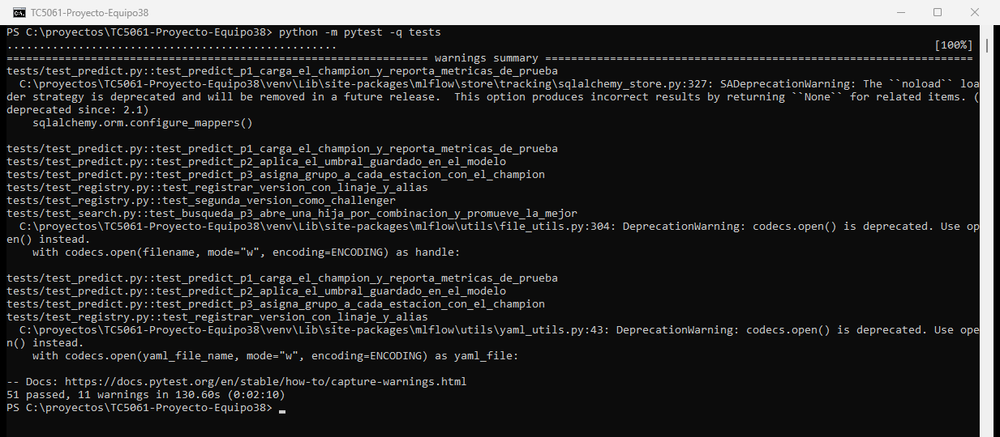

### Validación de datos con DeepChecks

`python -m mibici.validacion --exportar` escribe en `data/interim/` las tablas que se validan: las tres particiones de P1 completas (95,035, 11,379 y 22,399 filas estación-día), una muestra sin reemplazo de 200,000 filas estación-hora por conjunto de P2 (de 2,339,422, 272,496 y 536,089; semilla 42, orden temporal conservado, con los conteos completos de la etiqueta guardados en `exportacion.json`), el perfil de P3 (369 estaciones con 98 variables) y los 380,184 viajes crudos de enero de 2025 tal como los publica el portal, antes de `limpiar_viajes`, sin las columnas personales. `chequeos/validar_datos.py` corre la suite `data_integrity` sobre los viajes crudos, sobre los conjuntos de entrenamiento de P1 y P2 y sobre el perfil de P3, y la suite `train_test_validation` entre entrenamiento y prueba de P1 y P2. Las condiciones son las que DeepChecks trae por defecto (deriva menor a 0.2 por variable y a 0.15 en la etiqueta, deriva multivariada menor a 0.25, correlación entre variables hasta 0.9, duplicados y mezcla de muestras hasta 5 %, cero categorías, etiquetas y fechas nuevas); el único ajuste es `OutlierSampleDetection(timeout=60)`, porque con 380,184 viajes el tope de 10 s abortaría el chequeo. Cada suite deja un JSON (`to_json(with_display=False)`) y `reports/deepchecks/resumen.md` reúne las tablas de las seis con la lectura de cada hallazgo; los HTML con las gráficas quedan fuera de Git por su tamaño (unos 4.7 MB cada uno).

| Suite | Filas | Resultado | Hallazgos y lectura |
|---|---|---|---|
| Integridad de los viajes crudos (enero de 2025) | 380,184 | 8 pasan; 3 no aplican porque la tabla no tiene etiqueta; atípicos solo informativo | Sin `viaje_id` duplicado, sin faltantes en las cinco columnas necesarias, sin duraciones negativas ni mayores a 24 h. El problema real del mes son 9,282 viajes de menos de un minuto (2.44 %), que `limpiar_viajes` descarta: el conteo de la tabla cruda coincide con el que reporta la limpieza. 0.60 % de las muestras con probabilidad de atipicidad mayor o igual a 0.7 |
| Integridad del conjunto de entrenamiento de P1 | 95,035 | 9 pasan, 1 no pasa | Ocho pares con correlación mayor a 0.9: `dia_semana` con `fin_de_semana` (1.00, porque la segunda se deriva de la primera), `media_7` con `media_28` (0.99) y los rezagos con las medias móviles (0.91 a 0.92). La demanda diaria de una estación está muy autocorrelada y las medias móviles promedian los mismos rezagos, así que la redundancia es por construcción; los árboles no la resienten y Ridge la amortigua con la regularización. La condición se conserva y el hallazgo queda documentado |
| Integridad del conjunto de entrenamiento de P2 (muestra) | 200,000 | 8 pasan, 2 no pasan, 1 aviso | 0.65 % de las horas comparten exactamente las trece variables con otra hora de etiqueta contraria y 12.87 % de las filas son idénticas a otra: horas de poco o ningún movimiento en las que el riesgo de las dos horas siguientes no se distingue con las variables de la hora actual. Es ruido irreducible para cualquier modelo con estas entradas y acota el recall alcanzable. `dia_semana` y `fin_de_semana` correlacionan por diseño |
| Integridad del perfil de P3 | 369 | 7 pasan, 1 no pasa, 3 no aplican | Seis columnas constantes (`salidas_habil_02` a `salidas_habil_04` y `salidas_finde_02` a `salidas_finde_04`): el sistema no registra salidas entre las 2:00 y las 4:59, así que no aportan a la agrupación y conviene excluirlas en la siguiente iteración del perfil |
| Entrenamiento contra prueba de P1 | 95,035 contra 22,399 | 8 pasan, 3 no pasan | `mes` vale 11 y 12 solo en prueba, por eso fallan categorías nuevas, deriva por variable (Cramer's V de 1.0) y deriva multivariada (1.0): es consecuencia de la partición temporal, no un defecto de los datos. Al repetir `MultivariateDrift` sin `mes` la deriva baja a 0.128 (AUC del clasificador de dominio 0.564), las demás variables derivan menos de 0.04 y la etiqueta 0.04. Para el modelo sí importa: `HistGradientBoostingRegressor` trata `mes` como numérico y extrapola, y Ridge deja sin efecto mensual a las filas de prueba; queda como mejora codificar `mes` de forma cíclica o retirarlo de P1 |
| Entrenamiento contra prueba de P2 (muestras) | 200,000 contra 200,000 | 11 pasan, 1 no pasa | 37.65 % de las horas de prueba coinciden en las trece variables y la etiqueta con alguna hora de entrenamiento. No es fuga, porque la partición es temporal y los dos chequeos de fechas pasan: son horas sin movimiento o con flujos pequeños que se repiten en cualquier mes, y la cifra mide qué parte del conjunto es trivial para el modelo. Deriva por variable menor a 0.03 y de la etiqueta 0.022 |

La deriva que importa para la operación no la marca ninguna condición. En P2 la tasa de horas en riesgo pasa de 1.81 % en entrenamiento (42,327 de 2,339,422) a 1.25 % en prueba (6,718 de 536,089), una caída de 30.7 % en noviembre y diciembre; DeepChecks la mide en 0.022 porque con una clase tan rara la puntuación queda pequeña aunque la caída relativa sea grande, así que la lectura se hace con los conteos completos. Con la tasa de enero a septiembre se esperarían 9,699 horas en riesgo en prueba y ocurren 6,718: un modelo que mantuviera la frecuencia de alertas del entrenamiento daría del orden de 2,981 alertas sin riesgo real, un viaje de camión de más por cada una; en el otro sentido, no anticipar ninguna de las 6,718 horas costaría 33,590 unidades con el costo de P2 (cinco falsos positivos por cada falso negativo), y cada punto porcentual de recall que se pierda por la deriva equivale a 67 horas en riesgo mal anticipadas, 336 unidades. En P1, `rezago_7` promedia 33.26 viajes por estación y día en entrenamiento y 32.91 en prueba mientras la variable objetivo baja de 33.31 a 31.10: `rezago_7` menos `salidas` pasa de -0.05 viajes en entrenamiento a +1.81 en prueba, la demanda de fin de año cae pero el nivel de la semana anterior se mantiene. Como el *baseline* `naive7` predice exactamente `rezago_7`, ese sesgo son 40,560 viajes sobredimensionados en los 22,399 pares estación-día de prueba, flota y personal asignados a una demanda que no llega; los modelos que usan `media_28` y `mes` lo corrigen solo en parte, porque los meses 11 y 12 no existen en entrenamiento.

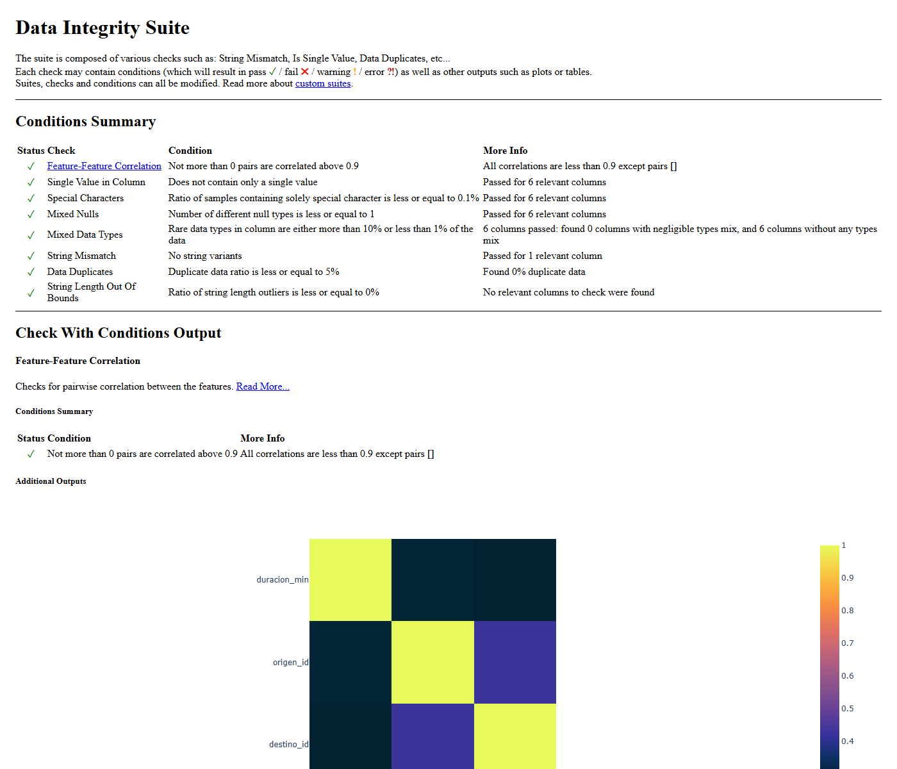

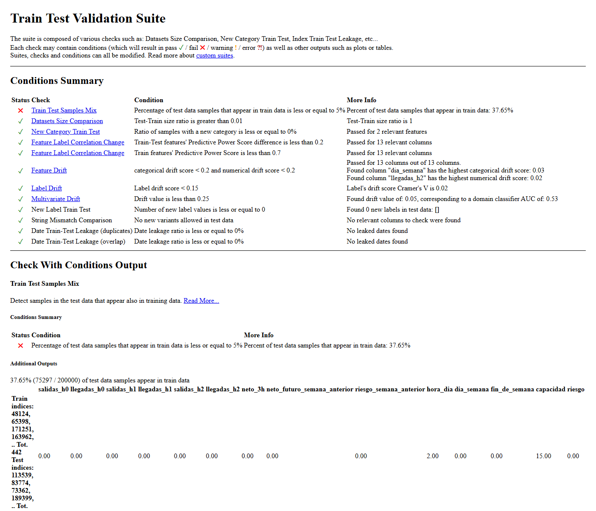

### Chequeos de seguridad

Configuración y secretos. El código lee el servidor de tracking con `os.environ.get("MLFLOW_TRACKING_URI", config.TRACKING_URI)`, cuyo valor por defecto es el almacén local `sqlite:///mlflow.db`; `.env.example` es la plantilla de esa variable. No hay carga automática de `.env`: el valor se exporta en la terminal (`set` o `export`) o se copia a `.env`, que está en `.gitignore` junto con `data/raw/*`, `data/interim/*`, `data/processed/*`, `*.csv`, `*.parquet`, `mlruns/`, `mlartifacts/`, `mlflow.db`, `models/*`, `*.pkl` y `*.joblib`. `tests/test_seguridad.py` comprueba esas entradas, que `git check-ignore` las aplica, que `.env.example` existe y que ningún archivo versionado contiene patrones de secretos; `chequeos/secretos.py` repite la búsqueda sobre las líneas agregadas en todos los commits de todas las ramas (`git log -p --all`) y sobre los archivos de `git ls-files`, con las categorías contraseñas asignadas, tokens y llaves de API, llaves de proveedores por su prefijo (AWS, GitHub, Google, Slack, OpenAI, Hugging Face), bloques PEM, URL con credenciales y cadenas largas en base64 o hexadecimal. Tres motivos de lista blanca, declarados en el código, evitan falsos positivos: las sumas SHA-256 de `data/manifiesto.json`, las imágenes PNG incrustadas en la libreta de exploración y las tablas comprimidas que DeepChecks serializa en los JSON de `reports/deepchecks/`. `reports/seguridad/secretos.txt` guarda la corrida sobre `main`: 29 commits, 4,278 líneas agregadas y 36 archivos versionados (34 de texto y 2 binarios) sin ningún hallazgo.

bandit. Sobre `mibici/` reportaba cuatro hallazgos de severidad baja y confianza alta en 1,392 líneas: B403 (importación de `pickle` en `artefactos.py`), B404 (importación de `subprocess` en `train.py`), B607 (arranque de un proceso con la ruta parcial `git`) y B603 (llamada a `subprocess.run` sin `shell=True`). B607 se corrigió resolviendo el ejecutable con `shutil.which("git")`, que devuelve `desconocido` cuando no hay `git`. Los otros tres se justifican en `[tool.bandit]` de `pyproject.toml` sin excluirlos del reporte: `pickle` solo mide el tamaño del modelo con `pickle.dumps` y nunca deserializa nada, y `subprocess` corre `git` con una lista fija de argumentos y sin intérprete de comandos para leer el commit y la rama. Después de la corrección bandit reporta tres hallazgos de severidad baja en 1,396 líneas del mismo código (1,536 con `mibici/validacion.py`) y ninguno de severidad media o alta, que es lo que vigila la compuerta de `make chequeos`. Evidencia: `reports/seguridad/bandit_antes.txt` y `bandit_despues.txt`.

| Hallazgo | Ubicación | Antes | Después | Qué se hizo |
|---|---|---|---|---|
| B403 `import pickle` | `mibici/modeling/artefactos.py` | Low | Low | Justificado: `pickle.dumps` mide `tamano_modelo_mb`; el modelo se guarda y se carga con MLflow, nunca con `pickle.load` |
| B404 `import subprocess` | `mibici/modeling/train.py` | Low | Low | Justificado: lista fija de argumentos, sin `shell`, solo para `git rev-parse` y `git status` |
| B607 ruta parcial del ejecutable | `mibici/modeling/train.py` | Low | Corregido | `shutil.which("git")` resuelve la ruta completa antes de `subprocess.run` |
| B603 `subprocess.run` sin `shell=True` | `mibici/modeling/train.py` | Low | Low | Justificado: es la forma segura de llamar a un proceso; la entrada no viene del usuario |

pip-audit. Sobre `requirements.txt` con MLflow 3.16.1 reportaba tres vulnerabilidades en ese paquete y ninguna en las otras dependencias:

| Aviso | Qué es | Versión que pip-audit indica como corrección | Relación con el proyecto |
|---|---|---|---|
| CVE-2026-53995 | Path traversal en el backend de tracking `FileStore` por el API de trazas | 3.17.2 | El servidor del proyecto usa SQLite por SQLAlchemy, no `FileStore`, y el proyecto no registra trazas |
| CVE-2026-115886 | SSRF en los endpoints de scorers de evaluación GenAI, con los paquetes opcionales `trulens` | 3.17.0 | El proyecto no usa scorers ni evaluación GenAI y no instala `trulens` |
| CVE-2026-116691 | El autologging de CrewAI registra la llave de API del proveedor de LLM en las trazas | 3.17.0 | El proyecto no usa CrewAI ni maneja llaves de API |

Aunque ninguna era explotable en la configuración del proyecto (servidor local con SQLite, sin scorers, sin CrewAI), la versión que pip-audit señala como corrección es 3.17.2 y con ella deja de reportar las tres, así que `requirements.txt` y `python_env.yaml` fijan `mlflow==3.17.2`; para CVE-2026-53995 OSV no nombra versión corregida y la garantía de fondo sigue siendo el almacén SQLite. La subida se verificó con la suite completa en verde y con una corrida `mlflow run . -e train -P question=p1 -P model=ridge --experiment-name mibici-equipo38 --env-manager local` contra un almacén temporal, que reproduce las métricas de la corrida `p1_ridge` de la segunda entrega (`test_mae` 6.2555 y `test_rmse` 10.5436). Con esa versión pip-audit no encuentra vulnerabilidades conocidas (`reports/seguridad/pip_audit_antes.txt` y `pip_audit_despues.txt`; `mibici` aparece como omitido porque es el paquete local de `-e .` y no existe en PyPI). Las 36 corridas y los tres modelos registrados de la segunda entrega se hicieron con 3.16.1 y se conservan tal cual.

Los cinco archivos de `reports/seguridad/` llevan en la primera línea la fecha, el commit y el comando exacto con que se generaron, para que la evidencia se lea sin correr nada.

Con la cuarta entrega bandit cubre también `api/` y `scripts/` (sin hallazgos en 194 líneas) y pip-audit audita además `requirements-api.txt` (no encuentra vulnerabilidades conocidas (`No known vulnerabilities found`)); la búsqueda de secretos sobre la rama del servicio tampoco encuentra nada (sin hallazgos en el historial ni en los archivos versionados).

Las dos capturas siguientes son el inicio y el final de la misma corrida de los comandos de `make chequeos`: la exportación de las tablas y las seis suites de DeepChecks, y después el reporte de bandit, la compuerta, pip-audit y la búsqueda de secretos.

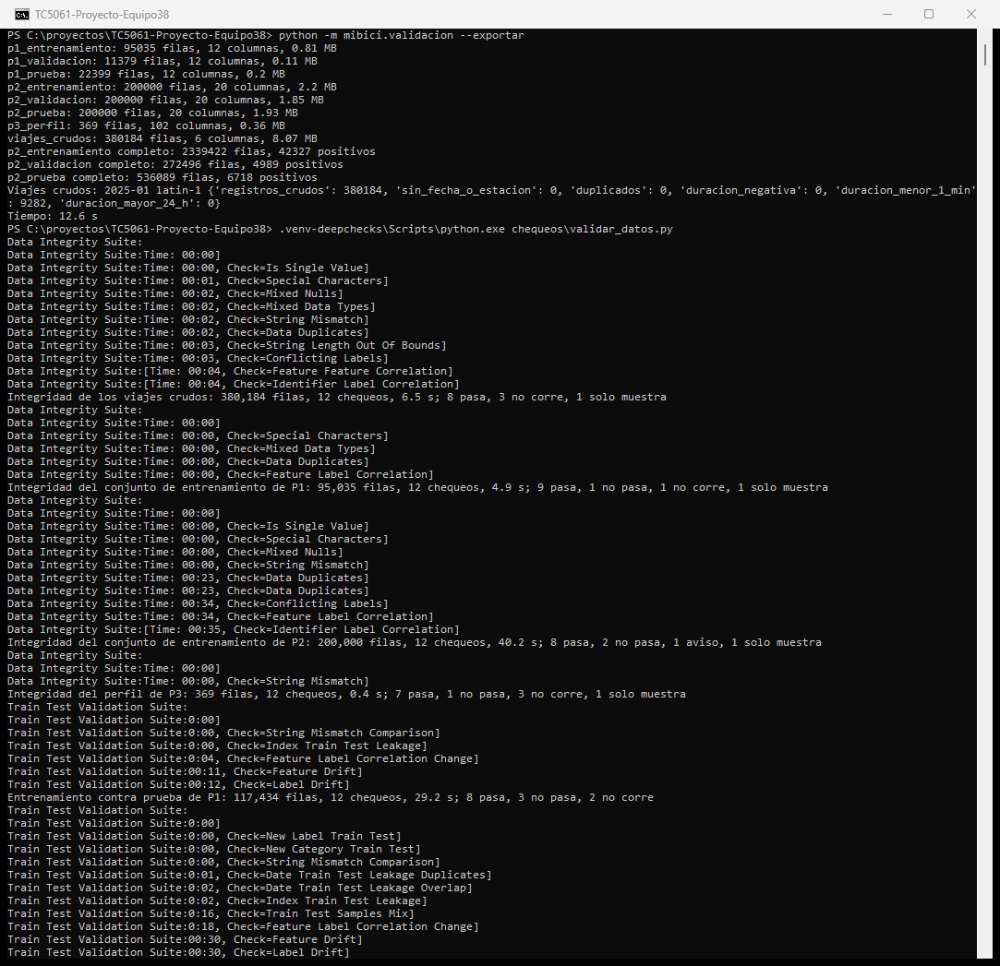

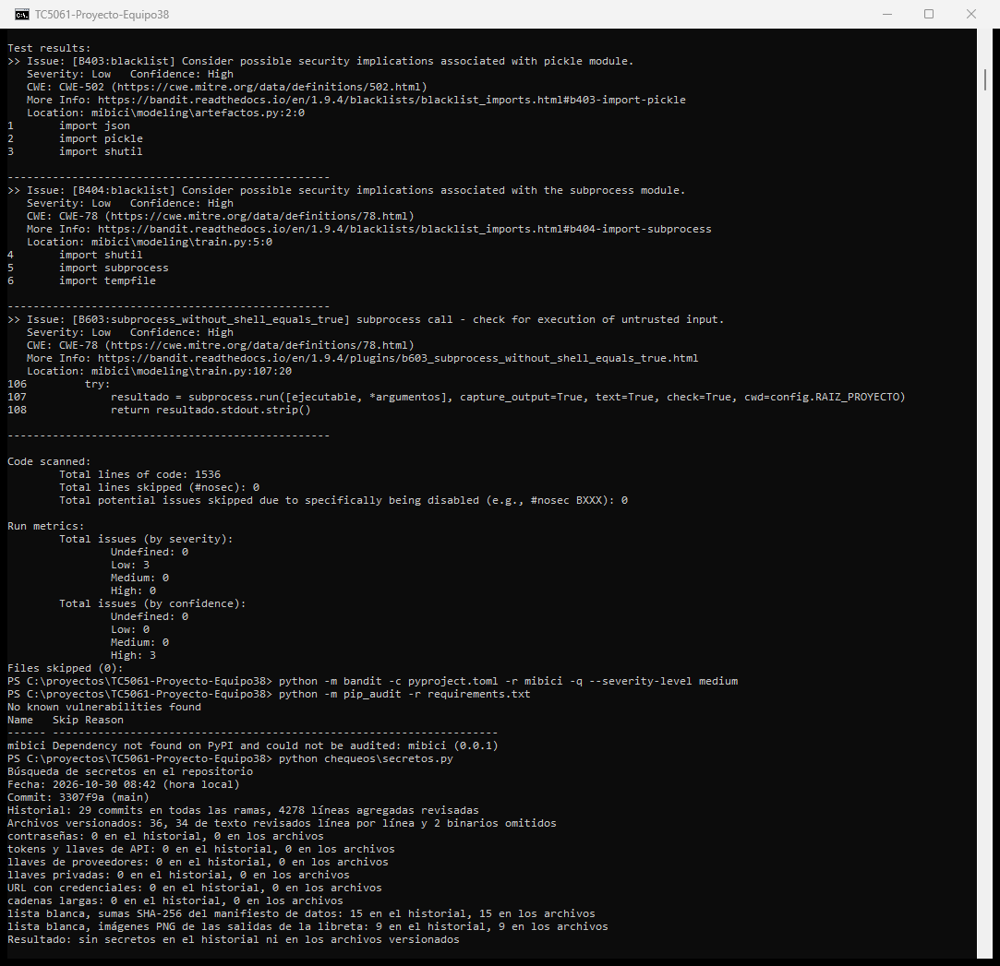

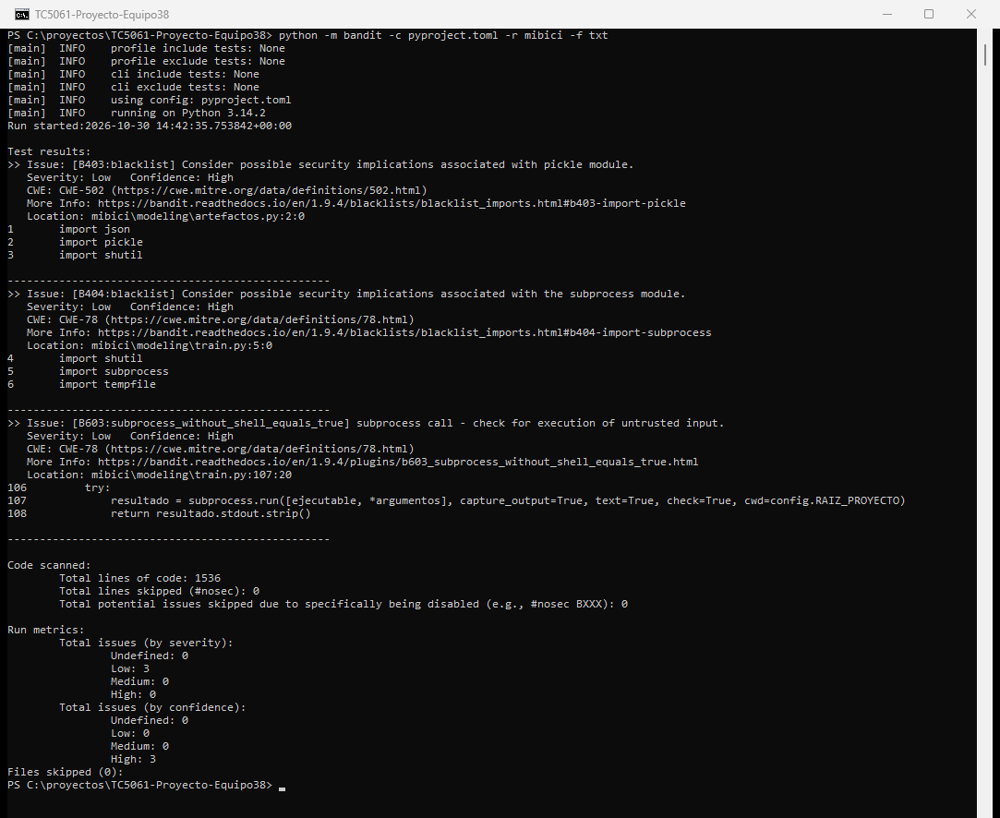

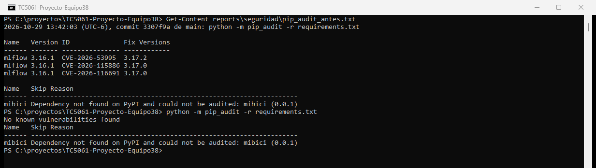

## Servicio de predicción

La cuarta entrega expone el modelo en producción de P2 como un servicio REST: una aplicación de [FastAPI](https://fastapi.tiangolo.com/) con esquemas de entrada y de salida en [Pydantic](https://pydantic.dev/docs/validation/latest/), que carga el modelo por nombre y alias desde el Model Registry al arrancar y responde en JSON, empaquetada con todas sus dependencias en una imagen OCI descrita en `Containerfile`. El servicio vive en `api/`, sus pruebas en `tests/test_api.py` y `tests/test_api_ejemplos.py`, y `scripts/probar_api.py` manda la petición de ejemplo y muestra la respuesta.

### Modelo que se expone

`mibici-equipo38-p2-riesgo@champion`, que hoy resuelve a la versión 1 del modelo registrado de P2: la corrida `p2_hgb_mejor`, un `HistGradientBoostingClassifier` balanceado dentro de un `FixedThresholdClassifier` con umbral 0.92 (`test_costo` 26,432, 0.7 MB). Se eligió P2 por tres razones. Es la decisión horaria del equipo de rebalanceo, a qué estaciones mandar el camión en la siguiente hora, con variables que cambian cada hora, que es lo que justifica un servicio de inferencia en línea. El umbral de decisión viaja dentro del modelo registrado, así que el servicio devuelve la clase y la probabilidad sin lógica adicional y lo que se despliega es exactamente lo que se evaluó. Y sus 13 variables caben en un cuerpo JSON legible. P1 (demanda diaria) se sirve por lotes con `predict.py` y P3 (98 variables, decisión de largo plazo) no necesita un servicio; los dos quedan como endpoints posteriores si la operación los pide (sección Estrategia de despliegue).

### Archivos

```
├── Containerfile          <- imagen OCI del servicio: python:3.14-slim, usuario sin privilegios, HEALTHCHECK y uvicorn
├── .dockerignore          <- lo que no entra al contexto de construcción (Docker y Podman leen este nombre)
├── requirements-api.txt   <- dependencias de la imagen con las versiones del entrenamiento
├── api
│   ├── main.py            <- aplicación: carga del modelo en el lifespan y los cuatro endpoints
│   ├── esquemas.py        <- PeticionRiesgo, RespuestaRiesgo, Metadata y Salud
│   ├── modelo.py          <- carga por nombre y alias (o desde RUTA_MODELO), DataFrame con la firma y predicción
│   └── ejemplos           <- peticion_p2.json, peticion_lote.json y respuesta_p2.json de la corrida real
├── scripts
│   └── probar_api.py      <- manda el ejemplo al servicio y muestra la respuesta
└── tests
    ├── conftest.py        <- cliente de pruebas con un modelo mínimo inyectado, sin registry
    ├── test_api.py        <- validación, lote, health, metadata, 503 y la prueba lenta contra el registry real
    └── test_api_ejemplos.py <- los ejemplos de api/ejemplos validan contra los esquemas y responden 200
```

### Recuperación del modelo desde el Model Registry

`api/modelo.py` carga el modelo una sola vez, en el evento de arranque de la aplicación (`lifespan`), con `mlflow.pyfunc.load_model("models:/mibici-equipo38-p2-riesgo@champion")`; el servidor de tracking se toma de la variable de entorno `MLFLOW_TRACKING_URI` y, si no está definida, de `sqlite:///mlflow.db`, como el resto del código. Antes de cargar resuelve el alias con `MlflowClient().get_model_version_by_alias`, de modo que cada respuesta y `/metadata` dicen a qué versión apunta `champion` en ese momento (hoy la 1). Del modelo cargado toma el estimador de scikit-learn (`get_raw_model()`), para calcular la probabilidad con `predict_proba` y leer el umbral, y la firma registrada con el modelo, de la que salen los nombres, el orden y los tipos (`float32`) de las 13 columnas con que se reconstruye el DataFrame de cada petición. Si la firma no coincide con los campos de `PeticionRiesgo`, el arranque falla y el servicio responde 503 en lugar de predecir con columnas mal alineadas; si el registry no responde al arrancar, el contenedor queda arriba, los endpoints devuelven 503 y el motivo queda en el registro de uvicorn.

Hay dos formas de que el modelo llegue al contenedor, con la misma imagen:

| Opción | Cómo | Cuándo |
|---|---|---|
| A, registry en red (la documentada y capturada abajo) | El servidor de MLflow del equipo corre en el anfitrión escuchando en todas las interfaces y aceptando el nombre con que lo ve el contenedor: `mlflow server --backend-store-uri sqlite:///mlflow.db --host 0.0.0.0 --port 5000 --allowed-hosts localhost:*,127.0.0.1:*,host.docker.internal:*` (o `make server HOST_SERVIDOR=0.0.0.0`). El contenedor recibe `-e MLFLOW_TRACKING_URI=http://host.docker.internal:5000` (con Podman, `http://host.containers.internal:5000`, y ese nombre en `--allowed-hosts`). El modelo y sus artefactos viajan por HTTP desde `mlartifacts/`. Sin `--allowed-hosts`, MLflow 3 solo acepta encabezados `Host` de localhost o de una IP privada (su valor por defecto), como protección contra DNS rebinding; al nombre del contenedor le responde 403 y el servicio arranca sin modelo | Quien tiene `mlflow.db` y `mlartifacts/` de las corridas (hoy, la máquina donde se entrenó, porque el registry no se versiona) o un servidor de tracking compartido |
| B, modelo exportado | `make exportar-modelo` (`mlflow artifacts download -u models:/mibici-equipo38-p2-riesgo@champion -d models/api`) deja el modelo en `models/api/`, carpeta ignorada por Git, junto con `registered_model_meta`, que anota nombre y versión; el contenedor monta esa carpeta y recibe `-e RUTA_MODELO=/modelo` | Quien recibe la carpeta exportada sin el servidor de MLflow. `/metadata` reporta la versión anotada y `alias` nulo, porque la carpeta no sabe a qué alias apuntaba |

Los modelos no se versionan en Git (`*.skops`, `mlartifacts/`, `models/*` y `mlflow.db` están en `.gitignore` y `tests/test_seguridad.py` lo exige), así que reproducir el servicio desde un clon exige el servidor de MLflow del equipo o la carpeta exportada; la imagen, en cambio, se construye desde cualquier clon.

### Esquemas y validación

`PeticionRiesgo` tiene los 13 campos de la firma, con el nombre exacto de `features.COLUMNAS_P2`, más `estacion_id`, opcional, que el servicio solo devuelve para identificar la respuesta. `ConfigDict(extra="forbid")` rechaza cualquier campo que no esté en la firma, los rangos rechazan valores imposibles y un validador comprueba que las dos variables derivadas coinciden con las que las originan, igual que las calcula `features.py`:

| Campo | Tipo y rango | Qué es |
|---|---|---|
| `estacion_id` | entero ≥ 1, opcional | Identificador de la estación; solo se devuelve |
| `salidas_h0`, `llegadas_h0` | entero ≥ 0 | Salidas y llegadas de la estación en la hora t |
| `salidas_h1`, `llegadas_h1`, `salidas_h2`, `llegadas_h2` | entero ≥ 0 | Lo mismo en t-1 y en t-2 |
| `neto_3h` | entero igual a llegadas menos salidas de las tres horas | Flujo neto acumulado |
| `neto_futuro_semana_anterior` | entero | Flujo neto de las dos horas siguientes a la misma hora de la semana anterior |
| `riesgo_semana_anterior` | 0 o 1 | Etiqueta de riesgo de la misma hora de la semana anterior |
| `hora_dia` | entero de 0 a 23 | Hora del día |
| `dia_semana` | entero de 0 (lunes) a 6 (domingo) | Día de la semana |
| `fin_de_semana` | 0 o 1, igual a `dia_semana >= 5` | Fin de semana |
| `capacidad` | entero > 0 | Anclajes de la estación |

Las entradas se validan como enteros, porque los conteos y las banderas lo son por naturaleza (`4.5` salidas se rechaza en lugar de truncarse), y después se convierten al tipo de la firma, `float32`, en el orden de la firma. La respuesta se valida con `response_model=RespuestaRiesgo`: `estacion_id`, `riesgo` (0 o 1), `probabilidad` (de 0 a 1, con seis decimales), `umbral` (el del modelo, 0.92) y `modelo` con `nombre`, `version` y `alias`; `riesgo` es `probabilidad >= umbral` y lo calcula el propio `FixedThresholdClassifier`.

### Endpoints

| Método y ruta | Cuerpo | Respuesta | Códigos |
|---|---|---|---|
| `POST /predecir` | Una `PeticionRiesgo` | Una `RespuestaRiesgo` | 200; 422 con el detalle de Pydantic (campo faltante, campo de más, valor fuera de rango o de tipo, variables derivadas incoherentes); 503 si el modelo no está cargado |
| `POST /predecir/lote` | Lista de `PeticionRiesgo`, al menos una | Lista de `RespuestaRiesgo` en el mismo orden | 200; 422 (el detalle incluye la posición de la petición inválida; la lista vacía también es 422); 503 |
| `GET /health` | | `{"estado": "ok", "modelo": ..., "version": ...}` | 200 solo cuando el modelo está cargado; 503 si no |
| `GET /metadata` | | Nombre, versión, alias y origen del modelo, `run_id`, umbral, columnas de la firma con su tipo y versión de MLflow | 200; 503 |
| `GET /docs` | | Documentación interactiva (OpenAPI) con los esquemas y el ejemplo de petición | 200 |

### Construir la imagen y levantar el contenedor

`Containerfile` parte de `python:3.14-slim`, instala `requirements-api.txt` (MLflow 3.17.2, scikit-learn 1.9.1, pandas 3.0.6, NumPy 2.5.3, SciPy 1.18.1 y skops 0.16.0, las versiones con que se entrenaron y registraron los modelos, más FastAPI 0.142.2, uvicorn 0.54.0 y Pydantic 2.13.5), copia solo `api/`, crea un usuario sin privilegios, fija `OMP_NUM_THREADS=1` (el modelo predice una fila o un lote corto por petición y con los 14 hilos de OpenMP que el contenedor ve en la máquina de trabajo cada predicción tardaba varios segundos por la sincronización de hilos; con un hilo responde en décimas de segundo), expone el puerto 8000, declara un `HEALTHCHECK` sobre `/health` y arranca uvicorn con `CMD` en forma exec, para que las señales de parada lleguen al proceso y el `lifespan` se ejecute completo. `.dockerignore`, el nombre que leen Docker y Podman (Podman acepta además `.containerignore`), deja fuera del contexto los datos, `mlartifacts/`, `mlflow.db`, `models/`, los entornos, los reportes y las libretas: el contexto que viaja al motor pesa menos de 10 kB. El mismo archivo sirve para los dos motores; abajo van los comandos con `docker` y entre paréntesis el cambio para `podman`.

Desde la raíz del repositorio, con el servidor de MLflow del equipo corriendo en otra terminal con `--host 0.0.0.0` y `--allowed-hosts` (el comando de la opción A):

```
docker build -f Containerfile -t mibici-api:1.0 .
docker run --rm -d --name mibici-api -p 8000:8000 --add-host=host.docker.internal:host-gateway -e MLFLOW_TRACKING_URI=http://host.docker.internal:5000 mibici-api:1.0
docker ps
docker logs mibici-api
docker stop mibici-api
```

`--add-host=host.docker.internal:host-gateway` define ese nombre también en Docker Engine sobre Linux, donde no existe por sí solo; en Docker Desktop es inofensivo. Con Podman son los mismos comandos con `podman` en lugar de `docker`, `http://host.containers.internal:5000` como servidor de tracking y `--add-host=host.containers.internal:host-gateway`; `podman build --format docker` conserva el `HEALTHCHECK`, que el formato OCI predeterminado descarta con una advertencia. La imagen construida pesa 1.27 GB en disco (288 MB en capas comprimidas) y la construcción tarda varios minutos, casi todo en descargar e instalar las dependencias. El contenedor tarda alrededor de un minuto en resolver el alias y cargar el modelo; mientras tanto `/health` responde 503, y cuando el `HEALTHCHECK` pasa `docker ps` lo marca `healthy`. Con el modelo exportado (opción B), sin servidor de MLflow:

```
make exportar-modelo
docker run --rm -d --name mibici-api -p 8000:8000 -v ${PWD}/models/api:/modelo:ro -e RUTA_MODELO=/modelo mibici-api:1.0
```

Objetivos del `Makefile` (rama `feat/api-contenedor-herramientas`): `make imagen`, `make contenedor`, `make probar-api`, `make exportar-modelo` y `make api`, que levanta el servicio sin contenedor con `uvicorn api.main:app --host 127.0.0.1 --port 8000` para desarrollar; `MOTOR=podman` cambia el motor y el nombre del anfitrión en los dos primeros (`make contenedor MOTOR=podman`), y `make server HOST_SERVIDOR=0.0.0.0` levanta el servidor de tracking de modo que el contenedor lo alcance.

### Consumir la API

`scripts/probar_api.py` lee `api/ejemplos/peticion_p2.json` (o el archivo que se pase en `--peticion`; si contiene una lista usa `/predecir/lote`), consulta `/health`, manda la petición y muestra la respuesta, que con `--salida` también guarda; `make probar-api` lo corre. Con `curl`:

```
curl -s http://127.0.0.1:8000/health
curl -s -X POST http://127.0.0.1:8000/predecir -H "Content-Type: application/json" -d @api/ejemplos/peticion_p2.json
curl -s -X POST http://127.0.0.1:8000/predecir/lote -H "Content-Type: application/json" -d @api/ejemplos/peticion_lote.json
```

Ejemplo real, tomado de la corrida contra el contenedor del 5 de noviembre de 2026. La petición (`api/ejemplos/peticion_p2.json`) es la estación 2 a las 0:00 del sábado 1 de noviembre de 2025, la primera fila del conjunto de prueba y del `input_example` guardado con el modelo:

```json
{
  "estacion_id": 2,
  "salidas_h0": 0,
  "llegadas_h0": 4,
  "salidas_h1": 1,
  "llegadas_h1": 2,
  "salidas_h2": 0,
  "llegadas_h2": 1,
  "neto_3h": 6,
  "neto_futuro_semana_anterior": 0,
  "riesgo_semana_anterior": 0,
  "hora_dia": 0,
  "dia_semana": 5,
  "fin_de_semana": 1,
  "capacidad": 15
}
```

Respuesta (`api/ejemplos/respuesta_p2.json`): una madrugada de fin de semana sin movimiento, probabilidad de riesgo cercana a cero, muy por debajo del umbral:

```json
{
  "estacion_id": 2,
  "riesgo": 0,
  "probabilidad": 0.001544,
  "umbral": 0.92,
  "modelo": {
    "nombre": "mibici-equipo38-p2-riesgo",
    "version": "1",
    "alias": "champion"
  }
}
```

El lote de `api/ejemplos/peticion_lote.json` son las estaciones 2, 3 y 4 a las 16:00 del martes 4 de noviembre de 2025, también del conjunto de prueba, y responde una predicción por estación en el mismo orden: la estación 2 queda en riesgo (`riesgo` 1, probabilidad 0.970204), la 3 también (1, 0.972269) y la 4 no (0, 0.865297, por debajo del umbral), cada una con el mismo bloque `modelo`. Esa hora tuvo riesgo real en la estación 4 y no en la 2 ni en la 3: un falso negativo y dos falsos positivos cerca del umbral, el comportamiento que miden `test_recall` y `test_precision` del modelo registrado.

Una petición sin `capacidad` responde 422 con `{"detail": [{"type": "missing", "loc": ["body", "capacidad"], "msg": "Field required", ...}]}`; un campo que no está en la firma, `extra_forbidden`; `hora_dia: 24`, `less_than_equal`; un `neto_3h` que no cuadra con las salidas y las llegadas, `value_error` con el valor esperado en el mensaje.

### Estrategia de despliegue

P2 se despliega como inferencia en tiempo real y P1 se queda por lotes. La decisión de P2 la toma el equipo de rebalanceo cada hora y por estación, con variables que cambian cada hora (los flujos de las últimas tres horas) y para una ventana de solo dos horas: una predicción que llega tarde no sirve, así que el servicio responde una petición por estación y hora en milisegundos, y `/predecir/lote` permite calcular todas las estaciones de una hora en una sola llamada cuando el operador prefiere correrlas juntas al cerrar la hora (en la máquina de trabajo una petición responde en 0.3 a 0.4 s desde el anfitrión y el lote de 371 estaciones en 0.5 s, medianas de 20 peticiones, porque el estimador tarda casi lo mismo con 371 filas que con una (50 ms en `predict_proba`): el lote de una hora completa cuesta lo mismo que una petición). El modelo se carga una vez al arrancar y se reutiliza en cada petición; el registry solo se consulta en el arranque, de modo que una caída del servidor de tracking no tira el servicio que ya está arriba. P1, en cambio, es una decisión diaria (flota y personal por estación para el día siguiente) con variables que solo cambian una vez al día: ahí conviene el modo por lotes que ya cubre `python -m mibici.modeling.predict --pregunta p1`, que carga el mismo `champion` del registry, predice todas las estaciones del periodo y deja el CSV en `models/`; un endpoint por petición no aportaría nada que un lote nocturno no dé. P3 es una decisión de planeación que se revisa pocas veces al año y se corre a mano.

### Pruebas y chequeos del servicio

`tests/test_api.py` tiene 23 pruebas que corren con `TestClient` y un modelo mínimo inyectado por `tests/conftest.py` (una regresión logística con la firma de P2 dentro de un `FixedThresholdClassifier`, descrita con la misma función `describir` que usa el servicio), así que `make test` sigue en verde desde un clon sin registry ni servidor: 200 con el ejemplo y la respuesta completa; `estacion_id` opcional; 422 por campo faltante, por campo de más, por nueve valores fuera de rango o de tipo (`hora_dia` 24 y -1, `dia_semana` 7, conteo negativo, `capacidad` 0, bandera 2, decimal en un conteo, texto en una bandera, `estacion_id` 0) y por variables derivadas incoherentes; el orden de los campos del JSON no cambia la predicción (el modelo de prueba exige las columnas en el orden del entrenamiento); lote con el mismo orden, con un elemento inválido y vacío; `/health` y `/metadata`; 503 en los tres endpoints sin modelo; `describir` rechaza una firma distinta al esquema; la lectura de `registered_model_meta`; y una prueba `lento` que carga el `champion` real por `MLFLOW_TRACKING_URI` y se omite sola cuando la variable no apunta a un servidor HTTP que responda. `tests/test_api_ejemplos.py` (rama `feat/api-pruebas-ejemplos`) comprueba que los tres archivos de `api/ejemplos/` validan contra los esquemas y responden 200. Con las dos ramas integradas la suite completa tiene 78 pruebas.

bandit sobre `api/` y `scripts/` no reporta hallazgos (194 líneas) y pip-audit sobre `requirements-api.txt` no encuentra vulnerabilidades conocidas (`No known vulnerabilities found`); `make chequeos` ya incluye las dos carpetas y los dos archivos de requisitos.

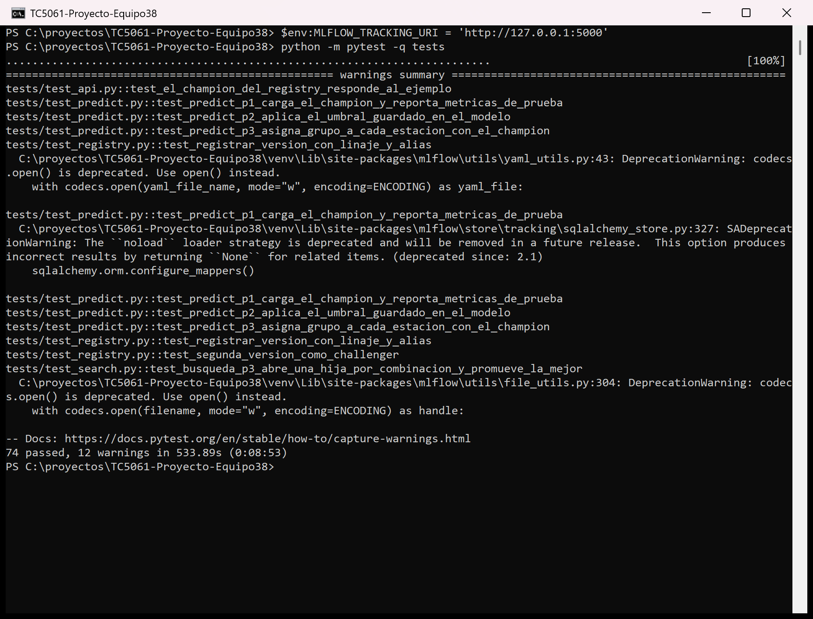

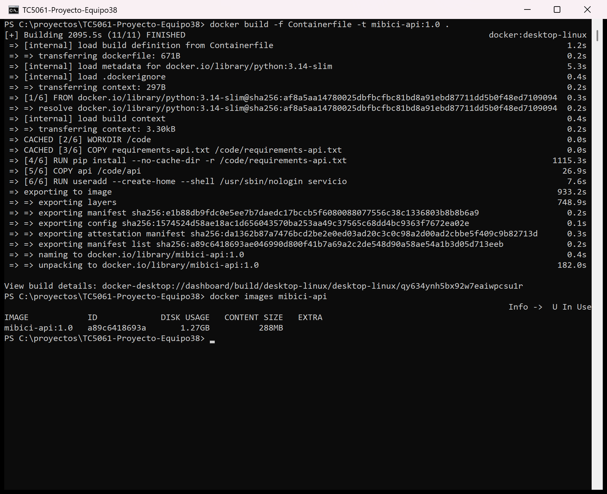

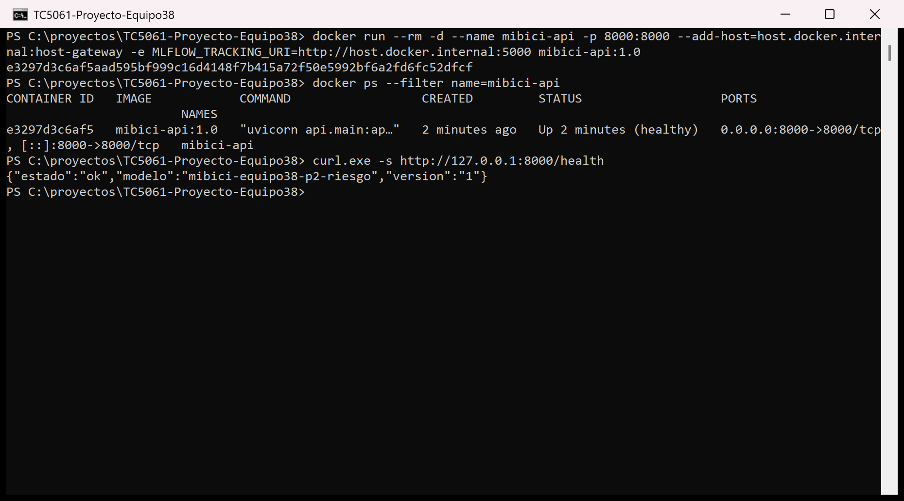

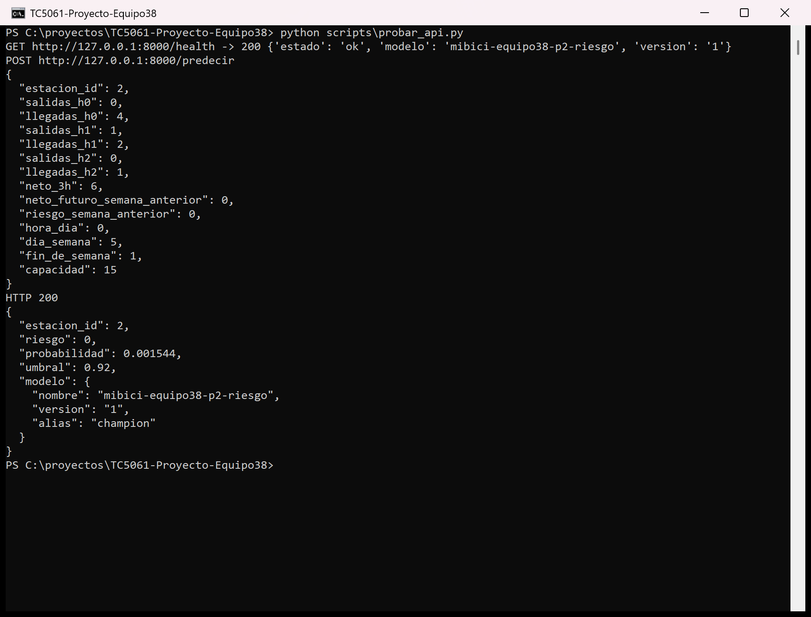

## Monitoreo y drift

La quinta entrega agrega la capa de observabilidad del modelo en producción de P2 (`mibici-equipo38-p2-riesgo`, el que sirve la API): ingesta del periodo posterior al entrenamiento en archivos aparte, reporte de *drift* y de calidad de datos con [Evidently](https://docs.evidentlyai.com/introduction), desempeño del modelo vigente mes a mes, una versión alternativa reentrenada y registrada en el Model Registry, un *A/B testing* entre las dos versiones con la regla de decisión escrita de antemano y una recomendación de *Continuous Training*. Los reportes quedan en `reports/monitoreo/` y las figuras en `reports/figures/`.

### Archivos

```
├── data
│   └── manifiesto_actual.json   <- versión de los datos del periodo actual (URL, tamaño y SHA-256 de cada mes, limpieza por mes)
├── mibici
│   ├── monitoreo
│   │   ├── datos.py             <- ingesta del periodo actual y tabla de monitoreo de P2 con la predicción del modelo vigente
│   │   ├── drift.py             <- reporte de drift y de calidad con Evidently, comparaciones de control, serie mensual y resumen
│   │   ├── desempeno.py         <- desempeño del modelo vigente por conjunto, por mes y por antigüedad de la estación
│   │   ├── costos.py            <- métricas y costo de los errores de P2, comunes al desempeño mensual y al A/B
│   │   ├── graficas.py          <- figuras del drift y del desempeño
│   │   └── formato.py           <- tablas y números de los reportes en Markdown
│   └── modeling
│       ├── reentrenar.py        <- versión alternativa: receta del champion sobre 2025 más el periodo actual, registrada como challenger
│       └── abtest.py            <- A/B testing de dos versiones registradas, regla de decisión y cambio de alias
├── reports
│   ├── monitoreo                <- resumen.md, drift.json y evidently_p2*.json (drift); desempeno.md y .json; abtest.md y .json
│   └── figures                  <- drift_*.png, evidently_*.png, desempeno_*.png y abtest_costo.png
└── tests
    ├── test_monitoreo.py        <- ventanas, ingesta aparte, tabla de monitoreo, reporte de Evidently, desempeño y MLproject
    ├── test_reentrenar.py       <- cortes del reentrenamiento y registro de la versión como challenger en un registry temporal
    └── test_abtest.py           <- McNemar, bootstrap por día, tráfico dividido, regla de decisión y cambio de alias
```

Los HTML interactivos de Evidently (`reports/monitoreo/evidently_p2.html` y `evidently_p2_alerta.html`, 4.7 MB cada uno) quedan fuera de Git, como los de DeepChecks, y se regeneran con un comando; sus métricas (`evidently_p2.json` y `evidently_p2_alerta.json`) y sus capturas sí se versionan.

### Conjuntos y periodos

| Conjunto | Periodo | Horas-estación | Estaciones | Horas en riesgo | Para qué se usa |
|---|---|---|---|---|---|
| Referencia | 1 de enero al 30 de septiembre de 2025 | 2,339,422 | 369 | 42,327 (1.81 %) | Conjunto de entrenamiento del `champion` (versión 1); es contra lo que se mide el *drift* |
| Validación de 2025 | Octubre de 2025 | 272,496 | 368 | 4,989 (1.83 %) | Mes con que el `champion` eligió su umbral de decisión |
| Prueba de 2025 | Noviembre y diciembre de 2025 | 536,089 | 368 | 6,718 (1.25 %) | Desempeño del `champion` fuera de su entrenamiento, que sirve de base para medir su degradación |
| Actual | 1 de enero al 30 de junio de 2026 | 1,622,169 | 412 | 18,196 (1.12 %) | Periodo en producción que se compara contra la referencia; con él se reentrena la versión alternativa |
| Evaluación | 1 de julio al 30 de septiembre de 2026 | 1,001,082 | 469 | 10,232 (1.02 %) | Conjunto del *A/B testing*: ninguna de las dos versiones lo usó para entrenar ni para elegir su umbral |
| Confirmación | Octubre de 2026 | 346,775 | 469 | 4,947 (1.43 %) | Último mes publicado; no entra en la regla del *A/B* y muestra si el resultado se sostiene |

- La referencia es la partición con que se entrenó el modelo que hoy está en producción: `armar_tabla` la obtiene con `features.conjuntos_p2` sobre los viajes de 2025 y reproduce sus 2,339,422 filas y 42,327 horas en riesgo. Medir el *drift* contra otro periodo diría cuánto cambió la ciudad, no cuánto se alejó la producción de lo que el modelo aprendió.
- El periodo actual son los seis primeros meses de 2026, lo que el modelo atendió sin reentrenarse. Como esos mismos meses existen en la referencia, una comparación de control con enero a junio de 2025 separa el cambio de un año a otro de la estacionalidad.
- Julio a septiembre de 2026 queda reservado para el *A/B*: es posterior a todo lo que vieron las dos versiones. Octubre, el último mes que publica el portal, queda fuera de la regla y sirve de confirmación.
- Las fechas viven en `config.py` (`FECHA_INICIO_ACTUAL`, `FECHA_FIN_ACTUAL`, `FIN_REENTRENAMIENTO`, `FIN_MONITOREO` y `FIN_EVALUACION`). Las filas de 2026 se calculan sobre la serie continua de los dos años, para que la primera semana de enero tenga sus rezagos y la etiqueta de la semana anterior, como ocurre en producción. Cada fila es una estación en una hora con las 13 variables de entrada de P2, la etiqueta de riesgo y la probabilidad y la clase que asigna el `champion`.
- La ingesta del periodo actual (`python -m mibici.monitoreo.datos --ingerir`) descarga los diez meses de 2026 que publica el portal (3,997,597 registros en 347.0 MB), aplica la misma `limpiar_viajes` y escribe `data/processed/viajes_actual.parquet` (3,840,981 viajes válidos) y `data/manifiesto_actual.json` (`version_datos` `f396cd21ea7d`). No toca `viajes.parquet` ni `data/manifiesto.json` de 2025, y usa la misma nomenclatura de estaciones para que la capacidad de cada estación sea la que vio el modelo.

### Comandos

Con el servidor de tracking levantado y `MLFLOW_TRACKING_URI` apuntando a él (sección Servidor de tracking), en este orden:

```
mlflow run . -e ingest_actual --experiment-name mibici-equipo38 --env-manager local
mlflow run . -e monitor -P version=1 --experiment-name mibici-equipo38 --env-manager local
mlflow run . -e reentrenar --experiment-name mibici-equipo38 --env-manager local
mlflow run . -e abtest -P promote=1 --experiment-name mibici-equipo38 --env-manager local
```

| Objetivo de `make` | Punto de entrada | Comando directo | Qué deja |
|---|---|---|---|
| `make ingest-actual` | `ingest_actual` | `python -m mibici.monitoreo.datos --ingerir` | `data/processed/viajes_actual.parquet` y `data/manifiesto_actual.json` |
| `make monitor` | `monitor` | `python -m mibici.monitoreo.datos --exportar`, `python -m mibici.monitoreo.drift --registrar` y `python -m mibici.monitoreo.desempeno` | `data/interim/monitoreo_p2.parquet`; `reports/monitoreo/resumen.md`, `drift.json`, `evidently_p2.html` y `.json`, `evidently_p2_alerta.html` y `.json`; `desempeno.md` y `.json`; figuras `drift_*.png` y `desempeno_*.png`; corrida `p2_monitoreo_drift` |
| `make reentrenar` | `reentrenar` | `python -m mibici.modeling.reentrenar` | Corrida `p2_hgb_reentrenado` y versión nueva de `mibici-equipo38-p2-riesgo` con alias `challenger` |
| `make abtest` (`make abtest PROMOVER=1`) | `abtest` | `python -m mibici.modeling.abtest` (`--promover`) | `reports/monitoreo/abtest.md` y `.json`, `reports/figures/abtest_costo.png` y corrida `p2_abtest_v<A>_v<B>`; con `--promover`, el alias `champion` se mueve solo si la regla se cumple |

`monitor` predice con el alias `champion`; `-P version=1` (o `--version 1`) fija la versión, que es lo que reproduce las cifras de esta entrega aunque el alias cambie después. `abtest` compara por defecto `champion` contra `challenger` y acepta `-P version_a=1 -P version_b=3`. El reporte de *drift* tarda unos ocho minutos con los 2.3 millones de filas de la referencia y la tabla de monitoreo, dos; el reentrenamiento, tres y medio; el *A/B*, uno.

### Reporte de drift con Evidently

`mibici/monitoreo/drift.py` usa la API actual de Evidently 0.7.23 (`from evidently import Report`, `from evidently.presets import DataDriftPreset, DataSummaryPreset` y `Report([...]).run(actual, referencia)`) sobre 16 columnas: las 13 variables de entrada, la etiqueta `riesgo` (objetivo) y la probabilidad y la clase que asigna el modelo (predicción). Las pruebas se fijan en el código para que no dependan del tamaño de la muestra: distancia de Wasserstein normalizada en las diez columnas numéricas y distancia de Jensen-Shannon en las seis categóricas, con deriva cuando el estadístico alcanza 0.1 y deriva del conjunto cuando deriva al menos la mitad de las columnas. Con millones de filas una prueba de hipótesis rechazaría la igualdad en todas las columnas; una distancia con umbral mide si el cambio es grande, no si existe.

| Comparación | Columnas con deriva | Estadísticos mayores |
|---|---|---|
| Referencia contra actual (reporte principal) | 0 de 16 | `neto_3h` 0.082, `probabilidad` 0.079, `neto_futuro_semana_anterior` 0.078, salidas 0.061, llegadas 0.055 |
| Mismos meses un año después (enero a junio de 2025 contra enero a junio de 2026) | 0 de 16 | `neto_3h` 0.088, `probabilidad` 0.085, salidas 0.070 |
| Solo estaciones de la referencia | 0 de 16 | `neto_3h` 0.079, `probabilidad` 0.073, salidas 0.057 |
| Referencia contra prueba de 2025 (solo cambio de temporada) | 0 de 16 | `neto_3h` 0.058, `probabilidad` 0.048, salidas 0.037 |

En el semestre completo ninguna columna alcanza el umbral, pero el cambio de un año a otro es mayor que el que produce la temporada (0.061 contra 0.037 en las salidas) y no desaparece al quitar las estaciones nuevas ni al comparar los mismos meses. El promedio del semestre esconde lo que pasa mes a mes:

| Mes de 2026 | Ene | Feb | Mar | Abr | May | Jun | Jul | Ago | Sep | Oct |
|---|---|---|---|---|---|---|---|---|---|---|
| Columnas con deriva (de 16) | 0 | 0 | 0 | 0 | 8 | 3 | 3 | 9 | 1 | 7 |
| `salidas_h0` | 0.05 | 0.04 | 0.03 | 0.05 | 0.11 | 0.08 | 0.10 | 0.12 | 0.02 | 0.15 |
| `neto_3h` | 0.07 | 0.07 | 0.06 | 0.06 | 0.11 | 0.12 | 0.12 | 0.11 | 0.08 | 0.04 |
| `capacidad` | 0.00 | 0.00 | 0.00 | 0.00 | 0.00 | 0.03 | 0.08 | 0.10 | 0.10 | 0.10 |
| `probabilidad` | 0.09 | 0.05 | 0.05 | 0.06 | 0.12 | 0.11 | 0.13 | 0.16 | 0.05 | 0.06 |

Mayo de 2026 es el primer mes con deriva del conjunto según la regla de Evidently (8 de 16 columnas: las seis de salidas y llegadas, `neto_3h` y `probabilidad`); agosto la repite con 9 y octubre queda en 7. `reports/monitoreo/resumen.md` trae la prueba, el estadístico, el umbral y el veredicto de las 16 columnas en cada comparación y en cada mes, y `evidently_p2_alerta.html` es el reporte de mayo contra la referencia.

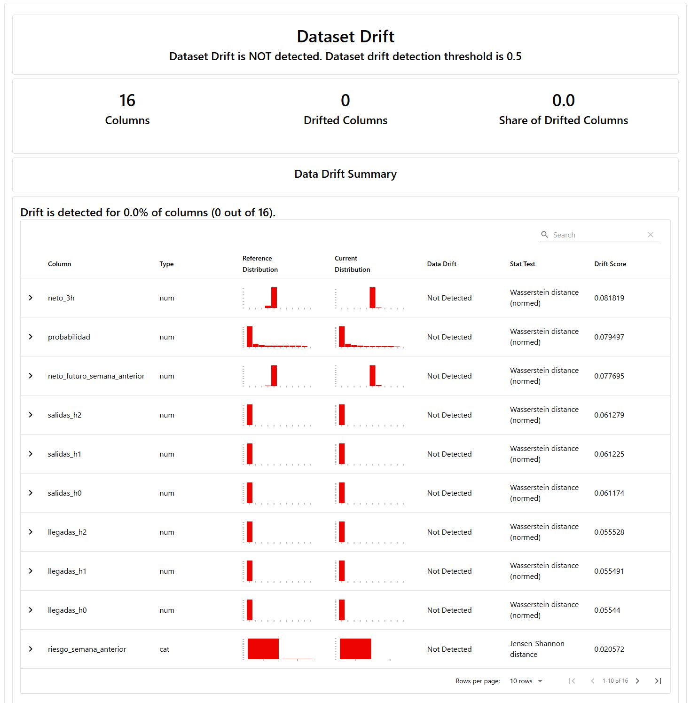

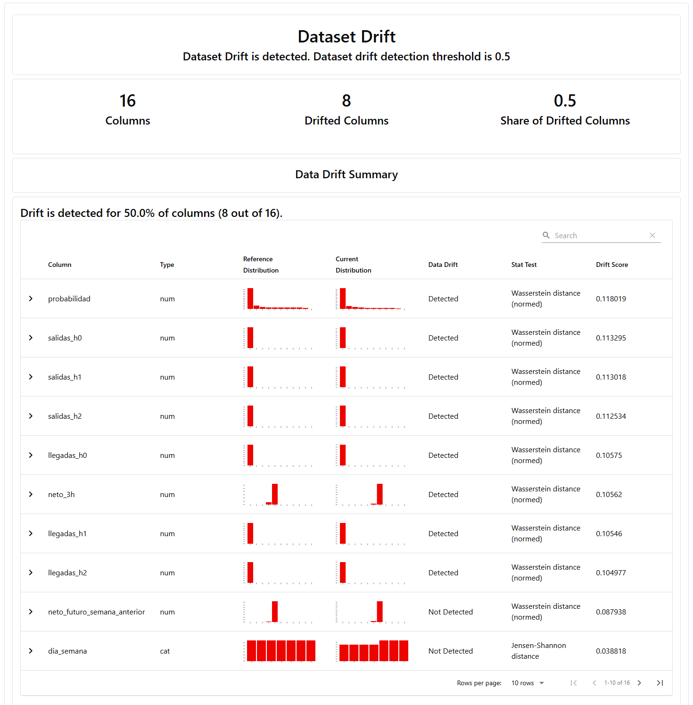

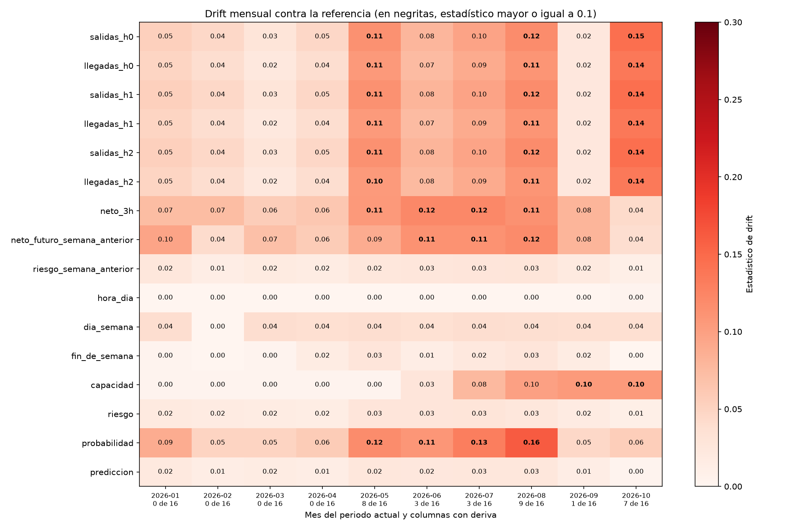

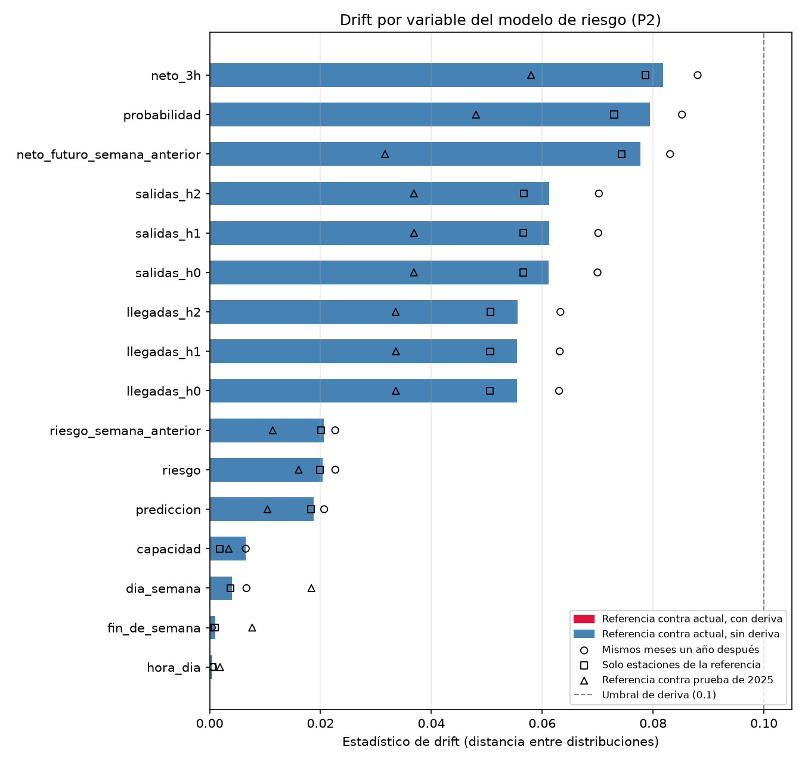

### Calidad de los datos

- Resumen de Evidently (`DataSummaryPreset`) sobre las mismas 16 columnas: ni la referencia ni el periodo actual tienen valores faltantes, filas vacías o columnas constantes; las tres columnas casi constantes son las binarias raras (`riesgo`, `prediccion` y `riesgo_semana_anterior`), y 44 % de las filas de la referencia y 46 % de las del periodo actual son idénticas a otra en las 16 columnas, horas sin movimiento que se repiten en cualquier mes. Los rangos se conservan (capacidad de 11 a 39 anclajes en los dos periodos; salidas por hora de 0 a 205 en la referencia y de 0 a 147 en el actual).
- Archivos crudos del portal, con los conteos de los dos manifiestos: los viajes de menos de un minuto pasan de 2.59 % de los registros en 2025 a 3.90 % en 2026 (4.99 % en junio); septiembre de 2026 trae 758 `viaje_id` duplicados, que en 2025 no existían; 3,869 viajes (0.10 %) usan una estación que no está en la nomenclatura; y las estaciones con viajes pasan de 371 a 472. La limpieza descarta los dos primeros y la tabla de monitoreo solo incluye estaciones con capacidad registrada.
- El volumen crece al final del periodo: 470,348 viajes válidos en septiembre y 607,759 en octubre, contra 305,117 a 376,321 en los ocho meses anteriores.

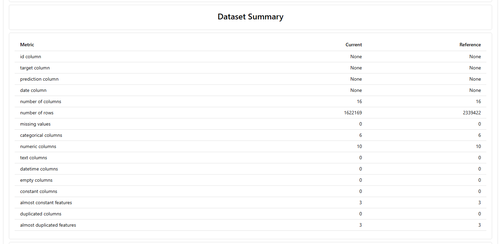

### Interpretación: qué deriva y qué implica para el modelo

Variables de entrada. Las seis de flujo (salidas y llegadas de la hora y de las dos anteriores) bajan 10.6 % en promedio, de 1.387 a 1.240 viajes por estación y hora, y arrastran a las dos derivadas (`neto_3h` y `neto_futuro_semana_anterior`). `capacidad` no se mueve en el semestre (0.006) y cruza el umbral desde septiembre, cuando el sistema ya opera con 469 estaciones contra las 369 de la referencia. Las de calendario no derivan.

Objetivo y predicción. La tasa de horas en riesgo cae de 1.81 % a 1.12 % (38.0 % menos): con la tasa de la referencia se esperarían 29,350 horas en riesgo en el periodo actual y ocurren 18,196. Evidently mide esa deriva en 0.020 porque la distancia de Jensen-Shannon de una clase rara queda pequeña aunque su frecuencia cambie mucho, así que el objetivo se vigila con la tasa y no solo con el veredicto. El modelo acompaña el cambio: su tasa de alertas baja de 1.87 % a 1.22 % y la probabilidad media de 0.200 a 0.178.

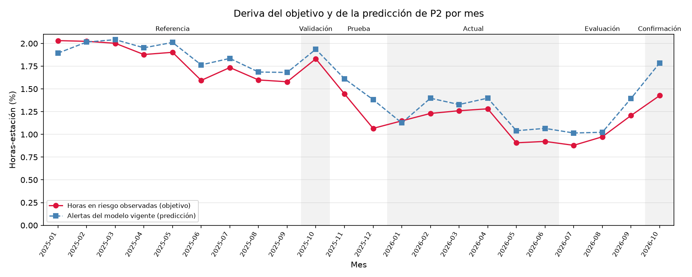

Efecto medido en el `champion` (`reports/monitoreo/desempeno.md` trae la tabla mes a mes). El costo cuenta un falso positivo como 1 y un falso negativo como 5; como el costo por mil horas-estación baja solo porque hay menos horas en riesgo, se reporta además frente a no alertar (el costo dividido entre lo que costaría no emitir ninguna alerta: 1 significa que el modelo no aporta nada).

| Conjunto | Recall | Precisión | PR-AUC | Costo por mil horas-estación | Costo frente a no alertar |
|---|---|---|---|---|---|
| Prueba de 2025 | 0.376 | 0.315 | 0.334 | 49.31 | 0.787 |
| Actual (enero a junio de 2026) | 0.354 | 0.325 | 0.311 | 44.47 | 0.793 |
| Evaluación (julio a septiembre de 2026) | 0.366 | 0.327 | 0.334 | 40.09 | 0.785 |
| Confirmación (octubre de 2026) | 0.380 | 0.304 | 0.329 | 56.67 | 0.795 |

El modelo resiste: fuera de junio, ningún mes de 2026 se aleja más de 4 % del costo frente a no alertar de la prueba (enero pierde 11.8 % de recall, pero con mejor precisión y casi el mismo costo). Junio de 2026 es la excepción: recall 0.302 (19.8 % menos), precisión 0.261, PR-AUC 0.245 y costo frente a no alertar 0.869 (10.4 % más), un mes después de que el reporte mensual marcara la deriva del conjunto.

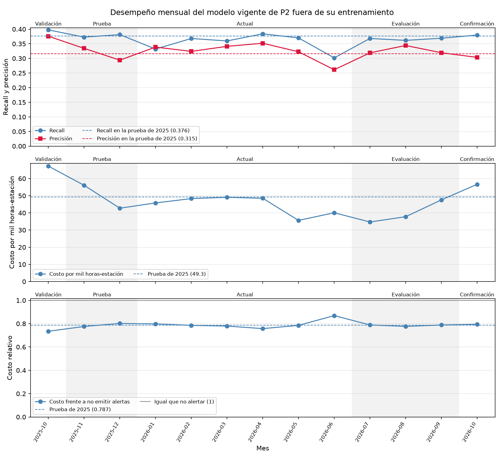

*Data drift* o *concept drift*. Con las horas agrupadas por estratos de 0.1 de la probabilidad que asigna el modelo, el cambio de la tasa de riesgo frente a la prueba de 2025 se parte en lo que se explica porque las horas caen en otros estratos (cambian las entradas) y lo que se explica porque dentro del mismo estrato la frecuencia de riesgo es otra (cambia la relación entre entradas y objetivo). En el periodo actual la tasa baja 0.131 puntos y 94 % es mezcla (0.124 contra 0.007): es *data drift* que el modelo absorbe, porque la misma probabilidad sigue correspondiendo a la misma frecuencia de riesgo (25.6 % en el estrato más alto en la prueba y 26.1 % en el actual). En la evaluación el efecto condicional sube a 25 % del cambio, y en octubre los dos efectos van en sentidos opuestos (0.300 de mezcla contra -0.126 condicional): hay más horas en zonas de probabilidad alta, pero con menos riesgo que antes a igual probabilidad, y la precisión baja a 0.304. Ese es el indicio de *concept drift* que hay que seguir.

Estaciones nuevas. De enero a junio las 44 estaciones que no existían en la referencia aportan 1.45 % de las filas y casi ningún riesgo (0.19 % de sus horas, contra 1.14 % en las de la referencia), y ahí el modelo cuesta más que no alertar (1.023). De julio a septiembre ya son 101 estaciones y 18.9 % de las filas, con recall 0.321 y costo frente a no alertar 0.833, contra 0.368 y 0.783 en las estaciones que el modelo conoce. La expansión del sistema es la fuente de deriva que más crece.

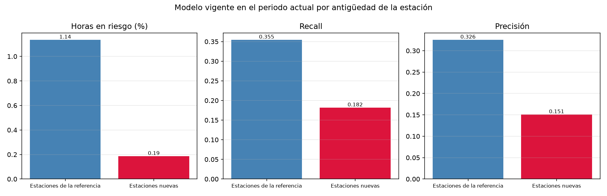

### Versión alternativa en el Model Registry

`mibici/modeling/reentrenar.py` lee de la corrida de origen del `champion` su algoritmo y sus hiperparámetros (`HistGradientBoostingClassifier` balanceado, `learning_rate` 0.1, 200 árboles, sin límite de profundidad) y entrena esa misma receta con más datos, de modo que el *A/B* mida el efecto de los datos y no el de otro algoritmo:

| | Versión 1 (`champion`) | Versión 3 (`challenger`) |
|---|---|---|
| Corrida | `p2_hgb_mejor` | `p2_hgb_reentrenado` |
| Entrenamiento | 1 de enero al 30 de septiembre de 2025 (2,339,422 filas) | 1 de enero de 2025 al 31 de mayo de 2026 (4,488,274 filas) |
| Validación para el umbral | Octubre de 2025 | Junio de 2026 (280,336 filas) |
| Umbral de decisión | 0.92 | 0.94 |
| Datos | `7aa5e436d887` | `7aa5e436d887+f396cd21ea7d` |

La versión nueva se registra con `registry.registrar_version` como versión 3 del mismo modelo y recibe el alias `challenger`, con el linaje de siempre (corrida, commit, versión de los datos, `test_costo` y `threshold`) más las etiquetas `entrega`, `origen`, `receta_de_la_version`, `periodo_entrenamiento`, `periodo_validacion` y `periodo_evaluacion`. La versión 2 (`p2_bosque`), que tenía ese alias desde la segunda entrega, lo cede porque un alias apunta a una sola versión: conserva su registro, su corrida y sus artefactos, y queda anotada con `alias_anterior=challenger` y `relevada_por=3`. El alias `champion` no se toca en este paso.

### A/B testing

La regla de decisión está escrita en `mibici/modeling/abtest.py` (`REGLA`, `CONFIANZA` y `MARGEN_RECALL`) y se fijó antes de registrar la versión 3 y de calcular cualquier resultado:

> La versión B se promueve a champion solo si, sobre el conjunto de evaluación, se cumplen las dos condiciones: (1) el intervalo de confianza de 95 % de la diferencia de costo por mil horas-estación (B menos A), calculado por bootstrap de bloques de un día sobre la comparación pareada, queda completo por debajo de cero; y (2) el límite inferior del intervalo de 95 % de la diferencia de recall (B menos A) no baja de -0.01. Si alguna falla, el alias champion no se mueve y la versión B conserva el alias challenger.

Diseño. Las dos versiones se cargan del Model Registry y predicen las mismas 1,001,082 horas-estación de julio a septiembre de 2026 (92 días, 10,232 horas en riesgo), cada una con el umbral que lleva dentro. La comparación es pareada: mismas filas, diferencias con intervalos por bootstrap de 2,000 réplicas que remuestrean días completos con los mismos días para las dos versiones (las horas de un día no son independientes entre sí), y prueba de McNemar sobre los pares discordantes. Aparte se simula el experimento como correría en producción: cada hora-estación se asigna al azar a una versión (50 % a cada una, semilla 42) y solo se cuenta la respuesta de la versión asignada.

| Métrica | A, versión 1 | B, versión 3 | B menos A | IC de 95 % |
|---|---|---|---|---|
| Recall | 0.3664 | 0.3258 | -0.0406 | -0.0448 a -0.0358 |
| Precisión | 0.3269 | 0.4074 | +0.0805 | +0.0740 a +0.0871 |
| F1 | 0.3455 | 0.3621 | +0.0166 | +0.0117 a +0.0214 |
| PR-AUC | 0.3338 | 0.3474 | +0.0136 | |
| Alertas | 11,470 | 8,184 | -3,286 | |
| Falsos positivos | 7,721 | 4,850 | -2,871 | |
| Falsos negativos | 6,483 | 6,898 | +415 | |
| Costo | 40,136 | 39,340 | -796 | |
| Costo por mil horas-estación | 40.09 | 39.30 | -0.80 | -1.08 a -0.51 |
| Costo frente a no alertar | 0.7845 | 0.7690 | -0.0156 | |

- McNemar: de las 4,028 horas-estación en que las versiones difieren, B acierta sola en 3,242 y A en 786 (valor p menor que 0.001). Separado por clase, B evita 3,148 falsas alertas de A y agrega 277, pero entre las horas en riesgo A acierta sola en 509 y B en 94.
- Tráfico dividido: con la mitad de las filas en cada brazo, B cuesta 38.92 por mil horas-estación contra 40.64 de A; la diferencia es -1.72 (IC de 95 % de -3.31 a -0.18), del mismo signo que la comparación pareada y con un intervalo más ancho porque cada brazo ve la mitad de los datos y no las mismas filas.
- Octubre de 2026, fuera de la regla: la diferencia se sostiene (costo por mil -1.06, IC de -1.74 a -0.41; recall -0.0542, IC de -0.0638 a -0.0439).

Decisión. La condición de costo se cumple (el intervalo queda completo por debajo de cero) y la de recall no (el límite inferior es -0.0448 frente al margen de -0.01): B ahorra 2,871 viajes de camión innecesarios a cambio de dejar sin aviso 415 horas en riesgo más. La regla dice mantener la versión A; el alias `champion` sigue en la versión 1 y la versión 3 conserva el alias `challenger`. `reports/monitoreo/abtest.md` trae las tablas completas y la corrida `p2_abtest_v1_v3` queda en el experimento con sus métricas y artefactos.

Análisis posterior a la decisión, que no la cambia. Para separar lo que aporta el reentrenamiento de lo que cambia el umbral, se busca el umbral con que B alcanza el recall de A en la evaluación (0.9279 en lugar de 0.94) y se repite la comparación: a igual recall B emite 788 alertas menos y cuesta 0.79 menos por mil horas-estación (IC de -1.03 a -0.56), y con ese umbral ya fijo, en octubre, cuesta 0.91 menos (IC de -1.44 a -0.39) con un recall de 0.3723 contra 0.3798. El reentrenamiento sí ordena mejor las horas (PR-AUC 0.3474 contra 0.3338); lo que hizo perder recall a la versión 3 fue elegir su umbral con un solo mes, junio de 2026, que es justo el mes atípico del periodo.

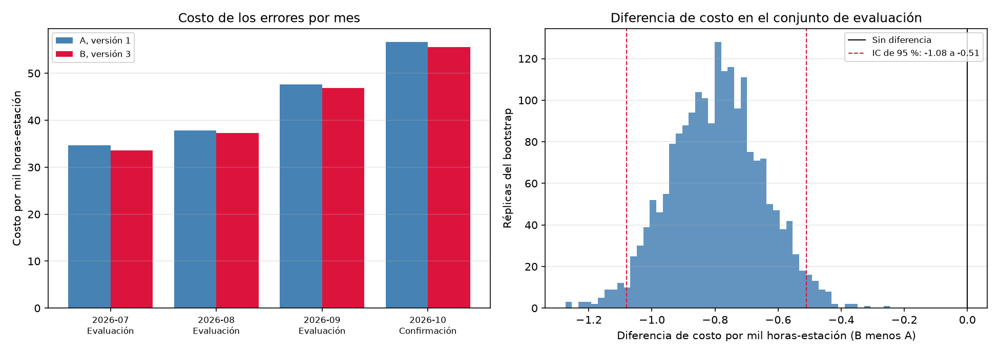

### Recomendación de Continuous Training

Sí conviene reentrenar de forma continua, pero como candidato programado con promoción condicionada, no como reemplazo automático.

- Decisión de hoy: la versión 1 sigue como `champion`. La versión 3 no se promueve porque no cumple la regla, y queda como `challenger`.
- Por qué reentrenar: con la misma receta y ocho meses más de datos el modelo ordena mejor (PR-AUC +0.0136) y, a igual recall, reduce 2.0 % el costo de los errores en la evaluación y 1.6 % en octubre. Entrenar cuesta poco (minuto y medio de ajuste con 4.5 millones de filas, tres y medio con el registro, y un modelo de 0.7 MB), así que el costo real del ciclo está en evaluar, no en entrenar.
- Por qué no promover en automático: el `champion` no se ha degradado de forma sostenida (costo frente a no alertar entre 0.757 y 0.798 en nueve de los diez meses de 2026, contra 0.787 en su prueba) y un reentrenamiento mal calibrado pierde recall, que es lo que la operación protege.
- Disparadores medidos en esta entrega, revisados cada mes con `make monitor` cuando el portal publica el mes anterior: (1) deriva del conjunto en el reporte mensual de Evidently, al menos 8 de las 16 columnas sobre 0.1 (ocurrió en mayo y en agosto de 2026); (2) costo frente a no alertar del mes más de 5 % por encima del de la prueba (0.826), que solo junio de 2026 rebasa (0.869); el recall solo no basta, porque enero perdió 11.8 % con el costo casi intacto; (3) estaciones que el modelo no vio en su entrenamiento con más de 5 % de las horas-estación del mes (1.45 % de enero a junio y 18.9 % de julio a septiembre). La tasa de riesgo sola no sirve de disparador: cayó 38 % sin que el modelo perdiera desempeño.
- Ciclo propuesto: cualquier disparador lanza `make reentrenar`; el candidato entra como `challenger` y se compara con `make abtest` sobre los meses siguientes; solo la regla mueve el alias, y la versión anterior conserva su registro para revertir con un comando. La etiqueta de P2 se conoce dos horas después de cada predicción, así que el desempeño se puede vigilar sin esperar al cierre del mes.
- Cambio para el siguiente candidato: elegir el umbral con una ventana de validación de tres meses y no de uno, que es lo que el análisis posterior señala como causa de la pérdida de recall.

### Pruebas del monitoreo

Las tres suites nuevas usan datos sintéticos y un registry temporal en SQLite, de modo que no dependen del portal ni del registry del equipo: `tests/test_monitoreo.py` (15 pruebas: ventanas sin huecos ni traslapes, ingesta en archivos aparte con el portal simulado, tabla de monitoreo que conserva la partición de 2025, reporte de Evidently con la prueba de cada tipo de columna, mes de alerta, descomposición de la tasa, desempeño por mes y por antigüedad de la estación, y puntos de entrada del `MLproject`), `tests/test_reentrenar.py` (4 pruebas: cortes del reentrenamiento, receta leída del `champion`, versión 3 como `challenger` y versión 2 anotada) y `tests/test_abtest.py` (8 pruebas: McNemar exacta y con ji cuadrada, bootstrap pareado y reproducible, tráfico dividido, las cuatro combinaciones de la regla y el cambio de alias). Con ellas la suite completa tiene 105 pruebas.

## Flujo de trabajo con Git y GitHub

- GitHub Flow: `main` siempre está en estado entregable. Cada cambio nace en una rama corta creada desde `main`, se publica en GitHub, se abre un *Pull Request*, otro integrante lo revisa, se integra y la rama se borra.
- Rama principal protegida: `main` exige *Pull Request* con una aprobación y bloquea el *force push* y el borrado de la rama. Los tres primeros *commits* (estructura generada con `ccds`, configuración inicial y README) entraron directo a `main` antes de activar la protección; desde entonces todo entra por *Pull Request*.
- Solo integración con *merge commit* (*squash* y *rebase* desactivados en la configuración del repositorio), para que los *commits* de cada rama, que son los que etiquetan las corridas de MLflow en `commit_git`, queden en el historial de `main`.
- Ramas: `tipo/descripcion-corta` en minúsculas y sin acentos, por ejemplo `feat/ingesta`, `feat/mlflow-project-registry`, `fix/features-particion-perfiles`.
- *Commits*: [Conventional Commits](https://www.conventionalcommits.org/es/v1.0.0/) en español, con los tipos `feat`, `fix`, `docs`, `test`, `refactor` y `chore`; asunto en minúsculas, sin punto final y de no más de 72 caracteres, por ejemplo `feat: búsqueda de hiperparámetros con nested runs`.
- Cada integrante abre al menos un *Pull Request* y revisa al menos uno de otro integrante; las revisiones se cruzan en anillo.
- Primera entrega, en el orden en que se integraron: `feat/ingesta` (`dataset.py`, manifiesto y pruebas), `feat/features` (`features.py`, pruebas y notebook de exploración), `feat/experimento-base` (`train.py`, `predict.py`, `plots.py`, `MLproject` y entorno) y `docs/referencias` (ML Canvas, diagrama de arquitectura y resultados del experimento base).
- Segunda entrega, en el orden en que se integran porque la primera rama consume lo que deja la segunda: `feat/model-registry` (`registry.py`, `predict.py` con carga por alias y `tests/test_registry.py`), `feat/mlflow-project-registry` (`MLproject`, `python_env.yaml`, `Makefile`, `artefactos.py`, `train.py`, `search.py`, pruebas y este README) y `fix/features-particion-perfiles` (corrección de `features.py` señalada en la revisión de la primera entrega: en P2 se excluyen de entrenamiento y validación las horas cuya ventana objetivo cruza el corte siguiente y en P3 los perfiles se alinean sobre la unión de estaciones con salidas y llegadas; entra después de las corridas de esta entrega para que sus `commit_git` reproduzcan exactamente lo que se midió, y se aplica en la siguiente iteración de los modelos).
- Tercera entrega, en el orden en que se integran: `feat/tests-reproducibilidad-deepchecks` (`pytest.ini`, `tests/test_reproducibilidad.py`, `tests/test_search.py`, `tests/test_predict.py` y los casos límite de `tests/test_train.py`; `mibici/validacion.py`, `chequeos/validar_datos.py`, `requirements-deepchecks.txt` y `reports/deepchecks/`; la corrección de bandit en `train.py`, `[tool.bandit]` en `pyproject.toml` y MLflow 3.17.2 en `requirements.txt` y `python_env.yaml`; `Makefile`, `.gitignore` y este README), `feat/chequeos-seguridad` (`tests/test_seguridad.py`, `.env.example`, `chequeos/secretos.py` y la evidencia de `reports/seguridad/`) y `test/casos-limite-datos-features` (casos límite de `tests/test_dataset.py` y `tests/test_features.py`). Cada rama pasa `python -m pytest -q tests` por separado antes de abrir su *Pull Request*, y la integración cierra con `make verificar` sobre `main`.
- Cuarta entrega, en el orden en que se integran: `feat/api-rest-contenedor` (`api/`, `.env.example`, `requirements.txt`, las capturas y este README), `feat/api-pruebas-ejemplos` (`tests/conftest.py`, `tests/test_api.py`, `api/ejemplos/` y `tests/test_api_ejemplos.py`) y `feat/api-contenedor-herramientas` (`Containerfile`, `.dockerignore`, `requirements-api.txt`, `scripts/probar_api.py` y los objetivos `api`, `imagen`, `contenedor`, `probar-api` y `exportar-modelo` del `Makefile`). Las dos últimas parten de `main` con la primera integrada, porque sus pruebas, su imagen y su script usan `api/`; cada *Pull Request* lo integra con *merge commit* quien lo revisa, y la integración cierra con `make verificar` sobre `main` y con el contenedor respondiendo a `make probar-api`.
- Quinta entrega, en el orden en que se integran: `feat/monitoreo-drift` (`mibici/config.py`, `mibici/monitoreo/datos.py`, `drift.py`, `costos.py`, `graficas.py` y `formato.py`, `data/manifiesto_actual.json`, Evidently en `requirements.txt` y `python_env.yaml`, `.gitignore`, la lista blanca del segundo manifiesto en `chequeos/secretos.py` y `tests/test_seguridad.py`, y los reportes y capturas del *drift*), `feat/ab-testing-versiones` (`mibici/modeling/reentrenar.py` y `abtest.py`, `tests/test_reentrenar.py`, `tests/test_abtest.py` y el reporte del *A/B*) y `feat/monitoreo-herramientas` (`mibici/monitoreo/desempeno.py`, los puntos de entrada del `MLproject`, los objetivos del `Makefile`, `tests/test_monitoreo.py`, los reportes de desempeño y este README). Las dos últimas parten de `main` con la primera integrada, porque usan `mibici/monitoreo/`; entre ellas no hay dependencia y se integran en cualquier orden.
- Nada de datos de MiBici, modelos serializados, carpetas de MLflow ni credenciales en el historial: `.gitignore` los excluye y los *Pull Requests* se revisan también con ese criterio.

## Integrantes y roles

El trabajo se repartió por etapas del *pipeline*, que es la separación que propone la plantilla: cada integrante es responsable de un módulo con una interfaz definida y revisa el módulo vecino.

| Integrante | Matrícula | Rol en el proyecto | Primera entrega | Segunda entrega | Tercera entrega | Cuarta entrega | Quinta entrega |
|---|---|---|---|---|---|---|---|
| José Andrés Hernández Guerra | A01840564 | Datos e ingesta; Model Registry; seguridad del repositorio | `mibici/dataset.py`, `data/manifiesto.json` y `tests/test_dataset.py` (rama `feat/ingesta`); revisión del *Pull Request* de *features* | `mibici/modeling/registry.py`, `mibici/modeling/predict.py` y `tests/test_registry.py` (rama `feat/model-registry`); revisión del *Pull Request* del MLflow Project | `tests/test_seguridad.py`, `.env.example`, `chequeos/secretos.py` y la evidencia fechada de `reports/seguridad/` (rama `feat/chequeos-seguridad`); revisión del *Pull Request* de pruebas y DeepChecks | `tests/conftest.py` y `tests/test_api.py` (las 23 pruebas del servicio con `TestClient` y un modelo mínimo), `api/ejemplos/` (petición, lote y respuesta de la corrida real) y `tests/test_api_ejemplos.py` (rama `feat/api-pruebas-ejemplos`); revisión e integración del *Pull Request* del servicio | `mibici/modeling/reentrenar.py` (versión alternativa con la receta del `champion` y su registro como `challenger`) y `mibici/modeling/abtest.py` (comparación pareada, McNemar, bootstrap por día, tráfico dividido y regla de decisión), con `tests/test_reentrenar.py`, `tests/test_abtest.py` y el reporte del *A/B* en `reports/monitoreo/` (rama `feat/ab-testing-versiones`); revisión e integración del *Pull Request* del monitoreo y el *drift* |
| Miguel Angel Higuera López | A01451684 | *Features* y exploración; casos límite de datos | `mibici/features.py`, `tests/test_features.py` y `notebooks/1.0-mah-exploracion-mibici.ipynb` (rama `feat/features`); revisión del *Pull Request* de ingesta | Corrección de la partición de P2 y de los perfiles de P3 en `mibici/features.py` con sus pruebas (rama `fix/features-particion-perfiles`); revisión del *Pull Request* del Model Registry | Casos límite de `limpiar_viajes` y `normalizar_nombre` en `tests/test_dataset.py` y de `particion_temporal`, `sin_ventana_posterior`, `etiquetar_riesgo` y `perfiles_por_estacion` en `tests/test_features.py` (rama `test/casos-limite-datos-features`); revisión del *Pull Request* de chequeos de seguridad | `Containerfile`, `.dockerignore` y `requirements-api.txt` (la imagen del servicio), `scripts/probar_api.py` y los objetivos `api`, `imagen`, `contenedor`, `probar-api` y `exportar-modelo` del `Makefile` (rama `feat/api-contenedor-herramientas`); revisión e integración del *Pull Request* de pruebas y ejemplos | `mibici/monitoreo/desempeno.py` (desempeño mensual del modelo vigente, descomposición de la tasa de riesgo y estaciones nuevas), puntos de entrada `ingest_actual`, `monitor`, `reentrenar` y `abtest` del `MLproject`, objetivos del `Makefile`, `tests/test_monitoreo.py`, los reportes de desempeño y la sección Monitoreo y drift de este README (rama `feat/monitoreo-herramientas`); revisión e integración del *Pull Request* de la versión alternativa y el *A/B* |
| Nicolás Hernández Ynurreta García | A01284528 | Integración y MLOps | Estructura con `ccds`, configuración, README, experimento base en MLflow, ML Canvas y diagrama, documento de la propuesta, revisión e integración | `MLproject`, `python_env.yaml`, `Makefile`, `artefactos.py`, `train.py`, `search.py` y sus pruebas (rama `feat/mlflow-project-registry`); corridas de la entrega, selección y registro de los modelos, reporte, revisión de los *Pull Requests* del equipo e integración | Prueba de reproducibilidad, `tests/test_search.py`, `tests/test_predict.py` y casos límite de `train`; validación con DeepChecks (`mibici/validacion.py`, `chequeos/validar_datos.py`, `reports/deepchecks/`); corrección de bandit y MLflow 3.17.2; `Makefile`, `.gitignore`, capturas y este README (rama `feat/tests-reproducibilidad-deepchecks`); revisión del *Pull Request* de casos límite e integración | Servicio de predicción (`api/`) con sus esquemas y la carga desde el registry, `.env.example`, `requirements.txt`, imagen y contenedor probados, capturas y este README (rama `feat/api-rest-contenedor`); revisión e integración del *Pull Request* de la imagen y las herramientas | Ingesta del periodo actual con su manifiesto, tabla de monitoreo con la predicción del `champion`, reporte de *drift* y de calidad con Evidently, métricas de costo, figuras, reportes y capturas (rama `feat/monitoreo-drift`); corridas de monitoreo, reentrenamiento y *A/B* sobre el registry del equipo; revisión e integración del *Pull Request* del desempeño, los comandos y el README |

El equipo quedó integrado por tres personas: la cuarta inscripción registrada en Canvas está inactiva.

## Buenas prácticas

| Ámbito | Práctica | Dónde se cumple en este repositorio |
|---|---|---|
| MLflow Projects | Proyecto ejecutable con un solo comando y entorno declarado | `MLproject` con `ingest`, `train` y `search`; `python_env.yaml` con las versiones de `requirements.txt` |
| MLflow Tracking | Un experimento por proyecto y *runs* con nombre descriptivo | Experimento `mibici-equipo38` y `run_name` en cada comando; `train.py` y `search.py` nombran cada corrida |
| MLflow Tracking | Registrar todo lo necesario para reproducir el *run* | Parámetros de rango de fechas, `version_datos`, semilla, modelo e hiperparámetros, partición; `config/` con las constantes y los argumentos |
| MLflow Tracking | Ligar cada *run* con el código, la pregunta y la etapa del trabajo | Etiquetas `commit_git`, `rama`, `question`, `pregunta`, `model_family`, `stage_of_work` y `equipo` |
| MLflow Tracking | Nombrar las métricas con el conjunto en que se calculan | `val_mae`, `test_mae`, `test_costo`, `train_silhouette`, etc. |
| MLflow Tracking | Búsquedas organizadas como *nested runs* | `search.py`: una corrida padre por búsqueda y una hija por combinación |
| Artefactos | Modelo con firma y ejemplo de entrada, versión de los datos, gráficas y configuración, en subcarpetas | `artefactos.py`: `plots/`, `data/`, `config/`, `log_input` y `modelo` |
| Model Registry | Nombre claro, descripción, linaje y versión en producción por alias | `registry.py`: `mibici-equipo38-p<N>-...`, etiquetas de versión y alias `champion` y `challenger` |
| Datos | No registrar credenciales ni datos personales | Las columnas personales se descartan en `dataset.py`; ningún parámetro, etiqueta o artefacto las contiene |
| Estructura y código | Notebooks solo para exploración; configuración en un solo lugar | `notebooks/`; `mibici/config.py` |
| Estructura y código | Dependencias con versión fija y entorno reproducible desde un clon limpio | `requirements.txt`, `python_env.yaml` y la sección Instalación |
| Datos y Git | Ningún dato, modelo, base de datos de MLflow ni credencial en el historial | `.gitignore` (datos, Parquet, `mlruns/`, `mlartifacts/`, `mlflow.db`, `models/`, `.env`) |
| Datos y Git | Todo cambio entra a `main` por *Pull Request* revisado | Rama `main` protegida con una aprobación y pestaña de *Pull Requests* del repositorio |
| Pruebas | Una suite por módulo con casos normales y límite, reproducibilidad con semilla fija y un solo comando que corre todo | `tests/`, `pytest.ini`, `make test` y `make verificar` |
| Datos | Validación de integridad y de deriva entre conjuntos con condiciones explícitas y hallazgos documentados, no ocultos | `chequeos/validar_datos.py` y `reports/deepchecks/resumen.md` |
| Seguridad | Análisis estático del código y de las dependencias con hallazgos corregidos o justificados, variables de entorno para la configuración y búsqueda de secretos en el historial | `[tool.bandit]` en `pyproject.toml`, `.env.example`, `chequeos/secretos.py`, `tests/test_seguridad.py` y `reports/seguridad/` |
| Despliegue | El servicio carga el modelo por nombre y alias desde el registry, una sola vez al arrancar, y devuelve en cada respuesta la versión a la que resolvió | `api/modelo.py`, `/metadata` y el campo `modelo` de `RespuestaRiesgo` |
| Despliegue | Entradas y salidas validadas con esquemas explícitos, campos desconocidos rechazados y el DataFrame reconstruido con el orden y los tipos de la firma | `api/esquemas.py` (`extra="forbid"`, rangos, variables derivadas), `response_model` y `api/modelo.py` |
| Despliegue | Imagen reproducible con las versiones del entrenamiento, usuario sin privilegios, `HEALTHCHECK` y configuración por variables de entorno; nada de datos ni modelos en el contexto | `Containerfile`, `requirements-api.txt`, `.dockerignore`, `MLFLOW_TRACKING_URI` y `RUTA_MODELO` |
| Monitoreo | Referencia igual al conjunto de entrenamiento del modelo en producción, periodo actual en archivos aparte y versionado con su propio manifiesto | `mibici/monitoreo/datos.py`, `data/manifiesto_actual.json` y las fechas de `config.py` |
| Monitoreo | Reporte de *drift* y de calidad reproducible con un comando, con la prueba y el umbral fijos en el código, revisado mes a mes y leído junto con el desempeño del modelo | `mibici/monitoreo/drift.py`, `desempeno.py`, `make monitor` y `reports/monitoreo/` |
| Monitoreo | Versión alternativa registrada como `challenger` y promovida solo por una regla escrita antes del resultado, sobre un periodo que ninguna versión vio | `mibici/modeling/reentrenar.py`, `abtest.py` (`REGLA`) y `reports/monitoreo/abtest.md` |
