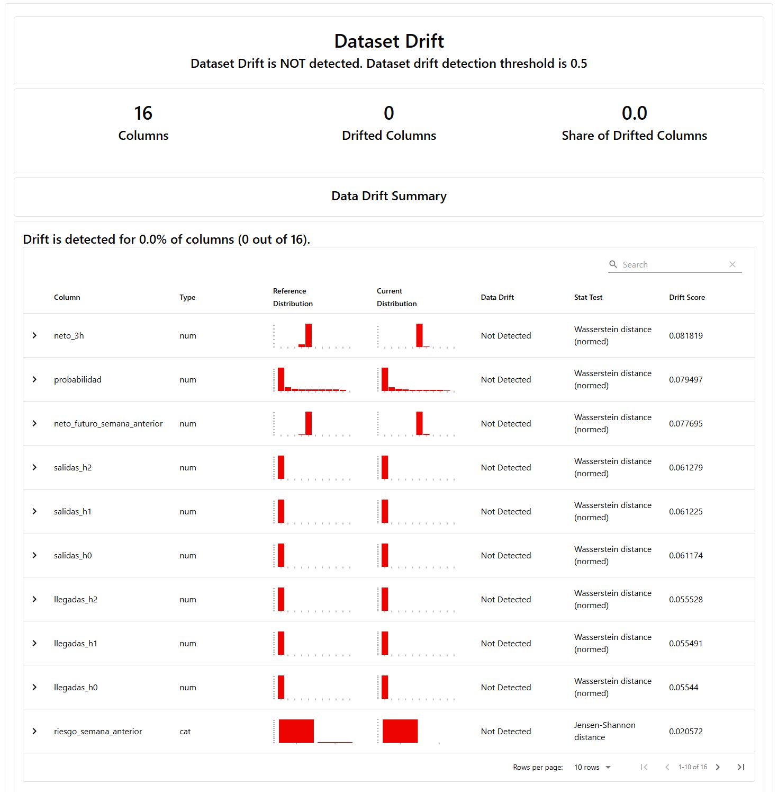
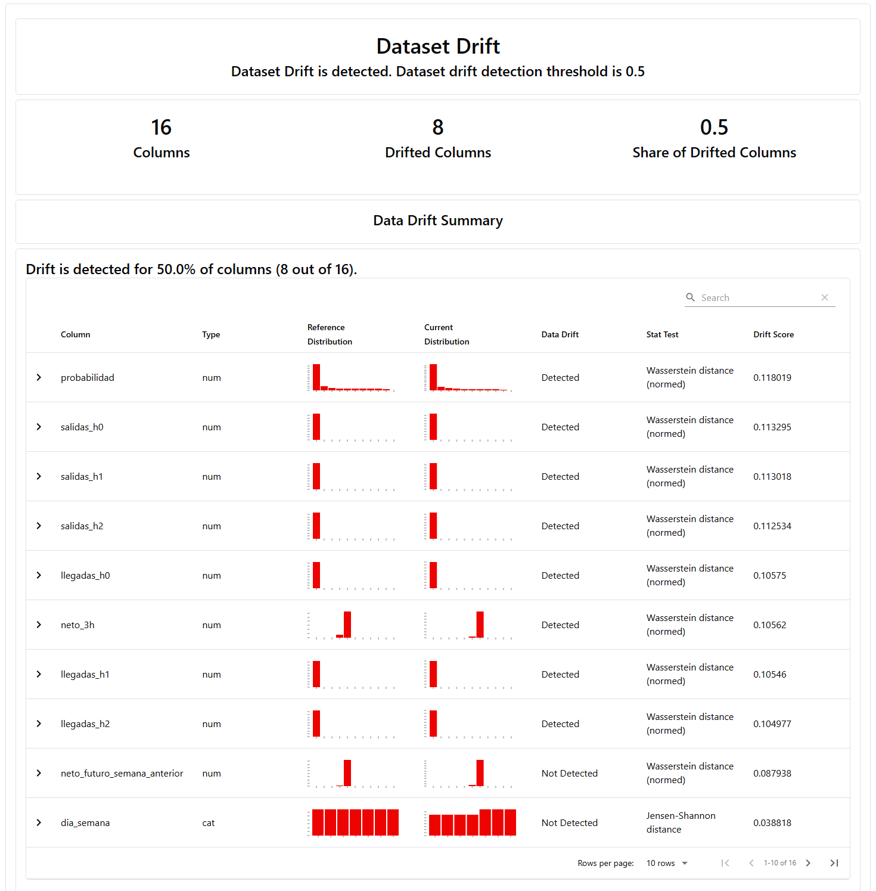
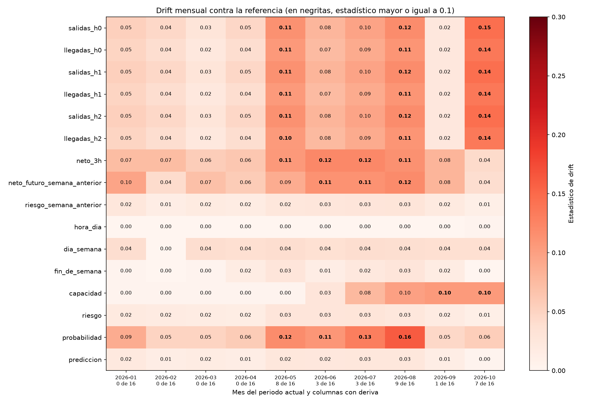
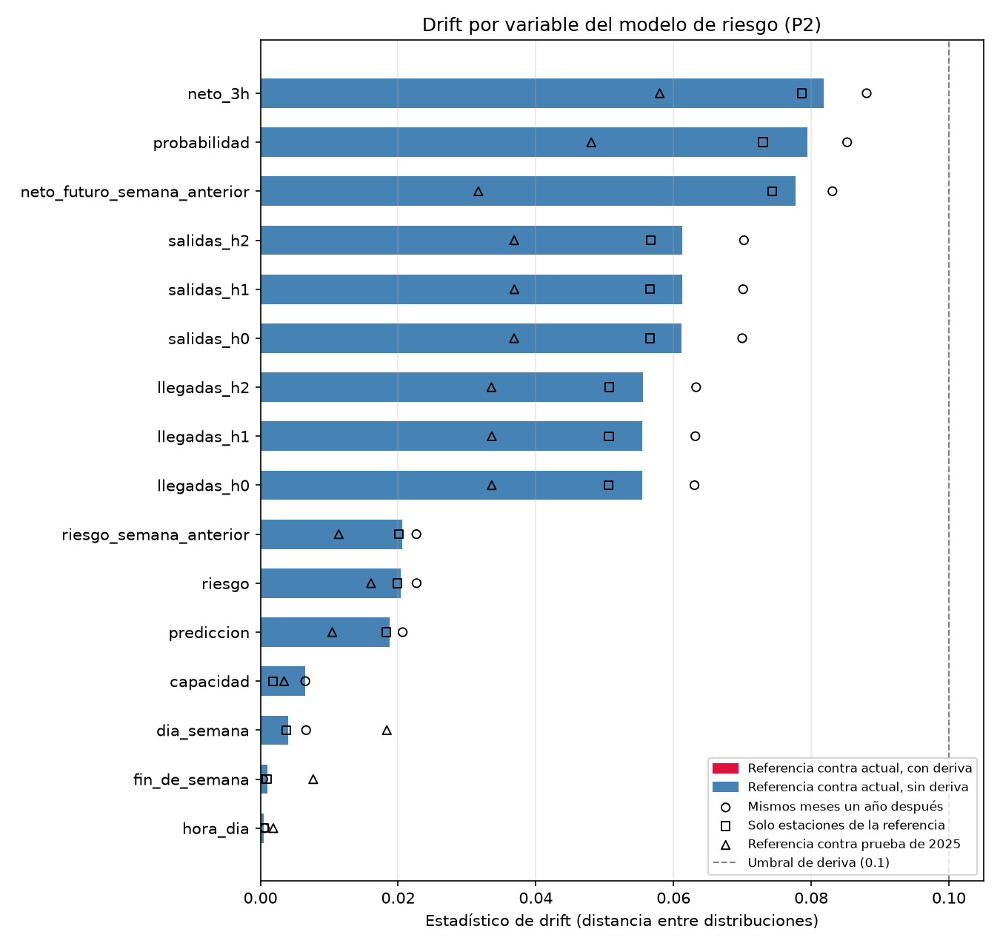
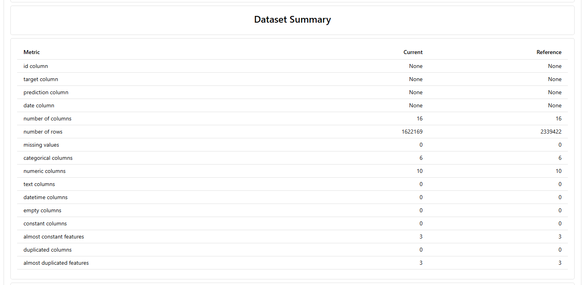
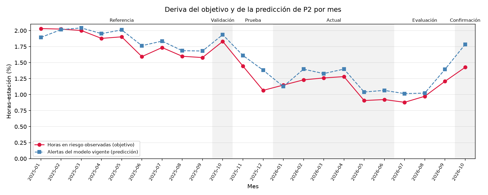
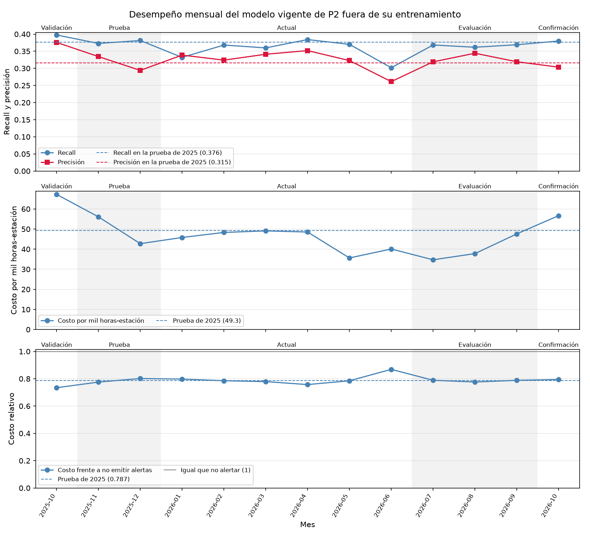
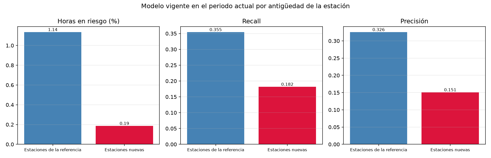
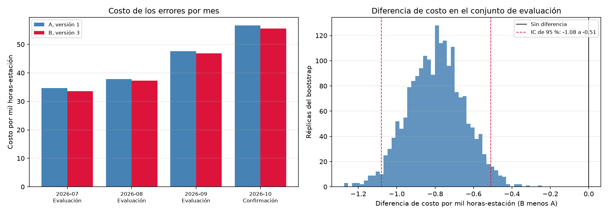

# Monitoreo y drift

La quinta entrega agrega la capa de observabilidad del modelo en producción de P2 (`mibici-equipo38-p2-riesgo`, el que sirve la API): ingesta del periodo posterior al entrenamiento en archivos aparte, reporte de *drift* y de calidad de datos con [Evidently](https://docs.evidentlyai.com/introduction), desempeño del modelo vigente mes a mes, una versión alternativa reentrenada y registrada en el Model Registry, un *A/B testing* entre las dos versiones con la regla de decisión escrita de antemano y una recomendación de *Continuous Training*. Los reportes quedan en `reports/monitoreo/` y las figuras en `reports/figures/`.

## Archivos

```
├── data
│   └── manifiesto_actual.json   <- versión de los datos del periodo actual (URL, tamaño y SHA-256 de cada mes, limpieza por mes)
├── mibici
│   ├── monitoreo
│   │   ├── datos.py             <- ingesta del periodo actual y tabla de monitoreo de P2 con la predicción del modelo vigente
│   │   ├── drift.py             <- reporte de drift y de calidad con Evidently, comparaciones de control, serie mensual y resumen
│   │   ├── desempeno.py         <- desempeño del modelo vigente por conjunto, por mes y por antigüedad de la estación
│   │   ├── costos.py            <- métricas y costo de los errores de P2, comunes al desempeño mensual y al A/B
│   │   ├── graficas.py          <- figuras del drift y del desempeño
│   │   └── formato.py           <- tablas y números de los reportes en Markdown
│   └── modeling
│       ├── reentrenar.py        <- versión alternativa: receta del champion sobre 2025 más el periodo actual, registrada como challenger
│       └── abtest.py            <- A/B testing de dos versiones registradas, regla de decisión y cambio de alias
├── reports
│   ├── monitoreo                <- resumen.md, drift.json y evidently_p2*.json (drift); desempeno.md y .json; abtest.md y .json
│   └── figures                  <- drift_*.png, evidently_*.png, desempeno_*.png y abtest_costo.png
└── tests
    ├── test_monitoreo.py        <- ventanas, ingesta aparte, tabla de monitoreo, reporte de Evidently, desempeño y MLproject
    ├── test_reentrenar.py       <- cortes del reentrenamiento y registro de la versión como challenger en un registry temporal
    └── test_abtest.py           <- McNemar, bootstrap por día, tráfico dividido, regla de decisión y cambio de alias
```

Los HTML interactivos de Evidently (`reports/monitoreo/evidently_p2.html` y `evidently_p2_alerta.html`, 4.7 MB cada uno) quedan fuera de Git, como los de DeepChecks, y se regeneran con un comando; sus métricas (`evidently_p2.json` y `evidently_p2_alerta.json`) y sus capturas sí se versionan.

## Conjuntos y periodos

| Conjunto | Periodo | Horas-estación | Estaciones | Horas en riesgo | Para qué se usa |
|---|---|---|---|---|---|
| Referencia | 1 de enero al 30 de septiembre de 2025 | 2,339,422 | 369 | 42,327 (1.81 %) | Conjunto de entrenamiento del `champion` (versión 1); es contra lo que se mide el *drift* |
| Validación de 2025 | Octubre de 2025 | 272,496 | 368 | 4,989 (1.83 %) | Mes con que el `champion` eligió su umbral de decisión |
| Prueba de 2025 | Noviembre y diciembre de 2025 | 536,089 | 368 | 6,718 (1.25 %) | Desempeño del `champion` fuera de su entrenamiento, que sirve de base para medir su degradación |
| Actual | 1 de enero al 30 de junio de 2026 | 1,622,169 | 412 | 18,196 (1.12 %) | Periodo en producción que se compara contra la referencia; con él se reentrena la versión alternativa |
| Evaluación | 1 de julio al 30 de septiembre de 2026 | 1,001,082 | 469 | 10,232 (1.02 %) | Conjunto del *A/B testing*: ninguna de las dos versiones lo usó para entrenar ni para elegir su umbral |
| Confirmación | Octubre de 2026 | 346,775 | 469 | 4,947 (1.43 %) | Último mes publicado; no entra en la regla del *A/B* y muestra si el resultado se sostiene |

- La referencia es la partición con que se entrenó el modelo que hoy está en producción: `armar_tabla` la obtiene con `features.conjuntos_p2` sobre los viajes de 2025 y reproduce sus 2,339,422 filas y 42,327 horas en riesgo. Medir el *drift* contra otro periodo diría cuánto cambió la ciudad, no cuánto se alejó la producción de lo que el modelo aprendió.
- El periodo actual son los seis primeros meses de 2026, lo que el modelo atendió sin reentrenarse. Como esos mismos meses existen en la referencia, una comparación de control con enero a junio de 2025 separa el cambio de un año a otro de la estacionalidad.
- Julio a septiembre de 2026 queda reservado para el *A/B*: es posterior a todo lo que vieron las dos versiones. Octubre, el último mes que publica el portal, queda fuera de la regla y sirve de confirmación.
- Las fechas viven en `config.py` (`FECHA_INICIO_ACTUAL`, `FECHA_FIN_ACTUAL`, `FIN_REENTRENAMIENTO`, `FIN_MONITOREO` y `FIN_EVALUACION`). Las filas de 2026 se calculan sobre la serie continua de los dos años, para que la primera semana de enero tenga sus rezagos y la etiqueta de la semana anterior, como ocurre en producción. Cada fila es una estación en una hora con las 13 variables de entrada de P2, la etiqueta de riesgo y la probabilidad y la clase que asigna el `champion`.
- La ingesta del periodo actual (`python -m mibici.monitoreo.datos --ingerir`) descarga los diez meses de 2026 que publica el portal (3,997,597 registros en 347.0 MB), aplica la misma `limpiar_viajes` y escribe `data/processed/viajes_actual.parquet` (3,840,981 viajes válidos) y `data/manifiesto_actual.json` (`version_datos` `f396cd21ea7d`). No toca `viajes.parquet` ni `data/manifiesto.json` de 2025, y usa la misma nomenclatura de estaciones para que la capacidad de cada estación sea la que vio el modelo.

## Comandos

Con el servidor de tracking levantado y `MLFLOW_TRACKING_URI` apuntando a él (sección Servidor de tracking), en este orden:

```
mlflow run . -e ingest_actual --experiment-name mibici-equipo38 --env-manager local
mlflow run . -e monitor -P version=1 --experiment-name mibici-equipo38 --env-manager local
mlflow run . -e reentrenar --experiment-name mibici-equipo38 --env-manager local
mlflow run . -e abtest -P promote=1 --experiment-name mibici-equipo38 --env-manager local
```

| Objetivo de `make` | Punto de entrada | Comando directo | Qué deja |
|---|---|---|---|
| `make ingest-actual` | `ingest_actual` | `python -m mibici.monitoreo.datos --ingerir` | `data/processed/viajes_actual.parquet` y `data/manifiesto_actual.json` |
| `make monitor` | `monitor` | `python -m mibici.monitoreo.datos --exportar`, `python -m mibici.monitoreo.drift --registrar` y `python -m mibici.monitoreo.desempeno` | `data/interim/monitoreo_p2.parquet`; `reports/monitoreo/resumen.md`, `drift.json`, `evidently_p2.html` y `.json`, `evidently_p2_alerta.html` y `.json`; `desempeno.md` y `.json`; figuras `drift_*.png` y `desempeno_*.png`; corrida `p2_monitoreo_drift` |
| `make reentrenar` | `reentrenar` | `python -m mibici.modeling.reentrenar` | Corrida `p2_hgb_reentrenado` y versión nueva de `mibici-equipo38-p2-riesgo` con alias `challenger` |
| `make abtest` (`make abtest PROMOVER=1`) | `abtest` | `python -m mibici.modeling.abtest` (`--promover`) | `reports/monitoreo/abtest.md` y `.json`, `reports/figures/abtest_costo.png` y corrida `p2_abtest_v<A>_v<B>`; con `--promover`, el alias `champion` se mueve solo si la regla se cumple |

`monitor` predice con el alias `champion`; `-P version=1` (o `--version 1`) fija la versión, que es lo que reproduce las cifras de esta entrega aunque el alias cambie después. `abtest` compara por defecto `champion` contra `challenger` y acepta `-P version_a=1 -P version_b=3`. El reporte de *drift* tarda unos ocho minutos con los 2.3 millones de filas de la referencia y la tabla de monitoreo, dos; el reentrenamiento, tres y medio; el *A/B*, uno.

## Reporte de drift con Evidently

`mibici/monitoreo/drift.py` usa la API actual de Evidently 0.7.23 (`from evidently import Report`, `from evidently.presets import DataDriftPreset, DataSummaryPreset` y `Report([...]).run(actual, referencia)`) sobre 16 columnas: las 13 variables de entrada, la etiqueta `riesgo` (objetivo) y la probabilidad y la clase que asigna el modelo (predicción). Las pruebas se fijan en el código para que no dependan del tamaño de la muestra: distancia de Wasserstein normalizada en las diez columnas numéricas y distancia de Jensen-Shannon en las seis categóricas, con deriva cuando el estadístico alcanza 0.1 y deriva del conjunto cuando deriva al menos la mitad de las columnas. Con millones de filas una prueba de hipótesis rechazaría la igualdad en todas las columnas; una distancia con umbral mide si el cambio es grande, no si existe.

| Comparación | Columnas con deriva | Estadísticos mayores |
|---|---|---|
| Referencia contra actual (reporte principal) | 0 de 16 | `neto_3h` 0.082, `probabilidad` 0.079, `neto_futuro_semana_anterior` 0.078, salidas 0.061, llegadas 0.055 |
| Mismos meses un año después (enero a junio de 2025 contra enero a junio de 2026) | 0 de 16 | `neto_3h` 0.088, `probabilidad` 0.085, salidas 0.070 |
| Solo estaciones de la referencia | 0 de 16 | `neto_3h` 0.079, `probabilidad` 0.073, salidas 0.057 |
| Referencia contra prueba de 2025 (solo cambio de temporada) | 0 de 16 | `neto_3h` 0.058, `probabilidad` 0.048, salidas 0.037 |

En el semestre completo ninguna columna alcanza el umbral, pero el cambio de un año a otro es mayor que el que produce la temporada (0.061 contra 0.037 en las salidas) y no desaparece al quitar las estaciones nuevas ni al comparar los mismos meses. El promedio del semestre esconde lo que pasa mes a mes:

| Mes de 2026 | Ene | Feb | Mar | Abr | May | Jun | Jul | Ago | Sep | Oct |
|---|---|---|---|---|---|---|---|---|---|---|
| Columnas con deriva (de 16) | 0 | 0 | 0 | 0 | 8 | 3 | 3 | 9 | 1 | 7 |
| `salidas_h0` | 0.05 | 0.04 | 0.03 | 0.05 | 0.11 | 0.08 | 0.10 | 0.12 | 0.02 | 0.15 |
| `neto_3h` | 0.07 | 0.07 | 0.06 | 0.06 | 0.11 | 0.12 | 0.12 | 0.11 | 0.08 | 0.04 |
| `capacidad` | 0.00 | 0.00 | 0.00 | 0.00 | 0.00 | 0.03 | 0.08 | 0.10 | 0.10 | 0.10 |
| `probabilidad` | 0.09 | 0.05 | 0.05 | 0.06 | 0.12 | 0.11 | 0.13 | 0.16 | 0.05 | 0.06 |

Mayo de 2026 es el primer mes con deriva del conjunto según la regla de Evidently (8 de 16 columnas: las seis de salidas y llegadas, `neto_3h` y `probabilidad`); agosto la repite con 9 y octubre queda en 7. `reports/monitoreo/resumen.md` trae la prueba, el estadístico, el umbral y el veredicto de las 16 columnas en cada comparación y en cada mes, y `evidently_p2_alerta.html` es el reporte de mayo contra la referencia.









## Calidad de los datos

- Resumen de Evidently (`DataSummaryPreset`) sobre las mismas 16 columnas: ni la referencia ni el periodo actual tienen valores faltantes, filas vacías o columnas constantes; las tres columnas casi constantes son las binarias raras (`riesgo`, `prediccion` y `riesgo_semana_anterior`), y 44 % de las filas de la referencia y 46 % de las del periodo actual son idénticas a otra en las 16 columnas, horas sin movimiento que se repiten en cualquier mes. Los rangos se conservan (capacidad de 11 a 39 anclajes en los dos periodos; salidas por hora de 0 a 205 en la referencia y de 0 a 147 en el actual).
- Archivos crudos del portal, con los conteos de los dos manifiestos: los viajes de menos de un minuto pasan de 2.59 % de los registros en 2025 a 3.90 % en 2026 (4.99 % en junio); septiembre de 2026 trae 758 `viaje_id` duplicados, que en 2025 no existían; 3,869 viajes (0.10 %) usan una estación que no está en la nomenclatura; y las estaciones con viajes pasan de 371 a 472. La limpieza descarta los dos primeros y la tabla de monitoreo solo incluye estaciones con capacidad registrada.
- El volumen crece al final del periodo: 470,348 viajes válidos en septiembre y 607,759 en octubre, contra 305,117 a 376,321 en los ocho meses anteriores.



## Interpretación: qué deriva y qué implica para el modelo

Variables de entrada. Las seis de flujo (salidas y llegadas de la hora y de las dos anteriores) bajan 10.6 % en promedio, de 1.387 a 1.240 viajes por estación y hora, y arrastran a las dos derivadas (`neto_3h` y `neto_futuro_semana_anterior`). `capacidad` no se mueve en el semestre (0.006) y cruza el umbral desde septiembre, cuando el sistema ya opera con 469 estaciones contra las 369 de la referencia. Las de calendario no derivan.

Objetivo y predicción. La tasa de horas en riesgo cae de 1.81 % a 1.12 % (38.0 % menos): con la tasa de la referencia se esperarían 29,350 horas en riesgo en el periodo actual y ocurren 18,196. Evidently mide esa deriva en 0.020 porque la distancia de Jensen-Shannon de una clase rara queda pequeña aunque su frecuencia cambie mucho, así que el objetivo se vigila con la tasa y no solo con el veredicto. El modelo acompaña el cambio: su tasa de alertas baja de 1.87 % a 1.22 % y la probabilidad media de 0.200 a 0.178.



Efecto medido en el `champion` (`reports/monitoreo/desempeno.md` trae la tabla mes a mes). El costo cuenta un falso positivo como 1 y un falso negativo como 5; como el costo por mil horas-estación baja solo porque hay menos horas en riesgo, se reporta además frente a no alertar (el costo dividido entre lo que costaría no emitir ninguna alerta: 1 significa que el modelo no aporta nada).

| Conjunto | Recall | Precisión | PR-AUC | Costo por mil horas-estación | Costo frente a no alertar |
|---|---|---|---|---|---|
| Prueba de 2025 | 0.376 | 0.315 | 0.334 | 49.31 | 0.787 |
| Actual (enero a junio de 2026) | 0.354 | 0.325 | 0.311 | 44.47 | 0.793 |
| Evaluación (julio a septiembre de 2026) | 0.366 | 0.327 | 0.334 | 40.09 | 0.785 |
| Confirmación (octubre de 2026) | 0.380 | 0.304 | 0.329 | 56.67 | 0.795 |

El modelo resiste: fuera de junio, ningún mes de 2026 se aleja más de 4 % del costo frente a no alertar de la prueba (enero pierde 11.8 % de recall, pero con mejor precisión y casi el mismo costo). Junio de 2026 es la excepción: recall 0.302 (19.8 % menos), precisión 0.261, PR-AUC 0.245 y costo frente a no alertar 0.869 (10.4 % más), un mes después de que el reporte mensual marcara la deriva del conjunto.



*Data drift* o *concept drift*. Con las horas agrupadas por estratos de 0.1 de la probabilidad que asigna el modelo, el cambio de la tasa de riesgo frente a la prueba de 2025 se parte en lo que se explica porque las horas caen en otros estratos (cambian las entradas) y lo que se explica porque dentro del mismo estrato la frecuencia de riesgo es otra (cambia la relación entre entradas y objetivo). En el periodo actual la tasa baja 0.131 puntos y 94 % es mezcla (0.124 contra 0.007): es *data drift* que el modelo absorbe, porque la misma probabilidad sigue correspondiendo a la misma frecuencia de riesgo (25.6 % en el estrato más alto en la prueba y 26.1 % en el actual). En la evaluación el efecto condicional sube a 25 % del cambio, y en octubre los dos efectos van en sentidos opuestos (0.300 de mezcla contra -0.126 condicional): hay más horas en zonas de probabilidad alta, pero con menos riesgo que antes a igual probabilidad, y la precisión baja a 0.304. Ese es el indicio de *concept drift* que hay que seguir.

Estaciones nuevas. De enero a junio las 44 estaciones que no existían en la referencia aportan 1.45 % de las filas y casi ningún riesgo (0.19 % de sus horas, contra 1.14 % en las de la referencia), y ahí el modelo cuesta más que no alertar (1.023). De julio a septiembre ya son 101 estaciones y 18.9 % de las filas, con recall 0.321 y costo frente a no alertar 0.833, contra 0.368 y 0.783 en las estaciones que el modelo conoce. La expansión del sistema es la fuente de deriva que más crece.



## Versión alternativa en el Model Registry

`mibici/modeling/reentrenar.py` lee de la corrida de origen del `champion` su algoritmo y sus hiperparámetros (`HistGradientBoostingClassifier` balanceado, `learning_rate` 0.1, 200 árboles, sin límite de profundidad) y entrena esa misma receta con más datos, de modo que el *A/B* mida el efecto de los datos y no el de otro algoritmo:

| | Versión 1 (`champion`) | Versión 3 (`challenger`) |
|---|---|---|
| Corrida | `p2_hgb_mejor` | `p2_hgb_reentrenado` |
| Entrenamiento | 1 de enero al 30 de septiembre de 2025 (2,339,422 filas) | 1 de enero de 2025 al 31 de mayo de 2026 (4,488,274 filas) |
| Validación para el umbral | Octubre de 2025 | Junio de 2026 (280,336 filas) |
| Umbral de decisión | 0.92 | 0.94 |
| Datos | `7aa5e436d887` | `7aa5e436d887+f396cd21ea7d` |

La versión nueva se registra con `registry.registrar_version` como versión 3 del mismo modelo y recibe el alias `challenger`, con el linaje de siempre (corrida, commit, versión de los datos, `test_costo` y `threshold`) más las etiquetas `entrega`, `origen`, `receta_de_la_version`, `periodo_entrenamiento`, `periodo_validacion` y `periodo_evaluacion`. La versión 2 (`p2_bosque`), que tenía ese alias desde la segunda entrega, lo cede porque un alias apunta a una sola versión: conserva su registro, su corrida y sus artefactos, y queda anotada con `alias_anterior=challenger` y `relevada_por=3`. El alias `champion` no se toca en este paso.

## A/B testing

La regla de decisión está escrita en `mibici/modeling/abtest.py` (`REGLA`, `CONFIANZA` y `MARGEN_RECALL`) y se fijó antes de registrar la versión 3 y de calcular cualquier resultado:

> La versión B se promueve a champion solo si, sobre el conjunto de evaluación, se cumplen las dos condiciones: (1) el intervalo de confianza de 95 % de la diferencia de costo por mil horas-estación (B menos A), calculado por bootstrap de bloques de un día sobre la comparación pareada, queda completo por debajo de cero; y (2) el límite inferior del intervalo de 95 % de la diferencia de recall (B menos A) no baja de -0.01. Si alguna falla, el alias champion no se mueve y la versión B conserva el alias challenger.

Diseño. Las dos versiones se cargan del Model Registry y predicen las mismas 1,001,082 horas-estación de julio a septiembre de 2026 (92 días, 10,232 horas en riesgo), cada una con el umbral que lleva dentro. La comparación es pareada: mismas filas, diferencias con intervalos por bootstrap de 2,000 réplicas que remuestrean días completos con los mismos días para las dos versiones (las horas de un día no son independientes entre sí), y prueba de McNemar sobre los pares discordantes. Aparte se simula el experimento como correría en producción: cada hora-estación se asigna al azar a una versión (50 % a cada una, semilla 42) y solo se cuenta la respuesta de la versión asignada.

| Métrica | A, versión 1 | B, versión 3 | B menos A | IC de 95 % |
|---|---|---|---|---|
| Recall | 0.3664 | 0.3258 | -0.0406 | -0.0448 a -0.0358 |
| Precisión | 0.3269 | 0.4074 | +0.0805 | +0.0740 a +0.0871 |
| F1 | 0.3455 | 0.3621 | +0.0166 | +0.0117 a +0.0214 |
| PR-AUC | 0.3338 | 0.3474 | +0.0136 | |
| Alertas | 11,470 | 8,184 | -3,286 | |
| Falsos positivos | 7,721 | 4,850 | -2,871 | |
| Falsos negativos | 6,483 | 6,898 | +415 | |
| Costo | 40,136 | 39,340 | -796 | |
| Costo por mil horas-estación | 40.09 | 39.30 | -0.80 | -1.08 a -0.51 |
| Costo frente a no alertar | 0.7845 | 0.7690 | -0.0156 | |

- McNemar: de las 4,028 horas-estación en que las versiones difieren, B acierta sola en 3,242 y A en 786 (valor p menor que 0.001). Separado por clase, B evita 3,148 falsas alertas de A y agrega 277, pero entre las horas en riesgo A acierta sola en 509 y B en 94.
- Tráfico dividido: con la mitad de las filas en cada brazo, B cuesta 38.92 por mil horas-estación contra 40.64 de A; la diferencia es -1.72 (IC de 95 % de -3.31 a -0.18), del mismo signo que la comparación pareada y con un intervalo más ancho porque cada brazo ve la mitad de los datos y no las mismas filas.
- Octubre de 2026, fuera de la regla: la diferencia se sostiene (costo por mil -1.06, IC de -1.74 a -0.41; recall -0.0542, IC de -0.0638 a -0.0439).

Decisión. La condición de costo se cumple (el intervalo queda completo por debajo de cero) y la de recall no (el límite inferior es -0.0448 frente al margen de -0.01): B ahorra 2,871 viajes de camión innecesarios a cambio de dejar sin aviso 415 horas en riesgo más. La regla dice mantener la versión A; el alias `champion` sigue en la versión 1 y la versión 3 conserva el alias `challenger`. `reports/monitoreo/abtest.md` trae las tablas completas y la corrida `p2_abtest_v1_v3` queda en el experimento con sus métricas y artefactos.

Análisis posterior a la decisión, que no la cambia. Para separar lo que aporta el reentrenamiento de lo que cambia el umbral, se busca el umbral con que B alcanza el recall de A en la evaluación (0.9279 en lugar de 0.94) y se repite la comparación: a igual recall B emite 788 alertas menos y cuesta 0.79 menos por mil horas-estación (IC de -1.03 a -0.56), y con ese umbral ya fijo, en octubre, cuesta 0.91 menos (IC de -1.44 a -0.39) con un recall de 0.3723 contra 0.3798. El reentrenamiento sí ordena mejor las horas (PR-AUC 0.3474 contra 0.3338); lo que hizo perder recall a la versión 3 fue elegir su umbral con un solo mes, junio de 2026, que es justo el mes atípico del periodo.



## Recomendación de Continuous Training

Sí conviene reentrenar de forma continua, pero como candidato programado con promoción condicionada, no como reemplazo automático.

- Decisión de hoy: la versión 1 sigue como `champion`. La versión 3 no se promueve porque no cumple la regla, y queda como `challenger`.
- Por qué reentrenar: con la misma receta y ocho meses más de datos el modelo ordena mejor (PR-AUC +0.0136) y, a igual recall, reduce 2.0 % el costo de los errores en la evaluación y 1.6 % en octubre. Entrenar cuesta poco (minuto y medio de ajuste con 4.5 millones de filas, tres y medio con el registro, y un modelo de 0.7 MB), así que el costo real del ciclo está en evaluar, no en entrenar.
- Por qué no promover en automático: el `champion` no se ha degradado de forma sostenida (costo frente a no alertar entre 0.757 y 0.798 en nueve de los diez meses de 2026, contra 0.787 en su prueba) y un reentrenamiento mal calibrado pierde recall, que es lo que la operación protege.
- Disparadores medidos en esta entrega, revisados cada mes con `make monitor` cuando el portal publica el mes anterior: (1) deriva del conjunto en el reporte mensual de Evidently, al menos 8 de las 16 columnas sobre 0.1 (ocurrió en mayo y en agosto de 2026); (2) costo frente a no alertar del mes más de 5 % por encima del de la prueba (0.826), que solo junio de 2026 rebasa (0.869); el recall solo no basta, porque enero perdió 11.8 % con el costo casi intacto; (3) estaciones que el modelo no vio en su entrenamiento con más de 5 % de las horas-estación del mes (1.45 % de enero a junio y 18.9 % de julio a septiembre). La tasa de riesgo sola no sirve de disparador: cayó 38 % sin que el modelo perdiera desempeño.
- Ciclo propuesto: cualquier disparador lanza `make reentrenar`; el candidato entra como `challenger` y se compara con `make abtest` sobre los meses siguientes; solo la regla mueve el alias, y la versión anterior conserva su registro para revertir con un comando. La etiqueta de P2 se conoce dos horas después de cada predicción, así que el desempeño se puede vigilar sin esperar al cierre del mes.
- Cambio para el siguiente candidato: elegir el umbral con una ventana de validación de tres meses y no de uno, que es lo que el análisis posterior señala como causa de la pérdida de recall.

## Pruebas del monitoreo

Las tres suites nuevas usan datos sintéticos y un registry temporal en SQLite, de modo que no dependen del portal ni del registry del equipo: `tests/test_monitoreo.py` (15 pruebas: ventanas sin huecos ni traslapes, ingesta en archivos aparte con el portal simulado, tabla de monitoreo que conserva la partición de 2025, reporte de Evidently con la prueba de cada tipo de columna, mes de alerta, descomposición de la tasa, desempeño por mes y por antigüedad de la estación, y puntos de entrada del `MLproject`), `tests/test_reentrenar.py` (4 pruebas: cortes del reentrenamiento, receta leída del `champion`, versión 3 como `challenger` y versión 2 anotada) y `tests/test_abtest.py` (8 pruebas: McNemar exacta y con ji cuadrada, bootstrap pareado y reproducible, tráfico dividido, las cuatro combinaciones de la regla y el cambio de alias). Con ellas la suite completa tiene 105 pruebas.
