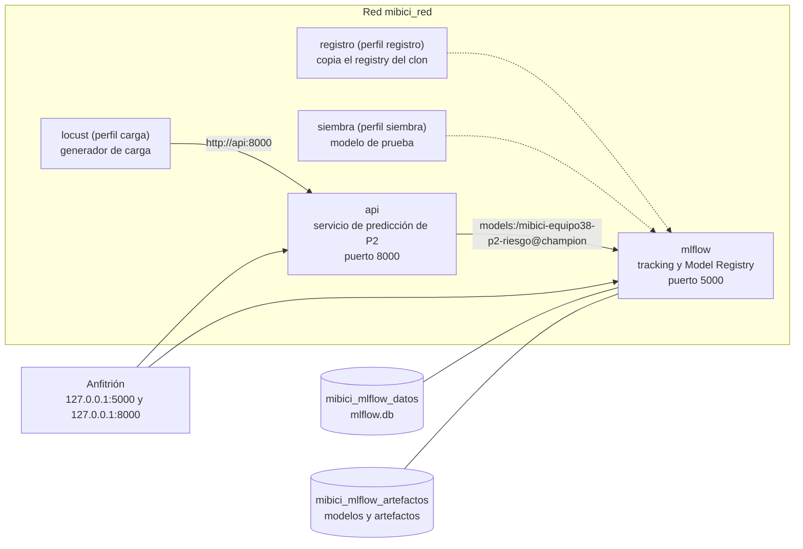
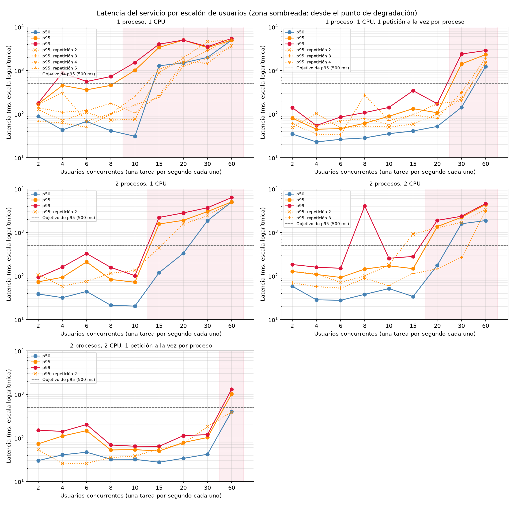
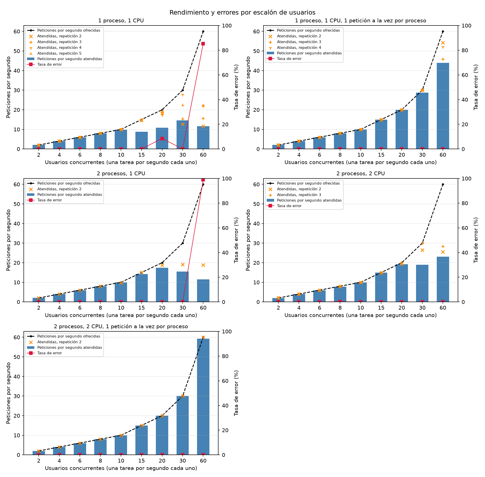
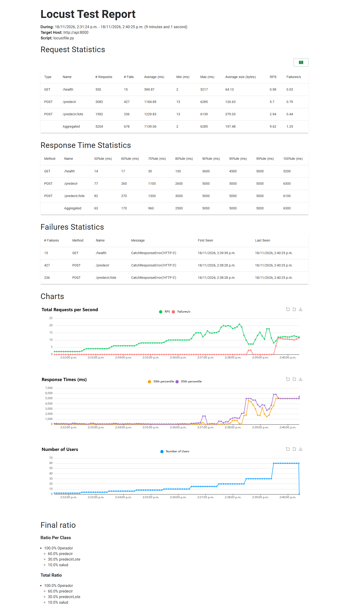
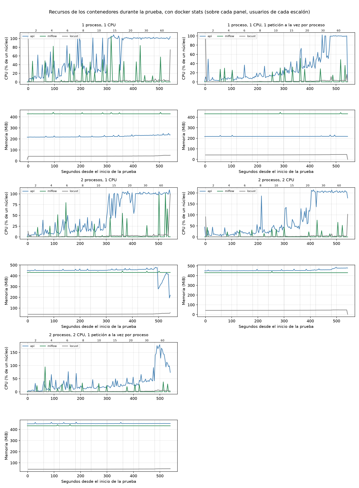
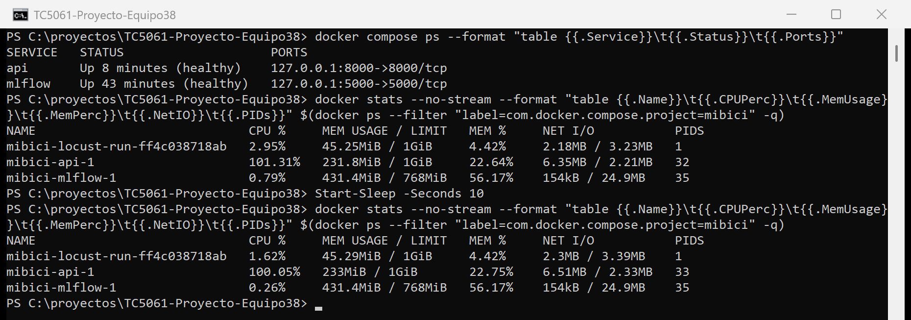
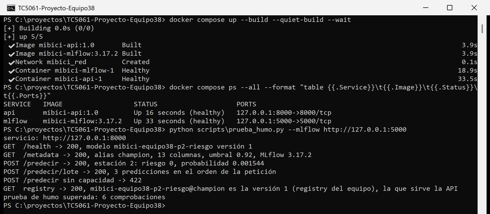

# Operación del sistema

La sexta entrega deja de tratar al servicio de predicción como un contenedor suelto y lo opera como un sistema: `docker-compose.yml` levanta juntos el servidor de MLflow y el servicio que carga de él el modelo en producción, un *pipeline* de GitHub Actions prueba, construye y despliega ese sistema en cada cambio, una prueba de carga con [Locust](https://docs.locust.io/en/stable/) mide hasta dónde aguanta mientras `docker stats` registra lo que consumen los contenedores, y `mibici/finops/costo.py` convierte esas mediciones y el precio por hora de una instancia en un costo por inferencia.

## Archivos

```
├── docker-compose.yml        <- servicios mlflow y api, y los perfiles registro, siembra y carga
├── .env.example              <- variables que sustituye Compose, con los mismos valores por defecto del archivo
├── servicios
│   └── mlflow
│       ├── Containerfile     <- imagen del servidor de tracking y registry: python:3.14-slim, MLflow fijo, usuario sin privilegios y HEALTHCHECK
│       ├── requirements.txt  <- la versión de MLflow del proyecto
│       └── importar.py       <- copia mlflow.db y mlartifacts/ del clon a los volúmenes del servidor
├── .github/workflows/ci.yml  <- pipeline de CI/CD
├── scripts
│   ├── sembrar_modelo.py     <- registra un modelo de prueba como champion si el registry no tiene uno
│   └── prueba_humo.py        <- comprueba el sistema levantado, solo con la biblioteca estándar
├── carga
│   ├── locustfile.py         <- escenario de carga
│   ├── escalones.py          <- estadísticas por escalón y por endpoint
│   ├── muestreador.py        <- docker stats a CSV
│   ├── correr.py             <- corridas de la prueba y diagnóstico de concurrencia
│   ├── hilos.py              <- predicciones por segundo según los hilos que predicen a la vez
│   └── resumen.py            <- resumen.md, carga.json y gráficas
├── mibici/finops/costo.py    <- costo por inferencia
├── reports/carga             <- resumen.md, carga.json, hilos.json, costo.md y costo.json
└── tests
    ├── test_orquestacion.py  <- docker-compose.yml, .env.example, Makefile e importar.py
    ├── test_siembra.py       <- modelo de prueba y su carga desde el servicio
    ├── test_humo.py          <- prueba de humo contra el servicio de pruebas
    ├── test_carga.py         <- escalones, muestreo, resumen, diagnóstico y escenario
    └── test_costo.py         <- capacidad, recursos, sensibilidad y costos
```

## Arquitectura



| Servicio | Imagen | Qué hace | Cuándo corre |
|---|---|---|---|
| `mlflow` | `mibici-mlflow:3.17.2`, construida con `servicios/mlflow/Containerfile` | Servidor de tracking y Model Registry sobre SQLite, con los artefactos servidos por el propio servidor (`mlflow-artifacts:/`). La base y los artefactos viven en dos volúmenes con nombre | Siempre |
| `api` | `mibici-api:1.0`, la imagen de la cuarta entrega (`Containerfile`), sin cambios | Servicio de predicción de P2. Carga `mibici-equipo38-p2-riesgo@champion` de `http://mlflow:5000` al arrancar y no se declara sano hasta tenerlo en memoria | Siempre, después de que `mlflow` esté sano |
| `registro` | La de `mlflow` | Paso de preparación: `importar.py` copia `mlflow.db` y `mlartifacts/` de la raíz del clon a los volúmenes, antes de que arranque el servidor, e imprime las versiones y los alias que encontró | Solo con `--profile registro` |
| `siembra` | La de `api` | Paso de preparación: `scripts/sembrar_modelo.py` registra un modelo de prueba como `champion` si el registry no tiene uno; si ya lo tiene no toca nada | Solo con `--profile siembra` |
| `locust` | `locustio/locust:2.47.0` | Generador de la prueba de carga, dentro de la misma red para que la latencia no incluya el reenvío de puertos del anfitrión | Solo con `--profile carga`, bajo demanda |

No hay Redis ni cola de trabajos con RQ: una predicción tarda decenas de milisegundos y el lote de todas las estaciones de una hora cabe en una sola petición, así que una cola no aportaría nada a esta arquitectura.

## Levantar el sistema con un solo comando

Hace falta Docker Engine 25 o posterior con Compose 2.20 o posterior, porque el archivo usa `start_interval` y dependencias opcionales (probado con Docker Desktop 29.9.2 y Compose 5.6.1). En un clon recién bajado, en cualquier máquina y desde la raíz del repositorio:

```
docker compose --profile siembra up --build --wait
```

construye las dos imágenes, crea la red y los volúmenes, arranca `mlflow` con el registry vacío, espera a que esté sano, registra con `siembra` un modelo de prueba (una regresión logística sobre datos sintéticos con la firma y el umbral de P2, etiquetada `origen=siembra`), arranca `api` y devuelve el control cuando los dos chequeos de salud pasan; si alguno no llega a estar sano, el comando termina con error. Es el mismo comando del *pipeline* y de `make sistema-prueba`, y sirve para comprobar el sistema de punta a punta, no para predecir, porque el registry del equipo no se versiona. La primera vez tarda lo que tarden en construirse las imágenes (varios minutos, casi todo en instalar dependencias); con las imágenes ya construidas, el sistema sembrado quedó sano en 77.5 s. El modelo que sirve el sistema es el que haya en el registry de sus volúmenes, y las otras dos situaciones se resuelven también con un solo comando:

| Situación | Comando | Qué pasa |
|---|---|---|
| Clon con el registry del equipo (`mlflow.db` y `mlartifacts/` en la raíz, que no se versionan) | `docker compose --profile registro up --build --wait` (`make sistema-registro`) | `registro` copia la base y los artefactos a los volúmenes y termina; después arrancan `mlflow` y `api`. El sistema sirve el `champion` real, hoy la versión 1. El registry del clon solo se lee: el sistema trabaja sobre su copia |
| Volúmenes ya poblados por alguno de los dos perfiles | `docker compose up --build --wait` (`make sistema`) | Arrancan `mlflow` y `api` con lo que ya había; el servidor de MLflow queda sano en unos 19 s y el servicio en unos 34 s (captura al final de esta sección) |

Sin ningún perfil y con el registry vacío, que es lo que pasa si `docker compose up --build --wait` es lo primero que se corre en un clon recién bajado, el servicio no encuentra el modelo, responde 503 y `--wait` termina con error (código 1 a los 203 s en la prueba): es deliberado, porque un modelo de prueba no debe quedar sirviendo en lugar del real sin que nadie lo pida. Después de levantar:

```
docker compose ps --all
python scripts/prueba_humo.py --mlflow http://127.0.0.1:5000
docker compose logs api
docker compose --profile registro --profile siembra --profile carga down
```

`prueba_humo.py` (`make humo`) espera a `/health`, revisa `/metadata` contra la petición de ejemplo, manda `api/ejemplos/peticion_p2.json` a `/predecir` y `api/ejemplos/peticion_lote.json` a `/predecir/lote`, comprueba que cada respuesta trae los campos del esquema y que la clase es la probabilidad contra el umbral, manda una petición sin `capacidad` y exige el 422, y con `--mlflow` pregunta al registry a qué versión apunta `champion` y exige que sea la que sirve la API; termina con código 1 en la primera comprobación que no se cumple. La interfaz de MLflow queda en http://127.0.0.1:5000 y la documentación del servicio en http://127.0.0.1:8000/docs. `down` conserva los volúmenes; `down --volumes` (`make sistema-abajo BORRAR_VOLUMENES=1`) borra también el registry del sistema, nunca el del clon.

## Qué configura docker-compose.yml

| Aspecto | Configuración | Para qué |
|---|---|---|
| Red | Red propia de tipo *bridge* (`mibici_red`); los servicios se hablan por nombre (`http://mlflow:5000`, `http://api:8000`) y los puertos solo se publican en `127.0.0.1` | El sistema no depende de `host.docker.internal` ni queda expuesto en las demás interfaces de la máquina |
| Volúmenes | `mibici_mlflow_datos` (la base SQLite) y `mibici_mlflow_artefactos` (modelos y artefactos), con nombre | El registry del sistema sobrevive a `down` y a la recreación de los contenedores y no vive en el árbol del clon |
| Variables | Diecisiete variables con valor por defecto (`${API_PROCESOS:-1}`), documentadas en `.env.example`: puertos, procesos, peticiones que cada proceso atiende a la vez, límites de CPU y memoria, versión de Locust y escenario de carga. `.env` es opcional | Cambiar la configuración sin editar el archivo; la prueba de carga compara sus configuraciones solo con variables |
| Orden de arranque | `depends_on` con `condition: service_healthy` (`api` espera a `mlflow`) y con `condition: service_completed_successfully` y `required: false` para los pasos de preparación | `api` no arranca hasta que el registry responde y, si se pidió importar o sembrar, hasta que ese paso terminó bien; sin el perfil, la dependencia se ignora |
| Salud | `healthcheck` sobre `/health` en los dos servicios, con `start_period` y `start_interval` de 3 s | `--wait` y `depends_on` saben cuándo está listo cada servicio; el del servicio de predicción solo pasa con el modelo cargado |
| Reinicio | `restart: unless-stopped` en `mlflow` y `api`; `"no"` en los pasos de preparación | Los servicios se recuperan de una caída o de un reinicio del motor; un paso que falla no se repite en silencio |
| Límites | `cpus` y `mem_limit` por servicio: 1 CPU y 1 GiB para `api`, 1 CPU y 768 MiB para `mlflow`, 2 CPU y 1 GiB para `locust` | Un servicio no se come a los demás, la prueba de carga es comparable entre corridas y los límites fijan el tamaño de máquina del análisis de costo |
| Privilegios | Los dos contenedores corren con usuario sin privilegios, `cap_drop: ALL` y `no-new-privileges`; el del servicio, además, con el sistema de archivos de solo lectura y `/tmp` en memoria | Superficie mínima: el servicio no puede escribir en su imagen ni ganar privilegios |
| Registros | Controlador `json-file` con rotación (tres archivos de 10 MB) | Los registros de un servicio que corre semanas no llenan el disco |
| Servidor de MLflow | `MLFLOW_WORKERS`, `MLFLOW_SERVER_ALLOWED_HOSTS` (`mlflow:*`, `localhost:*` y `127.0.0.1:*`) y `MLFLOW_SERVER_ENABLE_JOB_EXECUTION=false` | El servidor acepta el nombre con que lo ven los otros contenedores y no arranca los consumidores de trabajos de evaluación que este proyecto no usa: con ellos el contenedor ocupaba 1,005 MiB y 221 procesos e hilos; sin ellos, unos 430 MiB y 32 |

## Pipeline de CI/CD

`.github/workflows/ci.yml` corre en cada *push*, en cada *Pull Request* y a mano desde la pestaña Actions (`workflow_dispatch`). La insignia del inicio del [README](../README.md) muestra el estado de la última corrida sobre `main` y lleva a la lista de corridas.

| Trabajo | Qué hace | Qué lo hace fallar |
|---|---|---|
| `pruebas` | Instala `requirements.txt` con la caché de `pip` de `actions/setup-python` y corre `python -m pytest -q tests` en una matriz con Python 3.12, 3.13 y 3.14 (`fail-fast: false`, para ver el resultado de las tres); guarda el reporte JUnit de cada versión como artefacto | Cualquier prueba que falle en cualquiera de las tres versiones |
| `seguridad` | bandit sobre `mibici/`, `api/`, `scripts/`, `carga/` y `servicios/` (reporte completo y compuerta), búsqueda de secretos en el historial completo (`fetch-depth: 0`) y en los archivos versionados, y pip-audit sobre los tres archivos de requisitos | Un hallazgo de bandit de severidad media o alta o un secreto. pip-audit informa en el resumen de la corrida y no bloquea: un aviso nuevo sobre una dependencia no lo causa el cambio que se está integrando y se atiende subiendo la versión, como en la tercera entrega |
| `imagen` | Construye la imagen del servicio con `Containerfile` y BuildKit, con la caché de capas de GitHub Actions, y comprueba que corre con el usuario `servicio` y que importa la aplicación | Que la imagen no construya o no arranque |
| `sistema` | Valida `docker-compose.yml` con sus tres perfiles, levanta el sistema con `docker compose --profile siembra up --build --wait` (el mismo comando del README, con el modelo de prueba porque el registry del equipo no se versiona), corre `scripts/prueba_humo.py` contra `/health`, `/metadata`, `/predecir`, `/predecir/lote` y el registry, imprime `docker stats` y los registros de los servicios y apaga todo | Que algún servicio no llegue a estar sano en diez minutos o que alguna comprobación de la prueba de humo no se cumpla |
| `resumen` | Escribe en el resumen de la corrida el resultado de los cuatro trabajos anteriores | Que alguno de ellos haya fallado o se haya cancelado |
| `publicar` | Solo en *push* a `main` y solo si los cuatro trabajos pasaron: construye la imagen con la caché del trabajo `imagen` y la publica en GitHub Container Registry como `ghcr.io/nicoynurreta/tc5061-proyecto-equipo38`, con las etiquetas `latest` y `sha-<commit>` | Que el registro rechace la publicación |

Para leer una corrida: pestaña Actions del repositorio, flujo CI, la corrida del *commit* o del *Pull Request*; la página muestra los trabajos con su resultado, la tabla del trabajo `resumen` y el reporte de pip-audit, y cada trabajo despliega el registro de sus pasos. En un *Pull Request* los mismos trabajos aparecen como comprobaciones al pie de la conversación. La imagen publicada se descarga con `docker pull ghcr.io/nicoynurreta/tc5061-proyecto-equipo38:latest`.

La matriz se fijó probando antes: la suite se corrió en contenedores limpios de `python:3.11-slim` a `python:3.14-slim` con los mismos dos comandos del trabajo `pruebas`. Con 3.11 la instalación falla, porque NumPy 2.5.3 exige Python 3.12 o posterior (por eso `pyproject.toml` declara ahora `requires-python >= 3.12`); con 3.12, 3.13 y 3.14 la suite pasa completa. Las dos pruebas `lento` se omiten solas en el *pipeline*, que no tiene los datos ni el registry del equipo, y la validación con DeepChecks sigue siendo local porque necesita los datos reales (sección Pruebas y chequeos). Los pasos del *pipeline* se reproducen en local con los mismos comandos:

```
python -m pip install -r requirements.txt
python -m pytest -q tests
python -m bandit -c pyproject.toml -r mibici api scripts carga servicios -q --severity-level medium
python chequeos/secretos.py
docker build -f Containerfile -t mibici-api:ci .
docker compose --profile siembra up --build --wait
python scripts/prueba_humo.py --mlflow http://127.0.0.1:5000
docker compose --profile siembra down --volumes
```

## Prueba de carga con Locust

El escenario está en `carga/locustfile.py` y reproduce la forma en que se consume el servicio. Cada usuario simulado (`Operador`, un `FastHttpUser`) intenta una tarea por segundo (`constant_throughput(1)`), así que los usuarios concurrentes de un escalón son también las peticiones por segundo que se le ofrecen al servicio, y reparte sus tareas con tres pesos: seis de cada diez son una predicción individual (`POST /predecir` con `api/ejemplos/peticion_p2.json`), tres son un lote (`POST /predecir/lote` con las tres estaciones de `api/ejemplos/peticion_lote.json`) y una es el chequeo de salud (`GET /health`), que es lo que hace el orquestador. Cada respuesta se valida: cuenta como error cualquier código distinto de 200, una clase que no corresponda a la probabilidad contra el umbral, un lote en otro orden y toda petición que tarde más de 5 s, el tiempo límite del cliente. Los usuarios arrancan con un desfase aleatorio de semilla fija para no disparar todos en el mismo instante. La carga sube por escalones de 60 s (`Escalones`, un `LoadTestShape`): 2, 4, 6, 8, 10, 15, 20, 30 y 60 usuarios. Además de los CSV y del reporte HTML de Locust, el locustfile escribe `<corrida>_escalones.csv` con las estadísticas exactas de cada escalón y de cada endpoint (peticiones, errores, peticiones y predicciones por segundo, media, p50, p95, p99 y máximo), sin contar los primeros 10 s de cada escalón, y `<corrida>_escenario.json` con los parámetros.

`carga/correr.py` lanza cada corrida: recrea el servicio con los procesos, el límite de CPU y las peticiones simultáneas de esa configuración, mide cuánto tarda `/health` en responder 200, anota la versión del modelo que quedó servida y el desfase entre el reloj del anfitrión y el de los contenedores, arranca `carga/muestreador.py` (una lectura de `docker stats --no-stream` de los contenedores del sistema cada 3.5 s, a `<corrida>_recursos.csv`) y corre Locust sin interfaz dentro de la red de Compose. `carga/resumen.py` reúne todo en `reports/carga/resumen.md`, `reports/carga/carga.json` y tres gráficas. Con el sistema levantado:

```
python -m carga.correr
python -m carga.correr --solo un_proceso --sufijo _r2
python -m carga.correr --diagnostico 1,2,4,8,16
python -m carga.resumen
```

La primera línea corre las seis configuraciones (unos 55 minutos); `--solo` elige una, `--sufijo` guarda una repetición sin pisar la corrida original y `--diagnostico` mide dentro de un contenedor del servicio las predicciones por segundo según cuántos hilos predicen a la vez (`carga/hilos.py`). `make carga` encadena la primera y la última. Sin el script, el servicio `locust` del perfil `carga` corre el mismo escenario con las variables `CARGA_*` de `.env`: `docker compose --profile carga run --rm locust`. Los CSV y el HTML de Locust quedan en `reports/carga/` fuera de Git.

| Corrida | Procesos de uvicorn | Límite de CPU | Peticiones a la vez por proceso | Qué mide |
|---|---|---|---|---|
| `un_proceso` | 1 | 1 | 40 (los hilos de Starlette) | El servicio tal como se entregó en la cuarta entrega |
| `dos_procesos` | 2 | 2 | 40 | Cómo escala con el doble de procesos y de CPU |
| `dos_procesos_un_cpu` | 2 | 1 | 40 | Qué aportan los procesos sin más CPU |
| `un_proceso_en_serie` | 1 | 1 | 1 | El servicio con las predicciones de una en una (`API_HILOS=1`) |
| `dos_procesos_en_serie` | 2 | 2 | 1 | Lo mismo con dos procesos y dos CPU |
| `lote_hora` | 1 | 1 | 40 | Solo `/predecir/lote` con las 472 estaciones de una hora en cada petición |

Resultados de las diecinueve corridas del 18 de noviembre de 2026 en la máquina de trabajo (portátil de 12 núcleos y 16 GB; el motor de Docker Desktop ve 14 procesadores y 7.5 GiB), todas con el modelo real: `/metadata` reportó `mibici-equipo38-p2-riesgo` versión 1, alias `champion`. El objetivo de servicio con que se lee la prueba es un p95 de hasta 500 ms, errores de hasta 1 % y al menos 90 % de la carga ofrecida atendida: el punto de degradación es el primer escalón que rompe alguna de las tres condiciones y la capacidad, el mayor rendimiento de los escalones anteriores. Cada configuración se corrió de dos a cinco veces, en dos tandas (de 13:57 a 15:35 y de 16:59 a 18:19); las corridas cuyo nombre termina en `_r` y un número son las repeticiones. La tabla junta las corridas de cada configuración y da el menor y el mayor valor, sin promediar, porque la variación es parte del resultado: la prueba corrió en un portátil de uso general, con otros programas abiertos y la memoria casi llena (en las catorce corridas en que se registró el anfitrión, su CPU promedió entre 38 % y 59 %, contando la propia prueba, y la memoria libre bajó de 700 MB en algún momento de todas), y entre repeticiones el p95 de un mismo escalón llegó a variar hasta catorce veces. Cada corrida, con sus tablas por escalón, por endpoint y por contenedor, está en `reports/carga/resumen.md` y en `reports/carga/carga.json`.

| Configuración | Corridas | Punto de degradación (usuarios) | Capacidad dentro del objetivo (peticiones/s) | Mediana de la capacidad | p95 en ese escalón (ms) | Rendimiento máximo (peticiones/s) | Errores con 60 usuarios |
|---|---|---|---|---|---|---|---|
| 1 proceso, 1 CPU, 40 hilos (`un_proceso`) | 5 | 10 a 20 | 8 a 15 | 10 | 77 a 458 | 14.6 a 27.7 | 0 % a 88.1 % |
| 1 proceso, 1 CPU, 1 petición a la vez (`un_proceso_en_serie`) | 4 | 30 a 60 | 20 a 30 | 30 | 108 a 313 | 43.9 a 54.2 | 0 % |
| 2 procesos, 1 CPU, 40 hilos (`dos_procesos_un_cpu`) | 2 | 15 a 20 | 10 a 15 | 12.5 | 72 a 450 | 17.4 a 19.0 | 6.5 % a 99.0 % |
| 2 procesos, 2 CPU, 40 hilos (`dos_procesos`) | 3 | 15 a 60 | 10 a 30 | 15 | 148 a 266 | 23.1 a 30.0 | 0 % |
| 2 procesos, 2 CPU, 1 petición a la vez (`dos_procesos_en_serie`) | 2 | 60; sin degradación en una corrida | 30 a 60 | 45 | 102 a 391 | 59.3 a 60.0 | 0 % |







Lectura de los resultados:

- Dónde se degrada el servicio tal como estaba. Con un proceso y los 40 hilos de Starlette el servicio atiende sin degradarse entre 8 y 15 peticiones por segundo en sus cinco corridas (10 de mediana) y se degrada entre 10 y 20 usuarios: el p95 pasa de entre 77 y 458 ms en el último escalón sano a entre 0.9 y 1.5 s en el siguiente. Su rendimiento máximo fue de 14.6 a 27.7 peticiones por segundo. Con 60 usuarios el resultado depende de la corrida: en tres, entre 17 % y 88 % de las peticiones rebasan los 5 s del cliente; en las otras dos no hay errores, pero el p95 sube a entre 3.5 y 3.8 s. La mediana se mantiene entre 21 y 89 ms en los escalones anteriores a la degradación: lo que se rompe primero es la cola de la distribución, no el caso típico.
- Qué recurso se agota. La CPU: en el escalón de degradación de las cinco corridas de un proceso con 40 hilos el contenedor del servicio ya toca su límite en los picos (máximos de 101 % a 105 %), con una media de 35 % a 89 %, y uno o dos escalones después su media queda entre 94 % y 101 %, mientras su memoria casi no se mueve (217 a 252 MiB de 1 GiB con un proceso; 450 a 487 MiB con dos). El servidor de MLflow no participa en la inferencia: ocupa entre 400 y 450 MiB y su CPU solo muestra los picos breves de su chequeo de salud.
- Más procesos y más CPU, con los mismos hilos, rinden menos de lo que cuestan. Dos procesos con dos CPU atienden dentro del objetivo 10, 15 y 30 peticiones por segundo en sus tres corridas, con un máximo de 23 a 30 y sin errores con 60 usuarios; dos procesos sobre una sola CPU atienden 10 y 15, con un máximo de 17 a 19. Con el doble de recursos la mediana de la capacidad sube de 10 a 15.
- Por qué. `python -m carga.correr --diagnostico 1,2,4,8,16` mide el modelo dentro de un contenedor con el límite de 1 CPU, sin HTTP de por medio. Una predicción es trabajo de CPU en Python (armar el DataFrame, el `ColumnTransformer` y el `HistGradientBoostingClassifier`, dos veces: una para la clase y otra para la probabilidad), así que varios hilos no la reparten: compiten por el intérprete, y cada predicción gasta 5.3 veces la CPU, de 16.0 a 84.8 ms, entre esperas y cambios de contexto.

| Hilos que predicen a la vez | Predicciones/s | CPU por predicción (ms) | CPU en llamadas al sistema |
|---|---|---|---|
| 1 | 62.5 | 16.0 | 2 % |
| 2 | 29.9 | 33.5 | 22 % |
| 4 | 16.3 | 61.5 | 29 % |
| 8 | 12.6 | 80.0 | 32 % |
| 16 | 11.8 | 84.8 | 31 % |

- La mejora, medida. Con `HILOS_PREDICCION=1` cada proceso atiende una petición a la vez y las demás esperan su turno en lugar de estorbarse (`api/main.py` fija ese límite en el arranque; sin la variable el servicio se comporta como antes). Con un proceso y una CPU la capacidad dentro del objetivo sube a 20 peticiones por segundo en una corrida y a 30 en las otras tres, con p95 de 108 a 313 ms, el rendimiento máximo queda entre 44 y 54, y con 60 usuarios no hay un solo error. Con dos procesos y dos CPU atiende 30 en una corrida y en la otra las 60 que se le ofrecen en el último escalón, con p95 de 391 ms, sin llegar a degradarse: dos corridas tan distintas no alcanzan para decir cuánto escala con los procesos. Con la misma CPU y la misma memoria, el peor resultado de una en una (20) supera al mejor con 40 hilos (15) y el rendimiento máximo pasa de entre 14.6 y 27.7 a entre 43.9 y 54.2 peticiones por segundo. Por eso `docker-compose.yml` deja `API_HILOS=1` como valor por defecto, y `API_PROCESOS` queda para darle más procesos al servicio, uno por CPU.
- El lote es otra escala. `lote_hora` manda solo lotes de 472 estaciones, las de una hora completa de MiBici: el servicio atiende dentro del objetivo 4 lotes por segundo en una corrida y 8 en las otras dos, que son 1,888 y 3,776 predicciones por segundo, contra las 12 a 90 del escenario mixto, y un lote tarda de 30 a 119 ms de mediana en los escalones sanos. La demanda real del sistema, una predicción por estación y hora, cabe en una petición por hora.

Áreas de mejora que deja la prueba: mantener una petición a la vez por proceso, que es lo que ya quedó configurado, y medir con más corridas cuánto rinde agregar procesos o réplicas; resolver el cierre de hora con `/predecir/lote` en lugar de 472 peticiones; calcular la clase a partir de la probabilidad y del umbral para no recorrer el modelo dos veces por petición (en el contenedor, con un solo hilo, `predict` tardó 8.4 ms, `predict_proba` 7.4 ms y armar el DataFrame 2.7 ms); cambiar el chequeo de salud, que hoy lanza un intérprete de Python cada 15 s dentro del límite de CPU de cada contenedor, por una sonda más ligera; y repetir la prueba en una máquina dedicada y con escalones más largos y más finos entre 30 y 60 usuarios, porque con 50 s de medición por escalón el p95 de los escalones bajos sale de menos de 500 peticiones y la capacidad solo puede caer en uno de los nueve escalones.

## Uso de recursos con docker stats

`carga/muestreador.py` guardó entre 13 y 16 lecturas de `docker stats` por contenedor en cada escalón de 60 s (10 u 11 en los de 45 s). Lo que muestran, con el detalle por escalón en `reports/carga/resumen.md`:

| Contenedor | CPU | Memoria | Lectura |
|---|---|---|---|
| `api`, un proceso | De 5.5 % a 58.5 % de un núcleo en promedio en los escalones sanos; en la degradación, picos en el límite con media de 35 % a 101 %; donde la prueba sigue, media de 94 % o más uno o dos escalones después | 217 a 252 MiB de 1 GiB | La CPU es el cuello de botella; a la memoria le sobran tres cuartas partes del límite |
| `api`, dos procesos | Hasta 206 % en promedio con dos CPU (los dos núcleos llenos) | 450 a 487 MiB de 1 GiB | Cada proceso carga su copia del modelo y de las bibliotecas: unos 230 MiB por proceso |
| `mlflow` | De 0.2 % a 19 % en promedio por escalón, con picos de un instante por el chequeo de salud | 401 a 446 MiB de 768 MiB | No interviene en la inferencia: el servicio solo lo consulta al arrancar |
| `locust` | 5 % o menos en promedio por escalón y 12.9 % como máximo | 42 a 52 MiB | El generador de carga nunca fue el límite de la prueba |





En la primera corrida de dos procesos sobre una CPU, a mitad del escalón de 60 usuarios la memoria del servicio cae de 476 a 278 MiB y sus procesos e hilos de 80 a 46, vuelve a subir y al final cae a 194 MiB y 7: es lo que se espera si uvicorn reinicia primero uno y luego los dos procesos de trabajo por no responderle a tiempo. Esa corrida terminó con 99 % de errores; su repetición, con 6.5 %.

## Costo por inferencia

`mibici/finops/costo.py` lee los archivos de la prueba de carga y el precio por hora de una o varias instancias de referencia, que llegan como parámetro, y calcula el costo con cuatro factores: el tiempo (la capacidad se mide dentro de un objetivo de latencia y se recalcula con otros objetivos), los recursos (CPU y memoria medidos en el escalón de capacidad, para saber si el sistema cabe en la instancia), la escalabilidad (una fila por corrida de cada configuración, y peticiones contra predicciones para separar el efecto del lote) y la ocupación real (cuántas predicciones necesita MiBici por hora).

```
python -m mibici.finops.costo --instancia t3.small:2:2:0.0208 --instancia c6a.large:2:4:0.0765
```

Costo por inferencia = precio por hora de la instancia / (inferencias por segundo sostenidas dentro del objetivo x 3,600). Las opciones `--p95_objetivo_ms`, `--objetivos_alternos`, `--error_maximo`, `--demanda_hora` (472 por defecto, una predicción por cada estación con viajes en 2026) y `--descuento` cambian los supuestos; el resultado completo queda en `reports/carga/costo.md` y `reports/carga/costo.json`. Con el precio bajo demanda que AWS publica para Linux en el norte de Virginia, consultado el 18 de noviembre de 2026 (t3.small, 2 vCPU y 2 GiB, 0.0208 dólares por hora; c6a.large, 2 vCPU y 4 GiB, 0.0765), y la capacidad de las corridas de cada configuración:

| Configuración | Corridas | Peticiones de predicción por segundo dentro del objetivo | Dólares por millón de peticiones en t3.small | Dólares por millón de predicciones en t3.small |
|---|---|---|---|---|
| 1 proceso, 1 CPU, 40 hilos | 5 | 7.1 a 13.5 | 0.43 a 0.81 | 0.25 a 0.48 |
| 1 proceso, 1 CPU, 1 petición a la vez | 4 | 18.0 a 26.9 | 0.21 a 0.32 | 0.13 a 0.20 |
| 2 procesos, 1 CPU, 40 hilos | 2 | 9.0 a 13.6 | 0.43 a 0.64 | 0.25 a 0.38 |
| 2 procesos, 2 CPU, 40 hilos | 3 | 9.0 a 26.9 | 0.21 a 0.64 | 0.13 a 0.38 |
| 2 procesos, 2 CPU, 1 petición a la vez | 2 | 26.9 a 53.8 | 0.11 a 0.21 | 0.06 a 0.13 |
| Lotes de 472 estaciones | 3 | 4 a 8 lotes | 0.72 a 1.44 por millón de lotes | 0.0015 a 0.0031 |

A plena capacidad una inferencia cuesta menos de una millonésima de dólar; el número que importa es el de la demanda real. MiBici necesita del orden de 472 predicciones por hora, entre 0.003 % y 1.1 % de lo que el sistema puede atender, así que una instancia siempre encendida cobra casi todo su tiempo por esperar: 15.18 dólares al mes en t3.small, 44.07 dólares por millón de predicciones, entre 93 y 689 veces lo que cuesta a plena capacidad en el escenario mixto. Las optimizaciones, con lo que se midió:

| Optimización | Dato que la sustenta | Efecto en el costo |
|---|---|---|
| Una petición a la vez por proceso (ya aplicada) | Capacidad de 8 a 15 peticiones por segundo con 40 hilos y de 20 a 30 de una en una, con la misma CPU y memoria | El costo por petición a plena capacidad baja de entre 0.43 y 0.81 a entre 0.21 y 0.32 dólares por millón |
| Predecir la hora completa en un lote | 1,888 a 3,776 predicciones por segundo en lotes de 472 contra 12 a 90 en el escenario mixto | El costo por predicción a plena capacidad baja de entre 0.06 y 0.48 a entre 0.0015 y 0.0031 dólares por millón, entre 21 y 311 veces menos |
| No pagar el tiempo ocioso: encender el servicio solo para la predicción de cada hora | El servicio arranca en 9 a 43 s y la demanda de la hora se atiende en segundos: de 13 a 82 s de cómputo por hora, menos de 60 s en 16 de las 19 corridas | De 15.18 dólares al mes a entre 0.25 y 0.34 en t3.small, un ahorro de 97.7 % a 98.3 %: AWS factura por segundo con un mínimo de 60 s, así que el piso es 0.0208 x 60 / 3,600 x 730 = 0.25 dólares al mes. Sin ese mínimo, solo el cómputo sería de 0.06 a 0.34 |
| Tamaño de instancia | El sistema completo usa de 0.65 a 0.92 GiB de memoria y como máximo 1.86 núcleos en el escalón de capacidad | Cabe en 2 vCPU y 2 GiB; c6a.large, con el doble de memoria y sin ráfagas, cuesta 3.68 veces lo que t3.small (0.0765 contra 0.0208 dólares por hora) por la misma capacidad medida |
| Servidor de MLflow sin consumidores de trabajos | De 1,005 a unos 430 MiB | Libera más de 500 MiB, la cuarta parte de una instancia de 2 GiB |

t3.small es una instancia de ráfaga, pensada para un uso medio de CPU bajo como el de la demanda real; para sostener la plena capacidad durante horas la comparación justa es la instancia sin ráfagas, y por eso el reporte calcula las dos. Un descuento por compromiso de uso se aplica con `--descuento` y solo conviene si el servicio se queda siempre encendido. El encendido por hora cuenta solo el cómputo: el arranque medido del servicio y el tiempo de predicción, no el arranque de la máquina ni el del servidor de MLflow (unos 19 s). Por eso el piso de 0.25 dólares al mes es una cota inferior: con dos o tres minutos encendida por hora el costo sería de 0.51 a 0.76 dólares al mes, entre 95 % y 97 % menos que siempre encendida.

## Pruebas de la sexta entrega

Las seis suites nuevas suman 55 pruebas y ninguna necesita Docker, el registry del equipo ni la red: `tests/test_orquestacion.py` (14) lee `docker-compose.yml`, `.env.example` y el `Makefile` y corre `importar.py` sobre un registry de prueba; `tests/test_concurrencia.py` (6) cubre el límite de peticiones simultáneas; `tests/test_siembra.py` (3) siembra el modelo de prueba en un registry temporal y lo carga con el servicio; `tests/test_humo.py` (6) corre la prueba de humo contra el servicio de pruebas y contra un servidor HTTP local; `tests/test_costo.py` (12) y `tests/test_carga.py` (14) trabajan con corridas sintéticas escritas en `tmp_path`. Con ellas la suite completa tiene 160 pruebas; en la máquina de trabajo, con el servidor de MLflow del sistema levantado para la prueba `lento` del registry, terminó con `160 passed` en 446.71 s. La prueba que valida `docker-compose.yml` con `docker compose config` se omite sola donde no hay Docker.


