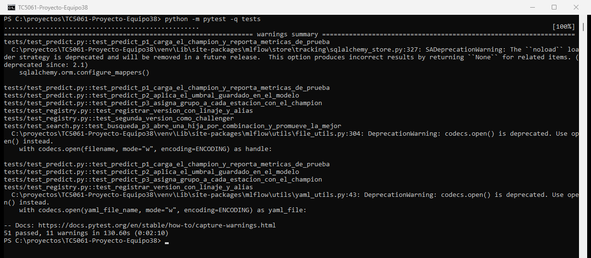
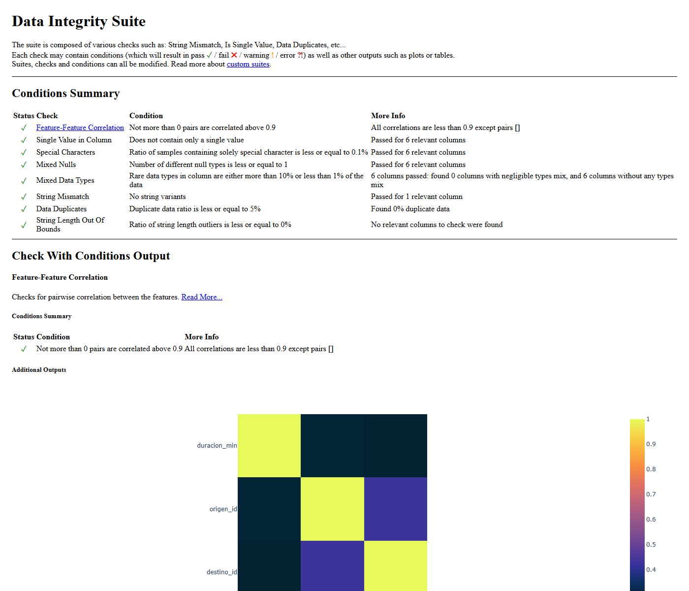
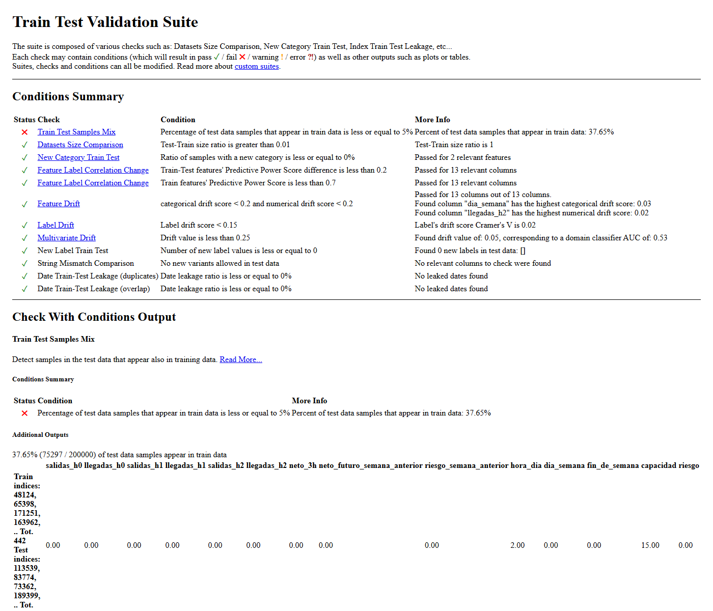
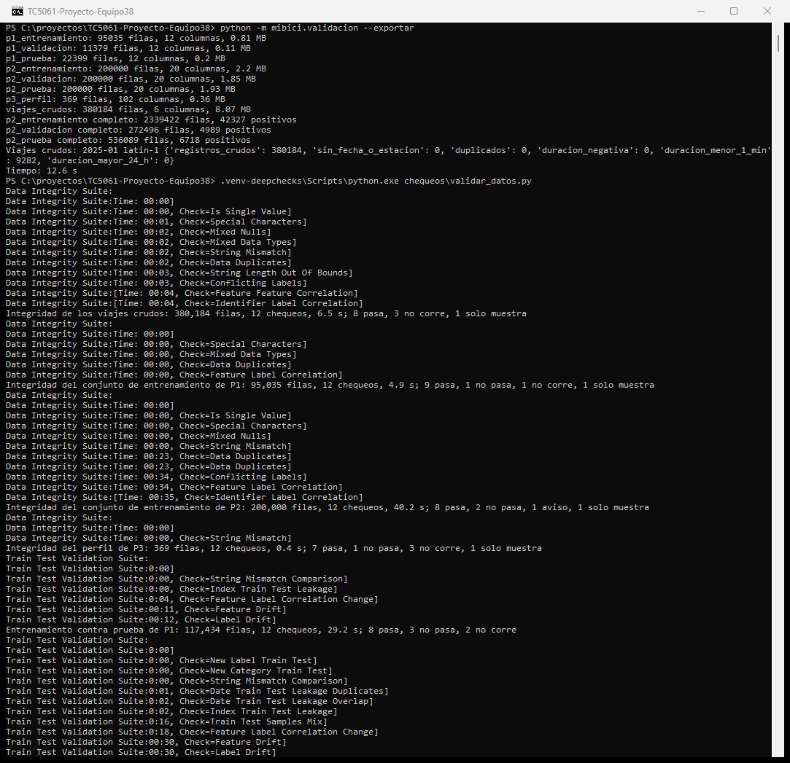
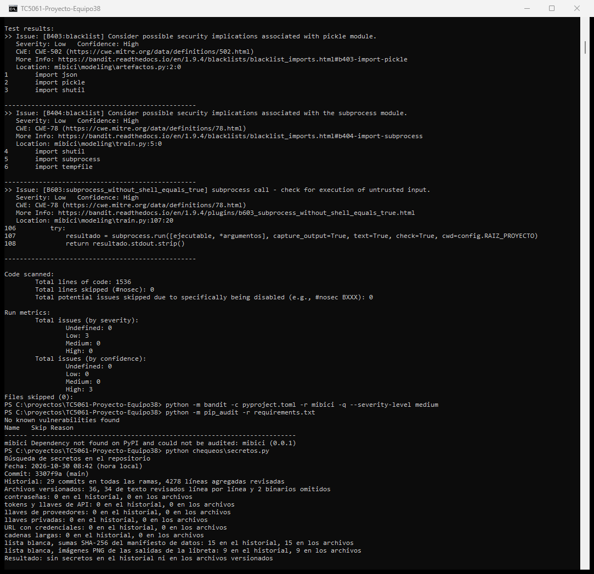
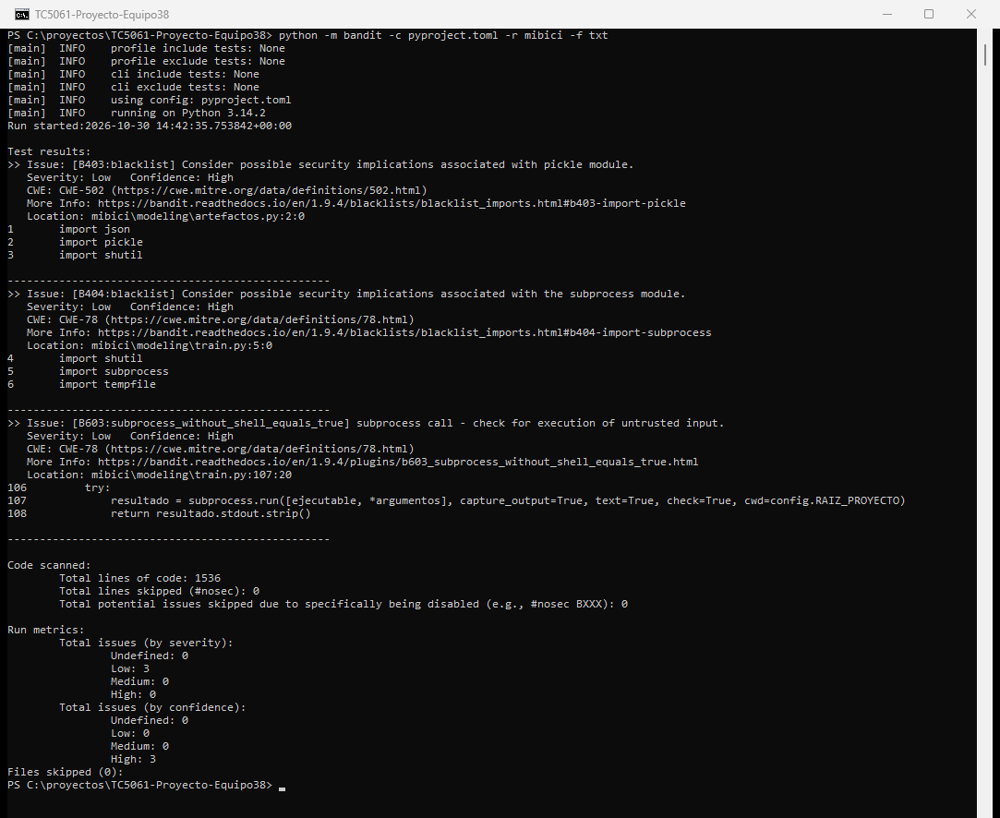
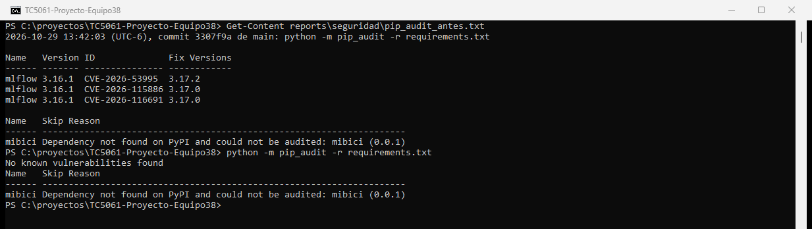

# Pruebas y chequeos

La tercera entrega agregó al repositorio una capa de calidad que se ejecuta con un solo comando: pruebas con pytest (una fila por módulo de `mibici/`, con casos normales y límite y una prueba de reproducibilidad del entrenamiento), la validación de los datos con DeepChecks (integridad de las tablas y deriva entre entrenamiento y prueba) y los chequeos de seguridad (`.gitignore`, variables de entorno, bandit, pip-audit y búsqueda de secretos en el historial), con la evidencia versionada en `reports/`. Con las pruebas del servicio de predicción de la cuarta entrega, las del monitoreo, la versión alternativa y el *A/B testing* de la quinta y las de la orquestación, el *pipeline*, la prueba de carga y el costo de la sexta, la suite tiene 160 pruebas, y desde la sexta entrega el *pipeline* de GitHub Actions las corre en cada *push* y en cada *Pull Request* (sección Operación del sistema).

## Los dos entornos

Las pruebas y los chequeos de seguridad corren en el entorno del proyecto (sección Instalación). bandit y pip-audit no son dependencias del proyecto, así que se instalan aparte en ese mismo entorno:

```
pip install bandit==1.9.4 pip-audit==2.10.1
```

DeepChecks corre en un entorno propio. La última versión de deepchecks (0.19.1, de diciembre de 2024) no es compatible con scikit-learn 1.9 ni con pandas 3: pide el scorer `max_error` que scikit-learn retiró en la 1.6, usa `np.Inf`, retirado en NumPy 2, e importa `pkg_resources`, que setuptools 81 eliminó. Bajar las versiones del proyecto cambiaría el entorno con que se hicieron las 36 corridas y los tres modelos registrados, así que DeepChecks vive en `.venv-deepchecks`, creado con [uv](https://docs.astral.sh/uv/) con Python 3.12 y las versiones fijas de `requirements-deepchecks.txt` (uv descarga CPython 3.12 si no está instalado):

```
pip install uv
uv venv --python 3.12 .venv-deepchecks
uv pip install -r requirements-deepchecks.txt --python .venv-deepchecks
```

`.venv-deepchecks/` está en `.gitignore`. En Windows el clon debe estar en una ruta corta (por ejemplo `C:\proyectos\TC5061-Proyecto-Equipo38`) o con las rutas largas habilitadas en el sistema, porque algunos archivos de scikit-learn dentro de `.venv-deepchecks` superan los 260 caracteres de ruta cuando el clon está en una carpeta profunda.

## Comandos

El orden es `make ingest` (una sola vez, genera `data/processed/`), `make test` y `make chequeos`; `make verificar` encadena los dos últimos. Sin `make` (Windows), los comandos equivalentes se corren desde la raíz con el entorno del proyecto activado:

| Comando | Qué hace | Equivalente sin `make` |
|---|---|---|
| `make test` | Las 160 pruebas. No necesita datos, servidor de MLflow, Docker ni el entorno de DeepChecks, así que corre desde un clon limpio (ahí se omiten solas las dos pruebas `lento`, que piden los datos reales y el registry del equipo, y sin Docker la que valida `docker-compose.yml` con `docker compose config`) | `python -m pytest -q tests` |
| `make chequeos` | Exporta a `data/interim/` las tablas que valida DeepChecks, corre las seis suites, bandit (reporte completo y compuerta) sobre `mibici/`, `api/`, `scripts/`, `carga/` y `servicios/`, pip-audit sobre los tres archivos de requisitos y la búsqueda de secretos | `python -m mibici.validacion --exportar`, `.venv-deepchecks\Scripts\python.exe chequeos\validar_datos.py`, `python -m bandit -c pyproject.toml -r mibici api scripts carga servicios -f txt --exit-zero`, `python -m bandit -c pyproject.toml -r mibici api scripts carga servicios -q --severity-level medium`, `python -m pip_audit -r requirements.txt`, `python -m pip_audit -r requirements-api.txt`, `python -m pip_audit -r servicios\mlflow\requirements.txt` y `python chequeos\secretos.py` |
| `make verificar` | `make test` seguido de `make chequeos` | Los dos renglones anteriores en ese orden |
| `make api` | El servicio de predicción sin contenedor, con uvicorn en `127.0.0.1:8000`, para desarrollar | `python -m uvicorn api.main:app --host 127.0.0.1 --port 8000` |
| `make imagen` | Construye la imagen `mibici-api:1.0` con `Containerfile` (`MOTOR=podman` cambia el motor) | `docker build -f Containerfile -t mibici-api:1.0 .` |
| `make contenedor` | Levanta el contenedor `mibici-api` en el puerto 8000 apuntando al servidor de tracking del anfitrión | `docker run --rm -d --name mibici-api -p 8000:8000 --add-host=host.docker.internal:host-gateway -e MLFLOW_TRACKING_URI=http://host.docker.internal:5000 mibici-api:1.0` |
| `make probar-api` | Manda `api/ejemplos/peticion_p2.json` al servicio y muestra la respuesta | `python scripts\probar_api.py` |
| `make exportar-modelo` | Descarga el `champion` de P2 a `models/api/` para arrancar el servicio sin registry (`RUTA_MODELO`) | `python -m mlflow artifacts download -u models:/mibici-equipo38-p2-riesgo@champion -d models/api` |
| `make ingest-actual`, `make monitor`, `make reentrenar` y `make abtest` | Ingesta del periodo actual, reporte de *drift* y desempeño mensual, versión alternativa y *A/B testing* (sección Monitoreo y drift) | `mlflow run . -e ingest_actual`, `-e monitor`, `-e reentrenar` y `-e abtest` con `--experiment-name mibici-equipo38 --env-manager local` |
| `make sistema-prueba`, `make sistema-registro` y `make sistema` | Levantan el sistema completo con Docker Compose y esperan a que los dos servicios estén sanos: sembrando antes un modelo de prueba, que es lo que sirve en un clon recién bajado, copiando antes el registry del clon o con el registry que ya está en los volúmenes (sección Operación del sistema) | `docker compose --profile siembra up --build --wait`, `docker compose --profile registro up --build --wait` y `docker compose up --build --wait` |
| `make sistema-estado` y `make sistema-abajo` | Estado de los servicios y apagado del sistema; los volúmenes del registry se conservan salvo con `BORRAR_VOLUMENES=1` | `docker compose ps --all` y `docker compose --profile registro --profile siembra --profile carga down` (con `--volumes` para borrar el registry del sistema) |
| `make humo` | Prueba de humo del sistema levantado: `/health`, `/metadata`, `/predecir`, `/predecir/lote`, una petición inválida y la versión que el registry marca como `champion` | `python scripts\prueba_humo.py --mlflow http://127.0.0.1:5000` |
| `make carga` | Prueba de carga con Locust por escalones, con muestreo de `docker stats`, y su resumen con gráficas (`CORRIDA=un_proceso` corre solo esa) | `python -m carga.correr` y `python -m carga.resumen` |
| `make costo` | Costo por inferencia con los CSV de `reports/carga/` y el precio de la instancia de referencia | `python -m mibici.finops.costo --instancia nombre:vcpu:memoria_gib:precio_hora` |

- Variables del Makefile: `PYTHON_INTERPRETER` (por defecto `python`) y `PYTHON_DEEPCHECKS` (`.venv-deepchecks/Scripts/python.exe` en Windows y `.venv-deepchecks/bin/python` en Linux o macOS), por ejemplo `make chequeos PYTHON_INTERPRETER=venv/Scripts/python.exe`.
- `make chequeos` usa `chequeos/secretos.py` y la evidencia de `reports/seguridad/`, que llegan con la rama `feat/chequeos-seguridad`, y la suite incluye los casos límite de `tests/test_dataset.py` y `tests/test_features.py` de la rama `test/casos-limite-datos-features`, así que `make verificar` completo corresponde a `main` con las tres ramas de la tercera entrega integradas.
- Si `data/processed/` no existe, la exportación y las suites de DeepChecks indican cómo generar los datos y terminan con código 0; bandit, pip-audit y la búsqueda de secretos corren de todos modos.
- Dos pruebas llevan el marcador `lento`: `test_p1_ridge_reproduce_sobre_los_datos_reales`, que usa los datos reales, tarda unos 2 s y se omite sola cuando falta `data/processed/`, y `test_el_champion_del_registry_responde_al_ejemplo`, que carga el `champion` real de P2 y se omite sola cuando `MLFLOW_TRACKING_URI` no apunta a un servidor HTTP que responda. `python -m pytest -q tests -m "not lento"` las excluye y `python -m pytest -q tests -m lento` corre solo esas dos.
- bandit se corre dos veces: la primera imprime el reporte completo con `--exit-zero` y la segunda es la compuerta que detiene `make` solo si aparece un hallazgo de severidad media o alta. pip-audit resuelve `requirements.txt` en un entorno temporal y consulta el servicio de avisos de PyPI, por eso tarda de dos a cuatro minutos. `chequeos/secretos.py` devuelve 1 si encuentra algo.
- Tiempos en la máquina de trabajo: la suite tardó 130.6 s con las 51 pruebas de la tercera entrega (captura de abajo) y 533.9 s con las 74 de la rama del servicio (captura de la sección Servicio de predicción), casi todos en las seis pruebas que registran, versionan o cargan modelos en un tracking temporal de MLflow (`log_model` infiere los requisitos del entorno); los comandos de `make chequeos` tardan unos cuatro minutos, de los que las seis suites de DeepChecks ocupan dos (120.7 s en `reports/deepchecks/resumen.md`) y pip-audit uno.

## Pruebas

Cada módulo de `mibici/` tiene su archivo en `tests/`, más `test_reproducibilidad.py` y `test_seguridad.py`. Ninguna prueba necesita los datos reales ni un servidor de MLflow: las que registran o cargan modelos usan un tracking temporal en SQLite dentro de `tmp_path`, las de `predict` redirigen las rutas de `config` con `monkeypatch` y las del servicio de predicción inyectan un modelo mínimo con `tests/conftest.py`, de modo que la suite no deja rastro en el clon; solo las dos pruebas `lento` piden los datos reales o el registry del equipo, y se omiten solas si no están. La columna Rama dice en qué *Pull Request* de la tercera entrega llega cada grupo de pruebas nuevas; las de las entregas anteriores se indican entre paréntesis.

| Módulo | Archivo | Pruebas | Casos normales | Casos límite | Rama |
|---|---|---|---|---|---|
| `dataset` | `tests/test_dataset.py` | 7 | `normalizar_nombre` quita acentos y mayúsculas; `limpiar_viajes` descarta duplicados, duraciones inválidas y columnas personales y convierte las fechas (`feat/ingesta`) | Columna necesaria faltante lanza `ValueError`; `viaje_id` repetido conserva la primera aparición y cuenta los descartes; duraciones en los límites exactos (negativa, 0 s, 59 s, 60 s, 24 h y 24 h más un segundo); tabla vacía devuelve tabla vacía con las columnas finales y los seis conteos en cero; nombres vacíos, con espacios, acentos y guiones bajos repetidos | `test/casos-limite-datos-features` |
| `features` | `tests/test_features.py` | 12 | Rezagos de P1 que no miran el día actual; etiqueta de P2 con la ventana posterior; partición temporal sin mezclar periodos; P2 excluye la ventana que cruza el corte; perfiles de P3 con estaciones de solo llegada y bloques que suman uno (`feat/features`, `fix/features-particion-perfiles`) | Registros exactamente en los cortes de la partición; periodos vacíos y tabla vacía; ventana que cubre todo el bloque, ventana cero y ventana de 23 horas; etiqueta cuya ventana cruza el final de la serie y ventana igual al largo; estación con exactamente `viajes_minimos` viajes frente a una con uno menos; estación sin llegadas o sin salidas sin `NaN` ni infinitos | `test/casos-limite-datos-features` |
| `plots` | indirecto | 0 | Sin archivo propio: la búsqueda completa de `tests/test_search.py` genera `plots/mapa_grupos.png`, `plots/perfiles_grupos.png` y `plots/resultados_busqueda.png` y comprueba que quedaron entre los artefactos. Las gráficas de P1 y P2 no las ejecuta ninguna prueba | | |
| `artefactos` | `tests/test_artefactos.py` | 4 | Constantes sin rutas absolutas; `config/` con tres archivos; subcarpetas de la corrida; tamaño del modelo y cronómetro (`feat/mlflow-project-registry`) | | |
| `train` | `tests/test_train.py` | 9 | `valor_hiperparametro` respeta el tipo del valor por defecto; `completar_hiperparametros` toma `config`; etapa *baseline* o candidata; `elegir_umbral` minimiza el costo; métricas de clasificación con costo; inercia igual a la de `KMeans` (`feat/mlflow-project-registry`) | `elegir_umbral` sin positivos no emite alertas y con probabilidades constantes solo tiene dos costos posibles; `valor_hiperparametro` rechaza texto no numérico y decimales con referencia entera, y acepta `None` con espacios | `feat/tests-reproducibilidad-deepchecks` |
| `search` | `tests/test_search.py` | 5 | `combinaciones` con las tres rejillas reales de `config` (9, 6 y 6 combinaciones); `etiqueta_combinacion`; `es_mejor` con el sentido de cada métrica; búsqueda completa de P3 con `search.main()` y tracking temporal: corrida padre con sus parámetros, seis hijas con sus nombres y etiquetas, la mejor promovida a candidata con sus artefactos y la métrica por combinación | Rejilla vacía (una sola combinación con los fijos) y lista de valores vacía (ninguna); empates en `es_mejor` | `feat/tests-reproducibilidad-deepchecks` |
| `predict` | `tests/test_predict.py` | 3 | Modelo mínimo registrado como `champion` en un registry temporal y `predict.main()` con argumentos simulados: métricas de prueba iguales a las del entrenamiento y CSV con las columnas y los registros esperados; en P2 el umbral viaja dentro del modelo; en P3 un grupo por estación | | `feat/tests-reproducibilidad-deepchecks` |
| `registry` | `tests/test_registry.py` | 2 | Versión con linaje y alias `champion`; segunda versión como `challenger` (`feat/model-registry`) | | |
| reproducibilidad | `tests/test_reproducibilidad.py` | 4 | Dos entrenamientos con `config.SEMILLA` sobre conjuntos sintéticos con las columnas exactas de cada pregunta producen predicciones, probabilidades, umbral, grupos y métricas idénticos en P1 (`hgb`), P2 (`hgb`) y P3 (`kmeans`), y la semilla llega al estimador (`random_state` igual a 42 en los tres); prueba `lento` con los datos reales y `ridge` en P1 | | `feat/tests-reproducibilidad-deepchecks` |
| seguridad | `tests/test_seguridad.py` | 5 | Entradas de `.gitignore` para datos, modelos, MLflow y `.env`; `git check-ignore` sobre ocho rutas de muestra; `.env.example` define `MLFLOW_TRACKING_URI`; ningún CSV, Parquet, modelo, base de datos ni `.env` versionado; ningún archivo versionado con patrones de secretos | | `feat/chequeos-seguridad` |
| servicio de predicción (`api`) | `tests/test_api.py` | 23 | 200 con el ejemplo y la respuesta completa (clase, probabilidad, umbral y modelo); `estacion_id` opcional; el orden de los campos del JSON no cambia la predicción; lote en el mismo orden; `/health` y `/metadata` con las columnas de la firma; los campos del esquema son `features.COLUMNAS_P2`; prueba `lento` contra el `champion` real del registry | 422 por campo faltante, por campo de más, por nueve valores fuera de rango o de tipo y por variables derivadas incoherentes; lote con un elemento inválido y lote vacío; 503 en los tres endpoints sin modelo; firma distinta al esquema rechazada; `registered_model_meta` ausente o de otro modelo | `feat/api-pruebas-ejemplos` |
| ejemplos del servicio | `tests/test_api_ejemplos.py` | 4 | La petición de ejemplo es la del esquema y responde 200; el lote responde una predicción por estación; la respuesta guardada tiene la forma del esquema y el modelo del registry; los ejemplos no traen campos fuera del esquema | | `feat/api-pruebas-ejemplos` |
| monitoreo (`monitoreo.datos`, `drift`, `desempeno` y `costos`) | `tests/test_monitoreo.py` | 15 | Ventanas consecutivas de los dos periodos; `armar_tabla` conserva la partición de 2025 y agrega el periodo actual; la ingesta escribe archivos aparte con el portal simulado y deja intactos los de 2025; el reporte de Evidently marca la columna desplazada con la prueba de su tipo; `analizar` deja el HTML, los JSON, el resumen y las figuras, con el mes de alerta; métricas y costo; desempeño por mes sin el entrenamiento; puntos de entrada del `MLproject` | Horas exactamente en los cortes de cada conjunto; mes que el portal no publica; exportar sin datos procesados; ninguna columna deriva cuando nada cambia; conjunto sin horas en riesgo; descomposición de la tasa con solo mezcla y con solo efecto condicional; estación que no existía en la referencia | `feat/monitoreo-herramientas` |
| versión alternativa (`reentrenar`) | `tests/test_reentrenar.py` | 4 | Entrenamiento, validación y evaluación con las fechas de `config`; `main` lee la receta del `champion` de un registry temporal, entrena y registra la versión 3 como `challenger` con sus etiquetas, los dos manifiestos entre los artefactos y el umbral dentro del modelo | Horas cuya etiqueta mira al bloque siguiente quedan fuera de entrenamiento y validación; la confirmación no entra a ningún conjunto; la versión que tenía el alias queda anotada y sin alias | `feat/ab-testing-versiones` |
| A/B testing (`abtest`) | `tests/test_abtest.py` | 8 | Conteos por día y métricas por réplica; bootstrap pareado y reproducible con la misma semilla; `comparar` con diferencias, intervalos y McNemar; tráfico dividido que solo cuenta el brazo asignado; `evaluar` con dos modelos, reporte y figura; `main` contra un registry temporal, con la corrida en MLflow y las versiones anotadas | McNemar sin pares discordantes, exacta con pocos pares y con ji cuadrada; versiones idénticas (intervalos en cero, la regla no promueve); las cuatro combinaciones de la regla y el margen exacto de recall; todo el tráfico a un brazo; tabla sin conjunto de evaluación; el alias solo se mueve con la regla cumplida y `--promover` | `feat/ab-testing-versiones` |
| orquestación (`docker-compose.yml`, `.env.example`, `Makefile` y `servicios/mlflow/importar.py`) | `tests/test_orquestacion.py` | 14 | Sin perfiles el sistema son `mlflow` y `api`; `api` espera a `mlflow` sano y carga el modelo de `http://mlflow:5000`; salud, reinicio, límites, privilegios mínimos y rotación de registros en los dos servicios; el registry en volúmenes con nombre y el servicio con sistema de archivos de solo lectura; puertos solo en `127.0.0.1`; toda variable con valor por defecto y documentada en `.env.example`, sin variables de sobra; MLflow con la versión fijada en los tres archivos de requisitos; Locust contra `http://api:8000`; objetivos del `Makefile`; `importar.py` copia la base y los artefactos y resume corridas, versiones y alias; `docker compose config` acepta el archivo con los tres perfiles (se omite sola sin Docker) | Los pasos de preparación son dependencias opcionales que deben terminar bien; el origen del registry se monta de solo lectura y sin crear la ruta si falta; importar dos veces no duplica; clon sin registry | `feat/orquestacion-compose` |
| peticiones simultáneas por proceso (`api.main.limitar_hilos`) | `tests/test_concurrencia.py` | 6 | Sin `HILOS_PREDICCION` quedan los 40 hilos de Starlette; con 1, 2 u 8 el proceso atiende esas peticiones a la vez; con 1 y seis clientes simultáneos nunca hay dos predicciones en curso | Variable vacía o en cero; valor que no es entero detiene el arranque | `feat/orquestacion-compose` |
| modelo de prueba (`scripts/sembrar_modelo.py`) | `tests/test_siembra.py` | 3 | El modelo sembrado tiene las columnas de `features.COLUMNAS_P2`, `float32`, el umbral dentro y es determinista; queda registrado como `champion` con las etiquetas `origen=siembra` y `datos=sinteticos`; el servicio lo carga desde un registry temporal y responde al ejemplo con la firma completa | Un registry que ya tiene `champion` no se toca: no se crea otra versión y el script lo dice | `feat/ci-cd-finops` |
| prueba de humo (`scripts/prueba_humo.py`) | `tests/test_humo.py` | 6 | Los cinco pasos contra el servicio de pruebas; el registry debe marcar como `champion` la versión que sirve la API; `pedir` devuelve JSON o texto con su código contra un servidor HTTP local | Servicio sin modelo (503); clase que no corresponde al umbral; lote en otro orden; campo faltante, modelo con otro nombre y cuerpo de error; registry con otra versión o sin el alias | `feat/ci-cd-finops` |
| costo por inferencia (`mibici.finops.costo`) | `tests/test_costo.py` | 12 | Costo igual al precio por hora entre las inferencias por hora; capacidad como el escalón de mayor rendimiento dentro del objetivo; peticiones de predicción sin las de salud; recursos solo en la ventana del escalón y con el desfase del reloj; sensibilidad al objetivo de latencia; costos a plena capacidad, siempre encendido, con compromiso y encendido solo para la demanda; `main` escribe `costo.md` y `costo.json` | Los escalones que siguen al primero que rompe el objetivo no cuentan aunque cumplan; errores sobre el máximo; ningún escalón cumple; instancia mal escrita o con valores no positivos; instancia en la que el sistema no cabe; carpeta sin archivos de la prueba | `feat/ci-cd-finops` |
| prueba de carga (`carga`) | `tests/test_carga.py` | 14 | Escalones leídos de una lista; lote del tamaño pedido con estaciones distintas y peticiones válidas contra el esquema; percentil por rango más cercano; `resumir` separa escalones y endpoints y descarta el calentamiento; `interpretar` convierte una lectura de `docker stats`; `muestrear` escribe una fila por contenedor; punto de degradación, capacidad, recursos alineados con los escalones, variación frente a la repetición y resumen por configuración; `main` escribe `resumen.md`, `carga.json` y las tres gráficas; `medir` cuenta las predicciones de todos los hilos; el locustfile define tres tareas ponderadas y la subida por escalones; las corridas comparan uno y dos procesos con los mismos escalones | Lista vacía o con texto; lote de una estación; lista vacía y de un elemento en el percentil; escalón sin peticiones; unidades de `docker stats`, cantidad en notación exponencial (`1e+03kB`), contenedor de otro proyecto y lectura sin cifras o con una cantidad que no se entiende; `docker` fuera del PATH; errores en el primer escalón (sin capacidad); corrida con filtro de tareas fuera de las gráficas; medición fuera de un contenedor | `feat/prueba-carga` |

La prueba de reproducibilidad compara dos ejecuciones completas de `entrenar_p1`, `entrenar_p2` y `entrenar_p3` con la misma semilla y exige igualdad exacta (`numpy.array_equal` e igualdad de los diccionarios de métricas), no cercanía; en conjuntos pequeños dos semillas distintas pueden coincidir por azar, por eso la prueba verifica además que la semilla llega al `HistGradientBoostingRegressor`, al `HistGradientBoostingClassifier` dentro del `FixedThresholdClassifier` y al `KMeans` del `Pipeline`, en lugar de exigir resultados distintos con otra semilla.



## Validación de datos con DeepChecks

`python -m mibici.validacion --exportar` escribe en `data/interim/` las tablas que se validan: las tres particiones de P1 completas (95,035, 11,379 y 22,399 filas estación-día), una muestra sin reemplazo de 200,000 filas estación-hora por conjunto de P2 (de 2,339,422, 272,496 y 536,089; semilla 42, orden temporal conservado, con los conteos completos de la etiqueta guardados en `exportacion.json`), el perfil de P3 (369 estaciones con 98 variables) y los 380,184 viajes crudos de enero de 2025 tal como los publica el portal, antes de `limpiar_viajes`, sin las columnas personales. `chequeos/validar_datos.py` corre la suite `data_integrity` sobre los viajes crudos, sobre los conjuntos de entrenamiento de P1 y P2 y sobre el perfil de P3, y la suite `train_test_validation` entre entrenamiento y prueba de P1 y P2. Las condiciones son las que DeepChecks trae por defecto (deriva menor a 0.2 por variable y a 0.15 en la etiqueta, deriva multivariada menor a 0.25, correlación entre variables hasta 0.9, duplicados y mezcla de muestras hasta 5 %, cero categorías, etiquetas y fechas nuevas); el único ajuste es `OutlierSampleDetection(timeout=60)`, porque con 380,184 viajes el tope de 10 s abortaría el chequeo. Cada suite deja un JSON (`to_json(with_display=False)`) y `reports/deepchecks/resumen.md` reúne las tablas de las seis con la lectura de cada hallazgo; los HTML con las gráficas quedan fuera de Git por su tamaño (unos 4.7 MB cada uno).

| Suite | Filas | Resultado | Hallazgos y lectura |
|---|---|---|---|
| Integridad de los viajes crudos (enero de 2025) | 380,184 | 8 pasan; 3 no aplican porque la tabla no tiene etiqueta; atípicos solo informativo | Sin `viaje_id` duplicado, sin faltantes en las cinco columnas necesarias, sin duraciones negativas ni mayores a 24 h. El problema real del mes son 9,282 viajes de menos de un minuto (2.44 %), que `limpiar_viajes` descarta: el conteo de la tabla cruda coincide con el que reporta la limpieza. 0.60 % de las muestras con probabilidad de atipicidad mayor o igual a 0.7 |
| Integridad del conjunto de entrenamiento de P1 | 95,035 | 9 pasan, 1 no pasa | Ocho pares con correlación mayor a 0.9: `dia_semana` con `fin_de_semana` (1.00, porque la segunda se deriva de la primera), `media_7` con `media_28` (0.99) y los rezagos con las medias móviles (0.91 a 0.92). La demanda diaria de una estación está muy autocorrelada y las medias móviles promedian los mismos rezagos, así que la redundancia es por construcción; los árboles no la resienten y Ridge la amortigua con la regularización. La condición se conserva y el hallazgo queda documentado |
| Integridad del conjunto de entrenamiento de P2 (muestra) | 200,000 | 8 pasan, 2 no pasan, 1 aviso | 0.65 % de las horas comparten exactamente las trece variables con otra hora de etiqueta contraria y 12.87 % de las filas son idénticas a otra: horas de poco o ningún movimiento en las que el riesgo de las dos horas siguientes no se distingue con las variables de la hora actual. Es ruido irreducible para cualquier modelo con estas entradas y acota el recall alcanzable. `dia_semana` y `fin_de_semana` correlacionan por diseño |
| Integridad del perfil de P3 | 369 | 7 pasan, 1 no pasa, 3 no aplican | Seis columnas constantes (`salidas_habil_02` a `salidas_habil_04` y `salidas_finde_02` a `salidas_finde_04`): el sistema no registra salidas entre las 2:00 y las 4:59, así que no aportan a la agrupación y conviene excluirlas en la siguiente iteración del perfil |
| Entrenamiento contra prueba de P1 | 95,035 contra 22,399 | 8 pasan, 3 no pasan | `mes` vale 11 y 12 solo en prueba, por eso fallan categorías nuevas, deriva por variable (Cramer's V de 1.0) y deriva multivariada (1.0): es consecuencia de la partición temporal, no un defecto de los datos. Al repetir `MultivariateDrift` sin `mes` la deriva baja a 0.128 (AUC del clasificador de dominio 0.564), las demás variables derivan menos de 0.04 y la etiqueta 0.04. Para el modelo sí importa: `HistGradientBoostingRegressor` trata `mes` como numérico y extrapola, y Ridge deja sin efecto mensual a las filas de prueba; queda como mejora codificar `mes` de forma cíclica o retirarlo de P1 |
| Entrenamiento contra prueba de P2 (muestras) | 200,000 contra 200,000 | 11 pasan, 1 no pasa | 37.65 % de las horas de prueba coinciden en las trece variables y la etiqueta con alguna hora de entrenamiento. No es fuga, porque la partición es temporal y los dos chequeos de fechas pasan: son horas sin movimiento o con flujos pequeños que se repiten en cualquier mes, y la cifra mide qué parte del conjunto es trivial para el modelo. Deriva por variable menor a 0.03 y de la etiqueta 0.022 |

La deriva que importa para la operación no la marca ninguna condición. En P2 la tasa de horas en riesgo pasa de 1.81 % en entrenamiento (42,327 de 2,339,422) a 1.25 % en prueba (6,718 de 536,089), una caída de 30.7 % en noviembre y diciembre; DeepChecks la mide en 0.022 porque con una clase tan rara la puntuación queda pequeña aunque la caída relativa sea grande, así que la lectura se hace con los conteos completos. Con la tasa de enero a septiembre se esperarían 9,699 horas en riesgo en prueba y ocurren 6,718: un modelo que mantuviera la frecuencia de alertas del entrenamiento daría del orden de 2,981 alertas sin riesgo real, un viaje de camión de más por cada una; en el otro sentido, no anticipar ninguna de las 6,718 horas costaría 33,590 unidades con el costo de P2 (cinco falsos positivos por cada falso negativo), y cada punto porcentual de recall que se pierda por la deriva equivale a 67 horas en riesgo mal anticipadas, 336 unidades. En P1, `rezago_7` promedia 33.26 viajes por estación y día en entrenamiento y 32.91 en prueba mientras la variable objetivo baja de 33.31 a 31.10: `rezago_7` menos `salidas` pasa de -0.05 viajes en entrenamiento a +1.81 en prueba, la demanda de fin de año cae pero el nivel de la semana anterior se mantiene. Como el *baseline* `naive7` predice exactamente `rezago_7`, ese sesgo son 40,560 viajes sobredimensionados en los 22,399 pares estación-día de prueba, flota y personal asignados a una demanda que no llega; los modelos que usan `media_28` y `mes` lo corrigen solo en parte, porque los meses 11 y 12 no existen en entrenamiento.





## Chequeos de seguridad

Configuración y secretos. El código lee el servidor de tracking con `os.environ.get("MLFLOW_TRACKING_URI", config.TRACKING_URI)`, cuyo valor por defecto es el almacén local `sqlite:///mlflow.db`; `.env.example` es la plantilla de esa variable. No hay carga automática de `.env`: el valor se exporta en la terminal (`set` o `export`) o se copia a `.env`, que está en `.gitignore` junto con `data/raw/*`, `data/interim/*`, `data/processed/*`, `*.csv`, `*.parquet`, `mlruns/`, `mlartifacts/`, `mlflow.db`, `models/*`, `*.pkl` y `*.joblib`. `tests/test_seguridad.py` comprueba esas entradas, que `git check-ignore` las aplica, que `.env.example` existe y que ningún archivo versionado contiene patrones de secretos; `chequeos/secretos.py` repite la búsqueda sobre las líneas agregadas en todos los commits de todas las ramas (`git log -p --all`) y sobre los archivos de `git ls-files`, con las categorías contraseñas asignadas, tokens y llaves de API, llaves de proveedores por su prefijo (AWS, GitHub, Google, Slack, OpenAI, Hugging Face), bloques PEM, URL con credenciales y cadenas largas en base64 o hexadecimal. Tres motivos de lista blanca, declarados en el código, evitan falsos positivos: las sumas SHA-256 de `data/manifiesto.json`, las imágenes PNG incrustadas en la libreta de exploración y las tablas comprimidas que DeepChecks serializa en los JSON de `reports/deepchecks/`. `reports/seguridad/secretos.txt` guarda la corrida sobre `main`: 29 commits, 4,278 líneas agregadas y 36 archivos versionados (34 de texto y 2 binarios) sin ningún hallazgo.

bandit. Sobre `mibici/` reportaba cuatro hallazgos de severidad baja y confianza alta en 1,392 líneas: B403 (importación de `pickle` en `artefactos.py`), B404 (importación de `subprocess` en `train.py`), B607 (arranque de un proceso con la ruta parcial `git`) y B603 (llamada a `subprocess.run` sin `shell=True`). B607 se corrigió resolviendo el ejecutable con `shutil.which("git")`, que devuelve `desconocido` cuando no hay `git`. Los otros tres se justifican en `[tool.bandit]` de `pyproject.toml` sin excluirlos del reporte: `pickle` solo mide el tamaño del modelo con `pickle.dumps` y nunca deserializa nada, y `subprocess` corre `git` con una lista fija de argumentos y sin intérprete de comandos para leer el commit y la rama. Después de la corrección bandit reporta tres hallazgos de severidad baja en 1,396 líneas del mismo código (1,536 con `mibici/validacion.py`) y ninguno de severidad media o alta, que es lo que vigila la compuerta de `make chequeos`. Evidencia: `reports/seguridad/bandit_antes.txt` y `bandit_despues.txt`.

| Hallazgo | Ubicación | Antes | Después | Qué se hizo |
|---|---|---|---|---|
| B403 `import pickle` | `mibici/modeling/artefactos.py` | Low | Low | Justificado: `pickle.dumps` mide `tamano_modelo_mb`; el modelo se guarda y se carga con MLflow, nunca con `pickle.load` |
| B404 `import subprocess` | `mibici/modeling/train.py` | Low | Low | Justificado: lista fija de argumentos, sin `shell`, solo para `git rev-parse` y `git status` |
| B607 ruta parcial del ejecutable | `mibici/modeling/train.py` | Low | Corregido | `shutil.which("git")` resuelve la ruta completa antes de `subprocess.run` |
| B603 `subprocess.run` sin `shell=True` | `mibici/modeling/train.py` | Low | Low | Justificado: es la forma segura de llamar a un proceso; la entrada no viene del usuario |

pip-audit. Sobre `requirements.txt` con MLflow 3.16.1 reportaba tres vulnerabilidades en ese paquete y ninguna en las otras dependencias:

| Aviso | Qué es | Versión que pip-audit indica como corrección | Relación con el proyecto |
|---|---|---|---|
| CVE-2026-53995 | Path traversal en el backend de tracking `FileStore` por el API de trazas | 3.17.2 | El servidor del proyecto usa SQLite por SQLAlchemy, no `FileStore`, y el proyecto no registra trazas |
| CVE-2026-115886 | SSRF en los endpoints de scorers de evaluación GenAI, con los paquetes opcionales `trulens` | 3.17.0 | El proyecto no usa scorers ni evaluación GenAI y no instala `trulens` |
| CVE-2026-116691 | El autologging de CrewAI registra la llave de API del proveedor de LLM en las trazas | 3.17.0 | El proyecto no usa CrewAI ni maneja llaves de API |

Aunque ninguna era explotable en la configuración del proyecto (servidor local con SQLite, sin scorers, sin CrewAI), la versión que pip-audit señala como corrección es 3.17.2 y con ella deja de reportar las tres, así que `requirements.txt` y `python_env.yaml` fijan `mlflow==3.17.2`; para CVE-2026-53995 OSV no nombra versión corregida y la garantía de fondo sigue siendo el almacén SQLite. La subida se verificó con la suite completa en verde y con una corrida `mlflow run . -e train -P question=p1 -P model=ridge --experiment-name mibici-equipo38 --env-manager local` contra un almacén temporal, que reproduce las métricas de la corrida `p1_ridge` de la segunda entrega (`test_mae` 6.2555 y `test_rmse` 10.5436). Con esa versión pip-audit no encuentra vulnerabilidades conocidas (`reports/seguridad/pip_audit_antes.txt` y `pip_audit_despues.txt`; `mibici` aparece como omitido porque es el paquete local de `-e .` y no existe en PyPI). Las 36 corridas y los tres modelos registrados de la segunda entrega se hicieron con 3.16.1 y se conservan tal cual.

Los cinco archivos de `reports/seguridad/` llevan en la primera línea la fecha, el commit y el comando exacto con que se generaron, para que la evidencia se lea sin correr nada.

Con la cuarta entrega bandit cubre también `api/` y `scripts/` (sin hallazgos en 194 líneas) y pip-audit audita además `requirements-api.txt` (no encuentra vulnerabilidades conocidas (`No known vulnerabilities found`)); la búsqueda de secretos sobre la rama del servicio tampoco encuentra nada (sin hallazgos en el historial ni en los archivos versionados).

Las dos capturas siguientes son el inicio y el final de la misma corrida de los comandos de `make chequeos`: la exportación de las tablas y las seis suites de DeepChecks, y después el reporte de bandit, la compuerta, pip-audit y la búsqueda de secretos.








