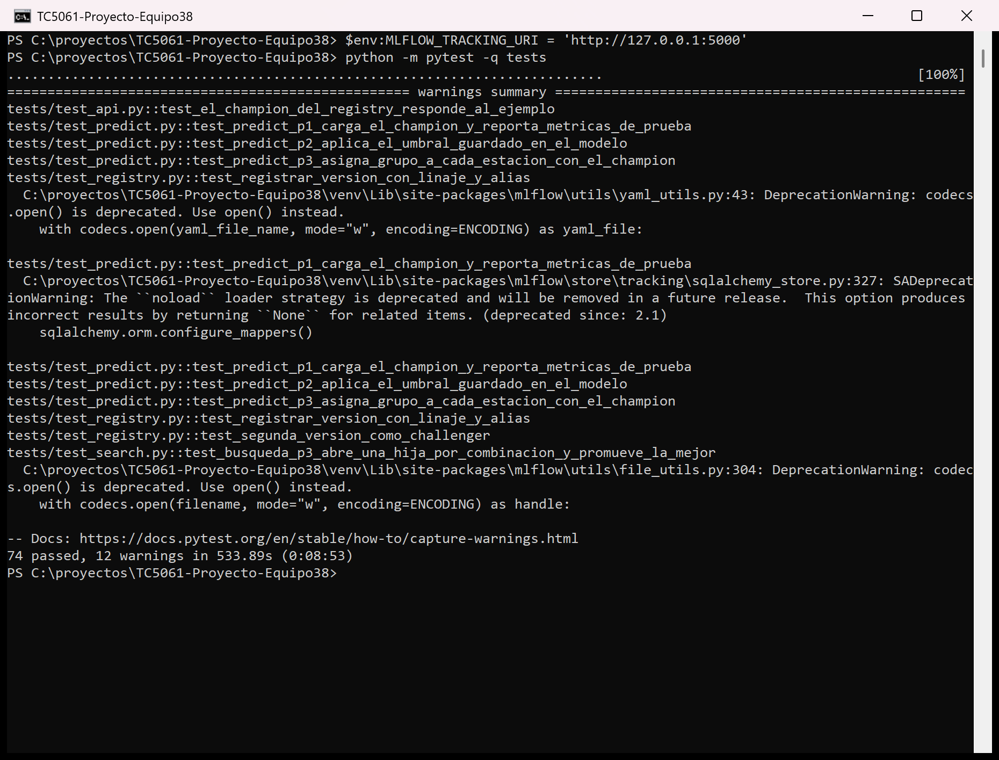
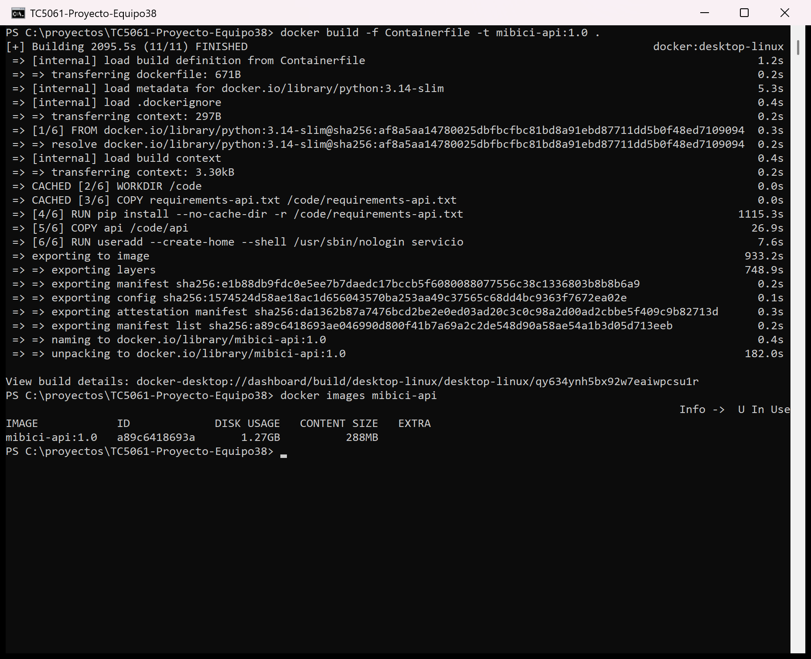
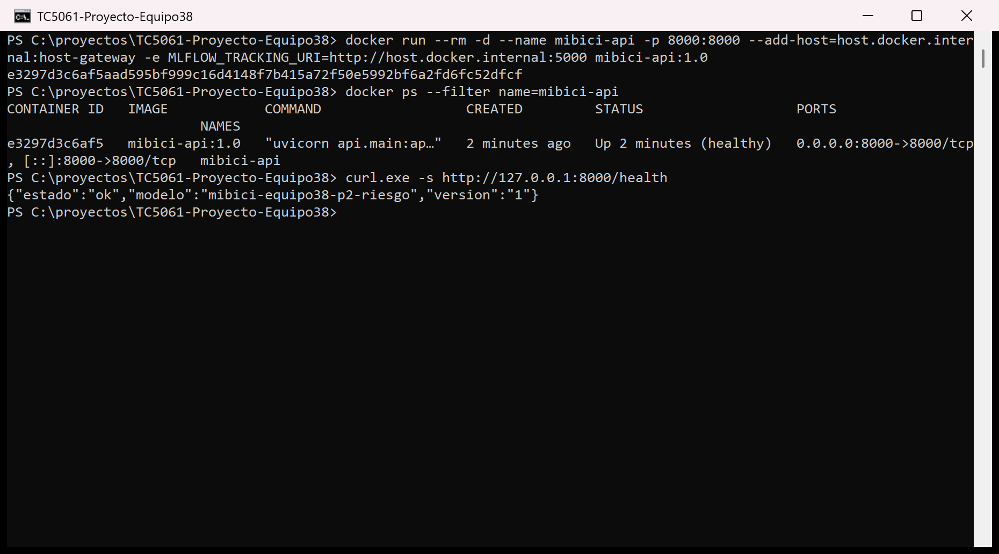
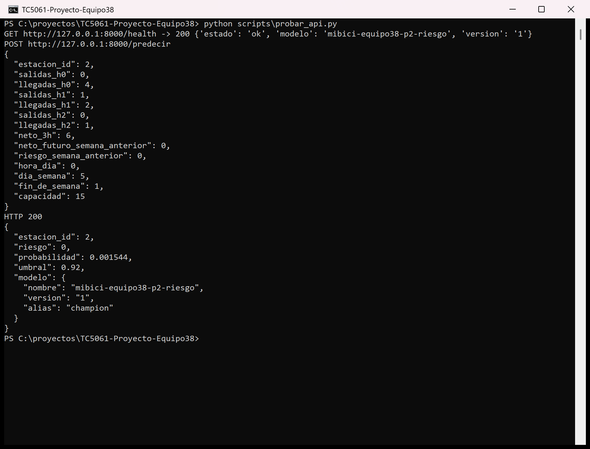

# Servicio de predicción

La cuarta entrega expone el modelo en producción de P2 como un servicio REST: una aplicación de [FastAPI](https://fastapi.tiangolo.com/) con esquemas de entrada y de salida en [Pydantic](https://pydantic.dev/docs/validation/latest/), que carga el modelo por nombre y alias desde el Model Registry al arrancar y responde en JSON, empaquetada con todas sus dependencias en una imagen OCI descrita en `Containerfile`. El servicio vive en `api/`, sus pruebas en `tests/test_api.py` y `tests/test_api_ejemplos.py`, y `scripts/probar_api.py` manda la petición de ejemplo y muestra la respuesta.

## Modelo que se expone

`mibici-equipo38-p2-riesgo@champion`, que hoy resuelve a la versión 1 del modelo registrado de P2: la corrida `p2_hgb_mejor`, un `HistGradientBoostingClassifier` balanceado dentro de un `FixedThresholdClassifier` con umbral 0.92 (`test_costo` 26,432, 0.7 MB). Se eligió P2 por tres razones. Es la decisión horaria del equipo de rebalanceo, a qué estaciones mandar el camión en la siguiente hora, con variables que cambian cada hora, que es lo que justifica un servicio de inferencia en línea. El umbral de decisión viaja dentro del modelo registrado, así que el servicio devuelve la clase y la probabilidad sin lógica adicional y lo que se despliega es exactamente lo que se evaluó. Y sus 13 variables caben en un cuerpo JSON legible. P1 (demanda diaria) se sirve por lotes con `predict.py` y P3 (98 variables, decisión de largo plazo) no necesita un servicio; los dos quedan como endpoints posteriores si la operación los pide (sección Estrategia de despliegue).

## Archivos

```
├── Containerfile          <- imagen OCI del servicio: python:3.14-slim, usuario sin privilegios, HEALTHCHECK y uvicorn
├── .dockerignore          <- lo que no entra al contexto de construcción (Docker y Podman leen este nombre)
├── requirements-api.txt   <- dependencias de la imagen con las versiones del entrenamiento
├── api
│   ├── main.py            <- aplicación: carga del modelo en el lifespan y los cuatro endpoints
│   ├── esquemas.py        <- PeticionRiesgo, RespuestaRiesgo, Metadata y Salud
│   ├── modelo.py          <- carga por nombre y alias (o desde RUTA_MODELO), DataFrame con la firma y predicción
│   └── ejemplos           <- peticion_p2.json, peticion_lote.json y respuesta_p2.json de la corrida real
├── scripts
│   └── probar_api.py      <- manda el ejemplo al servicio y muestra la respuesta
└── tests
    ├── conftest.py        <- cliente de pruebas con un modelo mínimo inyectado, sin registry
    ├── test_api.py        <- validación, lote, health, metadata, 503 y la prueba lenta contra el registry real
    └── test_api_ejemplos.py <- los ejemplos de api/ejemplos validan contra los esquemas y responden 200
```

## Recuperación del modelo desde el Model Registry

`api/modelo.py` carga el modelo una sola vez, en el evento de arranque de la aplicación (`lifespan`), con `mlflow.pyfunc.load_model("models:/mibici-equipo38-p2-riesgo@champion")`; el servidor de tracking se toma de la variable de entorno `MLFLOW_TRACKING_URI` y, si no está definida, de `sqlite:///mlflow.db`, como el resto del código. Antes de cargar resuelve el alias con `MlflowClient().get_model_version_by_alias`, de modo que cada respuesta y `/metadata` dicen a qué versión apunta `champion` en ese momento (hoy la 1). Del modelo cargado toma el estimador de scikit-learn (`get_raw_model()`), para calcular la probabilidad con `predict_proba` y leer el umbral, y la firma registrada con el modelo, de la que salen los nombres, el orden y los tipos (`float32`) de las 13 columnas con que se reconstruye el DataFrame de cada petición. Si la firma no coincide con los campos de `PeticionRiesgo`, el arranque falla y el servicio responde 503 en lugar de predecir con columnas mal alineadas; si el registry no responde al arrancar, el contenedor queda arriba, los endpoints devuelven 503 y el motivo queda en el registro de uvicorn.

Hay dos formas de que el modelo llegue al contenedor, con la misma imagen:

| Opción | Cómo | Cuándo |
|---|---|---|
| A, registry en red (la documentada y capturada abajo) | El servidor de MLflow del equipo corre en el anfitrión escuchando en todas las interfaces y aceptando el nombre con que lo ve el contenedor: `mlflow server --backend-store-uri sqlite:///mlflow.db --host 0.0.0.0 --port 5000 --allowed-hosts localhost:*,127.0.0.1:*,host.docker.internal:*` (o `make server HOST_SERVIDOR=0.0.0.0`). El contenedor recibe `-e MLFLOW_TRACKING_URI=http://host.docker.internal:5000` (con Podman, `http://host.containers.internal:5000`, y ese nombre en `--allowed-hosts`). El modelo y sus artefactos viajan por HTTP desde `mlartifacts/`. Sin `--allowed-hosts`, MLflow 3 solo acepta encabezados `Host` de localhost o de una IP privada (su valor por defecto), como protección contra DNS rebinding; al nombre del contenedor le responde 403 y el servicio arranca sin modelo | Quien tiene `mlflow.db` y `mlartifacts/` de las corridas (hoy, la máquina donde se entrenó, porque el registry no se versiona) o un servidor de tracking compartido |
| B, modelo exportado | `make exportar-modelo` (`mlflow artifacts download -u models:/mibici-equipo38-p2-riesgo@champion -d models/api`) deja el modelo en `models/api/`, carpeta ignorada por Git, junto con `registered_model_meta`, que anota nombre y versión; el contenedor monta esa carpeta y recibe `-e RUTA_MODELO=/modelo` | Quien recibe la carpeta exportada sin el servidor de MLflow. `/metadata` reporta la versión anotada y `alias` nulo, porque la carpeta no sabe a qué alias apuntaba |

Los modelos no se versionan en Git (`*.skops`, `mlartifacts/`, `models/*` y `mlflow.db` están en `.gitignore` y `tests/test_seguridad.py` lo exige), así que reproducir el servicio desde un clon exige el servidor de MLflow del equipo o la carpeta exportada; la imagen, en cambio, se construye desde cualquier clon.

## Esquemas y validación

`PeticionRiesgo` tiene los 13 campos de la firma, con el nombre exacto de `features.COLUMNAS_P2`, más `estacion_id`, opcional, que el servicio solo devuelve para identificar la respuesta. `ConfigDict(extra="forbid")` rechaza cualquier campo que no esté en la firma, los rangos rechazan valores imposibles y un validador comprueba que las dos variables derivadas coinciden con las que las originan, igual que las calcula `features.py`:

| Campo | Tipo y rango | Qué es |
|---|---|---|
| `estacion_id` | entero ≥ 1, opcional | Identificador de la estación; solo se devuelve |
| `salidas_h0`, `llegadas_h0` | entero ≥ 0 | Salidas y llegadas de la estación en la hora t |
| `salidas_h1`, `llegadas_h1`, `salidas_h2`, `llegadas_h2` | entero ≥ 0 | Lo mismo en t-1 y en t-2 |
| `neto_3h` | entero igual a llegadas menos salidas de las tres horas | Flujo neto acumulado |
| `neto_futuro_semana_anterior` | entero | Flujo neto de las dos horas siguientes a la misma hora de la semana anterior |
| `riesgo_semana_anterior` | 0 o 1 | Etiqueta de riesgo de la misma hora de la semana anterior |
| `hora_dia` | entero de 0 a 23 | Hora del día |
| `dia_semana` | entero de 0 (lunes) a 6 (domingo) | Día de la semana |
| `fin_de_semana` | 0 o 1, igual a `dia_semana >= 5` | Fin de semana |
| `capacidad` | entero > 0 | Anclajes de la estación |

Las entradas se validan como enteros, porque los conteos y las banderas lo son por naturaleza (`4.5` salidas se rechaza en lugar de truncarse), y después se convierten al tipo de la firma, `float32`, en el orden de la firma. La respuesta se valida con `response_model=RespuestaRiesgo`: `estacion_id`, `riesgo` (0 o 1), `probabilidad` (de 0 a 1, con seis decimales), `umbral` (el del modelo, 0.92) y `modelo` con `nombre`, `version` y `alias`; `riesgo` es `probabilidad >= umbral` y lo calcula el propio `FixedThresholdClassifier`.

## Endpoints

| Método y ruta | Cuerpo | Respuesta | Códigos |
|---|---|---|---|
| `POST /predecir` | Una `PeticionRiesgo` | Una `RespuestaRiesgo` | 200; 422 con el detalle de Pydantic (campo faltante, campo de más, valor fuera de rango o de tipo, variables derivadas incoherentes); 503 si el modelo no está cargado |
| `POST /predecir/lote` | Lista de `PeticionRiesgo`, al menos una | Lista de `RespuestaRiesgo` en el mismo orden | 200; 422 (el detalle incluye la posición de la petición inválida; la lista vacía también es 422); 503 |
| `GET /health` | | `{"estado": "ok", "modelo": ..., "version": ...}` | 200 solo cuando el modelo está cargado; 503 si no |
| `GET /metadata` | | Nombre, versión, alias y origen del modelo, `run_id`, umbral, columnas de la firma con su tipo y versión de MLflow | 200; 503 |
| `GET /docs` | | Documentación interactiva (OpenAPI) con los esquemas y el ejemplo de petición | 200 |

## Construir la imagen y levantar el contenedor

`Containerfile` parte de `python:3.14-slim`, instala `requirements-api.txt` (MLflow 3.17.2, scikit-learn 1.9.1, pandas 3.0.6, NumPy 2.5.3, SciPy 1.18.1 y skops 0.16.0, las versiones con que se entrenaron y registraron los modelos, más FastAPI 0.142.2, uvicorn 0.54.0 y Pydantic 2.13.5), copia solo `api/`, crea un usuario sin privilegios, fija `OMP_NUM_THREADS=1` (el modelo predice una fila o un lote corto por petición y con los 14 hilos de OpenMP que el contenedor ve en la máquina de trabajo cada predicción tardaba varios segundos por la sincronización de hilos; con un hilo responde en décimas de segundo), expone el puerto 8000, declara un `HEALTHCHECK` sobre `/health` y arranca uvicorn con `CMD` en forma exec, para que las señales de parada lleguen al proceso y el `lifespan` se ejecute completo. `.dockerignore`, el nombre que leen Docker y Podman (Podman acepta además `.containerignore`), deja fuera del contexto los datos, `mlartifacts/`, `mlflow.db`, `models/`, los entornos, los reportes y las libretas: el contexto que viaja al motor pesa menos de 10 kB. El mismo archivo sirve para los dos motores; abajo van los comandos con `docker` y entre paréntesis el cambio para `podman`.

Desde la raíz del repositorio, con el servidor de MLflow del equipo corriendo en otra terminal con `--host 0.0.0.0` y `--allowed-hosts` (el comando de la opción A):

```
docker build -f Containerfile -t mibici-api:1.0 .
docker run --rm -d --name mibici-api -p 8000:8000 --add-host=host.docker.internal:host-gateway -e MLFLOW_TRACKING_URI=http://host.docker.internal:5000 mibici-api:1.0
docker ps
docker logs mibici-api
docker stop mibici-api
```

`--add-host=host.docker.internal:host-gateway` define ese nombre también en Docker Engine sobre Linux, donde no existe por sí solo; en Docker Desktop es inofensivo. Con Podman son los mismos comandos con `podman` en lugar de `docker`, `http://host.containers.internal:5000` como servidor de tracking y `--add-host=host.containers.internal:host-gateway`; `podman build --format docker` conserva el `HEALTHCHECK`, que el formato OCI predeterminado descarta con una advertencia. La imagen construida pesa 1.27 GB en disco (288 MB en capas comprimidas) y la construcción tarda varios minutos, casi todo en descargar e instalar las dependencias. El contenedor tarda alrededor de un minuto en resolver el alias y cargar el modelo; mientras tanto `/health` responde 503, y cuando el `HEALTHCHECK` pasa `docker ps` lo marca `healthy`. Con el modelo exportado (opción B), sin servidor de MLflow:

```
make exportar-modelo
docker run --rm -d --name mibici-api -p 8000:8000 -v ${PWD}/models/api:/modelo:ro -e RUTA_MODELO=/modelo mibici-api:1.0
```

Objetivos del `Makefile` (rama `feat/api-contenedor-herramientas`): `make imagen`, `make contenedor`, `make probar-api`, `make exportar-modelo` y `make api`, que levanta el servicio sin contenedor con `uvicorn api.main:app --host 127.0.0.1 --port 8000` para desarrollar; `MOTOR=podman` cambia el motor y el nombre del anfitrión en los dos primeros (`make contenedor MOTOR=podman`), y `make server HOST_SERVIDOR=0.0.0.0` levanta el servidor de tracking de modo que el contenedor lo alcance.

## Consumir la API

`scripts/probar_api.py` lee `api/ejemplos/peticion_p2.json` (o el archivo que se pase en `--peticion`; si contiene una lista usa `/predecir/lote`), consulta `/health`, manda la petición y muestra la respuesta, que con `--salida` también guarda; `make probar-api` lo corre. Con `curl`:

```
curl -s http://127.0.0.1:8000/health
curl -s -X POST http://127.0.0.1:8000/predecir -H "Content-Type: application/json" -d @api/ejemplos/peticion_p2.json
curl -s -X POST http://127.0.0.1:8000/predecir/lote -H "Content-Type: application/json" -d @api/ejemplos/peticion_lote.json
```

Ejemplo real, tomado de la corrida contra el contenedor del 5 de noviembre de 2026. La petición (`api/ejemplos/peticion_p2.json`) es la estación 2 a las 0:00 del sábado 1 de noviembre de 2025, la primera fila del conjunto de prueba y del `input_example` guardado con el modelo:

```json
{
  "estacion_id": 2,
  "salidas_h0": 0,
  "llegadas_h0": 4,
  "salidas_h1": 1,
  "llegadas_h1": 2,
  "salidas_h2": 0,
  "llegadas_h2": 1,
  "neto_3h": 6,
  "neto_futuro_semana_anterior": 0,
  "riesgo_semana_anterior": 0,
  "hora_dia": 0,
  "dia_semana": 5,
  "fin_de_semana": 1,
  "capacidad": 15
}
```

Respuesta (`api/ejemplos/respuesta_p2.json`): una madrugada de fin de semana sin movimiento, probabilidad de riesgo cercana a cero, muy por debajo del umbral:

```json
{
  "estacion_id": 2,
  "riesgo": 0,
  "probabilidad": 0.001544,
  "umbral": 0.92,
  "modelo": {
    "nombre": "mibici-equipo38-p2-riesgo",
    "version": "1",
    "alias": "champion"
  }
}
```

El lote de `api/ejemplos/peticion_lote.json` son las estaciones 2, 3 y 4 a las 16:00 del martes 4 de noviembre de 2025, también del conjunto de prueba, y responde una predicción por estación en el mismo orden: la estación 2 queda en riesgo (`riesgo` 1, probabilidad 0.970204), la 3 también (1, 0.972269) y la 4 no (0, 0.865297, por debajo del umbral), cada una con el mismo bloque `modelo`. Esa hora tuvo riesgo real en la estación 4 y no en la 2 ni en la 3: un falso negativo y dos falsos positivos cerca del umbral, el comportamiento que miden `test_recall` y `test_precision` del modelo registrado.

Una petición sin `capacidad` responde 422 con `{"detail": [{"type": "missing", "loc": ["body", "capacidad"], "msg": "Field required", ...}]}`; un campo que no está en la firma, `extra_forbidden`; `hora_dia: 24`, `less_than_equal`; un `neto_3h` que no cuadra con las salidas y las llegadas, `value_error` con el valor esperado en el mensaje.

## Estrategia de despliegue

P2 se despliega como inferencia en tiempo real y P1 se queda por lotes. La decisión de P2 la toma el equipo de rebalanceo cada hora y por estación, con variables que cambian cada hora (los flujos de las últimas tres horas) y para una ventana de solo dos horas: una predicción que llega tarde no sirve, así que el servicio responde una petición por estación y hora en milisegundos, y `/predecir/lote` permite calcular todas las estaciones de una hora en una sola llamada cuando el operador prefiere correrlas juntas al cerrar la hora (en la máquina de trabajo una petición responde en 0.3 a 0.4 s desde el anfitrión y el lote de 371 estaciones en 0.5 s, medianas de 20 peticiones, porque el estimador tarda casi lo mismo con 371 filas que con una (50 ms en `predict_proba`): el lote de una hora completa cuesta lo mismo que una petición). El modelo se carga una vez al arrancar y se reutiliza en cada petición; el registry solo se consulta en el arranque, de modo que una caída del servidor de tracking no tira el servicio que ya está arriba. P1, en cambio, es una decisión diaria (flota y personal por estación para el día siguiente) con variables que solo cambian una vez al día: ahí conviene el modo por lotes que ya cubre `python -m mibici.modeling.predict --pregunta p1`, que carga el mismo `champion` del registry, predice todas las estaciones del periodo y deja el CSV en `models/`; un endpoint por petición no aportaría nada que un lote nocturno no dé. P3 es una decisión de planeación que se revisa pocas veces al año y se corre a mano.

## Pruebas y chequeos del servicio

`tests/test_api.py` tiene 23 pruebas que corren con `TestClient` y un modelo mínimo inyectado por `tests/conftest.py` (una regresión logística con la firma de P2 dentro de un `FixedThresholdClassifier`, descrita con la misma función `describir` que usa el servicio), así que `make test` sigue en verde desde un clon sin registry ni servidor: 200 con el ejemplo y la respuesta completa; `estacion_id` opcional; 422 por campo faltante, por campo de más, por nueve valores fuera de rango o de tipo (`hora_dia` 24 y -1, `dia_semana` 7, conteo negativo, `capacidad` 0, bandera 2, decimal en un conteo, texto en una bandera, `estacion_id` 0) y por variables derivadas incoherentes; el orden de los campos del JSON no cambia la predicción (el modelo de prueba exige las columnas en el orden del entrenamiento); lote con el mismo orden, con un elemento inválido y vacío; `/health` y `/metadata`; 503 en los tres endpoints sin modelo; `describir` rechaza una firma distinta al esquema; la lectura de `registered_model_meta`; y una prueba `lento` que carga el `champion` real por `MLFLOW_TRACKING_URI` y se omite sola cuando la variable no apunta a un servidor HTTP que responda. `tests/test_api_ejemplos.py` (rama `feat/api-pruebas-ejemplos`) comprueba que los tres archivos de `api/ejemplos/` validan contra los esquemas y responden 200. Con las dos ramas integradas la suite completa tiene 78 pruebas.

bandit sobre `api/` y `scripts/` no reporta hallazgos (194 líneas) y pip-audit sobre `requirements-api.txt` no encuentra vulnerabilidades conocidas (`No known vulnerabilities found`); `make chequeos` ya incluye las dos carpetas y los dos archivos de requisitos.








